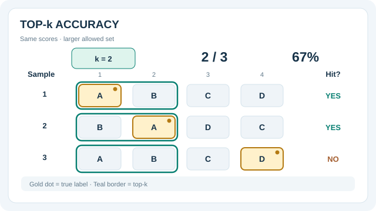
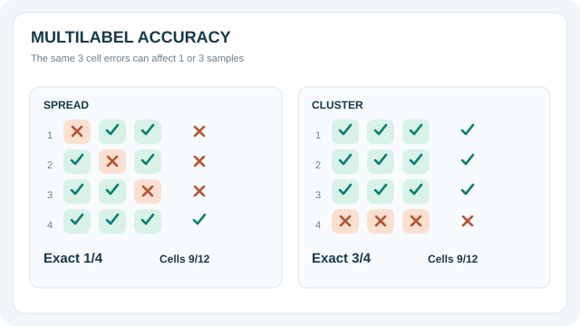
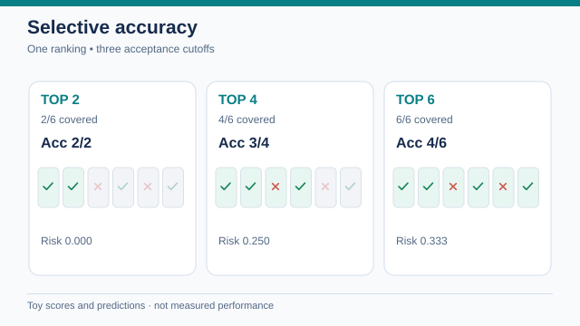

---
related:
  - engineering/evaluation
tags:
  - evaluation
  - metrics
  - classification
---

# Accuracy

Accuracy is the fraction of predictions that match the true label. It is the simplest classification metric and the one most often misread.

## Definition

For a binary problem with true positives $TP$, true negatives $TN$, false positives $FP$ and false negatives $FN$:

$$\text{Accuracy} = \frac{TP + TN}{TP + TN + FP + FN}$$

For multiclass problems, it is the share of samples whose predicted class equals the true class.

## Animated explanation: prevalence and balanced accuracy

*Original instructional animation, CC BY-SA 4.0.* MkDocs provides Play/Pause; focus the image to scroll horizontally on narrow screens. Reduced-motion users see a still frame. [GitHub static preview](../../../../assets/concept-animations/accuracy-prevalence-still.svg) · [Full SVG animation](../../../../assets/concept-animations/accuracy-prevalence-motion.svg).

The illustration uses **hypothetical population rates, not sampled or measured classifier results**. If positive prevalence is $p$, with fixed sensitivity (TPR) $0.80$ and specificity (TNR) $0.90$:

$$
\begin{gathered}
\operatorname{Accuracy}(p) \\
= p(0.80)+(1-p)(0.90) \\
= 0.90-0.10p.
\end{gathered}
$$

Balanced accuracy is the **unweighted mean of class recalls**, $(0.80+0.90)/2=0.85$. Varying $p$ from $0.10$ to $0.90$ thus moves ordinary accuracy from **0.89 to 0.81**, while balanced accuracy stays **0.85**.[^balanced-demo] This holds only if both conditional class-wise rates remain fixed; real distribution shifts can change them too.

## Top-k membership: expanding the rank window

*Original 12-second instructional SVG, with a separate GitHub-readable static preview (CC BY-SA 4.0).* Three fixed, **synthetic** four-class score rankings have true-label ranks $1$, $2$, and $4$. Enlarging the admitted rank window from $k=1$ to $k=2$ to $k=4$ changes top-k accuracy from $1/3$ to $2/3$ to $3/3$. Only the **evaluation rule** changes; no model, prediction, or input is updated. Top-4 is trivially perfect for four classes, not evidence of learning. Top-1 is ordinary argmax accuracy, whereas top-k is a **single-label multiclass** metric, not multilabel subset accuracy.

On MkDocs use Play/Pause. On narrow screens focus the diagram and use horizontal arrow-key scrolling. Reduced-motion mode holds the top-2 stage. [GitHub still](../../../../assets/concept-animations/accuracy-topk-window-still.svg) · [Animated SVG](../../../../assets/concept-animations/accuracy-topk-window-motion.svg).

## Top-k boundary ties: the same scores, different membership

*Original 8-second instructional SVG and dual-panel GitHub-safe fallback (CC BY-SA 4.0).* Set $k=2$, true class **C**, and fixed artificial scores **A=0.90, B=0.70, C=0.70, D=0.20**. Classes B and C tie at the membership boundary. If lower class indices break ties, the chosen set is $\{A,B\}$, yielding **0/1** for this sample; if higher indices win, it is $\{A,C\}$, yielding **1/1**. The discrete scene switch changes only the tie policy. A one-case outcome is not a performance estimate.

scikit-learn's `top_k_accuracy_score` explicitly prioritises **higher class indices** for tied scores.[^topk-api] Always document class-index ordering and tie-breaking before comparing metrics from different implementations. Unlike ROC-AUC's half-credit for cross-class ranking ties, top-k evaluates discrete set membership.

MkDocs supports Play/Pause and a reduced-motion still (higher-index case); GitHub's static preview deliberately shows **both** policies. [GitHub still](../../../../assets/concept-animations/accuracy-topk-tie-policy-still.svg) · [Animated SVG](../../../../assets/concept-animations/accuracy-topk-tie-policy-motion.svg).

## Multilabel exact match versus label-wise agreement

*Original eight-second SVG teaching animation (CC BY-SA 4.0).* All values are **constructed comparisons, not measured model scores**. A green tick means one predicted binary label agrees with its true value; orange crosses mark disagreement. The raw binary values are not needed to evaluate these match indicators. In both layouts, exactly **9 of 12 label decisions are correct** (label-wise agreement 0.75, or Hamming loss 0.25). But subset accuracy requires **all three labels in a sample** to match: spreading errors across three samples gives **1/4 = 0.25**, while concentrating them in one sample gives **3/4 = 0.75**. Thus per-label agreement does not determine exact-match accuracy; the *joint distribution of label errors across samples* matters. See the [scikit-learn definitions](https://scikit-learn.org/stable/modules/generated/sklearn.metrics.accuracy_score.html) and [Hamming loss](https://scikit-learn.org/stable/modules/generated/sklearn.metrics.hamming_loss.html).

On MkDocs use Play/Pause and focus the image to scroll with the arrow keys on mobile. Reduced-motion users see the clustered-error stage. GitHub shows both layouts simultaneously: [static comparison](../../../../assets/concept-animations/accuracy-multilabel-error-placement-still.svg) · [full SVG motion](../../../../assets/concept-animations/accuracy-multilabel-error-placement-motion.svg).

## Sample weights can reverse accuracy rankings

*Original eight-second SVG teaching animation (CC BY-SA 4.0).* The five predictions are held fixed. Model A is correct on cases 1–4 and model B on cases 1, 2 and 5. With weights all one, A scores **4/5 = 0.800**, B **3/5 = 0.600**. Giving case 5 a **weight of five** while the other four remain at one reverses the ordering: **A = 4/9 ≈ 0.444**, **B = 7/9 ≈ 0.778**.

$$
\mathrm{WeightedAccuracy}=\frac{\sum_i w_i\,\mathbf{1}(\hat y_i=y_i)}{\sum_i w_i}, \qquad w_i\ge 0,\ \sum_i w_i>0.
$$

These are **synthetic importance weights**, not observed frequencies, estimated deployment probabilities, class-balancing recommendations or evidence that model B improved. The interpretation depends on how weights were chosen (e.g., survey design or a prespecified deployment objective), and both models must be evaluated under the same scheme. The official [`accuracy_score` API](https://scikit-learn.org/stable/modules/generated/sklearn.metrics.accuracy_score.html) accepts a `sample_weight` argument.

MkDocs offers Play/Pause and reduced-motion (the weighted stage); the image region supports keyboard scrolling on narrow screens. GitHub compares both weight schemes in its [static preview](../../../../assets/concept-animations/accuracy-sample-weight-ranking-still.svg) · [full SVG motion](../../../../assets/concept-animations/accuracy-sample-weight-ranking-motion.svg).

## Selective accuracy versus coverage

*Original 12-second instructional SVG, CC BY-SA 4.0.* Six **synthetic** score/correctness pairs, sorted descending, are (0.97, correct), (0.91, correct), (0.80, wrong), (0.72, correct), (0.60, wrong), and (0.51, correct). A reject option accepts only the top $k$ cases. For $k=2,4,6$, respectively, **coverage** (accepted fraction of all cases) is **2/6, 4/6, 6/6**, **selective accuracy** (correct fraction *among accepted cases*) is **2/2, 3/4, 4/6**, and selective risk (incorrect fraction among accepted cases) is **0, 1/4, 1/3**. A model's predictions stay unchanged; only the evaluation subset changes. These scores are **not calibrated probabilities or measured model outputs**. This is a constructed example, not a guaranteed risk–coverage curve.[^selective-origin]

On MkDocs, the **interactive cutoff player** starts paused: use Play/Pause, Previous/Next step, the seek slider or 0.5×/1×/2× speed. Its bilingual trace lists the accepted count, correct count and selective risk at each cutoff. In reduced-motion mode it stays paused at the middle cutoff until explicitly operated; switching away from the tab also pauses at the current acceptance stage, and playback resumes only after pressing Play. The original static comparison remains available without JavaScript. For narrow screens, focus the scrollable figure and use horizontal arrow keys. The [GitHub static fallback](../../../../assets/concept-animations/accuracy-selective-coverage-still.svg) compares all three cutoffs; [full SVG motion](../../../../assets/concept-animations/accuracy-selective-coverage-motion.svg) advances through them.

A **linked risk–coverage plot** under the interactive SVG highlights the active acceptance cutoff: 2/6 accepted with 0% risk, 4/6 with 25% risk, and 6/6 with about 33% risk (exactly 2/6). The orange ring follows Play, step and seek controls. The three **filled** plotted points select the playable masks: click one or focus it and press Enter/Space to pause and change the main SVG's accepted set. With a point focused, Left/Right arrows move to adjacent cutoffs and Home/End jump to the first/last cutoff. The line now traces **all six integer cutoffs** in the same constructed sample, with hollow markers at k=1,3,5 and the three filled, directly selectable stages at k=2,4,6. The selective risks are **0/1, 0/2, 1/3, 1/4, 2/5, 2/6**. Risk **falls from 1/3 to 1/4** when the fourth (correct) case is included, and **from 2/5 to 2/6** when the sixth (correct) case is included. Thus risk need **not rise monotonically** with coverage even for unchanged predictions and score ranking. Connecting segments join discrete integer counts only; they are not a continuous interpolation or empirical model results. On MkDocs, **hover, tap/click, or keyboard-focus the hollow k=1,3,5 markers** to inspect their exact cumulative error fraction and the percentage-point change from the preceding cutoff. Tab traverses all six cutoffs in ascending k order, with Enter/Space available for inspection; it does **not** change the main SVG's three playable acceptance masks. The inspection readout makes the declines from 1/3 to 1/4 and 2/5 to 2/6 explicit, without treating the line as a continuous empirical curve. The plot shares the figure's horizontal keyboard scrolling on narrow screens. A [GitHub-safe static risk–coverage plot](../../../../assets/concept-animations/accuracy-selective-coverage-linked-still.svg) shows all six discrete cutoffs if JavaScript cannot run.

## Class-conditional coverage under rejection

*Original eight-second instructional SVG, CC BY-SA 4.0.* In this **constructed binary example**, four true-positive-class instances have correctness **correct, wrong, wrong, correct**, and the four negative-class instances are all correct. Without rejection, accuracy is **6/8 = 0.75** and coverage is 8/8. Suppose a reject option keeps only the first positive-class instance and all four negative-class instances. Among accepted cases accuracy rises to **5/5 = 1.00**, while overall coverage falls to **5/8 = 0.625**. Crucially, coverage conditional on the *true class* is **1/4 for positives versus 4/4 for negatives**. Reporting only selective accuracy conceals uneven rejection; none of the underlying predictions was fixed. This example is **not an empirical fairness analysis, nor a model performance measurement**. The acceptance mask is deliberately constructed from case indices for explanation; it is **not** a deployable rule that can inspect true labels at inference.

On MkDocs, the **interactive class-coverage player** starts paused and offers Play/Pause, Previous/Next acceptance rule, a seek slider and 0.5×/1×/2× speed. The accessible bilingual trace identifies positive and negative conditional coverage separately; moving the slider changes the acceptance mask, not the predictions. Reduced-motion mode stays paused on the selective stage unless the reader operates it. Leaving the tab pauses playback without silently advancing the accepted set; press Play after returning to resume. Keyboard users can scroll the native-width diagram; without JavaScript, GitHub and the page show the side-by-side [static comparison](../../../../assets/concept-animations/accuracy-selective-class-coverage-still.svg), with a separate [SVG animation](../../../../assets/concept-animations/accuracy-selective-class-coverage-motion.svg).

A **linked class-coverage chart** below the interactive SVG updates both bars with the selected rejection rule. Overall acceptance falls from 8/8 to 5/8; positive-class acceptance falls from 4/4 to 1/4, while negative-class acceptance remains 4/4. The live calculation trace includes overall coverage as well as the per-class fractions. A visible **OVERALL** line now distinguishes **8/8 accepted · 6/8 correct** from **5/8 accepted · 5/5 correct**. The denominator for accepted-only accuracy is the accepted subset, not all eight original cases. The plot also has **ALL** and **SELECTIVE** comparison controls. Click/tap either control, or focus it with Tab and press Enter/Space, to pause playback and switch the acceptance rule directly. Left/Right arrows switch between rules, while Home/End select the first/last rule; the two bars, overall-coverage narration, main SVG and timeline update together. The active control is indicated visually and with `aria-pressed`. The bars depict the same constructed label distribution as the SVG, not deployment performance, and remain readable through their numeric labels and accessible description. The [GitHub-safe mobile-readable stacked class-coverage chart](../../../../assets/concept-animations/accuracy-selective-class-coverage-linked-still.svg) shows both acceptance rules without scripts.

## Interpretation

Accuracy is easy to explain once predicted labels are fixed. When the classifier outputs scores, the decision rule (such as a binary cutoff or multiclass argmax) can change accuracy. Its weakness is that it depends on the class balance. If 99% of cases are negative, a model that never predicts a positive scores 99% accuracy while finding no positives at all.

## When to use it

Use accuracy when the classes are roughly balanced and every kind of error has the same cost. Otherwise report precision and recall alongside it, or use a ranking metric such as [PR-AUC](pr-auc.md).

## Worked example

Using the [shared synthetic 100-case confusion matrix](index.md), accuracy is $(40 + 30) / 100 = 0.70$. The same classifier has precision 0.80 and recall 0.67 (see [precision](precision.md) and [recall](recall.md)), so accuracy alone does not show which kind of error dominates.

## Properties and variants

- **Baseline.** A classifier that always predicts the majority class scores that class's share of the data. On data that is 90% negative, 0.90 accuracy is no improvement.
- **Balanced accuracy.** The mean of recall over classes, which for two classes is $\tfrac{1}{2}(\mathrm{TPR} + \mathrm{TNR})$. It does not depend on class sizes.
- **Top-k accuracy.** In multi-class problems, a case counts as correct if the true class is among the $k$ highest scores.
- **Limit.** Accuracy treats every error alike, so it cannot express unequal costs of false alarms and misses.

## Pitfalls

- **Imbalance.** A high score can come from predicting the majority class. Compare against the majority-class rate as a baseline.
- **Multilabel data.** In scikit-learn, accuracy for multilabel input is subset accuracy: a sample counts as correct only when its whole set of labels matches. This is stricter than averaging per-label accuracy (see References).

## Related metrics

[Precision](precision.md), [Recall](recall.md) and [F1](f1.md) separate the kinds of error that accuracy combines. The family overview is [Classification Metrics](index.md).

## References

### Articles and documentation

- scikit-learn contributors. *accuracy_score*. https://scikit-learn.org/stable/modules/generated/sklearn.metrics.accuracy_score.html — API reference giving the definition, the normalisation option and the multilabel behaviour.
- scikit-learn contributors. *Metrics and scoring: quantifying the quality of predictions*. https://scikit-learn.org/stable/modules/model_evaluation.html — Overview of classification scorers and when each is appropriate.

### Additional sources

- Geifman, Y. & El-Yaniv, R. (2017). *Selective Classification for Deep Neural Networks*. https://arxiv.org/abs/1705.08500 — Introduces selective classification by rejection and the risk–coverage objective.

- Saito, T. & Rehmsmeier, M. (2015). The precision-recall plot is more informative than the ROC plot when evaluating binary classifiers on imbalanced datasets. *PLoS ONE* 10(3). https://doi.org/10.1371/journal.pone.0118432 — Shows why precision-recall curves are more informative than ROC curves for rare positives.
- Murphy, K. P. *Probabilistic Machine Learning: An Introduction*. MIT Press, 2022. https://probml.github.io/pml-book/book1.html — Textbook with a free online draft on probabilistic machine learning.
- *The Elements of Statistical Learning: Data Mining, Inference, and Prediction*, 2nd edition. https://hastie.su.domains/ElemStatLearn/ — Standard textbook on statistical learning and its evaluation.

[^selective-origin]: Geifman & El-Yaniv (2017), [Selective Classification for Deep Neural Networks](https://arxiv.org/abs/1705.08500) — Selective risk and coverage under rejection.

[^balanced-demo]: scikit-learn contributors. *balanced_accuracy_score*. https://scikit-learn.org/stable/modules/generated/sklearn.metrics.balanced_accuracy_score.html — Defines the mean per-class recall used in the illustration.

[^topk-api]: scikit-learn contributors. *top_k_accuracy_score*. https://scikit-learn.org/stable/modules/generated/sklearn.metrics.top_k_accuracy_score.html — Defines the score and its higher-index tie policy.
