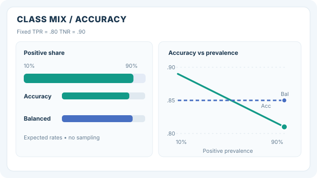
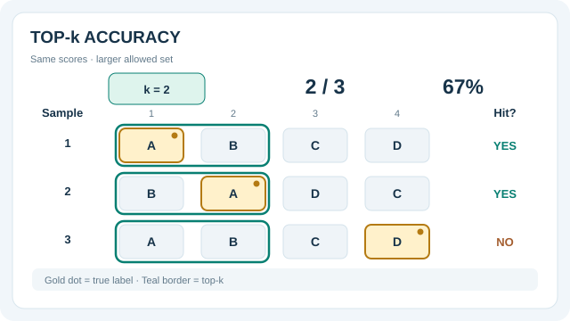
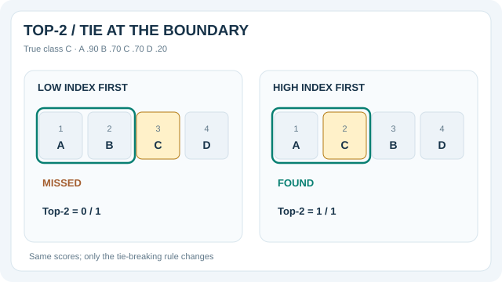
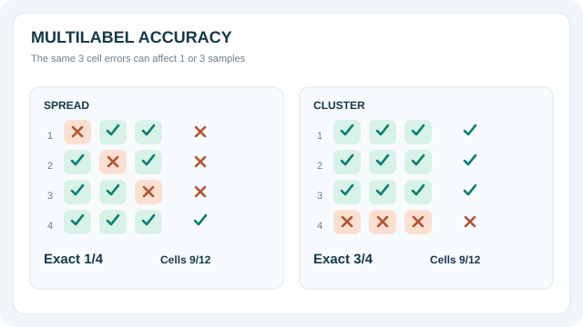
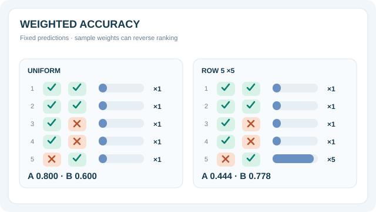
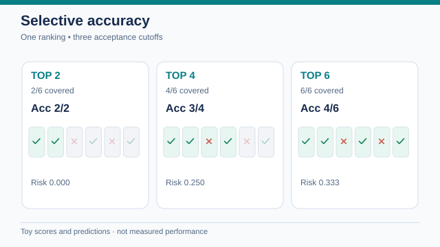
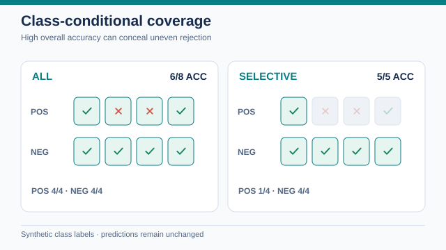

---
related:
  - engineering/evaluation
tags:
  - evaluation
  - metrics
  - classification
---

# 準確率

準確率是預測與正確標籤相符的比例。它是最簡單的分類指標，也是最常被誤讀的一個。

## 定義

對於二元問題，設真正例為 $TP$、真負例為 $TN$、偽正例為 $FP$、偽負例為 $FN$：

$$\text{準確率} = \frac{TP + TN}{TP + TN + FP + FN}$$

多類別問題中，它是預測類別與真實類別相同的樣本所占的比例。

## 動態教學：類別比例與平衡準確率

*原創教學動畫, CC BY-SA 4.0.* MkDocs 網站可播放／暫停，窄螢幕可聚焦後以方向鍵水平捲動；減少動態效果模式顯示靜態影格。 [GitHub 靜態預覽](../../../../assets/concept-animations/accuracy-prevalence-still.svg) · [完整 SVG 動畫](../../../../assets/concept-animations/accuracy-prevalence-motion.svg).

這是**假設母體比例的解析示例，並非模型實測或有限樣本結果**。若正例比例為 $p$，固定敏感度（TPR）$0.80$ 與特異度（TNR）$0.90$：

$$
\begin{gathered}
\operatorname{Accuracy}(p) \\
= p(0.80)+(1-p)(0.90) \\
= 0.90-0.10p.
\end{gathered}
$$

平衡準確率為**兩類別召回率的不加權平均**，$(0.80+0.90)/2=0.85$。當 $p$ 從 $0.10$ 變為 $0.90$，一般準確率便從 **0.89 降至 0.81**，但平衡準確率保持 **0.85**。[^balanced-demo] 此結論以兩個條件辨識率固定為前提；實際分布偏移也可能使它們改變。

## Top-k 成員判斷：排名視窗如何擴大

*原創 12 秒 SVG 教學動畫，搭配獨立的 GitHub 靜態回退圖（CC BY-SA 4.0）。* 三筆固定的**人工四類別排名**中，真實類別分別位於第 $1$、$2$、$4$ 名。允許的排名視窗從 $k=1$ 擴大到 $2$、$4$，top-k 準確率便從 $1/3$、$2/3$ 變成 $3/3$。改變的只有**評分規則**，模型、分數與輸入均未更新。四類別的 top-4 必然全對，不代表模型學得更好。Top-1 等於一般 argmax 準確率；此處 top-k 是**單標籤多類別**評估，不是多標籤完整集合準確率。

MkDocs 可播放／暫停；手機可聚焦圖形，再使用方向鍵水平捲動。減少動態效果模式固定顯示 top-2。[GitHub 靜態圖](../../../../assets/concept-animations/accuracy-topk-window-still.svg) · [完整 SVG 動畫](../../../../assets/concept-animations/accuracy-topk-window-motion.svg)。

## Top-k 邊界同分：分數相同仍可能改變命中結果

*原創 8 秒 SVG 教學動畫與 GitHub 雙欄靜態回退（CC BY-SA 4.0）。* 設 $k=2$、真實類別 **C**，固定人工分數為 **A=0.90、B=0.70、C=0.70、D=0.20**。B 與 C 在第二名的邊界同分。若同分時優先**較低的類別索引**，取出 $\{A,B\}$，此筆得 **0/1**；若優先**較高的索引**，取出 $\{A,C\}$，則得 **1/1**。離散動畫只切換同分規則，不代表模型分數發生變動。單筆示意不能視為模型效能估計。

scikit-learn 的 `top_k_accuracy_score` 明確採用**較高類別索引優先**的同分規則。[^topk-api] 比較不同實作時，必須說明類別索引順序及同分規則。這不同於 ROC-AUC 對正負配對同分給半分；top-k 最後仍進行離散的集合成員判斷。

MkDocs 沿用播放／暫停和減少動態效果回退（較高索引情境）；GitHub 靜態圖則**並排保留兩種結果**。[GitHub 靜態圖](../../../../assets/concept-animations/accuracy-topk-tie-policy-still.svg) · [完整 SVG 動畫](../../../../assets/concept-animations/accuracy-topk-tie-policy-motion.svg)。

## 多標籤完整符合率與逐標籤正確比例

*原創八秒 SVG 教學動畫（CC BY-SA 4.0）。* 這些是**人為構造的比較結果，不是模型實測指標**。綠色勾號表示該二元標籤預測正確，橘色叉號表示錯誤；計算此示例只需比較結果，不必指定每格的原始 0/1 值。兩種分布都正確預測 **12 格中的 9 格**，逐標籤正確比例為 **0.75**、Hamming loss 為 **0.25**。但多標籤的 subset accuracy 要求**同一筆樣本的三個標籤全部正確**。將三個錯誤分散至三筆樣本時為 **1/4 = 0.25**；集中到一筆樣本時則為 **3/4 = 0.75**。因此，完整符合率也取決於**不同標籤的錯誤如何共同出現在各筆樣本**，不能只由逐標籤平均正確率推算。參見 [scikit-learn Accuracy 定義](https://scikit-learn.org/stable/modules/generated/sklearn.metrics.accuracy_score.html)及 [Hamming loss 文件](https://scikit-learn.org/stable/modules/generated/sklearn.metrics.hamming_loss.html)。

MkDocs 可以播放／暫停；手機可聚焦圖像區域後以方向鍵水平捲動。減少動態效果模式固定為錯誤集中狀態。GitHub 的[雙情境靜態圖](../../../../assets/concept-animations/accuracy-multilabel-error-placement-still.svg)會同時顯示兩種結果；另可查看[完整 SVG 動畫](../../../../assets/concept-animations/accuracy-multilabel-error-placement-motion.svg)。

## 樣本權重可以反轉準確率排名

*原創八秒 SVG 教學動畫（CC BY-SA 4.0）。* 模型 A 在第 1–4 筆預測正確，模型 B 在第 1、2、5 筆正確。兩者預測結果完全固定。五筆全部等權重時，A 為 **4/5 = 0.800**、B 為 **3/5 = 0.600**。如果只將第 5 筆的權重改成 **5**，其他仍為 1，結果就反轉為 **A = 4/9 ≈ 0.444**、**B = 7/9 ≈ 0.778**。

$$
\mathrm{WeightedAccuracy}=\frac{\sum_i w_i\,\mathbf{1}(\hat y_i=y_i)}{\sum_i w_i}, \qquad w_i\ge 0,\ \sum_i w_i>0.
$$

權重為**人為設定的重要性係數**，不是實際抽樣頻率、部署母體盛行率估計或推薦的類別平衡權重，也不代表 B 學習得更好。權重必須對應事先定義的評估目的（例如抽樣設計或部署損失），比較不同模型時也應使用同一套權重。scikit-learn 的 [`accuracy_score`](https://scikit-learn.org/stable/modules/generated/sklearn.metrics.accuracy_score.html) 提供 `sample_weight` 參數。

MkDocs 沿用播放／暫停與手機鍵盤水平捲動；減少動態效果模式固定顯示加權結果。GitHub 使用[兩種權重設定的靜態預覽](../../../../assets/concept-animations/accuracy-sample-weight-ranking-still.svg)；另可查看[完整 SVG 動畫](../../../../assets/concept-animations/accuracy-sample-weight-ranking-motion.svg)。

## 選擇性分類：覆蓋率與保留樣本準確率

*原創 12 秒教學 SVG，CC BY-SA 4.0。* 六筆依分數排序的**人工示意資料**依序為 (0.97, 對)、(0.91, 對)、(0.80, 錯)、(0.72, 對)、(0.60, 錯)、(0.51, 對)。若拒答機制只接受前 $k$ 筆，當 $k=2,4,6$ 時，**覆蓋率**（接受筆數／總筆數）依序為 **2/6、4/6、6/6**；**選擇性準確率**（接受樣本中正確的比例）依序為 **2/2、3/4、4/6**；選擇性風險（接受樣本中的錯誤比例）為 **0、1/4、1/3**。所有模型預測保持不變，只有評估集合改變。這些分數**不是校準後機率，也不是模型實測輸出**；示例不保證一般風險—覆蓋率曲線必然如此。[^selective-origin]

MkDocs 的**互動門檻播放器**預設暫停，可使用播放／暫停、上一步／下一步、進度滑桿，以及 0.5×／1×／2× 速度切換。畫面下方的繁體中文計算說明會依門檻顯示接受筆數、正確筆數與選擇性風險。減少動態效果模式維持暫停，首次互動停在中間門檻。切換到其他分頁也會暫停在目前接受門檻，返回後須再次按「播放」才能繼續；無 JavaScript 時仍有完整靜態比較。手機可聚焦圖表後以左右方向鍵水平捲動。[GitHub 三情境靜態比較](../../../../assets/concept-animations/accuracy-selective-coverage-still.svg)與[完整 SVG 動畫](../../../../assets/concept-animations/accuracy-selective-coverage-motion.svg)共用同一組資料。

互動 SVG 下方的**連動風險—覆蓋率圖**會依目前接受門檻移動橘色圈：接受 2/6 時風險為 0%，接受 4/6 時為 25%，接受 6/6 時約為 33%（精確分數是 2/6）。播放、單步與拖曳進度都會同步更新。三個**實心資料點**可直接選取：滑鼠點選，或以鍵盤聚焦後按 Enter／空白鍵，即可暫停播放並跳到該接受門檻。聚焦資料點時，左右方向鍵可切換相鄰門檻，Home／End 可直接跳到第一個／最後一個門檻。這條折線現在包含同一組人工示例的**六個整數門檻**：空心點為中間的 k=1、3、5，實心的 k=2、4、6 仍是可直接切換主動畫的三個階段。選擇性風險依序為 **0/1、0/2、1/3、1/4、2/5、2/6**。納入第 4 筆正確案例時，風險由 **1/3 降為 1/4**；納入第 6 筆正確案例時，又由 **2/5 降為 2/6**。因此，即使預測及分數排序不變，**風險也不一定隨覆蓋率單調上升**。線段只是連接不同樣本數的離散結果，不代表可線性內插或模型實測；在 MkDocs 中，可將滑鼠移至空心的 k=1、3、5 資料點、以觸控點按，或用鍵盤 Tab 依 k=1 至 k=6 的順序聚焦，再按 Enter／空白鍵檢視**累積錯誤筆數、精確風險分數，以及相對上一個整數門檻的百分點變化**。檢視不會改變主 SVG 僅有的三組可播放接受遮罩；其中 1/3 降至 1/4、2/5 降至 2/6 的變化是離散結果，不是連續實測曲線。手機上的連動圖保留 640px 原始閱讀寬度，可聚焦圖表容器後水平捲動，不會把數值與標籤縮小到難以閱讀。另提供[不依賴 JavaScript 的風險—覆蓋率靜態比較圖](../../../../assets/concept-animations/accuracy-selective-coverage-linked-still.svg)，完整顯示六個整數門檻。

在門檻 $k$ **新納入一筆案例**時，令 $e_k\in\{0,1\}$ 表示其固定預測是否錯誤，$E_k=\sum_{i=1}^{k}e_i$ 為累積錯誤數。相鄰整數門檻的精確更新為：

$$
R_k=\frac{E_k}{k},\qquad
R_k-R_{k-1}=\frac{e_k-R_{k-1}}{k}\quad(k\ge 2).
$$

互動檢視列以少量英文標籤 **+CORRECT**（$e_k=0$）或 **+WRONG**（$e_k=1$）標示新增案例是否預測正確，同時顯示累積錯誤比例與百分點變化。$k=3$ 新增錯誤案例，風險由 $0/2$ 升至 $1/3$；$k=4$ 新增正確案例，風險降至 $1/4$。改變的是**接受集合**，不是模型預測或排序。主 SVG 仍只有 $k=2,4,6$ 三個可播放狀態。當 $k=0$ 時沒有任何接受案例，選擇性風險 $E_k/k$ **未定義**，不能當成零；因此離散圖從 $k=1$ 開始。所有結果都是人工示例，不是模型實測。

## 拒答後的各類別覆蓋率差異

*原創 8 秒教學 SVG，CC BY-SA 4.0。* **人工二元分類示例**中，四筆真正類別為正的樣本，其預測正確性依序為**對、錯、錯、對**；另外四筆負例全部正確。原始準確率是 **6/8 = 0.75**，覆蓋率為 8/8。假設拒答規則只保留第一筆正例及全部四筆負例，則保留樣本準確率為 **5/5 = 1.00**，整體覆蓋率卻降為 **5/8 = 0.625**。而以**真實類別**區分的覆蓋率，正例僅為 **1/4**，負例則是 **4/4**。只回報選擇性準確率會掩蓋拒答分布的不均；任何原本錯誤的預測都沒有被修正。這**不是實際模型效能或公平性評估**。 接受／拒答遮罩是為教學而依樣本索引人為設定，**不是部署時能讀取未知真實標籤的可實作決策規則**。

MkDocs 的**各類別覆蓋率互動播放器**預設暫停，提供播放／暫停、上一步／下一步、進度滑桿及 0.5×／1×／2× 速度切換。繁體中文計算說明分別列出正負類別覆蓋率；拖動滑桿只改變接受／拒答遮罩，不會改動預測。減少動態效果模式維持暫停並以拒答後狀態開始。切換分頁時會暫停並保留目前接受集合，返回後按「播放」才繼續；鍵盤仍可水平捲動。無 JavaScript 時繼續顯示[GitHub 雙情境靜態比較](../../../../assets/concept-animations/accuracy-selective-class-coverage-still.svg)及[完整 SVG 動畫](../../../../assets/concept-animations/accuracy-selective-class-coverage-motion.svg)呈現同一組人工資料。

互動 SVG 下方的**連動類別覆蓋率長條圖**會依拒答狀態更新兩條長條：整體接受比例由 8/8 降至 5/8；正類別接受比例從 4/4 降至 1/4，負類別則維持 4/4。畫面下方的即時計算說明會同時呈現整體與各類別的覆蓋率。連動圖的 **OVERALL** 列另外直接呈現 **8/8 接受、6/8 正確** 與 **5/8 接受、5/5 正確** 的差別；後者的準確率分母是已接受的樣本數，而不是全體八筆樣本。即時更新的 **GAP** 表示**正負類別覆蓋率的絕對差距** $\Delta_C=|C_{\mathrm{POS}}-C_{\mathrm{NEG}}|$：由 **0 增為 75 個百分點**（4/4 與 4/4，接著變成 1/4 與 4/4）。此數值只描述人工接受遮罩造成的差異，**不能直接視為公平性判定或可部署的拒答規則**。圖表上方另外提供 **ALL**（全部接受）與 **SELECTIVE**（選擇性接受）切換控制：可以滑鼠點選、觸控，或按 Tab 聚焦後按 Enter／空白鍵，直接暫停動畫並比較兩種接受規則。聚焦後也可用左右方向鍵在 ALL 與 SELECTIVE 間切換，Home／End 可選擇第一個／最後一個規則。兩條長條、整體接受比例解讀、主 SVG 及時間軸都會同步更新；目前狀態也會透過 `aria-pressed` 告知輔助科技。圖上分數與無障礙文字描述和主圖共用相同人工示例，不能解讀為真實部署結果。手機上的連動圖同樣維持 640px 寬度，可在支援鍵盤捲動的圖表區域水平查看各列，避免數值縮得太小。另可查看[不依賴 JavaScript、上下排列兩種接受規則與整體準確率的類別覆蓋率比較圖](../../../../assets/concept-animations/accuracy-selective-class-coverage-linked-still.svg)。

## 解讀

準確率在預測標籤已固定時容易解釋；若模型輸出分數，轉換成標籤的規則（二元分類門檻或多類別 argmax 等）可能改變準確率。它的弱點是取決於類別比例。若 99% 的案例是負例，一個從不預測正例的模型，準確率就有 99%，但完全找不到任何正例。

## 何時使用

當類別大致平衡，且每種錯誤代價相同時，使用準確率。否則應同時報告精確率與召回率，或改用如 [PR-AUC](pr-auc.md) 之類的排序指標。

## 範例

以[共用的人工 100 筆混淆矩陣範例](index.md)為例，準確率為 $(40 + 30) / 100 = 0.70$。同一分類器的精確率為 0.80、召回率為 0.67（見[精確率](precision.md)與[召回率](recall.md)），準確率本身並不能顯示哪一類錯誤較多。

## 性質與變體

- **基準線。** 永遠預測多數類別的分類器，準確率等於該類別的比例。在 90% 為負例的資料上，0.90 的準確率並沒有進步。
- **平衡準確率。** 各類別召回率的平均。二元情況下為 $\tfrac{1}{2}(\mathrm{TPR} + \mathrm{TNR})$，不受類別大小影響。
- **Top-k 準確率。** 多類別問題中，只要真實類別在分數最高的 $k$ 個之中，該案例即算正確。
- **限制。** 準確率對所有錯誤一視同仁，無法表達誤報與漏報成本不同的情況。

## 常見陷阱

- **類別不平衡。** 高準確率可能只是因為模型預測多數類別。應以多數類別的比例作為基準比較。
- **多標籤資料。** 在 scikit-learn 中，多標籤輸入的準確率是子集準確率：只有整組標籤完全相符，樣本才算正確。這比逐標籤平均的準確率更嚴格（見參考文獻）。

## 相關指標

[精確率](precision.md)、[召回率](recall.md)與 [F1 分數](f1.md)分別拆解了準確率所合併的兩種錯誤。家族概述見[分類指標](index.md)。

## 參考文獻

### 文章與文件

- scikit-learn contributors. *accuracy_score*. https://scikit-learn.org/stable/modules/generated/sklearn.metrics.accuracy_score.html — API 參考，說明定義、正規化選項與多標籤的行為。
- scikit-learn contributors. *Metrics and scoring: quantifying the quality of predictions*. https://scikit-learn.org/stable/modules/model_evaluation.html — 分類評分器的概述，以及各自的適用時機。

### 補充來源

- Geifman, Y. & El-Yaniv, R. (2017). *Selective Classification for Deep Neural Networks*. https://arxiv.org/abs/1705.08500 — 提出透過拒答進行選擇性分類，並探討風險與覆蓋率。

- Saito, T. & Rehmsmeier, M. (2015). The precision-recall plot is more informative than the ROC plot when evaluating binary classifiers on imbalanced datasets. *PLoS ONE* 10(3). https://doi.org/10.1371/journal.pone.0118432 — 說明為什麼在稀有正例上，精確率—召回率曲線比 ROC 曲線更有資訊量。
- Murphy, K. P. *Probabilistic Machine Learning: An Introduction*. MIT Press, 2022. https://probml.github.io/pml-book/book1.html — 提供免費線上草稿的機率機器學習教科書。
- *The Elements of Statistical Learning: Data Mining, Inference, and Prediction*, 2nd edition. https://hastie.su.domains/ElemStatLearn/ — 統計學習的標準教科書，涵蓋其評估方法。

[^selective-origin]: Geifman & El-Yaniv (2017)，[Selective Classification for Deep Neural Networks](https://arxiv.org/abs/1705.08500) — 拒答式分類的風險與覆蓋率。

[^balanced-demo]: scikit-learn contributors. *balanced_accuracy_score*. https://scikit-learn.org/stable/modules/generated/sklearn.metrics.balanced_accuracy_score.html — 定義本示意採用的逐類別召回率平均。

[^topk-api]: scikit-learn contributors. *top_k_accuracy_score*. https://scikit-learn.org/stable/modules/generated/sklearn.metrics.top_k_accuracy_score.html — 定義 top-k 準確率與較高索引優先的同分政策。
