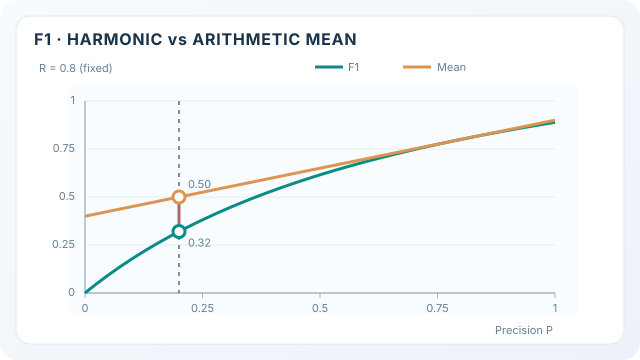
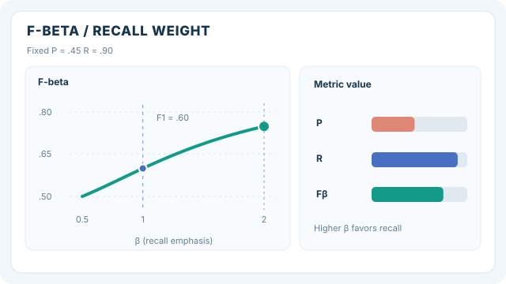
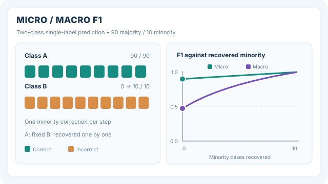

---
related:
  - engineering/evaluation
tags:
  - evaluation
  - metrics
  - classification
---

# F1 Score

The F1 score combines precision and recall into one number. It is the harmonic mean of the two, so it is high only when both are high. It is also called the balanced F-score or F-measure.

## Definition

$$F_1 = \frac{2 \cdot \text{Precision} \cdot \text{Recall}}{\text{Precision} + \text{Recall}} = \frac{2\,TP}{2\,TP + FP + FN}$$

The second form shows that F1 does not use true negatives.

## Animated explanation: Harmonic mean: why imbalance lowers F1

*Original instructional animation, CC BY-SA 4.0.* On MkDocs use Play/Pause and keyboard focus for horizontal scrolling; reduced-motion users see a still frame. GitHub shows the static preview. [GitHub static preview](../../../../assets/concept-animations/f1-harmonic-gap-still.svg) · [Full SVG animation](../../../../assets/concept-animations/f1-harmonic-gap-motion.svg).

With **schematic** recall fixed at $R=0.8$ and precision $P$ swept continuously from 0.10 to 0.95, the animation traces $F_1(P)=1.6P/(P+0.8)$ and the arithmetic mean $M(P)=(P+0.8)/2$. At $P=0.2$, **F1 = 0.32** versus **M = 0.50**; the two coincide at $P=R=0.8$. The changing $P$ is a mathematical parameter sweep, **not** a training or decision-threshold trajectory. These independent $(P,R)$ pairs are not claimed to come from one classifier.

## Animated explanation: F-beta and recall weighting

*Original instructional animation, CC BY-SA 4.0.* MkDocs provides Play/Pause; focus the image to scroll horizontally on narrow screens. Reduced-motion users see a still frame. [GitHub static preview](../../../../assets/concept-animations/fbeta-recall-emphasis-still.svg) · [Full SVG animation](../../../../assets/concept-animations/fbeta-recall-emphasis-motion.svg).

This is an **analytic sweep of a metric parameter**, not model training, measured performance, or decision-threshold tuning. For schematic fixed precision $P=0.45$ and recall $R=0.90$:

$F_\beta=\frac{(1+\beta^2)PR}{\beta^2P+R}.$

At $\beta=0.5$, $F_\beta=0.50$; at $\beta=1$, $F_1=0.60$; at $\beta=2$, $F_\beta=0.75$.[^fbeta-demo] Larger $\beta$ emphasizes recall, but the displayed rise depends on **$R>P$**: if recall were lower than precision, increasing $\beta$ would lower this score. Selecting $\beta$ expresses a preference for a summary metric; it is **not a full cost model** for false alerts versus missed cases.

## Animated explanation: Macro-F1 versus micro-F1 under imbalance

*Original instructional animation, CC BY-SA 4.0.* On MkDocs use Play/Pause and keyboard focus for horizontal scrolling. Reduced-motion viewers receive a still frame; GitHub uses the static preview. [GitHub static preview](../../../../assets/concept-animations/f1-macro-micro-imbalance-still.svg) · [Full SVG animation](../../../../assets/concept-animations/f1-macro-micro-imbalance-motion.svg).

In a **synthetic, mutually exclusive two-class** evaluation, class A has 90 examples and class B has 10. All 90 A cases are always correct; initially all B cases are incorrectly labelled A. Let $k\in\{0,\ldots,10\}$ of the B cases be recovered (predicted B), with the others still predicted A. For the one-vs-rest per-class F1 scores:

$F_{1,A}(k)=\frac{180}{190-k},\qquad F_{1,B}(k)=\frac{2k}{10+k}.$

**Macro-F1** equally averages the class scores; **micro-F1** pools the TP/FP/FN counts and, specifically for this *single-label, all-labels-included* setting, equals accuracy:

$F_{1,\mathrm{macro}}=\tfrac12(F_{1,A}+F_{1,B}),\qquad F_{1,\mathrm{micro}}=\frac{90+k}{100}.$

When $k=0$, **micro-F1 = 0.900** but **macro-F1 ≈ 0.474** because class B is entirely missed. Both reach 1 when $k=10$. One colored block in the A lane represents *ten* correct cases; each block in the B lane represents *one* case. The discrete transitions represent counterfactual corrections to labels, **not** a measured training trajectory. For other task types (notably multilabel), micro-F1 need not equal accuracy.

## Interpretation

The harmonic mean punishes imbalance. A model with precision 0.9 and recall 0.1 has an arithmetic mean of 0.5, but an F1 of 0.18. This is why F1 is preferred over a simple average. F1 is also equal to the Dice coefficient on binary masks, which links it to [segmentation metrics](../segmentation/index.md).

## When to use it

Use F1 when there is a single positive class of interest, the true negatives are not informative, and a single summary is needed. In binary classification, F1 is most useful as one row in a table of precision, recall and F1 at a stated threshold.

## Worked example

Using the 100 cases above, precision is 0.80 and recall is 0.67. Their harmonic mean is $2 \cdot 0.80 \cdot 0.67 / (0.80 + 0.67) \approx 0.73$, which equals $2 \cdot 40 / (2 \cdot 40 + 10 + 20) = 80 / 110$. The harmonic mean is pulled toward the smaller of the two values.

## Properties and variants

- **$F_\beta$ family.** $F_\beta = (1 + \beta^2)\,PR / (\beta^2 P + R)$. Setting $\beta > 1$ weights recall more, and $\beta < 1$ weights precision more. $F_1$ is the case $\beta = 1$.
- **Ignores true negatives.** The formula has no TN term, so it stays the same when correct negatives are added.
- **Averaging.** For several classes, macro-F1 averages per-class F1 values, while micro-F1 pools the counts first. The two can disagree strongly under imbalance.
- **Limit.** F1 is one number that hides the trade-off between precision and recall, and it does not reflect the cost of each error type.

## Pitfalls

- **Ignores true negatives.** F1 says nothing about how well the negative class is handled. For balanced problems where negatives matter, use [accuracy](accuracy.md) alongside it.
- **Threshold dependence.** Like precision and recall, F1 changes with the threshold, so the threshold must be reported.
- **Multiclass averaging.** The score for several classes depends on how per-class F1 values are averaged. State the averaging method.

## Related metrics

F1 is built from [precision](precision.md) and [recall](recall.md). The family overview is [Classification Metrics](index.md).

## References

### Articles and documentation

- scikit-learn contributors. *f1_score*. https://scikit-learn.org/stable/modules/generated/sklearn.metrics.f1_score.html — API reference giving the formula $2TP / (2TP + FP + FN)$ and the averaging options.
- Manning, C. D., Raghavan, P. & Schütze, H. *Evaluation of ranked retrieval results*, online edition of *Introduction to Information Retrieval*. https://nlp.stanford.edu/IR-book/html/htmledition/evaluation-of-ranked-retrieval-results-1.html — Names the balanced F-measure and describes precision and recall as the measures it combines.

### Additional sources

- scikit-learn contributors. *Metrics and scoring: quantifying the quality of predictions*. https://scikit-learn.org/stable/modules/model_evaluation.html — Overview of the scorers for classification, regression and ranking, and when each is appropriate.
- Murphy, K. P. *Probabilistic Machine Learning: An Introduction*. MIT Press, 2022. https://probml.github.io/pml-book/book1.html — Textbook with a free online draft on probabilistic machine learning.
- *The Elements of Statistical Learning: Data Mining, Inference, and Prediction*, 2nd edition. https://hastie.su.domains/ElemStatLearn/ — Standard textbook on statistical learning and its evaluation.

[^fbeta-demo]: scikit-learn contributors. *fbeta_score*. https://scikit-learn.org/stable/modules/generated/sklearn.metrics.fbeta_score.html — Defines the F-beta formula and the role of beta.
