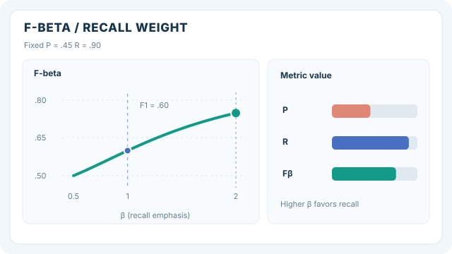
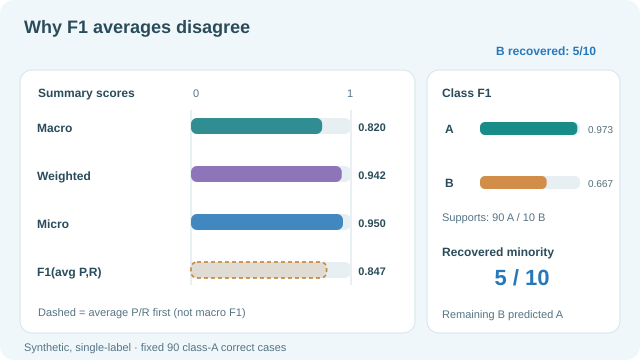
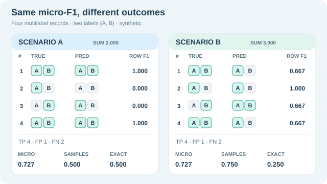

---
related:
  - engineering/evaluation
tags:
  - evaluation
  - metrics
  - classification
---

# F1 分數

F1 分數把精確率與召回率合併成一個數字。它是兩者的調和平均，因此只有在兩者都高時才會高。它也稱為平衡 F 值或 F 測度。

## 定義

$$F_1 = \frac{2 \cdot \text{精確率} \cdot \text{召回率}}{\text{精確率} + \text{召回率}} = \frac{2\,TP}{2\,TP + FP + FN}$$

第二種寫法顯示，F1 並不使用真負例。

## 動態教學：調和平均：為何精確率與召回率失衡會降低 F1

*原創教學動畫，CC BY-SA 4.0。* MkDocs 網站可播放／暫停；鍵盤可聚焦後水平捲動。減少動態效果設定會顯示靜態影格；GitHub 顯示靜態預覽。 [GitHub 靜態預覽](../../../../assets/concept-animations/f1-harmonic-gap-still.svg) · [完整 SVG 動畫](../../../../assets/concept-animations/f1-harmonic-gap-motion.svg).

固定人工示意召回率 $R=0.8$，讓精確率 $P$ 由 0.10 連續掃描至 0.95，動畫追蹤 $F_1(P)=1.6P/(P+0.8)$ 與算術平均 $M(P)=(P+0.8)/2$。當 $P=0.2$ 時，**F1 = 0.32**，而 **M = 0.50**；在 $P=R=0.8$ 時兩者相等。變動的 $P$ 是**數學參數掃描**，不是訓練軌跡或實際決策門檻變化；也不宣稱這些 $(P,R)$ 組合來自同一個分類器。

## 動態教學：F-beta 與召回率權重

*原創教學動畫, CC BY-SA 4.0.* MkDocs 網站可播放／暫停，窄螢幕可聚焦後以方向鍵水平捲動；減少動態效果模式顯示靜態影格。 [GitHub 靜態預覽](../../../../assets/concept-animations/fbeta-recall-emphasis-still.svg) · [完整 SVG 動畫](../../../../assets/concept-animations/fbeta-recall-emphasis-motion.svg).

此處是**指標參數的解析式掃描**，不是實際訓練、模型實測或決策門檻變動。固定示意精確率 $P=0.45$、召回率 $R=0.90$：

$F_\beta=\frac{(1+\beta^2)PR}{\beta^2P+R}.$

$\beta=0.5$ 時 $F_\beta=0.50$，$\beta=1$ 時 $F_1=0.60$，$\beta=2$ 時 $F_\beta=0.75$。[^fbeta-demo] $\beta$ 越大，越重視召回率，但圖中的分數上升來自 **$R>P$**，若召回率較低，分數反而會下降。選擇 $\beta$ 是摘要指標的偏好設定，**不是**對誤報與漏報成本的完整建模。

## 動態教學：類別不平衡時的 Macro-F1 與 Micro-F1

*原創教學動畫，CC BY-SA 4.0。* MkDocs 提供播放／暫停；窄螢幕可聚焦後使用方向鍵捲動。減少動態效果設定使用靜態圖，GitHub 則顯示回退預覽。[GitHub 靜態預覽](../../../../assets/concept-animations/f1-macro-micro-imbalance-still.svg) · [完整 SVG 動畫](../../../../assets/concept-animations/f1-macro-micro-imbalance-motion.svg)。

此處使用**人工設定、互斥的二元單標籤**案例：A 類有 90 筆，B 類有 10 筆。90 筆 A 類固定全對；起初 B 類 10 筆都被錯分為 A。令 $k\in\{0,\ldots,10\}$ 表示已修正為 B 的案例數，其餘仍預測為 A。以一對其餘類別（one-vs-rest）計算：

$$
F_{1,A}(k)=\frac{180}{190-k}.
$$

$$
F_{1,B}(k)=\frac{2k}{10+k}.
$$

**巨觀 F1（Macro-F1）** 不依樣本數，直接平均各類別 F1；**微觀 F1（Micro-F1）** 先合併 TP、FP、FN。在這個**納入所有類別的單標籤**設定下，Micro-F1 等於準確率：

$$
F_{1,\mathrm{macro}}=\tfrac12(F_{1,A}+F_{1,B}).
$$

$$
F_{1,\mathrm{micro}}=\frac{90+k}{100}.
$$

當 $k=0$，**Micro-F1 = 0.900**，但 **Macro-F1 ≈ 0.474**，因為 B 類全被漏掉；$k=10$ 時兩者皆為 1。A 類每一個色塊代表*十筆*正確案例，B 類每一個色塊代表*一筆*。逐步翻轉色塊是**反事實的分類修正示意**，不是實際訓練軌跡。此處 Micro-F1 等於準確率的結論，不可直接套用到多標籤任務。

## 動態教學：F1 的支援數加權與運算順序

*原創 12 秒教學動畫與 GitHub 可閱讀的靜態回退（CC BY-SA 4.0）。* 延用前述人工設定的**單標籤 A 類 90 筆／B 類 10 筆**資料，其中所有 A 類固定預測正確，讓 $k\in\{0,2,5,10\}$ 筆 B 類被正確找回。各影格呈現的是**不同反事實分類結果**，不是模型訓練過程或實測效能改善。右側是兩個類別各自的一對其餘類別（one-vs-rest）F1；左側是**三種正確的聚合方式**及一個容易混淆的虛線數值：

$$
F_{1,A}=\frac{180}{190-k},\quad F_{1,B}=\frac{2k}{10+k}.
$$

$$
F_{1,\mathrm{macro}}=\frac{F_{1,A}+F_{1,B}}{2}.
$$

$$
F_{1,\mathrm{weighted}}=0.9F_{1,A}+0.1F_{1,B}.
$$

$$
F_{1,\mathrm{micro}}=\frac{90+k}{100}.
$$

在 $k=5$ 時，$F_{1,A}=180/185\approx0.973$、$F_{1,B}=10/15\approx0.667$，所以 **Macro-F1 ≈ 0.820**、**依真實類別支援數加權的 F1 ≈ 0.942**、**Micro-F1 = 0.950**。加權 F1 的權重是**真實類別的樣本數**，不是預測為該類的數量。此處 Micro-F1 等於準確率，是因為每筆資料各有一個真實及預測標籤，並納入全部類別；多標籤任務或只評估部分類別不一定成立。

虛線的 **F1(avg P,R)** 是先把每個類別的精確率與召回率分別做巨觀平均，再取調和平均。當 $k=5$，兩個平均值分別為 $(90/95+1)/2\approx0.974$ 與 $(1+1/2)/2=0.75$，因此得到 **0.847**，**不等於** Macro-F1 0.820：非線性的調和平均與平均運算通常無法交換次序。當 $k=0$ 時，沒有任何樣本被預測成 B 類，其精確率未定義；此處按 `zero_division=0` 慣例設為零。動畫每個狀態停留三秒；靜態圖固定 $k=5$。MkDocs 提供鍵盤可操作的播放／暫停按鈕；偏好減少動態效果時會顯示靜態圖，手機可水平捲動 640px 圖面。[GitHub 靜態預覽](../../../../assets/concept-animations/f1-averaging-rules-still.svg) · [完整動畫](../../../../assets/concept-animations/f1-averaging-rules-motion.svg)。聚合定義沿用本頁已列的 scikit-learn `f1_score` 參考文件。

## 動態教學：多標籤任務的 Micro-F1、Samples-F1 與完全符合率

*原創 12 秒教學動畫與 GitHub 靜態回退（CC BY-SA 4.0）。* 圖中的 **TRUE** 是每筆實際存在的 A、B 標籤；**PRED** 是預測標籤，實心綠色方塊代表該標籤存在。兩種**人工設計**的多標籤預測方案使用同一批四筆真實標籤：`{A,B}`、`{A}`、`{B}`、`{A,B}`。動畫每三秒逐列移動醒目框，標題列的 **SUM** 同步顯示已掃描列的 F1 總和；它們是兩種固定預測結果的**逐筆計算過程**，不是模型訓練、門檻掃描或實測效能。

方案 A 預測 `{A,B}`、`{}`、`{A}`、`{A,B}`，各筆 F1 為 `1,0,0,1`；方案 B 預測 `{A}`、`{A}`、`{A,B}`、`{A}`，各筆 F1 為 `2/3,1,2/3,2/3`。兩者先合併計數後的 `TP=4, FP=1, FN=2` **完全相同**，因此

$$
F_{1,\mathrm{micro}}=\frac{2(4)}{2(4)+1+2}=\frac{8}{11}\approx0.727.
$$

但 **Samples-F1** 先計算每一筆資料的標籤集合 F1，再平均；**subset accuracy（完全符合率）** 則要求該筆的預測標籤集合與真實集合完全一致：[^multi-eval]

$$
F_{1,\mathrm{samples}}=\frac{1}{4}\sum_{i=1}^{4}\frac{2\lvert Y_i\cap\widehat Y_i\rvert}{\lvert Y_i\rvert+\lvert\widehat Y_i\rvert}.
$$

因此方案 A 的 Samples-F1 為 **0.500**、完全符合率 **2/4 = 0.500**；方案 B 分別為 **0.750** 與 **1/4 = 0.250**。**Micro-F1 相同，不代表每筆樣本的平均品質或完全符合比例相同；Samples-F1 較高，也不保證完全符合率較高。** 本例所有真實標籤集合非空，因此不涉及雙方皆無標籤時的零除慣例。

網站沿用既有可用鍵盤操作的 Play／Pause；`prefers-reduced-motion` 顯示固定終態，手機可聚焦後水平捲動。GitHub 使用[靜態 SVG 回退](../../../../assets/concept-animations/f1-multilabel-aggregation-still.svg)，網站提供[完整動畫](../../../../assets/concept-animations/f1-multilabel-aggregation-motion.svg)。來源見本頁 scikit-learn `f1_score` 與新增的 `accuracy_score` 官方文件。

## 解讀

調和平均會懲罰不平衡。精確率為 0.9、召回率為 0.1 的模型，算術平均是 0.5，但 F1 只有 0.18。這就是 F1 比單純平均更常被採用的原因。在二元遮罩上，F1 也等於 Dice 係數，因此它與[分割指標](../segmentation/index.md)相關。

## 何時使用

當只關心一個正例類別、真負例的資訊不重要，而且需要單一摘要數字時，使用 F1。在二元分類中，F1 最適合作為精確率、召回率與 F1 三者之一，並附上明確的門檻。

## 範例

以[共用的人工 100 筆混淆矩陣範例](index.md)為例，精確率為 0.80，召回率為 0.67。它們的調和平均為 $2 \cdot 0.80 \cdot 0.67 / (0.80 + 0.67) \approx 0.73$，與 $2 \cdot 40 / (2 \cdot 40 + 10 + 20) = 80 / 110$ 相同。調和平均會偏向兩者中較小的那個值。

## 性質與變體

- **$F_\beta$ 家族。** $F_\beta = (1 + \beta^2)\,PR / (\beta^2 P + R)$。$\beta > 1$ 時較重視召回率，$\beta < 1$ 時較重視精確率。$F_1$ 即 $\beta = 1$ 的情況。
- **不計入真負例。** 公式中沒有 TN，因此增加正確的負例不會改變它。
- **平均方式。** 多類別時，巨觀 F1 先算各類別 F1 再平均，微觀 F1 先合併計數。在不平衡資料上兩者可能差異很大。
- **限制。** F1 是單一數字，會掩蓋精確率與召回率之間的取捨，也不反映各類錯誤的成本。

## 常見陷阱

- **忽略真負例。** F1 不反映負例類別的處理情況。若負例很重要，應搭配[準確率](accuracy.md)一起報告。
- **門檻依賴。** 與精確率、召回率一樣，F1 會隨門檻改變，因此必須報告門檻。
- **多類別平均。** 多類別的分數取決於各類別 F1 的平均方式。應說明採用的平均方法。

## 相關指標

F1 由[精確率](precision.md)與[召回率](recall.md)組成。家族概述見[分類指標](index.md)。

## 動畫示範：F1 隨決策門檻升降，並非單調變化

*原創教學動畫（CC BY-SA 4.0）。* 假設八筆人工設定、排序分數彼此不同的樣本，依分數降冪為 `+ − + + − + − −`，其中四筆是真正例。若選取前 `k` 筆為預測正例，則 `FP(k)=k-TP(k)`、`FN(k)=4-TP(k)`，因此

$$
\begin{gathered}
F_1(k)=\frac{2TP(k)}{2TP(k)+FP(k)+FN(k)}
\\ =\frac{2TP(k)}{k+4}.
\end{gathered}
$$

動畫逐筆移動選取邊界，與 TP／FP／FN 及 F1 計算同步。在 `k=4` 時 **F1 = 0.750**；納入第五筆負例後降至 **6/9 ≈ 0.667**；納入第六筆正例後，升至本例最大值 **8/10 = 0.800**。未選取任何樣本時，依本例約定設 F1 為零。這顯示放寬分類門檻可能提高或降低 F1。實務上應使用與測試集分離的驗證資料決定門檻；F1 也未必反映部署任務的錯誤成本。**本圖為人工示意，非模型實測結果。** MkDocs 支援鍵盤播放／暫停與減少動態效果的靜態回退。[GitHub 靜態預覽](../../../../assets/concept-animations/f1-threshold-topk-still.svg) · [完整 SVG 動畫](../../../../assets/concept-animations/f1-threshold-topk-motion.svg)。手機可橫向捲動。

選取前綴與標記以離散步驟變化，循環結束時重設；固定連線與數值只是參考，不代表非整數筆數的觀測。

## 參考文獻

### 文章與文件

- scikit-learn contributors. *accuracy_score*. https://scikit-learn.org/stable/modules/generated/sklearn.metrics.accuracy_score.html — 官方 API 定義：多標籤任務的 subset accuracy 需要整筆標籤集合完全一致。
- scikit-learn contributors. *f1_score*. https://scikit-learn.org/stable/modules/generated/sklearn.metrics.f1_score.html — API 參考，給出公式 $2TP / (2TP + FP + FN)$ 與平均選項。
- Manning, C. D., Raghavan, P. & Schütze, H. *Evaluation of ranked retrieval results*, online edition of *Introduction to Information Retrieval*. https://nlp.stanford.edu/IR-book/html/htmledition/evaluation-of-ranked-retrieval-results-1.html — 提到平衡 F 測度，並將精確率與召回率描述為它所合併的指標。

### 補充來源

- scikit-learn contributors. *Metrics and scoring: quantifying the quality of predictions*. https://scikit-learn.org/stable/modules/model_evaluation.html — 分類、迴歸與排序評分器的概述，以及各自的適用時機。
- Murphy, K. P. *Probabilistic Machine Learning: An Introduction*. MIT Press, 2022. https://probml.github.io/pml-book/book1.html — 提供免費線上草稿的機率機器學習教科書。
- *The Elements of Statistical Learning: Data Mining, Inference, and Prediction*, 2nd edition. https://hastie.su.domains/ElemStatLearn/ — 統計學習的標準教科書，涵蓋其評估方法。

[^fbeta-demo]: scikit-learn contributors. *fbeta_score*. https://scikit-learn.org/stable/modules/generated/sklearn.metrics.fbeta_score.html — 定義 F-beta 公式與 beta 的權重意義。

[^multi-eval]: scikit-learn contributors. *f1_score* and *accuracy_score*. https://scikit-learn.org/stable/modules/generated/sklearn.metrics.f1_score.html ; https://scikit-learn.org/stable/modules/generated/sklearn.metrics.accuracy_score.html — 分別定義 samples 聚合與多標籤完全符合率。
