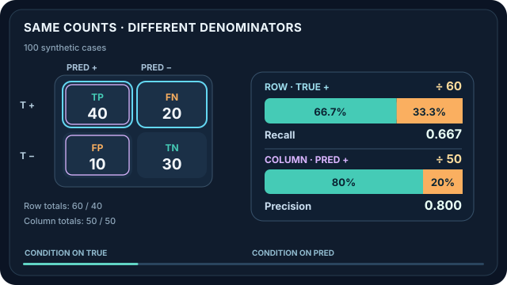

---
related:
  - engineering/evaluation
tags:
  - evaluation
  - metrics
  - classification
---

# Classification Metrics

Classification metrics score a model whose output is a class label or a score for each class. Some metrics evaluate class labels under a fixed decision rule (for example, a binary cutoff, multiclass argmax, or directly emitted labels): accuracy, precision, recall and F1. Others read the scores across all thresholds and ask how well positives are ranked above negatives: ROC-AUC and PR-AUC. The two groups answer different questions, so a model can look strong on one and weak on the other.

## Key metrics

| Metric | What it measures | Fixed label decision needed | Use when |
|---|---|---|---|
| [Accuracy](accuracy.md) | Fraction of correct labels | Yes | Classes are balanced and every error costs the same |
| [Precision](precision.md) | Share of predicted positives that are correct | Yes | False alarms are costly |
| [Recall](recall.md) | Share of true positives that are found | Yes | Missed cases are costly |
| [F1](f1.md) | Harmonic mean of precision and recall | Yes | One number for the positive class |
| [ROC-AUC](roc-auc.md) | Ranking of positives above negatives | No | Comparing models without fixing a threshold |
| [PR-AUC](pr-auc.md) | Precision across recall levels | No | Positives are rare |

For score-based classifiers, these label metrics can change with the decision rule: report the cutoff or label-selection policy alongside the metric. A numeric threshold is not needed when a classifier already outputs labels. Ranking metrics do not depend on a single cutoff. However, ROC-AUC alone may conceal low precision at a rare-event deployment base rate; precision–recall summaries are prevalence-sensitive and their integration conventions must be stated.

## Shared synthetic 100-case example

The worked examples for [accuracy](accuracy.md), [precision](precision.md), [recall](recall.md), and [F1](f1.md) all use **the same** binary-classification confusion matrix. Rows represent **actual** classes and columns represent **predicted** classes. Entries are counts, not probabilities.

| Actual class | Predicted positive | Predicted negative | Total |
|---|---:|---:|---:|
| Positive | 40 (TP) | 20 (FN) | 60 |
| Negative | 10 (FP) | 30 (TN) | 40 |
| **Total** | **50** | **50** | **100** |

From these identical 100 cases, accuracy is **70/100 = 0.700**, precision is **40/50 = 0.800**, recall is **40/60 ≈ 0.667**, and F1 is **80/110 ≈ 0.727**. This is a **constructed count example, not measured classifier performance**. The animations elsewhere in this section use *different* explicitly synthetic scores or population parameters; they are not results from this 100-case matrix.

## Animated matrix conditioning: actual rows versus predicted columns

*Original 16-second instructional SVG animation and independent GitHub-safe static fallback (CC BY-SA 4.0).* The diagram uses **exactly the synthetic 100-case matrix above**, not new observations, fitted-model measurements or an experiment. The moving outlines select one **denominator group** at a time: two actual-class rows (0–8 s) and then two predicted-class columns (8–16 s). Bars show the two exhaustive fractions within that group. The four states are **discrete conditional normalizations**, not a continuous training or threshold trajectory.

**Condition on the actual label (row totals):** among the 60 actual positives, recall is $TP/(TP+FN)=40/60\approx0.667$ (the remaining $20/60$ are missed). Among 40 actual negatives, specificity is $TN/(TN+FP)=30/40=0.750$; the false-positive rate is $10/40=0.250$.

**Condition on the predicted label (column totals):** among 50 predicted positives, precision is $TP/(TP+FP)=40/50=0.800$ (the other $10/50$ are false alerts). Among 50 predicted negatives, negative predictive value is $TN/(TN+FN)=30/50=0.600$. **Recall and precision therefore condition on different populations even when their numerator is the same TP.** The static GitHub preview puts both denominators side by side; the animation separately highlights all four groups.

On MkDocs, use the keyboard-accessible Play/Pause control; on a narrow screen focus the graphic and scroll horizontally with arrow keys. `prefers-reduced-motion` displays an unchanged first-stage diagram. [GitHub static preview](../../../../assets/concept-animations/confusion-condition-direction-still.svg) · [Full SVG animation](../../../../assets/concept-animations/confusion-condition-direction-motion.svg). Metric definitions follow the scikit-learn evaluation documentation already cited below.

## Three linked ROC decision experiments

These **three separate synthetic experiments** connect ranking performance, positive-prediction reliability and deployment decisions. They are *not* repeated measurements from the shared 100-case confusion matrix above. The [ROC-AUC chapter](roc-auc.md) contains the full animated explanations, assumptions and derivations.

| Animation ([full SVG] links open the motion; [still] links work on GitHub) | Held constant | Changed parameter | Consequence |
|---|---|---|---|
| [Fixed ROC, changing precision](roc-auc.md) ([still](../../../../assets/concept-animations/roc-pr-shift-still.svg) · [full SVG](../../../../assets/concept-animations/roc-pr-shift-motion.svg)) | TPR = 0.80, FPR = 0.10, class-conditional score distributions | Positive prevalence: 5% → 60% | Precision / PPV: 0.296 → 0.923; the ROC point stays put |
| [Youden J versus cost](roc-auc.md) ([still](../../../../assets/concept-animations/roc-youden-cost-still.svg) · [full SVG](../../../../assets/concept-animations/roc-youden-cost-motion.svg)) | Six-case score ranking, deployment prevalence 10%, FP cost 1 | FN cost: 1 → 5 | Minimum-cost cutoff switches from k = 1 to k = 4 at FN cost 4.5; maximum J stays at k = 4 |
| [Prior shift and optimal policy](roc-auc.md) ([still](../../../../assets/concept-animations/roc-prior-policy-still.svg) · [full SVG](../../../../assets/concept-animations/roc-prior-policy-motion.svg)) | Six-case score ranking and costs (FN = 2, FP = 1); conditional score distributions | Positive prevalence: 5% → 60% | Cost-optimal cutoff switches at 20% prevalence, although the ROC curve is unchanged |

**Interpretation:** A fixed decision rule can keep its ROC point under a **pure prior-probability shift** while its PPV changes. Re-optimising the rule against altered prevalence or error costs is a different operation, and may move the *chosen* ROC point without changing the underlying ROC curve. If class-conditional score distributions also shift, the ROC curve itself may change. All numbers are illustrative population assumptions, not fitted-model results or deployment measurements. MkDocs offers Play/Pause and reduced-motion stills; use the static previews for GitHub or when animation is unavailable.

## Connections

Whether the scores behave like probabilities is a separate question, covered in [Probabilistic Metrics](../probabilistic/index.md). The procedure for splitting data and validating a classifier is in [Evaluation and Validation](../../../paradigms/supervised/evaluation-and-validation/index.md).

## References

### Surveys and documentation

- Saito, T. & Rehmsmeier, M. (2015). The precision-recall plot is more informative than the ROC plot when evaluating binary classifiers on imbalanced datasets. *PLoS ONE* 10(3). https://doi.org/10.1371/journal.pone.0118432 — Shows why precision-recall curves are more informative than ROC curves for rare positives.
- scikit-learn contributors. *Metrics and scoring: quantifying the quality of predictions*. https://scikit-learn.org/stable/modules/model_evaluation.html — Reference for the standard classification scorers and their definitions.
- Manning, C. D., Raghavan, P. & Schütze, H. *Evaluation of ranked retrieval results*, online edition of *Introduction to Information Retrieval*. https://nlp.stanford.edu/IR-book/html/htmledition/evaluation-of-ranked-retrieval-results-1.html — Defines precision, recall, the F measure and average precision for retrieval, which carry over to classification.

### Additional sources

- Fawcett, T. (2006). An introduction to ROC analysis. *Pattern Recognition Letters* 27(8), 861–874. https://doi.org/10.1016/j.patrec.2005.10.010 — Explains how ROC curves and the AUC are built, read and commonly misused.
- Murphy, K. P. *Probabilistic Machine Learning: An Introduction*. MIT Press, 2022. https://probml.github.io/pml-book/book1.html — Textbook with a free online draft on probabilistic machine learning.
- *The Elements of Statistical Learning: Data Mining, Inference, and Prediction*, 2nd edition. https://hastie.su.domains/ElemStatLearn/ — Standard textbook on statistical learning and its evaluation.
