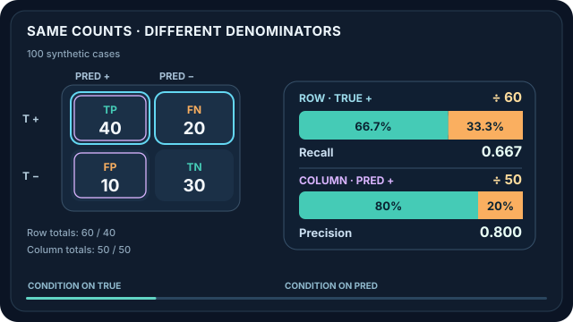

---
related:
  - engineering/evaluation
tags:
  - evaluation
  - metrics
  - classification
translation_reviewed: 2026-11-19
---

# 分類指標

分類指標用來評估輸出為類別標籤或各類別分數的模型。準確率、精確率、召回率與 F1 都評估依固定決策規則得到的類別標籤；規則可能是二元分類門檻、多類別 argmax，或模型直接輸出的標籤。另一些則跨越所有門檻，檢查分數是否把正例排在負例之上：ROC-AUC 與 PR-AUC。兩組指標回答的問題不同，因此模型可能在一組指標上表現很好，在另一組上表現很差。

## 主要指標

| 指標 | 衡量什麼 | 是否需要固定標籤決策 | 適用時機 |
|---|---|---|---|
| [準確率](accuracy.md) | 正確標籤的比例 | 是 | 類別大致平衡，且每種錯誤代價相同 |
| [精確率](precision.md) | 預測為正例中真正為正例的比例 | 是 | 誤報代價高 |
| [召回率](recall.md) | 真正的正例中被找到的比例 | 是 | 漏報代價高 |
| [F1 分數](f1.md) | 精確率與召回率的調和平均 | 是 | 以一個數字概括正例類別 |
| [ROC-AUC](roc-auc.md) | 正例排在負例之上的程度 | 否 | 不固定門檻，比較模型 |
| [PR-AUC](pr-auc.md) | 各召回率水準下的精確率 | 否 | 正例稀少 |

對輸出分數的分類器，這些指標可能隨標籤決策規則改變，因此應一併報告門檻或標籤選取方式；直接輸出標籤的模型不一定有數值門檻。排序指標不依賴單一門檻；然而，ROC-AUC 可能掩蓋稀有事件在部署盛行率下的低精確率，而精確率—召回率相關指標會隨盛行率改變，且需要說明積分或彙整方式。

## 共用的人工 100 筆混淆矩陣範例

[準確率](accuracy.md)、[精確率](precision.md)、[召回率](recall.md)與 [F1](f1.md) 的數值範例都使用**同一組**二元分類混淆矩陣。表格列為**實際類別**，欄為**預測類別**，所有數字均為整數筆數，非機率。

| 實際類別 | 預測正例 | 預測負例 | 合計 |
|---|---:|---:|---:|
| 正例 | 40 (TP) | 20 (FN) | 60 |
| 負例 | 10 (FP) | 30 (TN) | 40 |
| **合計** | **50** | **50** | **100** |

對同一組 100 筆案例，準確率是 **70/100 = 0.700**、精確率是 **40/50 = 0.800**、召回率是 **40/60 ≈ 0.667**，F1 是 **80/110 ≈ 0.727**。這是**人工計數範例，並非分類器實測表現**。本章動畫使用各自獨立的人工分數資料或母體參數，不代表這 100 筆資料的連續實驗結果。

## 分母的方向：依實際類別或預測類別正規化

*原創 16 秒 SVG 教學動畫，搭配可直接在 GitHub 閱讀的靜態回退圖（CC BY-SA 4.0）。* 圖中使用的就是**上方相同的人工 100 筆混淆矩陣**，不是其他實測、模型訓練或額外樣本。外框依序標示**分母所涵蓋的群組**：前八秒選取實際正／負例的兩個列群組，接著八秒選取預測正／負例的兩個欄群組。每組色條分成兩個占比。四個狀態是**離散的條件比例計算**，不是連續的訓練或門檻軌跡。

**以實際類別為條件（列合計）：** 60 筆真正正例中，召回率是 $TP/(TP+FN)=40/60\approx0.667$，其餘 $20/60$ 是漏報。40 筆真正負例中，特異度是 $TN/(TN+FP)=30/40=0.750$，誤報率則為 $10/40=0.250$。

**以預測類別為條件（欄合計）：** 50 筆預測正例中，精確率是 $TP/(TP+FP)=40/50=0.800$，其餘 $10/50$ 是誤報。50 筆預測負例中，陰性預測值（NPV）是 $TN/(TN+FN)=30/50=0.600$。**召回率和精確率即使都以 TP 當分子，條件化的母群也不同。** GitHub 靜態圖同時並列兩種分母；動畫則依序示範四個群組。

MkDocs 提供可用鍵盤操作的播放／暫停功能；窄螢幕可聚焦圖面後用方向鍵水平捲動。`prefers-reduced-motion` 模式維持第一個靜態狀態。[GitHub 靜態預覽](../../../../assets/concept-animations/confusion-condition-direction-still.svg) · [完整 SVG 動畫](../../../../assets/concept-animations/confusion-condition-direction-motion.svg)。指標定義沿用本頁已列出的 scikit-learn 評估文件。

## 三組相互對照的 ROC 決策動畫

以下是**三個彼此獨立的人工思想實驗**，用來區分排序能力、陽性預測可信度與部署決策；它們**不是**上方共用 100 筆混淆矩陣的重複實測。[ROC-AUC 專頁](roc-auc.md)提供完整動畫、數學推導與適用假設。

| 動畫（[靜態預覽]可在 GitHub 觀看，[完整 SVG]展示動態） | 保持不變 | 改變的參數 | 導致的結果 |
|---|---|---|---|
| [ROC 固定、精確率改變](roc-auc.md)（[靜態預覽](../../../../assets/concept-animations/roc-pr-shift-still.svg) · [完整 SVG](../../../../assets/concept-animations/roc-pr-shift-motion.svg)） | TPR = 0.80、FPR = 0.10、各類別內的分數條件分布 | 正例盛行率 5% → 60% | Precision／PPV 由 0.296 → 0.923；ROC 操作點不移動 |
| [Youden J 與錯誤成本](roc-auc.md)（[靜態預覽](../../../../assets/concept-animations/roc-youden-cost-still.svg) · [完整 SVG](../../../../assets/concept-animations/roc-youden-cost-motion.svg)） | 六筆人工排序、部署盛行率 10%、FP 成本 1 | FN 成本 1 → 5 | 最低成本門檻在 FN 成本 4.5 時由 k = 1 切換至 k = 4；最大 J 始終在 k = 4 |
| [先驗比例漂移與最佳策略](roc-auc.md)（[靜態預覽](../../../../assets/concept-animations/roc-prior-policy-still.svg) · [完整 SVG](../../../../assets/concept-animations/roc-prior-policy-motion.svg)） | 六筆人工排序與錯誤成本（FN = 2、FP = 1）、各類別內的分數條件分布 | 正例盛行率 5% → 60% | 最低成本門檻在盛行率 20% 時切換；ROC 曲線維持不變 |

**如何解讀：** 在**純先驗比例漂移**且固定決策規則時，ROC 操作點可保持不變，但 PPV 仍會改變。若因部署盛行率或錯誤成本改變而**重新最佳化門檻**，選中的 ROC 點可能移動，並不代表底層 ROC 曲線變了。若各類別內的分數條件分布也變動，ROC 曲線本身就可能變化。所有數值皆為人工母體假設，**非模型實測或部署統計**。MkDocs 提供播放／暫停及 Reduced Motion 靜態回退；GitHub 或不支援動畫時可使用靜態預覽。

## 關聯

分數是否表現得像機率，是另一個問題，見[機率指標](../probabilistic/index.md)。資料切分與分類器驗證的流程，見[評估與驗證](../../../paradigms/supervised/evaluation-and-validation/index.md)。

## 參考文獻

### 綜述與文件

- Saito, T. & Rehmsmeier, M. (2015). The precision-recall plot is more informative than the ROC plot when evaluating binary classifiers on imbalanced datasets. *PLoS ONE* 10(3). https://doi.org/10.1371/journal.pone.0118432 — 說明為什麼在稀有正例上，精確率—召回率曲線比 ROC 曲線更有資訊量。
- scikit-learn contributors. *Metrics and scoring: quantifying the quality of predictions*. https://scikit-learn.org/stable/modules/model_evaluation.html — 標準分類評分器與其定義的參考。
- Manning, C. D., Raghavan, P. & Schütze, H. *Evaluation of ranked retrieval results*, online edition of *Introduction to Information Retrieval*. https://nlp.stanford.edu/IR-book/html/htmledition/evaluation-of-ranked-retrieval-results-1.html — 為檢索定義精確率、召回率、F 值與平均精確率，這些定義可延伸至分類。

### 補充來源

- Fawcett, T. (2006). An introduction to ROC analysis. *Pattern Recognition Letters* 27(8), 861–874. https://doi.org/10.1016/j.patrec.2005.10.010 — 說明 ROC 曲線與 AUC 的建構、解讀與常見誤用。
- Murphy, K. P. *Probabilistic Machine Learning: An Introduction*. MIT Press, 2022. https://probml.github.io/pml-book/book1.html — 提供免費線上草稿的機率機器學習教科書。
- *The Elements of Statistical Learning: Data Mining, Inference, and Prediction*, 2nd edition. https://hastie.su.domains/ElemStatLearn/ — 統計學習的標準教科書，涵蓋其評估方法。
