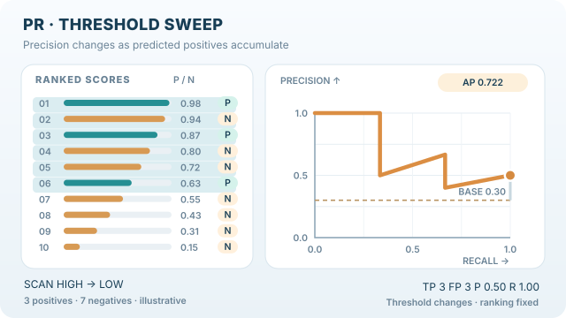
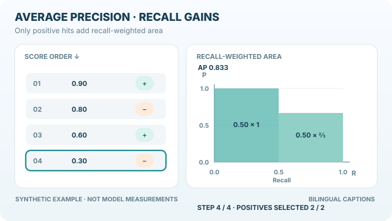

---
related:
  - engineering/evaluation
tags:
  - evaluation
  - metrics
  - classification
---

# PR-AUC

PR-AUC summarises the precision-recall curve, which plots precision against recall as the decision threshold changes. It is the metric to prefer when positives are rare, because it focuses on how the positives are ranked.

## Definition

Average precision (AP) is the usual PR-AUC estimate. It sums the precision at each threshold, weighted by the gain in recall from the previous threshold:

$$AP = \sum_n (R_n - R_{n-1})\, P_n$$

where $P_n$ and $R_n$ are precision and recall at the $n$-th threshold. scikit-learn's `average_precision_score` uses this step-wise form, which does not interpolate between points. It warns that the trapezoidal area under the same curve can be overly optimistic.

## Interpretation

At population level, scores independent of the labels give a horizontal precision reference at the positive prevalence. This is not the exact expected non-interpolated AP of a finite randomly ordered sample. Unlike ROC-AUC, the baseline changes with the data, so PR-AUC values are not comparable across datasets with different prevalence. Compare models on the same dataset.

## When to use it

Use PR-AUC when positives are rare, as in fraud or fault detection, and when the scores will be used to pick the top of a ranked list. Saito and Rehmsmeier (2015) show that on imbalanced data the precision-recall plot is more informative than the ROC plot.

## Worked example

Use the same four scores. Sorted by score, the list is 0.9 (positive), 0.8 (negative), 0.6 (positive), 0.3 (negative). Precision at the two positives is $1/1$ and $2/3$, so average precision is $(1 + 2/3) / 2 \approx 0.83$, which matches the value `average_precision_score` returns. The prevalence reference is 0.5, but enumerating the six equally likely placements of two positives gives expected finite-sample AP $49/72 \approx 0.681$ under uniform random ordering.

## Animated ranking and average precision

*Original animated teaching visual (CC BY-SA 4.0).* This invented example uses the **same ten ranked scores as the ROC animation**: positives at ranks **1, 3, 6** and seven negatives. Each accepted positive increases recall by $1/3$; each accepted negative decreases precision while recall stays fixed. Precision at the three positive ranks is $1$, $2/3$ and $3/6$, giving **non-interpolated average precision $AP=(1+2/3+1/2)/3=13/18 \approx 0.722$**. The dashed line marks the positive prevalence $3/10=0.30$, a common population-level random-score reference. **For this finite ten-item example, the expected sample AP of a uniformly random permutation is about 0.450, not 0.300** (enumerating all 120 placements of three positives). At zero accepted cases, precision is undefined; the plot uses $(R,P)=(0,1)$ as an endpoint convention. The displayed polyline connects threshold operating points; **AP is the recall-increment-weighted mean of precisions, not the trapezoidal area underneath those segments** (see the scikit-learn reference). All scores and labels are **synthetic, not empirical model predictions**. MkDocs provides a keyboard-operable Play/Pause button and a reduced-motion still fallback; [GitHub static preview](../../../../assets/concept-animations/pr-threshold-sweep-still.svg) and [complete SVG animation](../../../../assets/concept-animations/pr-threshold-sweep-motion.svg) are also available. On narrow screens, scroll horizontally.

## Animated AP: recall-weighted rectangles

*Original teaching animation (CC BY-SA 4.0).* Unlike the threshold-sweep visualization above, this panel **builds AP from the actual recall increments**. Four invented scores are ordered 0.90 **(positive)**, 0.80 (negative), 0.60 **(positive)**, 0.30 (negative). Positive hits at ranks 1 and 3 contribute rectangular areas `(1/2) × (1/1)` and `(1/2) × (2/3)`, respectively. Thus **AP = 1/2 + 1/3 = 5/6 ≈ 0.833**. Selecting a negative case does not increase recall, so it adds **zero area** even though it changes the precision of the active prefix. The rectangles encode **non-interpolated average precision**, not a linearly interpolated trapezoidal PR area. No probabilities or measurements were fitted to data. Use the MkDocs Play/Pause control or reduced-motion still; [GitHub static preview](../../../../assets/concept-animations/pr-ap-rectangles-still.svg) and [full SVG animation](../../../../assets/concept-animations/pr-ap-rectangles-motion.svg) are provided. The figure scrolls horizontally on narrow screens.

## Properties and variants

- **Baseline.** Prevalence is the population-level random-score reference; finite-sample expected AP can be higher. State which baseline is being used.
- **Interpolation variants.** Older benchmarks, such as early PASCAL VOC evaluations, used 11-point interpolated average precision. At recall levels $0, 0.1, \ldots, 1$ it takes the maximum precision at or above each level and averages those. This differs from the step-wise average precision used here.
- **Single-point summaries.** Precision at a fixed recall, such as 90%, is a single-point summary that some applications prefer.
- **Limit.** Like ROC-AUC it judges the ranking but not calibration, and its value depends on prevalence.

## Pitfalls

- **Prevalence.** Two datasets with different positive rates give different PR-AUC baselines. Report the prevalence next to the score.
- **Interpolation.** Trapezoidal and step-wise estimates of the same curve differ. State which one is used.

## Related metrics

[ROC-AUC](roc-auc.md) is the threshold-free metric that uses the true and false positive rates instead. [Precision](precision.md) and [recall](recall.md) are the points on the curve. The family overview is [Classification Metrics](index.md).

## References

### Seminal papers

- Saito, T. & Rehmsmeier, M. (2015). The precision-recall plot is more informative than the ROC plot when evaluating binary classifiers on imbalanced datasets. *PLoS ONE* 10(3). https://doi.org/10.1371/journal.pone.0118432 — Shows why precision-recall curves are more informative than ROC curves for rare positives.

### Articles and documentation

- scikit-learn contributors. *average_precision_score*. https://scikit-learn.org/stable/modules/generated/sklearn.metrics.average_precision_score.html — API reference giving the step-wise formula for average precision and the warning about the trapezoidal rule.
- scikit-learn contributors. *Metrics and scoring: quantifying the quality of predictions*. https://scikit-learn.org/stable/modules/model_evaluation.html — Overview of threshold-free classification scorers and how they are used.

### Additional sources

- Manning, C. D., Raghavan, P. & Schütze, H. *Evaluation of ranked retrieval results*, online edition of *Introduction to Information Retrieval*. https://nlp.stanford.edu/IR-book/html/htmledition/evaluation-of-ranked-retrieval-results-1.html — Defines precision, recall, the F measure and average precision for retrieval.
- Murphy, K. P. *Probabilistic Machine Learning: An Introduction*. MIT Press, 2022. https://probml.github.io/pml-book/book1.html — Textbook with a free online draft on probabilistic machine learning.
