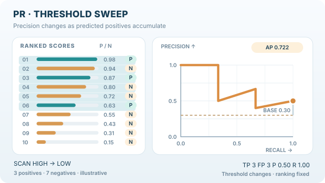

---
related:
  - engineering/evaluation
tags:
  - evaluation
  - metrics
  - classification
---

# PR-AUC

PR-AUC 概括精確率—召回率曲線，該曲線描繪門檻改變時精確率對召回率的關係。當正例稀少時，這是應優先採用的指標，因為它著重於正例如何被排序。

## 定義

平均精確率（average precision, AP）是 PR-AUC 常用的估計值。它把每個門檻上的精確率加總，權重為相對於前一個門檻所增加的召回率：

$$AP = \sum_n (R_n - R_{n-1})\, P_n$$

其中 $P_n$ 與 $R_n$ 是第 $n$ 個門檻上的精確率與召回率。scikit-learn 的 `average_precision_score` 採用這種階梯式的形式，點與點之間不做內插。它提醒，同一條曲線以梯形法則計算的面積可能過於樂觀。

## 解讀

隨機分類器的精確率等於正例比例，因此隨機排序的 PR-AUC 就等於正例的盛行率。與 ROC-AUC 不同，基準線會隨資料改變，因此不同資料集之間的 PR-AUC 數值不能直接比較。應在同一個資料集上比較模型。

## 何時使用

當正例稀少時使用 PR-AUC，例如詐欺或設備故障偵測，而且分數將用來挑出排序列表最前面的項目。Saito 與 Rehmsmeier（2015）指出，在不平衡資料上，精確率—召回率圖比 ROC 圖更有資訊量。

## 範例

沿用同樣的四個分數。依分數排序後為 0.9（正）、0.8（負）、0.6（正）、0.3（負）。兩個正例處的精確率分別為 $1/1$ 與 $2/3$，因此平均精確率為 $(1 + 2/3) / 2 \approx 0.83$，與 `average_precision_score` 的回傳值相同。隨機排序在此處的 PR-AUC 會是 0.5，即正例比例。

## 動畫示範：排序掃描與平均精確率

*原創教學動畫（CC BY-SA 4.0）。* 本圖採用與 ROC 新動畫**相同的十筆人工資料**，正例位於第 **1、3、6** 名，其餘七筆為負例。每納入一筆正例，召回率增加 $1/3$；每納入一筆負例，精確率下降、召回率不變。三筆正例出現時的精確率分別為 $1$、$2/3$、$3/6$，因此**不內插的平均精確率為 $AP=(1+2/3+1/2)/3=13/18 \approx 0.722$**。橫向虛線表示正例比例 $3/10=0.30$，也就是隨機排序的期望基準。圖中的折線連接各門檻的操作點；**AP 是依召回率增量對精確率加權，不等於折線下方的梯形面積**（參見 scikit-learn 參考文件）。所有數值與標籤皆為**人工示意，非模型實測預測**。MkDocs 網站提供可使用鍵盤操作的播放／暫停按鈕，偏好減少動態效果時切換為靜態預覽；亦可直接開啟 [GitHub 靜態圖](../../../../assets/concept-animations/pr-threshold-sweep-still.svg)或[完整 SVG 動畫](../../../../assets/concept-animations/pr-threshold-sweep-motion.svg)。手機可橫向捲動。

## 性質與變體

- **基準線。** 隨機排序的 PR-AUC 等於盛行率，因此應對照該基準線解讀，如解讀一節所述。
- **內插變體。** 較早期的基準（例如早期的 PASCAL VOC 評估）採用 11 點內插平均精確率。在召回率 $0, 0.1, \ldots, 1$ 的每一點上，取不低於該召回率的最大精確率，再求平均。這與此處的階梯式平均精確率不同。
- **單點摘要。** 固定召回率（例如 90%）時的精確率是單點摘要，某些應用偏好此指標。
- **限制。** 與 ROC-AUC 一樣，它評估排序而非校準，且數值依賴盛行率。

## 常見陷阱

- **盛行率。** 兩個正例比例不同的資料集，PR-AUC 的基準線也不同。應在分數旁報告盛行率。
- **內插方式。** 同一條曲線以梯形法與階梯法計算的結果不同。應說明採用哪一種。

## 相關指標

[ROC-AUC](roc-auc.md)是與門檻無關、改以真正例率與偽正例率計算的指標。[精確率](precision.md)與[召回率](recall.md)則是曲線上的點。家族概述見[分類指標](index.md)。

## 參考文獻

### 開創性論文

- Saito, T. & Rehmsmeier, M. (2015). The precision-recall plot is more informative than the ROC plot when evaluating binary classifiers on imbalanced datasets. *PLoS ONE* 10(3). https://doi.org/10.1371/journal.pone.0118432 — 說明為什麼在稀有正例上，精確率—召回率曲線比 ROC 曲線更有資訊量。

### 文章與文件

- scikit-learn contributors. *average_precision_score*. https://scikit-learn.org/stable/modules/generated/sklearn.metrics.average_precision_score.html — API 參考，給出平均精確率的階梯式公式，以及對梯形法則的警告。
- scikit-learn contributors. *Metrics and scoring: quantifying the quality of predictions*. https://scikit-learn.org/stable/modules/model_evaluation.html — 與門檻無關的分類評分器概述，以及它們的使用方式。

### 補充來源

- Manning, C. D., Raghavan, P. & Schütze, H. *Evaluation of ranked retrieval results*, online edition of *Introduction to Information Retrieval*. https://nlp.stanford.edu/IR-book/html/htmledition/evaluation-of-ranked-retrieval-results-1.html — 為檢索定義精確率、召回率、F 值與平均精確率。
- Murphy, K. P. *Probabilistic Machine Learning: An Introduction*. MIT Press, 2022. https://probml.github.io/pml-book/book1.html — 提供免費線上草稿的機率機器學習教科書。
