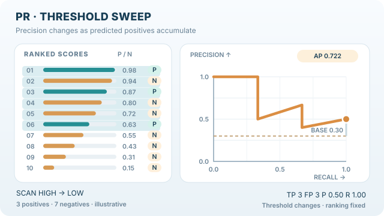
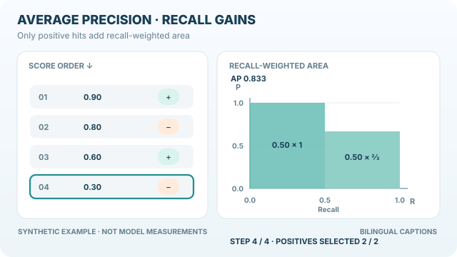
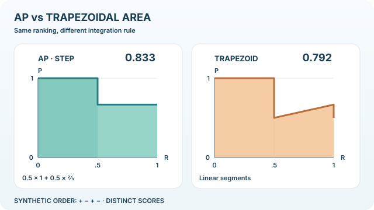
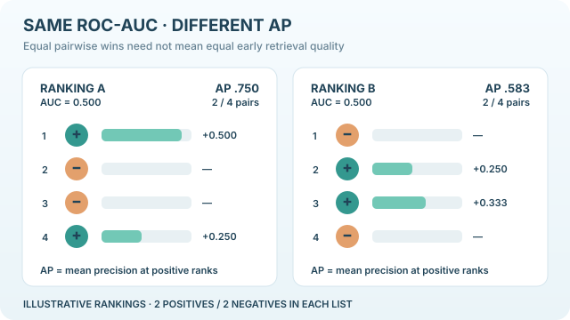
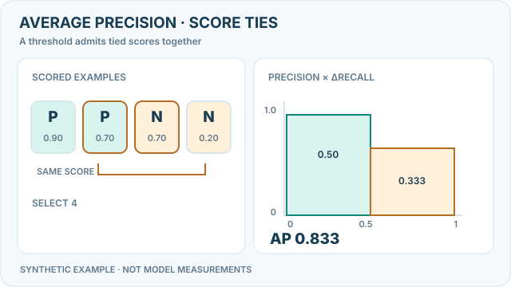
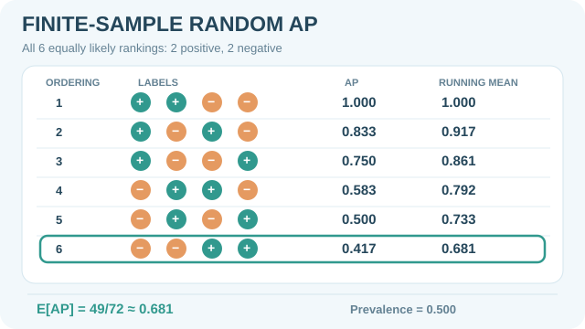
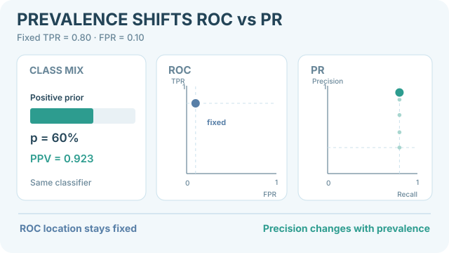

---
related:
  - engineering/evaluation
tags:
  - evaluation
  - metrics
  - classification
---

# PR-AUC

PR-AUC 概括決策門檻變動時的精確率—召回率曲線。針對稀少正例的檢索任務通常很有參考價值，因為精確率直接反映被選取案例中正例的比例。**必須說明積分定義**：不內插的平均精確率（AP）與梯形法計算的 PR 面積是不同指標。

## 定義

平均精確率（average precision, AP）是 PR-AUC 常用的估計值。它把每個門檻上的精確率加總，權重為相對於前一個門檻所增加的召回率：

$$AP = \sum_n (R_n - R_{n-1})\, P_n$$

其中 $P_n$ 與 $R_n$ 是第 $n$ 個門檻上的精確率與召回率。scikit-learn 的 `average_precision_score` 採用這種階梯式的形式，點與點之間不做內插。它提醒，同一條曲線以梯形法則計算的面積可能過於樂觀。

## 解讀

在母體層級，與標籤獨立的隨機分數，其精確率參考線等於正例盛行率；這不等於有限樣本隨機排序時，不內插 AP 的精確期望。不同於隨機排序時期望值為 0.5 的 ROC-AUC 基準線，母體 PR 基準線取決於正例盛行率。因此，**不同盛行率資料集的原始 AP 數值必須審慎比較**，不能單憑數值判定哪個模型排序能力較好。宜優先使用同一評估分布進行成對比較，並報告正例比例與 AP 的計算定義。

## 何時使用

當正例稀少時使用 PR-AUC，例如詐欺或設備故障偵測，而且分數將用來挑出排序列表最前面的項目。Saito 與 Rehmsmeier（2015）指出，在不平衡資料上，精確率—召回率圖比 ROC 圖更有資訊量。

## 範例

沿用同樣的四個分數。依分數排序後為 0.9（正）、0.8（負）、0.6（正）、0.3（負）。兩個正例處的精確率分別為 $1/1$ 與 $2/3$，因此平均精確率為 $(1 + 2/3) / 2 \approx 0.83$，與 `average_precision_score` 的回傳值相同。盛行率參考值是 0.5，但枚舉兩筆正例的六種等機率位置組合，均勻隨機排序的有限樣本 AP 期望為 $49/72 \approx 0.681$。

## 動畫示範：排序掃描與平均精確率

*原創教學動畫（CC BY-SA 4.0）。* 本圖採用與 ROC 新動畫**相同的十筆人工資料**，正例位於第 **1、3、6** 名，其餘七筆為負例。每納入一筆正例，召回率增加 $1/3$；每納入一筆負例，精確率下降、召回率不變。三筆正例出現時的精確率分別為 $1$、$2/3$、$3/6$，因此**不內插的平均精確率為 $AP=(1+2/3+1/2)/3=13/18 \approx 0.722$**。橫向虛線表示正例比例 $3/10=0.30$，這是常用的母體層級隨機分數參考線。**但對本圖有限的十筆樣本，將三筆正例隨機排列於十個位置的 120 種組合，其樣本 AP 期望約為 0.450，而非 0.300**。尚未納入任何樣本時，精確率未定義；圖中以 $(R,P)=(0,1)$ 作為端點慣例。圖中的折線連接各門檻的操作點；**AP 是依召回率增量對精確率加權，不等於折線下方的梯形面積**（參見 scikit-learn 參考文件）。所有數值與標籤皆為**人工示意，非模型實測預測**。MkDocs 網站提供可使用鍵盤操作的播放／暫停按鈕，偏好減少動態效果時切換為靜態預覽；亦可直接開啟 [GitHub 靜態圖](../../../../assets/concept-animations/pr-threshold-sweep-still.svg)或[完整 SVG 動畫](../../../../assets/concept-animations/pr-threshold-sweep-motion.svg)。手機可橫向捲動。

## 動畫示範：以召回率增量累積平均精確率

*原創教學動畫（CC BY-SA 4.0）。* 此圖與前面的門檻掃描不同，直接展示 **AP 如何按召回率增量累積**。四筆**人工分數**依序為 0.90（正例）、0.80（負例）、0.60（正例）、0.30（負例）。第 1 名與第 3 名正例的矩形面積分別為 `(1/2) × (1/1)` 及 `(1/2) × (2/3)`，因此 **AP = 1/2 + 1/3 = 5/6 ≈ 0.833**。遇到負例時召回率不增加，新增面積為**零**，即使目前選取前綴的精確率會改變。這是**不做線性內插的平均精確率**，而不是將 PR 折線以梯形法積分；亦非任何模型實測數據。MkDocs 網站可播放／暫停，偏好減少動畫時會顯示靜態圖；另提供[GitHub 靜態預覽](../../../../assets/concept-animations/pr-ap-rectangles-still.svg)及[完整 SVG 動畫](../../../../assets/concept-animations/pr-ap-rectangles-motion.svg)。手機請橫向捲動觀看。

## 動畫示範：階梯式 AP 與梯形 PR 面積

*原創教學動畫（CC BY-SA 4.0）。* 使用同樣的四筆**人工排序** `+ − + −`，**不內插的 AP** 為 $(1/2)(1)+(1/2)(2/3)=5/6\approx0.833$。若將各門檻的 PR 操作點用直線連接（包含召回率相同時的垂直段），得到的**梯形面積**為 $A_{\mathrm{trap}}=19/24\approx0.792$（後半段貢獻 $(1/2)(1/2+2/3)/2=7/24$），此例差距 $1/24$。**梯形法並不保證分數總是較大**，其差異取決於排序與內插定義；不能把梯形面積直接稱為 `average_precision_score`。動畫先逐步顯示 AP 矩形，再顯示右側的插值區域，並非模型實測評估。MkDocs 支援鍵盤播放／暫停及 Reduced Motion 靜態回退。[GitHub 靜態比較圖](../../../../assets/concept-animations/pr-ap-trapezoid-gap-still.svg) · [完整 SVG 動畫](../../../../assets/concept-animations/pr-ap-trapezoid-gap-motion.svg)。手機可橫向捲動。

## 動畫示範：ROC-AUC 相同，平均精確率仍可能不同

*原創教學動畫（CC BY-SA 4.0）。* 比較兩組**分數互不相同的人工排序**，每組皆有兩筆正例及兩筆負例。排序 A 為 `+ − − +`，正例位於**第 1、4 名**，故 **$AP_A=(1+2/4)/2=0.750$**；排序 B 為 `− + + −`，正例位於**第 2、3 名**，故 **$AP_B=(1/2+2/3)/2=7/12\approx0.583$**。兩者四組正負配對中都只有**兩組排序正確**，所以 **ROC-AUC 都是 $0.500$**。掃描線逐步通過各名次時，僅遇到正例才新增 AP 貢獻長條；圖上的 AP 與 AUC 總結是根據**完整四筆排序**計算，並非掃描尚未結束時的中途指標。此例說明相同的成對區辨能力，不代表相關項目出現在相同排名位置；不屬於模型實測值。MkDocs 支援鍵盤播放／暫停，偏好減少動畫時顯示靜態回退。[GitHub 靜態預覽](../../../../assets/concept-animations/auc-ap-ranking-contrast-still.svg) · [完整 SVG 動畫](../../../../assets/concept-animations/auc-ap-ranking-contrast-motion.svg)。手機請橫向捲動；參考來源見 References 中的 Fawcett（2006）與 scikit-learn AP 文件。

## 性質與變體

- **基準線。** 盛行率是母體層級的隨機分數參考線；有限樣本 AP 的期望可能更高，應說明採用哪一種基準。
- **內插變體。** 較早期的基準（例如早期的 PASCAL VOC 評估）採用 11 點內插平均精確率。在召回率 $0, 0.1, \ldots, 1$ 的每一點上，取不低於該召回率的最大精確率，再求平均。這與此處的階梯式平均精確率不同。
- **單點摘要。** 固定召回率（例如 90%）時的精確率是單點摘要，某些應用偏好此指標。
- **限制。** 與 ROC-AUC 一樣，它評估排序而非校準，且數值依賴盛行率。

## 常見陷阱

- **盛行率。** 兩個正例比例不同的資料集，PR-AUC 的基準線也不同。應在分數旁報告盛行率。
- **內插方式。** 同一條曲線以梯形法與階梯法計算的結果不同。應說明採用哪一種。

## 相關指標

[ROC-AUC](roc-auc.md)是與門檻無關、改以真正例率與偽正例率計算的指標。[精確率](precision.md)與[召回率](recall.md)則是曲線上的點。家族概述見[分類指標](index.md)。

## 動畫解說：同分門檻下的平均精確率

*原創教學動畫，CC BY-SA 4.0 授權；GitHub 顯示靜態 SVG 回退。* [GitHub static preview](../../../../assets/concept-animations/pr-ap-tied-threshold-still.svg) · [Full SVG animation](../../../../assets/concept-animations/pr-ap-tied-threshold-motion.svg).

依據分數門檻繪製 Precision–Recall 曲線時，**同分樣本必須在同一門檻一起納入**，不能以任意排序替代同分分組。本例 $0.90(+),0.70(+),0.70(-),0.20(-)$ 的不同門檻依序得到 $(R,P)=(1/2,1)$、$(1,2/3)$、$(1,1/2)$。因此不內插的 $AP=(1/2)(1)+(1/2)(2/3)=5/6\approx0.8333$。最後加入負例雖降低 Precision，卻未增加 Recall，因此 AP 不變。若強行拆開同分群組，逐筆計算正例名次的貢獻，可能得出不同結果；此圖採用 scikit-learn `average_precision_score` 的同分門檻分組方式。數值皆為**人工示例，非模型實測**。MkDocs 提供播放／暫停及鍵盤水平捲動。

## 動畫示範：有限樣本下隨機排序的 AP 基準

*原創教學動畫（CC BY-SA 4.0）；所有標籤與分數均為**人工示例，非模型實測**。* 假設四筆資料包含**兩筆正例、兩筆負例**，分數互不相同，且隨機排序與真實標籤獨立。因此正例位置共有 $\binom{4}{2}=6$ 種等機率組合。每個正例在第 $r$ 名的 AP 貢獻為 $P@r/2$；六種完整排序的不內插 AP 依序為 $1,5/6,3/4,7/12,1/2,5/12$。動畫框線逐列掃描，並顯示已列舉組合的累積平均：

$$
\mathbb E[AP]=\frac{1+5/6+3/4+7/12+1/2+5/12}{6}
=\frac{49}{72}\approx0.681.
$$

結果**不等於**正例比例 $2/4=0.5$。盛行率是與標籤獨立的分數在*母體層級*精確率曲線上的參考值，不是有限樣本不內插 AP 的確切期望。本圖只是小樣本的精確排列組合示例，**不可視為所有資料集都適用的隨機 AP 修正公式**。MkDocs 支援鍵盤操作播放／暫停；偏好減少動態效果時顯示完整靜態表格。[GitHub 靜態預覽](../../../../assets/concept-animations/pr-random-ap-expectation-still.svg) · [完整 SVG 動畫](../../../../assets/concept-animations/pr-random-ap-expectation-motion.svg)。手機可橫向捲動。AP 定義對照既有 References 中的 scikit-learn 文件。

## 動畫示範：盛行率改變時 ROC 固定、精確率改變

*原創人工示意動畫（CC BY-SA 4.0）。* 固定條件式 TPR = 0.80 與 FPR = 0.10，讓正例盛行率依序採用**五個離散且精確的狀態**：5%、10%、20%、40%、60%。ROC 操作點維持在 (0.10, 0.80)，PR 座標的召回率仍是 0.80，但精確率變成

\[
\operatorname{PPV}(p)=\frac{0.80p}{0.80p+0.10(1-p)}.
\]

五種狀態的精確率依序為 **0.296、0.471、0.667、0.842、0.923**。以上是母體比例的**人工數學示意，不是模型實測**；條件式辨識率不變僅是假設，不能保證分布轉移後仍然成立。動畫採離散狀態，避免將非線性關係錯誤呈現為線性內插。MkDocs 提供鍵盤可操作的播放／暫停，偏好減少動態效果者可觀看靜態圖；手機請聚焦後水平捲動。[GitHub 靜態預覽](../../../../assets/concept-animations/roc-pr-prevalence-still.svg) · [完整 SVG 動畫](../../../../assets/concept-animations/roc-pr-prevalence-motion.svg)。

## 參考文獻

### 開創性論文

- Saito, T. & Rehmsmeier, M. (2015). The precision-recall plot is more informative than the ROC plot when evaluating binary classifiers on imbalanced datasets. *PLoS ONE* 10(3). https://doi.org/10.1371/journal.pone.0118432 — 說明為什麼在稀有正例上，精確率—召回率曲線比 ROC 曲線更有資訊量。

### 文章與文件

- scikit-learn contributors. *average_precision_score*. https://scikit-learn.org/stable/modules/generated/sklearn.metrics.average_precision_score.html — API 參考，給出平均精確率的階梯式公式，以及對梯形法則的警告。
- scikit-learn contributors. *Metrics and scoring: quantifying the quality of predictions*. https://scikit-learn.org/stable/modules/model_evaluation.html — 與門檻無關的分類評分器概述，以及它們的使用方式。

### 補充來源

- Manning, C. D., Raghavan, P. & Schütze, H. *Evaluation of ranked retrieval results*, online edition of *Introduction to Information Retrieval*. https://nlp.stanford.edu/IR-book/html/htmledition/evaluation-of-ranked-retrieval-results-1.html — 為檢索定義精確率、召回率、F 值與平均精確率。
- Murphy, K. P. *Probabilistic Machine Learning: An Introduction*. MIT Press, 2022. https://probml.github.io/pml-book/book1.html — 提供免費線上草稿的機率機器學習教科書。
