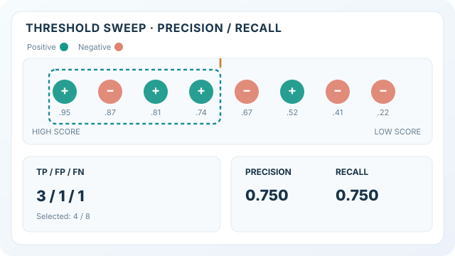
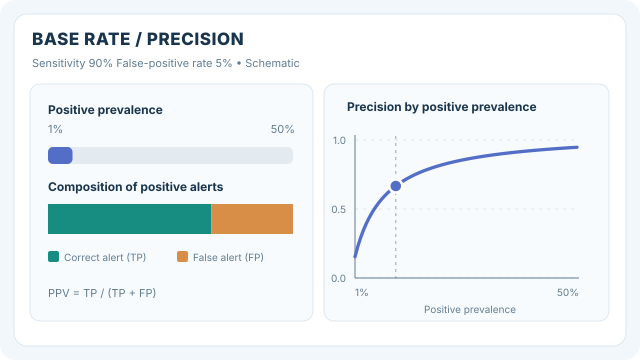

---
related:
  - engineering/evaluation
tags:
  - evaluation
  - metrics
  - classification
---

# Precision

Precision is the share of predicted positives that are truly positive. It answers: when the model raises an alarm, how often is it right?

## Definition

$$\text{Precision} = \frac{TP}{TP + FP}$$

Precision is undefined when the model predicts no positives, because the denominator is zero.

## Animated explanation: Threshold sweep: when more alerts change precision

*Original instructional animation, CC BY-SA 4.0.* On MkDocs use Play/Pause and keyboard focus for horizontal scrolling; reduced-motion users see a still frame. GitHub shows the static preview. [GitHub static preview](../../../../assets/concept-animations/precision-recall-threshold-still.svg) · [Full SVG animation](../../../../assets/concept-animations/precision-recall-threshold-motion.svg).

A **schematic** ranked set has eight scores (.95, .87, .81, .74, .67, .52, .41, .22) and true labels (+, −, +, +, −, +, −, −). Selecting the four highest scores gives TP = 3, FP = 1, FN = 1, so precision and recall are both **0.75**. As the threshold is lowered to include six cases, TP = 4 and FP = 2: recall rises to **1.00** while precision becomes **4/6 ≈ 0.667**. Neither the scores nor the labels are model measurements. Precision need **not** change monotonically: it increases when adding a true positive and decreases when adding a false positive.

## Animated explanation: The base-rate effect on precision

*Original instructional animation, CC BY-SA 4.0.* On MkDocs use Play/Pause and keyboard focus for horizontal scrolling. Reduced-motion viewers receive a still frame; GitHub uses the static preview. [GitHub static preview](../../../../assets/concept-animations/precision-base-rate-still.svg) · [Full SVG animation](../../../../assets/concept-animations/precision-base-rate-motion.svg).

For the **schematic population probabilities** in the animation, hold sensitivity (TPR) at $0.90$ and false-positive rate (FPR) at $0.05$. With positive prevalence $p$, Bayes' rule gives the precision of a positive alert:

$\mathrm{PPV}(p)=\frac{0.90p}{0.90p+0.05(1-p)}.$

At $p=0.01$ precision is **0.154**, at $p=0.10$ it is **0.667**, and at $p=0.50$ it is **0.947**. The stacked bar shows the **composition of issued positive alerts**, not the fraction of all cases. This is a conditional-rate thought experiment: no sample was measured, no model was retrained, and the continuous motion is a prevalence parameter sweep. Even with the *same* TPR and FPR, precision depends strongly on the population's base rate.

## Interpretation

Precision measures the cost of false alarms. A spam filter with high precision rarely sends real mail to the spam folder. Precision depends on the decision threshold: raising the threshold usually removes some false positives and raises precision, at the price of [recall](recall.md).

## When to use it

Use precision when acting on a positive prediction is expensive or harmful, for example when a flagged transaction is blocked or a patient is called back for further tests. Report it at the threshold you will actually deploy, not at a default value.

## Worked example

For the [shared synthetic 100-case confusion matrix](index.md), the classifier predicts 50 positives. Precision is $40 / (40 + 10) = 0.80$: four in five flagged cases are correct. It says nothing about the 20 positives that were missed.

## Properties and variants

- **Range and undefined case.** Precision lies in $[0, 1]$. It is undefined when there are no positive predictions ($\mathrm{TP} + \mathrm{FP} = 0$), so the convention used, such as `zero_division`, must be stated.
- **Ignores true negatives.** Adding correct negatives does not change precision, which makes it useful when negatives are plentiful.
- **Precision at $k$.** In retrieval, precision at $k$ is the share of relevant items among the top $k$ results.
- **Limit.** A model that predicts positive only for its most certain cases can have high precision with very low recall.

## Pitfalls

- **Threshold dependence.** Precision at one threshold says little about the model as a whole. Pair it with a threshold-free metric such as [PR-AUC](pr-auc.md).
- **Rare positives.** A high precision on a small number of predicted positives can be noisy. Report the counts.

## Related metrics

Precision is one half of the [F1](f1.md) score. Its counterpart is [recall](recall.md). The family overview is [Classification Metrics](index.md).

## References

### Articles and documentation

- scikit-learn contributors. *precision_score*. https://scikit-learn.org/stable/modules/generated/sklearn.metrics.precision_score.html — API reference giving the definition $tp / (tp + fp)$ and the options for averaging over classes.
- Manning, C. D., Raghavan, P. & Schütze, H. *Evaluation of ranked retrieval results*, online edition of *Introduction to Information Retrieval*. https://nlp.stanford.edu/IR-book/html/htmledition/evaluation-of-ranked-retrieval-results-1.html — Describes precision as a set-based retrieval measure.

### Additional sources

- Saito, T. & Rehmsmeier, M. (2015). The precision-recall plot is more informative than the ROC plot when evaluating binary classifiers on imbalanced datasets. *PLoS ONE* 10(3). https://doi.org/10.1371/journal.pone.0118432 — Shows why precision-recall curves are more informative than ROC curves for rare positives.
- Murphy, K. P. *Probabilistic Machine Learning: An Introduction*. MIT Press, 2022. https://probml.github.io/pml-book/book1.html — Textbook with a free online draft on probabilistic machine learning.
- scikit-learn contributors. *Metrics and scoring: quantifying the quality of predictions*. https://scikit-learn.org/stable/modules/model_evaluation.html — Overview of the scorers for classification, regression and ranking, and when each is appropriate.
- *The Elements of Statistical Learning: Data Mining, Inference, and Prediction*, 2nd edition. https://hastie.su.domains/ElemStatLearn/ — Standard textbook on statistical learning and its evaluation.
