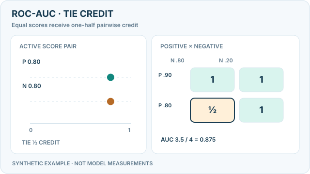
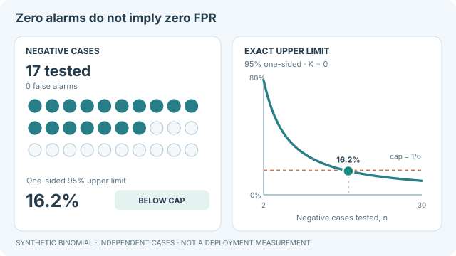
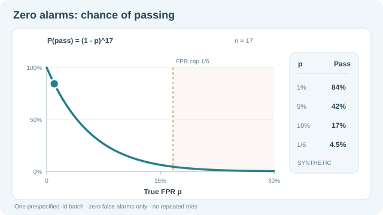
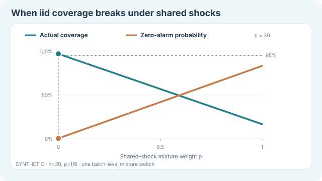

---
related:
  - engineering/evaluation
tags:
  - evaluation
  - metrics
  - classification
---

# ROC-AUC

ROC-AUC is the area under the receiver operating characteristic curve. The curve plots the true positive rate against the false positive rate as the decision threshold sweeps from high to low. The area summarises how well the scores separate positives from negatives, with no single threshold chosen.

## Definition

At each threshold $t$, the true positive rate is $TP/(TP+FN)$ and the false positive rate is $FP/(FP+TN)$. The ROC curve collects these points, and ROC-AUC is the area under it.

A useful ranking interpretation is: ROC-AUC equals the probability that a randomly chosen positive has a strictly higher score than a randomly chosen negative, **plus half the probability of a tie**. A perfect ranking gives 1.0; for independent, identically distributed random scores, the **expected** AUC is 0.5, not necessarily the AUC of a particular finite sample (Fawcett, 2006).

## Interpretation

ROC-AUC needs only the scores, not labels at a threshold, so it compares models without fixing an operating point. It depends on the ordering of scores, not their calibration: a model can have a high ROC-AUC while its probabilities are badly scaled. See [Calibration Error](../probabilistic/calibration-error.md).

## When to use it

Use ROC-AUC to compare ranking discrimination across thresholds when the deployment operating point is not yet fixed. ROC-AUC does **not** mathematically require similarly sized positive and negative classes, but a low false-positive rate can still correspond to many false alarms when prevalence is low. In that setting, inspect precision–recall performance and the deployment base rate as well as ROC-AUC.

## Worked example

Take four cases with scores. The two positives score 0.9 and 0.6, and the two negatives score 0.8 and 0.3. There are four positive-negative pairs. The positive scores higher in three of them (0.9 over 0.8, 0.9 over 0.3, 0.6 over 0.3) and lower in one (0.6 under 0.8). So ROC-AUC is $3 / 4 = 0.75$.

## Animated threshold sweep

*Original animated teaching visual (CC BY-SA 4.0).* This separate, invented ten-case example has positive cases at ranks **1, 3, 6** and seven negative cases; all prediction scores are distinct. Lowering the decision threshold accepts the scores in rank order. Each true positive moves the ROC operating point **up** by $1/3$ (TPR), while each false positive moves it **right** by $1/7$ (FPR). After six accepted cases, $TP=3$, $FP=3$, $TPR=1$ and $FPR=3/7$. Of the 21 positive–negative pairs in the full ranking, 17 have the correct score order, so **ROC-AUC = $17/21 \approx 0.810$**. The pale line shows the full curve and the coloured portion shows the thresholds already visited. All labels and scores are **synthetic, not measured model predictions**. MkDocs provides a keyboard-operable Play/Pause button and uses the still image when reduced motion is preferred; the [GitHub static preview](../../../../assets/concept-animations/roc-threshold-sweep-still.svg) and [complete SVG animation](../../../../assets/concept-animations/roc-threshold-sweep-motion.svg) are also available. On narrow screens, scroll horizontally. The ROC ranking interpretation is discussed in Fawcett (2006) in References.

## Animated ROC-AUC: every positive-negative comparison

*Original teaching animation (CC BY-SA 4.0).* This second visualization explains the **ranking interpretation** rather than repeating the threshold sweep. In a **synthetic** four-case example, positive scores are 0.90 and 0.60; negative scores are 0.80 and 0.30. The four positive-negative comparisons yield **three wins and one loss**, so `AUC = 3 / 4 = 0.75`. In general, `AUC = (wins + 0.5 × ties) / (n_positive × n_negative)`; a tie contributes one half. Comparisons are revealed one at a time, and the final grid is visible in the static fallback. The running count is **not a valid final AUC until all four pairs are considered**. All values are invented, not predictions from a fitted model. MkDocs provides a keyboard-operable Play/Pause control, while reduced-motion users get the still. [GitHub static preview](../../../../assets/concept-animations/roc-pairwise-auc-still.svg) · [Full SVG animation](../../../../assets/concept-animations/roc-pairwise-auc-motion.svg). On a phone, scroll the figure horizontally.

## Animated partial ROC area at low false-positive rates

*Original animated teaching visual (CC BY-SA 4.0).* Six distinct-score, **synthetic** examples ranked `+ − + − − −` contain two positives and four negatives. The first positive reaches TPR $1/2$ at FPR $0$; the first negative moves to FPR $1/4$; the second positive reaches TPR $1$. Seven of eight positive–negative pair comparisons are correctly ranked, giving **full AUC $7/8=0.875$**. Restricting the integral to **FPR $\le 0.25$** produces the **raw partial ROC area $0.25\times 0.5=0.125$**. The animated cutoff reveals additional area as the FPR range expands to $1$. This is the **unnormalised** area, *not* the **standardized partial AUC** that scikit-learn's `roc_auc_score(max_fpr=...)` may return. All numbers are schematic, not classifier measurements. MkDocs offers keyboard-operated Play/Pause and a reduced-motion still. [GitHub static preview](../../../../assets/concept-animations/roc-partial-area-still.svg) · [Full SVG animation](../../../../assets/concept-animations/roc-partial-area-motion.svg). Scroll horizontally on mobile.

## Animated score transformation: ROC-AUC does not depend on score scale

*Original teaching animation (CC BY-SA 4.0).* The illustrative scores are positive **0.90, 0.60** and negative **0.80, 0.30**. As the circles move, the applied map changes continuously between $\sqrt{s}$ and $s^3$ according to $g_t(s)=(1-t)\sqrt{s}+t s^3$, with $0\leq t\leq1$. Each map is **strictly increasing** on $[0,1]$; therefore all four positive–negative comparisons retain their outcomes and **ROC-AUC remains $3/4=0.75$** despite potentially large changes in score magnitude. The open circles in the fallback indicate the square-root positions and the filled circles the cubed positions. This invariance does **not** imply calibrated probabilities, or preserve the set of predictions at a fixed numerical threshold. All scores are **synthetic, not model measurements**. MkDocs offers keyboard-accessible Play/Pause; a still is used when reduced motion is preferred. [GitHub static preview](../../../../assets/concept-animations/roc-rank-transform-still.svg) · [Full SVG animation](../../../../assets/concept-animations/roc-rank-transform-motion.svg). On mobile, scroll horizontally. See Fawcett (2006) in References for the ranking interpretation.

## Properties and variants

- **Probabilistic meaning.** ROC-AUC equals the probability that a random positive receives a higher score than a random negative, with ties counted as one half. This is the Mann-Whitney U statistic divided by the number of positive-negative pairs.
- **Invariances and assumptions.** Strictly increasing score transformations preserve ROC-AUC. Under a *pure prior-probability shift* with unchanged class-conditional score distributions, the **population** ROC curve and AUC remain unchanged even when prevalence changes, because TPR and FPR are conditional rates. Class-conditional distribution shift can change both, and empirical AUC estimates still vary with finite samples.
- **Partial AUC.** The area over a restricted range of FPR, such as 0 to 0.1, focuses on the low false-alarm regime.
- **Limit.** ROC-AUC can be high while precision is poor when positives are rare, and it does not measure calibration.

## Pitfalls

- **Rare positives.** When negatives vastly outnumber positives, the false positive rate stays small even for many false alarms, so ROC-AUC can look better than the model is for the positive class. Saito and Rehmsmeier (2015) show that the precision-recall view is more informative in this case. Use [PR-AUC](pr-auc.md) for rare events.
- **Multiclass use.** In scikit-learn, multiclass ROC-AUC requires the `multi_class` argument set to `'ovr'` or `'ovo'`; the default raises an error.

## Related metrics

[PR-AUC](pr-auc.md) is the precision-recall counterpart. The family overview is [Classification Metrics](index.md).

## Animated explanation: Tied scores count as half a pair

*Original instructional animation, CC BY-SA 4.0; GitHub uses the static SVG fallback.* [GitHub static preview](../../../../assets/concept-animations/roc-tie-half-credit-still.svg) · [Full SVG animation](../../../../assets/concept-animations/roc-tie-half-credit-motion.svg).

ROC-AUC counts an equal-score positive–negative pair as **half a correct ranking pair**. With artificial positive scores (0.90, 0.80) and negative scores (0.80, 0.20), the four credits are 1, 1, 1/2, 1, so $\mathrm{AUC}=(1+1+0.5+1)/4=0.875$. Watch each pair in turn before the final matrix is complete. The reduced-motion still presents the completed comparison. These are schematic scores, **not model measurements**. On MkDocs use Play/Pause and focus the frame for keyboard horizontal scrolling.

## Animated randomized ROC operating-rule mixtures

*Original teaching animation (CC BY-SA 4.0).* Consider two **hypothetical fixed decision rules** evaluated against the same underlying population: rule A has `(FPR, TPR)=(0.10, 0.60)` and rule B has `(0.40, 0.90)`. Independently for each new instance, choose B with probability `λ` or A otherwise. Conditional on either true label, the **expected** false-positive and true-positive rates are:

$$
\begin{gathered}
\mathrm{FPR}_{mix}=0.10+0.30\lambda,\\
\mathrm{TPR}_{mix}=0.60+0.30\lambda.
\end{gathered}
$$

The marker traces the straight line segment between A and B as `λ` changes continuously. For `λ=0.5`, the expected operating point is **(FPR 0.25, TPR 0.75)**. This represents randomized decisions between *two fixed rules*, **not** an interpolated model score, retraining, probability calibration, or a guarantee of exact finite-sample rates. It illustrates randomized points along an ROC operating envelope, as discussed by Fawcett (2006) in References. **These rates are constructed examples, not measurements.** MkDocs provides keyboard-operated Play/Pause and a reduced-motion still. [GitHub static preview](../../../../assets/concept-animations/roc-randomized-operating-mix-still.svg) · [Full SVG animation](../../../../assets/concept-animations/roc-randomized-operating-mix-motion.svg). Scroll horizontally on narrow screens.

## Animated cost-sensitive ROC operating-point selection

*Original instructional animation (CC BY-SA 4.0); all operating rates and cost inputs are **constructed, not measured or validated deployment statistics**.* Suppose four distinct ranked scores have labels `+ − + −`, with two positives and two negatives. Accepting the top $k=0,1,2,3,4$ items yields conditional $(FPR,TPR)$ points $(0,0)$, $(0,1/2)$, $(1/2,1/2)$, $(1/2,1)$, $(1,1)$. For a **hypothetical deployment population**, separately assume prevalence $p=0.25$, false-negative cost $C_{FN}=2$, and false-positive cost $C_{FP}=1$. Expected error cost per case is

$$
\begin{aligned}
L(k)&=C_{FN}p[1-TPR(k)]\\
&\quad+C_{FP}(1-p)FPR(k).
\end{aligned}
$$

The five costs are respectively **0.500, 0.250, 0.625, 0.375, 0.750**. The moving outline and ROC marker jointly identify each threshold; the lowest illustrative expected cost occurs at **$k=1$**. Importantly, the balanced four-item ranking determines these illustrative **conditional** operating rates; the $25\%$ prevalence is a **separate assumption**, not inferred from those four cases. Actual deployment decisions additionally need calibrated cost estimates and representative rate estimates. **ROC-AUC does not select an optimal decision threshold by itself.** MkDocs offers keyboard-accessible Play/Pause and a reduced-motion still. [GitHub static preview](../../../../assets/concept-animations/roc-cost-operating-point-still.svg) · [Full SVG animation](../../../../assets/concept-animations/roc-cost-operating-point-motion.svg). On mobile, scroll horizontally. See Fawcett (2006) in References for ROC operating-point interpretation.

The mixture sweeps its probability forward and backward, not training time. Cost thresholds instead advance in discrete steps and reset; the ROC connector is a reference guide, not a sequence of fractional observations.

## Animated ROC versus precision under prevalence shift

*Original instructional SVG (CC BY-SA 4.0).* This is a **synthetic population-rate thought experiment**, not model training or measured deployment performance. Sensitivity $TPR=0.80$ and false-positive rate $FPR=0.10$ stay fixed while prevalence $p$ changes from $0.05$ to $0.60$. The ROC operating point therefore **does not move**, but the positive-alert precision follows Bayes' rule:

$$
PPV(p)=\frac{0.80p}{0.80p+0.10(1-p)}.
$$

At the two endpoints, precision rises from **0.296** to **0.923**. A fixed ROC point is therefore insufficient to predict alert precision without a prevalence assumption. **This animation assumes a pure prevalence (prior-probability) shift:** the class-conditional score distributions, and therefore TPR/FPR at the fixed decision rule, stay unchanged. A change in score distributions *within* either class can move the ROC point too; prevalence change alone is not a guarantee that an arbitrary deployed model has fixed TPR/FPR. This complements the [precision base-rate animation](precision.md), which examines alert composition rather than placing both metrics side by side. In MkDocs, the animation has keyboard-operable Play/Pause; reduced-motion users receive a still image. On narrow screens, focus the figure and scroll horizontally. [GitHub static preview](../../../../assets/concept-animations/roc-pr-shift-still.svg) · [Full SVG motion](../../../../assets/concept-animations/roc-pr-shift-motion.svg).

## Animated Youden J versus deployment error cost

*Original instructional SVG (CC BY-SA 4.0).* Consider **six strictly ranked artificial labels** `+ − + + − −` (three positive, three negative). Accepting the top four scores gives $TPR=1$, $FPR=1/3$, and the maximum Youden statistic $J=TPR-FPR=2/3$. This maximises **balanced sensitivity minus false-positive rate**, not necessarily expected deployment utility. Separately hypothesise a deployment population with prevalence $p=0.10$, false-positive cost $C_{FP}=1$, and false-negative cost $C_{FN}$ moving from $1$ to $5$:

$$
\begin{aligned}
L(k) &= C_{FN}p[1-TPR(k)]\\
&\quad+C_{FP}(1-p)FPR(k).
\end{aligned}
$$

For the top-one cutoff, $L(1)=C_{FN}/15$. For the top-four cutoff, $L(4)=0.30$. Among **all seven candidate cutoffs** $k=0,\ldots,6$, the minimum-cost choice is **$k=1$** when $C_{FN}=1$ (cost $0.0667$), but **$k=4$** when $C_{FN}=5$ (cost $0.300$); these two alternatives tie at $C_{FN}=4.5$. Over the **illustrated cost range** $1\le C_{FN}\le5$, the optimum is $k=1$ below 4.5, either $k=1$ or $k=4$ at 4.5, and $k=4$ above 4.5. The other five candidate cutoffs never improve on the better of these two choices in this range; the chart therefore shows only the two potentially optimal loss lines. The connection with **Youden J** is exact under a specific cost balance: if $C_{FN}p=C_{FP}(1-p)=w$, then

$$
L(k)=w[1-J(k)].
$$

Thus maximizing $J$ minimizes expected loss **when the conditional rates apply to the deployment population and these effective error weights match**. With the illustrated $p=0.10$ and $C_{FP}=1$, equality would require $C_{FN}=9$, **outside** the animation's cost sweep $1$–$5$. The $k=4$ optimum at $C_{FN}=5$ happens to agree with maximum $J$; that coincidence does not make the objectives generally equivalent. The ROC staircase comes from the six-case example; deployment prevalence and costs are **separate hypothetical assumptions**. The moving markers sweep assumptions, **not epochs or actual inference samples**. MkDocs offers keyboard-accessible Play/Pause and a reduced-motion still; scroll horizontally on phones. [GitHub static preview](../../../../assets/concept-animations/roc-youden-cost-still.svg) · [Full SVG motion](../../../../assets/concept-animations/roc-youden-cost-motion.svg). For decision-theoretic context see Fawcett (2006) in References.

## Animated cutoff switching under a prior shift

*Original animated teaching visual (CC BY-SA 4.0).* Unlike the preceding PPV animation, which **holds the decision rule fixed**, this example **re-optimises** the rule as the deployment base rate changes. It uses the separate, artificial six-case ordering **+ − + + − −**, retaining the same class-conditional score distributions and ROC staircase under a **pure prior-probability shift**. Assume false-negative cost $C_{FN}=2$ and false-positive cost $C_{FP}=1$. The two undominated cutoffs have expected losses:

$$
L(1;p)=\frac{4p}{3}.
$$

$$
L(4;p)=\frac{1-p}{3}.
$$

The lines intersect at $p=0.20$. For this particular pair of ROC operating points, the more general crossover is

$$
p^*=\frac{C_{FP}}{2C_{FN}+C_{FP}}.
$$

The switch can also be read **directly from the slope between the two ROC points**, rather than by treating the 20% crossover as a memorised constant. Compare the more permissive cutoff $k=4$ against $k=1$. Its gain in sensitivity is $\Delta TPR=2/3$, accompanied by $\Delta FPR=1/3$. For a deployment prevalence $p$ and strictly positive error costs, the expected-loss difference is

$$
\begin{aligned}
L(4;p)-L(1;p)
&=-C_{FN}p\,\Delta TPR\\
&\quad+C_{FP}(1-p)\,\Delta FPR.
\end{aligned}
$$

Thus $k=4$ wins exactly when $C_{FN}p\,\Delta TPR>C_{FP}(1-p)\,\Delta FPR$, or here **$2C_{FN}p>C_{FP}(1-p)$**; equality gives a tie. The relevant trade-off is the ROC **secant slope** $\Delta TPR/\Delta FPR=2$, not AUC alone. With $C_{FN}=2$ and $C_{FP}=1$ this recovers $p>0.20$. This is a comparison of the two synthetic candidate policies under the assumed error costs, not a universal calibrated-probability threshold or an experimentally measured deployment rule.

For **$p=0.10$**, top one costs **0.133** versus **0.300** for top four; for **$p=0.40$**, top four costs **0.200** versus **0.533** for top one. Both tie at **$p=0.20$**. All five other cutoffs are dominated by the better of these two across $0<p<1$. The selected ROC point switches, but **the underlying ROC curve does not**. The moving cursors trace a parameter sweep, **not model training or measured predictions**; all rates and costs are synthetic assumptions. MkDocs supports keyboard-operated Play/Pause and a reduced-motion still. The still marks the 20% crossover and GitHub displays it directly. On phones, scroll horizontally. [GitHub static preview](../../../../assets/concept-animations/roc-prior-policy-still.svg) · [Full SVG motion](../../../../assets/concept-animations/roc-prior-policy-motion.svg). See Fawcett (2006) in References for the ROC decision-cost interpretation.

## Why randomizing between optimal cutoffs cannot beat both endpoints

The **prior-shift policy animation** selects the less permissive cutoff $k=1$ or the more permissive cutoff $k=4$. A third possibility is to choose $k=4$ independently for each future case with probability $\lambda$, and otherwise choose $k=1$, where $0\leq\lambda\leq1$. Crucially, the random choice must not depend on the case's unknown true label. For this synthetic ranking, the expected ROC rates become:

$$
\begin{aligned}
\mathrm{TPR}_{\lambda}&=\frac{1+2\lambda}{3},\\
\mathrm{FPR}_{\lambda}&=\frac{\lambda}{3}.
\end{aligned}
$$

Under the same *linear* false-negative and false-positive cost model, this randomized rule has expected loss

$$
L_{\lambda}(p)=(1-\lambda)\frac{4p}{3}+\lambda\frac{1-p}{3}.
$$

At prevalence $p=0.10$, an equal mixture ($\lambda=0.5$) has loss **0.217**, higher than the **0.133** from always using $k=1$. At $p=0.40$, the same mixture costs **0.367**, higher than the **0.200** from always using $k=4$. At $p=0.20$, every mixture ties at $4/15\approx0.267$. Hence intermediate ROC points are possible, but **randomization cannot strictly improve on both endpoints when minimizing this unconstrained linear expected loss**. Additional constraints, such as a maximum allowed false-alarm rate, can make an intermediate feasible policy relevant.

### When an FPR budget makes a mixture useful

Suppose the same **synthetic six-case ROC** must satisfy a population **FPR cap of 1/6**, with deployment prevalence **p = 0.40** and the same costs **C_FN = 2, C_FP = 1**. The unconstrained minimum-cost cutoff **k = 4** has FPR 1/3 and violates the cap; **k = 1** is feasible with FPR 0 but TPR only 1/3. Mixing these two cutoffs independently of the unknown label gives:

$$
\mathrm{FPR}_{\lambda}=\frac{\lambda}{3}\leq\frac16
\quad\Longrightarrow\quad\lambda\leq\frac12,
\qquad\mathrm{TPR}_{1/2}=\frac23.
$$

Within **this two-rule mixture family**, taking **λ = 1/2** maximizes TPR under the cap and minimizes its linear expected loss at **11/30 ≈ 0.367**, versus **8/15 ≈ 0.533** for feasible deterministic cutoff **k = 1**. Always choosing **k = 4** would cost **1/5 = 0.200**, but is **infeasible** under the budget. The FPR constraint concerns a *population conditional error rate*, not a guarantee on the number of false alarms in a finite sample. This is an illustrative constrained-policy calculation, not a performance measurement or a guarantee against all possible decision rules.

**Finite-sample distinction.** The animation's FPR cap constrains the assumed *population conditional rate*, not every evaluation batch. Suppose three independent future negatives each have false-positive probability $1/6$ under the randomized decision rule. One or more false positives would give empirical FPR at least $1/3$, violating the nominal $1/6$ cap. The exact probability is

$$
P(\widehat{\mathrm{FPR}}>1/6\mid n_{-}=3)=1-(5/6)^3=91/216\approx0.421.
$$

Thus even if expected FPR equals the budget, a three-negative batch exceeds that budget with about **42.1% probability** under these illustrative independence assumptions. This is neither a statistical confidence bound nor evidence that a deployed model satisfies the assumed FPR.

### Animated finite-batch FPR: four possible false-alarm counts

*Original instructional animation (CC BY-SA 4.0); entirely synthetic assumptions, not fitted-model estimates.* Let $K$ be the number of false alarms among **three independent true negatives**, each with an assumed false-positive probability $1/6$. Then

$$
P(K=k)=\binom{3}{k}\left(\frac16\right)^k\left(\frac56\right)^{3-k},\qquad k=0,1,2,3.
$$

The four exact probabilities are **125/216**, **75/216**, **15/216** and **1/216**, giving observed FPR values **0**, **1/3**, **2/3** and **1**, respectively. The animated outline moves through the **four possible counts**, while three negative-case markers show one possible arrangement for each count. **Every count gets equal screen time for explanation, not in proportion to its probability**; the fixed histogram encodes those unequal probabilities. Outcomes with $K\geq1$ exceed the population cap $1/6$, with combined probability **91/216 ≈ 42.1%**. These four states are alternative samples, **not consecutive training steps or a single batch accumulating false alarms**. MkDocs provides keyboard-operated Play/Pause; reduced-motion users see the complete histogram and one over-budget example. On narrow screens, focus the graphic and scroll horizontally. [GitHub static preview](../../../../assets/concept-animations/roc-fpr-batch-still.svg) · [Full SVG animation](../../../../assets/concept-animations/roc-fpr-batch-motion.svg).

### Zero observed alarms and the exact upper FPR limit

*Original instructional animation (CC BY-SA 4.0); all cases synthetic, not measured.* The preceding illustration asks what a **finite batch may show given a population rate**. Here we reverse the inference: observing **zero false alarms** does not establish a zero *population* FPR. For $n$ independent, identically distributed true negatives with an unknown conditional false-alarm probability $p$ and observed $K=0$, the **one-sided 95% exact Clopper–Pearson upper confidence limit** inverts $P_p(K=0)=(1-p)^n$:

$$
U_{0.95}(n)=1-0.05^{1/n},\qquad n>0,\ K=0.
$$

For hypothetical zero-alarm batches of **3, 12, 17 and 30** negatives, empirical FPR is always **0**, but the respective upper limits are **63.2%, 22.1%, 16.2% and 9.5%** (rounded). Against the illustrative $1/6$ FPR budget, 16 negative cases without an alarm are **not enough** ($U_{0.95}(16)\approx17.1\%$); **17** cases without an alarm put the upper confidence limit **below** the budget. The required integer threshold, *conditional on all tested negatives yielding no false alarms*, is:

$$
n_{\min}=\left\lceil\frac{\log(0.05)}{\log(5/6)}\right\rceil=17.
$$

This has a **frequentist repeated-sampling coverage** interpretation, not a 95% posterior probability that an individual system is safe, and not a guarantee for each subsequent batch. Independent representative negatives and a prespecified sample size and stopping rule matter; data-dependent stopping requires sequential inference. The moving display contrasts hypothetical sample sizes, **not training iterations**. MkDocs offers keyboard Play/Pause and reduced-motion fallback; narrow screens scroll horizontally. [GitHub static preview](../../../../assets/concept-animations/roc-fpr-zero-alarms-still.svg) · [Full SVG animation](../../../../assets/concept-animations/roc-fpr-zero-alarms-motion.svg). See Clopper and Pearson (1934) in References.

### Zero-alarm certification power and repeated attempts

*Original instructional SVG (CC BY-SA 4.0); analytical hypothetical rates, never model measurements.* The preceding exact bound is an **inference after observing zero alarms**. The reverse design question is how likely a precommitted test is to produce that evidence at a true population FPR $p$. With **exactly 17 independent, representative negative cases**, an unadjusted one-sided 95% Clopper–Pearson upper bound is strictly below the illustrative $1/6$ cap **only when $K=0$**: at $K=0$ the bound is $1-0.05^{1/17}\approx0.162$, whereas at $K=1$ it exceeds $1/6$. Thus, for a single prespecified batch,

$$
P_p(\mathrm{pass})=P_p(K=0)=(1-p)^{17}.
$$

For invented $p=0.01, 0.05, 0.10, 1/6$, the pass probabilities are about **84.3%, 41.8%, 16.7%, 4.5%**, respectively. A low passing probability does **not** mean the confidence procedure is wrong: the zero-alarm requirement is conservative and can have poor *power* even for a system whose real FPR is below the cap. Against the composite null $p\geq1/6$, a **single precommitted** pass has probability at most $(5/6)^{17}\approx4.51\%$.

**Repeated attempts change the claim.** If $m$ *independent* fresh batches of 17 negatives are tried and only the first passing batch is reported, then

$$
P_p(\text{at least one pass})=1-\left[1-(1-p)^{17}\right]^m.
$$

At the boundary $p=1/6$, **ten** independent tries raise the chance of at least one apparent pass to about **36.95%**, not 4.51%. This is **not** a valid single-test 95% certification procedure; reporting the successful batch without accounting for the repeated testing invalidates the stated error control. Reusing data, retuning thresholds, or adaptively deciding when to stop demands a different analysis; the independent-batch formula does not describe those cases. The motion sweeps **possible true FPRs**, not observed model updates. MkDocs supports keyboard Play/Pause, reduced-motion stills, and horizontal scrolling; [GitHub static preview](../../../../assets/concept-animations/roc-fpr-certificate-power-still.svg) · [full SVG animation](../../../../assets/concept-animations/roc-fpr-certificate-power-motion.svg). The one-sided bound uses Clopper–Pearson (1934), already cited below.

## When false alarms are dependent

*Original animated visual and GitHub static comparison (CC BY-SA 4.0).* The earlier binomial batch and Clopper–Pearson examples **assume independent negative observations**. To see why this matters, contrast two **hypothetical joint models for three truly negative cases**. Each case has the same *marginal* false-alarm probability $p=1/6$:

- **Independent alarms:** $K\sim\mathrm{Binomial}(3,1/6)$, giving $P(K\geq1)=91/216\approx42.1\%$.
- **One perfectly shared shock:** draw $Z\sim\mathrm{Bernoulli}(1/6)$ once, then set every case's alarm indicator equal to $Z$. Consequently $K=3Z$ and $P(K\geq1)=1/6\approx16.7\%$.

Both have $E[K/3]=1/6$, yet the **batch distributions differ**. In this particular construction the probability of *any* alarm decreases under complete positive dependence, while the empirical-rate variance **increases** from $5/108$ to $5/36$; dependence does not have one universally beneficial direction. Treating the shared-shock batch as three independent Bernoulli trials would invalidate the binomial likelihood and the preceding exact confidence-bound calculation. All values are synthetic, **not measured model or deployment results**. The bars animate between alternative data-generating assumptions, **not training steps or a temporal change in a deployed model**. MkDocs supplies keyboard-accessible Play/Pause; the still compares both distributions when animation is unavailable or reduced motion is preferred. On mobile, focus and scroll horizontally. [GitHub static preview](../../../../assets/concept-animations/roc-fpr-dependence-still.svg) · [Full SVG animation](../../../../assets/concept-animations/roc-fpr-dependence-motion.svg).

### Between independence and one shared shock: the intermediate frames

The changing bars above can be interpreted as a **specific batch-level mixture model**, rather than an arbitrary change in correlation. For each batch, first draw a mechanism switch $B\sim\mathrm{Bernoulli}(\rho)$ independently of the random sources used by either mechanism. If $B=0$, draw three independent Bernoulli alarms with probability $p=1/6$; if $B=1$, draw **one** Bernoulli shock and copy it to all three records. The batch chooses its mechanism **once**, not independently for each record. The resulting count distribution is a convex combination of the two histograms:

$$
P_{\rho}(K=k)=(1-\rho)P_{\mathrm{iid}}(K=k)+\rho P_{\mathrm{shared}}(K=k).
$$

Here $0\leq\rho\leq1$ is also the *pairwise correlation* of two distinct alarm indicators **for this constructed mixture only**. Their marginal FPR remains $1/6$. The intermediate frames illustrate valid hypothetical joint distributions, but they do not estimate correlation from data. For three negatives:

$$
\begin{aligned}
P_{\rho}(K\geq1)&=(1-\rho)\frac{91}{216}+\rho\frac16,\\
\operatorname{Var}_{\rho}(K/3)&=\frac{5}{108}(1+2\rho),\\
n_{\mathrm{eff,var}}&=\frac{3}{1+2\rho}.
\end{aligned}
$$

At $\rho=1/2$, the chance of any false alarm is $127/432\approx29.4\%$, the variance is $5/54$, and the **variance-equivalent** independent sample count is $1.5$, even though three records were collected. The general expression for $n$ exchangeable alarm indicators in this model is $n_{\mathrm{eff,var}}=n/[1+(n-1)\rho]$; for 30 records and $\rho=1/2$, it is $60/31\approx1.94$. This effective count matches **only the sample-mean variance**. It is not an integer trial count and **must not** be substituted into a Clopper–Pearson exact binomial interval. The next animation contrasts the *actual zero-alarm likelihoods* at the two endpoints.

### Animation: why thirty fully dependent negatives are not thirty independent trials

*Original synthetic instructional animation and static fallback (CC BY-SA 4.0); no model estimates.* The previous figure shows different count distributions at **fixed marginal FPR**. Here the inference is reversed: after observing **zero alarms**, how much evidence do 30 negative cases supply? Under the explicit model $X_1,\ldots,X_{30}\overset{\mathrm{iid}}{\sim}\mathrm{Bernoulli}(p)$, the zero-alarm likelihood is $(1-p)^{30}$, yielding the familiar one-sided 95% Clopper–Pearson limit. Under the alternative **perfect-shock construction** $X_1=\cdots=X_{30}=Z$, $Z\sim\mathrm{Bernoulli}(p)$, there is only *one independent shock*, despite 30 recorded cases:

$$
\begin{aligned}
P_p(K=0\mid \mathrm{iid})&=(1-p)^{30},&
U_{\mathrm{iid}}&=1-0.05^{1/30}\approx0.095;\\
P_p(K=0\mid \mathrm{shared})&=1-p,&
U_{\mathrm{shared}}&=1-0.05=0.95.
\end{aligned}
$$

Both bounds concern the same **hypothetical zero-alarm observation**, but they are valid only for their respective sampling assumptions. The horizontal $1/6$ budget is an illustrative requirement, **not** an empirical operating guarantee. Under the shared-shock model with true $p=1/6$, blindly applying the *iid* 30-sample bound would **fail to cover** $p$ in the no-alarm outcome, which occurs with probability $5/6$; its actual coverage is only **$1/6$ (16.7%)**, not the advertised 95%. For the all-alarm outcome, the binomial upper bound is 1 and covers $p$. This exact result holds for this deliberately extreme perfect-dependence construction, **not for arbitrary correlated negatives**; general dependence requires a justified sampling model, independent groups or another valid inferential method. The animation sweeps the number of *recorded* zero-alarm negatives, not training time. MkDocs provides keyboard-operated Play/Pause, reduced-motion users get the two complete curves, and narrow screens can scroll the figure horizontally. [GitHub static preview](../../../../assets/concept-animations/roc-fpr-shared-bound-still.svg) · [Full SVG animation](../../../../assets/concept-animations/roc-fpr-shared-bound-motion.svg). The exact binomial inversion is the Clopper–Pearson (1934) method cited in References; the shared-shock contrast is an original worked calculation.

### Coverage erosion between independent and shared-shock batches

*Original analytic animation (CC BY-SA 4.0).* The teal and orange markers sweep continuously from $\rho=0$ (independent alarms) to $\rho=1$ (a single shared shock) and back. The dotted line is the **nominal** 95% target, not the actual guarantee under dependence. The static GitHub view shows $\rho=0.5$. The values are calculated from a **synthetic** probability model, not classifier measurements. Use MkDocs Play/Pause or keyboard controls to stop the sweep; reduced-motion settings display the static midpoint, and mobile readers may scroll the 640px figure. [GitHub-safe static fallback](../../../../assets/concept-animations/roc-fpr-mix-coverage-still.svg) · [Full SVG animation](../../../../assets/concept-animations/roc-fpr-mix-coverage-motion.svg).

The dependence animation above compares the two endpoints. Its batch-level mechanism mixture also gives a **continuous, mathematically defined bridge**: choose the iid process with probability $1-\rho$, or the fully shared shock with probability $\rho$, once for all 30 records. With synthetic true $p=1/6$, the probability of recording zero alarms rises sharply with dependence, even though each record retains the same marginal FPR. More importantly, the *actual repeated-sampling coverage* of an incorrectly applied iid one-sided 95% Clopper–Pearson upper limit is

$$
\begin{aligned}
P_{\rho}(K=0)&=(1-\rho)(5/6)^{30}+\rho(5/6),\\
q_{\mathrm{iid}}&=P_{\mathrm{Bin}(30,1/6)}(K\leq1)
=(5/6)^{30}+30(1/6)(5/6)^{29},\\
\mathrm{Coverage}_{\rho}&=(1-\rho)(1-q_{\mathrm{iid}})+\rho/6.
\end{aligned}
$$

For this **specific** $n=30$, $p=1/6$ example, the naive iid upper bound misses the true parameter precisely when the observed alarm count is **0 or 1**; the one-sided 95% binomial inversion puts its upper limit below $1/6$ for those two counts. Coverage consequently drops from **97.05% at $\rho=0$**, to **56.86% at $\rho=0.5$**, to **16.67% at $\rho=1$**. The nominal 95% guarantee presumes the iid sampling law and does **not** survive this correlated-data mechanism mixture.

The model mixes whole-batch processes, not individual-record prediction probabilities. Its $\rho$ is a synthetic mechanism-mixture weight and pairwise correlation *for this construction*, not a universal dependence correction or an estimated parameter. The derived values are analytic examples, not measured false-alarm rates. The two endpoint curves in the preceding animation illustrate why the information content of 30 records depends on the joint sampling process; the coverage calculation exposes what fails when one uses the wrong likelihood.

*Original instructional animation (CC BY-SA 4.0); synthetic rates and costs, not model or deployment measurements.* The marker moves continuously from $\lambda=0$ to $1$ and back, showing that the **unconstrained** lower-cost endpoint (right of the vertical budget line) is **infeasible** under the FPR cap. The outlined midpoint at $\lambda=0.5$ is the minimum-cost **feasible** choice in the illustrated two-rule mixture family, with $\mathrm{FPR}=1/6$, $\mathrm{TPR}=2/3$, and $L=11/30$. Shaded regions distinguish feasible and over-budget choices. The animation advances *policy mixing probability*, not model training time. On MkDocs use keyboard-accessible Play/Pause; reduced-motion users see the static cap point. On phones focus and horizontally scroll the figure. [GitHub static preview](../../../../assets/concept-animations/roc-fpr-budget-mix-still.svg) · [Full SVG animation](../../../../assets/concept-animations/roc-fpr-budget-mix-motion.svg).

The earlier [randomized ROC-rule static preview](../../../../assets/concept-animations/roc-randomized-operating-mix-still.svg) and [full animation](../../../../assets/concept-animations/roc-randomized-operating-mix-motion.svg) show the same interpolation mechanism with **different hypothetical operating rates**. Do not combine that visual's numbers with this six-case policy example. All rates and costs here are constructed assumptions, not deployment measurements; see Fawcett (2006) in References.

## References

### Seminal papers

- Clopper, C. J. & Pearson, E. S. (1934). The use of confidence or fiducial limits illustrated in the case of the binomial. *Biometrika* 26(4), 404–413. https://doi.org/10.1093/biomet/26.4.404 — Introduces the exact binomial confidence limits used in the zero-false-alarm example.

- Fawcett, T. (2006). An introduction to ROC analysis. *Pattern Recognition Letters* 27(8), 861–874. https://doi.org/10.1016/j.patrec.2005.10.010 — Explains how ROC curves and the AUC are built, read and commonly misused.
- Saito, T. & Rehmsmeier, M. (2015). The precision-recall plot is more informative than the ROC plot when evaluating binary classifiers on imbalanced datasets. *PLoS ONE* 10(3). https://doi.org/10.1371/journal.pone.0118432 — Compares ROC and precision-recall curves on imbalanced data.

### Articles and documentation

- scikit-learn contributors. *roc_auc_score*. https://scikit-learn.org/stable/modules/generated/sklearn.metrics.roc_auc_score.html — API reference for computing ROC AUC from prediction scores, with binary and multiclass usage.

### Additional sources

- scikit-learn contributors. *Metrics and scoring: quantifying the quality of predictions*. https://scikit-learn.org/stable/modules/model_evaluation.html — Overview of the scorers for classification, regression and ranking, and when each is appropriate.
- Murphy, K. P. *Probabilistic Machine Learning: An Introduction*. MIT Press, 2022. https://probml.github.io/pml-book/book1.html — Textbook with a free online draft on probabilistic machine learning.
- *The Elements of Statistical Learning: Data Mining, Inference, and Prediction*, 2nd edition. https://hastie.su.domains/ElemStatLearn/ — Standard textbook on statistical learning and its evaluation.
