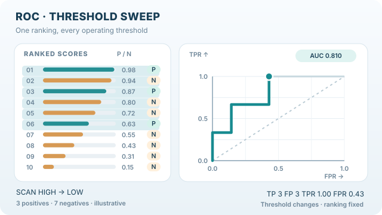
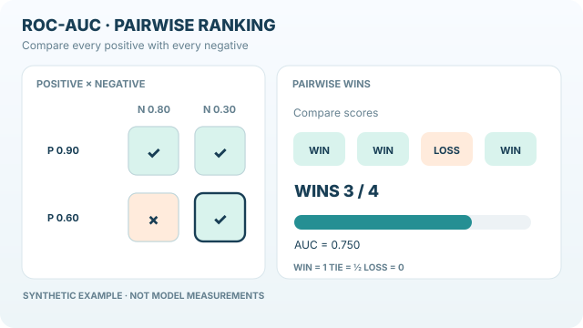
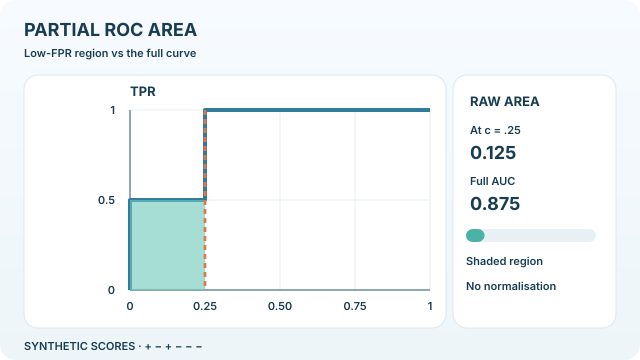
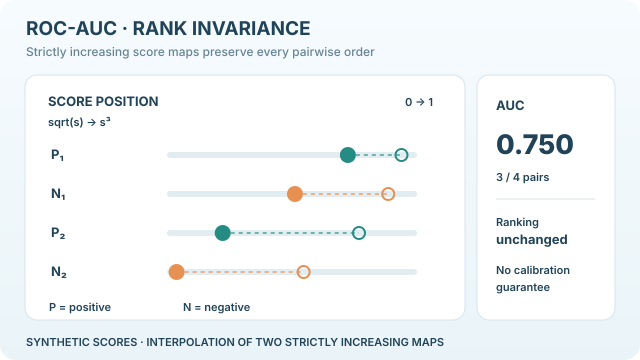
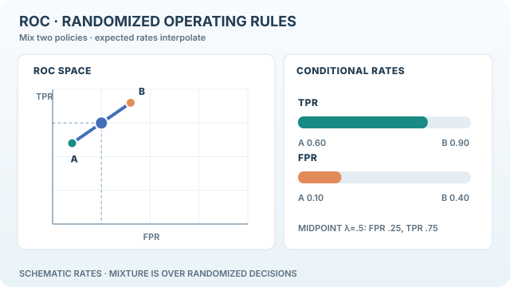
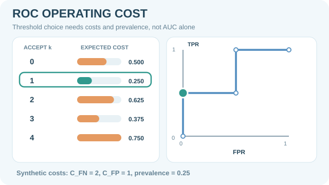
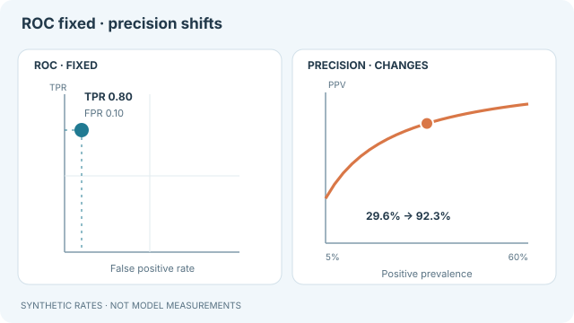
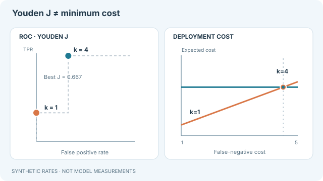
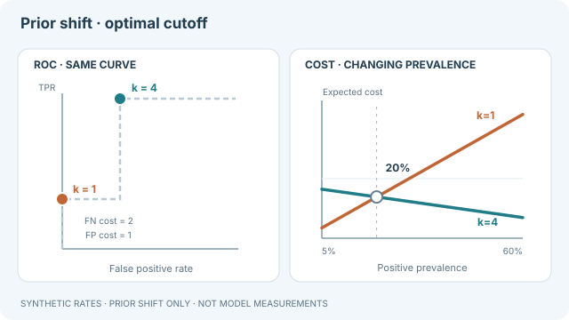

---
related:
  - engineering/evaluation
tags:
  - evaluation
  - metrics
  - classification
---

# ROC-AUC

ROC-AUC is the area under the receiver operating characteristic curve. The curve plots the true positive rate against the false positive rate as the decision threshold sweeps from high to low. The area summarises how well the scores separate positives from negatives, with no single threshold chosen.

## Definition

At each threshold $t$, the true positive rate is $TP/(TP+FN)$ and the false positive rate is $FP/(FP+TN)$. The ROC curve collects these points, and ROC-AUC is the area under it.

A useful ranking interpretation is: ROC-AUC equals the probability that a randomly chosen positive has a strictly higher score than a randomly chosen negative, **plus half the probability of a tie**. A perfect ranking gives 1.0; for independent, identically distributed random scores, the **expected** AUC is 0.5, not necessarily the AUC of a particular finite sample (Fawcett, 2006).

## Interpretation

ROC-AUC needs only the scores, not labels at a threshold, so it compares models without fixing an operating point. It depends on the ordering of scores, not their calibration: a model can have a high ROC-AUC while its probabilities are badly scaled. See [Calibration Error](../probabilistic/calibration-error.md).

## When to use it

Use ROC-AUC to compare ranking discrimination across thresholds when the deployment operating point is not yet fixed. ROC-AUC does **not** mathematically require similarly sized positive and negative classes, but a low false-positive rate can still correspond to many false alarms when prevalence is low. In that setting, inspect precision–recall performance and the deployment base rate as well as ROC-AUC.

## Worked example

Take four cases with scores. The two positives score 0.9 and 0.6, and the two negatives score 0.8 and 0.3. There are four positive-negative pairs. The positive scores higher in three of them (0.9 over 0.8, 0.9 over 0.3, 0.6 over 0.3) and lower in one (0.6 under 0.8). So ROC-AUC is $3 / 4 = 0.75$.

## Animated threshold sweep

*Original animated teaching visual (CC BY-SA 4.0).* This separate, invented ten-case example has positive cases at ranks **1, 3, 6** and seven negative cases; all prediction scores are distinct. Lowering the decision threshold accepts the scores in rank order. Each true positive moves the ROC operating point **up** by $1/3$ (TPR), while each false positive moves it **right** by $1/7$ (FPR). After six accepted cases, $TP=3$, $FP=3$, $TPR=1$ and $FPR=3/7$. Of the 21 positive–negative pairs in the full ranking, 17 have the correct score order, so **ROC-AUC = $17/21 \approx 0.810$**. The pale line shows the full curve and the coloured portion shows the thresholds already visited. All labels and scores are **synthetic, not measured model predictions**. MkDocs provides a keyboard-operable Play/Pause button and uses the still image when reduced motion is preferred; the [GitHub static preview](../../../../assets/concept-animations/roc-threshold-sweep-still.svg) and [complete SVG animation](../../../../assets/concept-animations/roc-threshold-sweep-motion.svg) are also available. On narrow screens, scroll horizontally. The ROC ranking interpretation is discussed in Fawcett (2006) in References.

## Animated ROC-AUC: every positive-negative comparison

*Original teaching animation (CC BY-SA 4.0).* This second visualization explains the **ranking interpretation** rather than repeating the threshold sweep. In a **synthetic** four-case example, positive scores are 0.90 and 0.60; negative scores are 0.80 and 0.30. The four positive-negative comparisons yield **three wins and one loss**, so `AUC = 3 / 4 = 0.75`. In general, `AUC = (wins + 0.5 × ties) / (n_positive × n_negative)`; a tie contributes one half. Comparisons are revealed one at a time, and the final grid is visible in the static fallback. The running count is **not a valid final AUC until all four pairs are considered**. All values are invented, not predictions from a fitted model. MkDocs provides a keyboard-operable Play/Pause control, while reduced-motion users get the still. [GitHub static preview](../../../../assets/concept-animations/roc-pairwise-auc-still.svg) · [Full SVG animation](../../../../assets/concept-animations/roc-pairwise-auc-motion.svg). On a phone, scroll the figure horizontally.

## Animated partial ROC area at low false-positive rates

*Original animated teaching visual (CC BY-SA 4.0).* Six distinct-score, **synthetic** examples ranked `+ − + − − −` contain two positives and four negatives. The first positive reaches TPR $1/2$ at FPR $0$; the first negative moves to FPR $1/4$; the second positive reaches TPR $1$. Seven of eight positive–negative pair comparisons are correctly ranked, giving **full AUC $7/8=0.875$**. Restricting the integral to **FPR $\le 0.25$** produces the **raw partial ROC area $0.25\times 0.5=0.125$**. The animated cutoff reveals additional area as the FPR range expands to $1$. This is the **unnormalised** area, *not* the **standardized partial AUC** that scikit-learn's `roc_auc_score(max_fpr=...)` may return. All numbers are schematic, not classifier measurements. MkDocs offers keyboard-operated Play/Pause and a reduced-motion still. [GitHub static preview](../../../../assets/concept-animations/roc-partial-area-still.svg) · [Full SVG animation](../../../../assets/concept-animations/roc-partial-area-motion.svg). Scroll horizontally on mobile.

## Animated score transformation: ROC-AUC does not depend on score scale

*Original teaching animation (CC BY-SA 4.0).* The illustrative scores are positive **0.90, 0.60** and negative **0.80, 0.30**. As the circles move, the applied map changes continuously between $\sqrt{s}$ and $s^3$ according to $g_t(s)=(1-t)\sqrt{s}+t s^3$, with $0\leq t\leq1$. Each map is **strictly increasing** on $[0,1]$; therefore all four positive–negative comparisons retain their outcomes and **ROC-AUC remains $3/4=0.75$** despite potentially large changes in score magnitude. The open circles in the fallback indicate the square-root positions and the filled circles the cubed positions. This invariance does **not** imply calibrated probabilities, or preserve the set of predictions at a fixed numerical threshold. All scores are **synthetic, not model measurements**. MkDocs offers keyboard-accessible Play/Pause; a still is used when reduced motion is preferred. [GitHub static preview](../../../../assets/concept-animations/roc-rank-transform-still.svg) · [Full SVG animation](../../../../assets/concept-animations/roc-rank-transform-motion.svg). On mobile, scroll horizontally. See Fawcett (2006) in References for the ranking interpretation.

## Properties and variants

- **Probabilistic meaning.** ROC-AUC equals the probability that a random positive receives a higher score than a random negative, with ties counted as one half. This is the Mann-Whitney U statistic divided by the number of positive-negative pairs.
- **Invariances.** The value does not change under any strictly increasing transformation of the scores. It also does not depend on prevalence, because TPR and FPR are rates within each class.
- **Partial AUC.** The area over a restricted range of FPR, such as 0 to 0.1, focuses on the low false-alarm regime.
- **Limit.** ROC-AUC can be high while precision is poor when positives are rare, and it does not measure calibration.

## Pitfalls

- **Rare positives.** When negatives vastly outnumber positives, the false positive rate stays small even for many false alarms, so ROC-AUC can look better than the model is for the positive class. Saito and Rehmsmeier (2015) show that the precision-recall view is more informative in this case. Use [PR-AUC](pr-auc.md) for rare events.
- **Multiclass use.** In scikit-learn, multiclass ROC-AUC requires the `multi_class` argument set to `'ovr'` or `'ovo'`; the default raises an error.

## Related metrics

[PR-AUC](pr-auc.md) is the precision-recall counterpart. The family overview is [Classification Metrics](index.md).

## Animated explanation: Tied scores count as half a pair

*Original instructional animation, CC BY-SA 4.0; GitHub uses the static SVG fallback.* [GitHub static preview](../../../../assets/concept-animations/roc-tie-half-credit-still.svg) · [Full SVG animation](../../../../assets/concept-animations/roc-tie-half-credit-motion.svg).

ROC-AUC counts an equal-score positive–negative pair as **half a correct ranking pair**. With artificial positive scores (0.90, 0.80) and negative scores (0.80, 0.20), the four credits are 1, 1, 1/2, 1, so $\mathrm{AUC}=(1+1+0.5+1)/4=0.875$. Watch each pair in turn before the final matrix is complete. The reduced-motion still presents the completed comparison. These are schematic scores, **not model measurements**. On MkDocs use Play/Pause and focus the frame for keyboard horizontal scrolling.

## Animated randomized ROC operating-rule mixtures

*Original teaching animation (CC BY-SA 4.0).* Consider two **hypothetical fixed decision rules** evaluated against the same underlying population: rule A has `(FPR, TPR)=(0.10, 0.60)` and rule B has `(0.40, 0.90)`. Independently for each new instance, choose B with probability `λ` or A otherwise. Conditional on either true label, the **expected** false-positive and true-positive rates are:

$$
\begin{gathered}
\mathrm{FPR}_{mix}=0.10+0.30\lambda,\\
\mathrm{TPR}_{mix}=0.60+0.30\lambda.
\end{gathered}
$$

The marker traces the straight line segment between A and B as `λ` changes continuously. For `λ=0.5`, the expected operating point is **(FPR 0.25, TPR 0.75)**. This represents randomized decisions between *two fixed rules*, **not** an interpolated model score, retraining, probability calibration, or a guarantee of exact finite-sample rates. It illustrates randomized points along an ROC operating envelope, as discussed by Fawcett (2006) in References. **These rates are constructed examples, not measurements.** MkDocs provides keyboard-operated Play/Pause and a reduced-motion still. [GitHub static preview](../../../../assets/concept-animations/roc-randomized-operating-mix-still.svg) · [Full SVG animation](../../../../assets/concept-animations/roc-randomized-operating-mix-motion.svg). Scroll horizontally on narrow screens.

## Animated cost-sensitive ROC operating-point selection

*Original instructional animation (CC BY-SA 4.0); all operating rates and cost inputs are **constructed, not measured or validated deployment statistics**.* Suppose four distinct ranked scores have labels `+ − + −`, with two positives and two negatives. Accepting the top $k=0,1,2,3,4$ items yields conditional $(FPR,TPR)$ points $(0,0)$, $(0,1/2)$, $(1/2,1/2)$, $(1/2,1)$, $(1,1)$. For a **hypothetical deployment population**, separately assume prevalence $p=0.25$, false-negative cost $C_{FN}=2$, and false-positive cost $C_{FP}=1$. Expected error cost per case is

$$
\begin{aligned}
L(k)&=C_{FN}p[1-TPR(k)]\\
&\quad+C_{FP}(1-p)FPR(k).
\end{aligned}
$$

The five costs are respectively **0.500, 0.250, 0.625, 0.375, 0.750**. The moving outline and ROC marker jointly identify each threshold; the lowest illustrative expected cost occurs at **$k=1$**. Importantly, the balanced four-item ranking determines these illustrative **conditional** operating rates; the $25\%$ prevalence is a **separate assumption**, not inferred from those four cases. Actual deployment decisions additionally need calibrated cost estimates and representative rate estimates. **ROC-AUC does not select an optimal decision threshold by itself.** MkDocs offers keyboard-accessible Play/Pause and a reduced-motion still. [GitHub static preview](../../../../assets/concept-animations/roc-cost-operating-point-still.svg) · [Full SVG animation](../../../../assets/concept-animations/roc-cost-operating-point-motion.svg). On mobile, scroll horizontally. See Fawcett (2006) in References for ROC operating-point interpretation.

The mixture sweeps its probability forward and backward, not training time. Cost thresholds instead advance in discrete steps and reset; the ROC connector is a reference guide, not a sequence of fractional observations.

## Animated ROC versus precision under prevalence shift

*Original instructional SVG (CC BY-SA 4.0).* This is a **synthetic population-rate thought experiment**, not model training or measured deployment performance. Sensitivity $TPR=0.80$ and false-positive rate $FPR=0.10$ stay fixed while prevalence $p$ changes from $0.05$ to $0.60$. The ROC operating point therefore **does not move**, but the positive-alert precision follows Bayes' rule:

$$
PPV(p)=\frac{0.80p}{0.80p+0.10(1-p)}.
$$

At the two endpoints, precision rises from **0.296** to **0.923**. A fixed ROC point is therefore insufficient to predict alert precision without a prevalence assumption. **This animation assumes a pure prevalence (prior-probability) shift:** the class-conditional score distributions, and therefore TPR/FPR at the fixed decision rule, stay unchanged. A change in score distributions *within* either class can move the ROC point too; prevalence change alone is not a guarantee that an arbitrary deployed model has fixed TPR/FPR. This complements the [precision base-rate animation](precision.md), which examines alert composition rather than placing both metrics side by side. In MkDocs, the animation has keyboard-operable Play/Pause; reduced-motion users receive a still image. On narrow screens, focus the figure and scroll horizontally. [GitHub static preview](../../../../assets/concept-animations/roc-pr-shift-still.svg) · [Full SVG motion](../../../../assets/concept-animations/roc-pr-shift-motion.svg).

## Animated Youden J versus deployment error cost

*Original instructional SVG (CC BY-SA 4.0).* Consider **six strictly ranked artificial labels** `+ − + + − −` (three positive, three negative). Accepting the top four scores gives $TPR=1$, $FPR=1/3$, and the maximum Youden statistic $J=TPR-FPR=2/3$. This maximises **balanced sensitivity minus false-positive rate**, not necessarily expected deployment utility. Separately hypothesise a deployment population with prevalence $p=0.10$, false-positive cost $C_{FP}=1$, and false-negative cost $C_{FN}$ moving from $1$ to $5$:

$$
\begin{aligned}
L(k) &= C_{FN}p[1-TPR(k)]\\
&\quad+C_{FP}(1-p)FPR(k).
\end{aligned}
$$

For the top-one cutoff, $L(1)=C_{FN}/15$. For the top-four cutoff, $L(4)=0.30$. Among **all seven candidate cutoffs** $k=0,\ldots,6$, the minimum-cost choice is **$k=1$** when $C_{FN}=1$ (cost $0.0667$), but **$k=4$** when $C_{FN}=5$ (cost $0.300$); these two alternatives tie at $C_{FN}=4.5$. Over the **illustrated cost range** $1\le C_{FN}\le5$, the optimum is $k=1$ below 4.5, either $k=1$ or $k=4$ at 4.5, and $k=4$ above 4.5. The other five candidate cutoffs never improve on the better of these two choices in this range; the chart therefore shows only the two potentially optimal loss lines. The connection with **Youden J** is exact under a specific cost balance: if $C_{FN}p=C_{FP}(1-p)=w$, then

$$
L(k)=w[1-J(k)].
$$

Thus maximizing $J$ minimizes expected loss **when the conditional rates apply to the deployment population and these effective error weights match**. With the illustrated $p=0.10$ and $C_{FP}=1$, equality would require $C_{FN}=9$, **outside** the animation's cost sweep $1$–$5$. The $k=4$ optimum at $C_{FN}=5$ happens to agree with maximum $J$; that coincidence does not make the objectives generally equivalent. The ROC staircase comes from the six-case example; deployment prevalence and costs are **separate hypothetical assumptions**. The moving markers sweep assumptions, **not epochs or actual inference samples**. MkDocs offers keyboard-accessible Play/Pause and a reduced-motion still; scroll horizontally on phones. [GitHub static preview](../../../../assets/concept-animations/roc-youden-cost-still.svg) · [Full SVG motion](../../../../assets/concept-animations/roc-youden-cost-motion.svg). For decision-theoretic context see Fawcett (2006) in References.

## Animated cutoff switching under a prior shift

*Original animated teaching visual (CC BY-SA 4.0).* Unlike the preceding PPV animation, which **holds the decision rule fixed**, this example **re-optimises** the rule as the deployment base rate changes. It uses the separate, artificial six-case ordering **+ − + + − −**, retaining the same class-conditional score distributions and ROC staircase under a **pure prior-probability shift**. Assume false-negative cost $C_{FN}=2$ and false-positive cost $C_{FP}=1$. The two undominated cutoffs have expected losses:

$$
L(1;p)=\frac{4p}{3}.
$$

$$
L(4;p)=\frac{1-p}{3}.
$$

The lines intersect at $p=0.20$. For this particular pair of ROC operating points, the more general crossover is

$$
p^*=\frac{C_{FP}}{2C_{FN}+C_{FP}}.
$$

For **$p=0.10$**, top one costs **0.133** versus **0.300** for top four; for **$p=0.40$**, top four costs **0.200** versus **0.533** for top one. Both tie at **$p=0.20$**. All five other cutoffs are dominated by the better of these two across $0<p<1$. The selected ROC point switches, but **the underlying ROC curve does not**. The moving cursors trace a parameter sweep, **not model training or measured predictions**; all rates and costs are synthetic assumptions. MkDocs supports keyboard-operated Play/Pause and a reduced-motion still. The still marks the 20% crossover and GitHub displays it directly. On phones, scroll horizontally. [GitHub static preview](../../../../assets/concept-animations/roc-prior-policy-still.svg) · [Full SVG motion](../../../../assets/concept-animations/roc-prior-policy-motion.svg). See Fawcett (2006) in References for the ROC decision-cost interpretation.

## References

### Seminal papers

- Fawcett, T. (2006). An introduction to ROC analysis. *Pattern Recognition Letters* 27(8), 861–874. https://doi.org/10.1016/j.patrec.2005.10.010 — Explains how ROC curves and the AUC are built, read and commonly misused.
- Saito, T. & Rehmsmeier, M. (2015). The precision-recall plot is more informative than the ROC plot when evaluating binary classifiers on imbalanced datasets. *PLoS ONE* 10(3). https://doi.org/10.1371/journal.pone.0118432 — Compares ROC and precision-recall curves on imbalanced data.

### Articles and documentation

- scikit-learn contributors. *roc_auc_score*. https://scikit-learn.org/stable/modules/generated/sklearn.metrics.roc_auc_score.html — API reference for computing ROC AUC from prediction scores, with binary and multiclass usage.

### Additional sources

- scikit-learn contributors. *Metrics and scoring: quantifying the quality of predictions*. https://scikit-learn.org/stable/modules/model_evaluation.html — Overview of the scorers for classification, regression and ranking, and when each is appropriate.
- Murphy, K. P. *Probabilistic Machine Learning: An Introduction*. MIT Press, 2022. https://probml.github.io/pml-book/book1.html — Textbook with a free online draft on probabilistic machine learning.
- *The Elements of Statistical Learning: Data Mining, Inference, and Prediction*, 2nd edition. https://hastie.su.domains/ElemStatLearn/ — Standard textbook on statistical learning and its evaluation.
