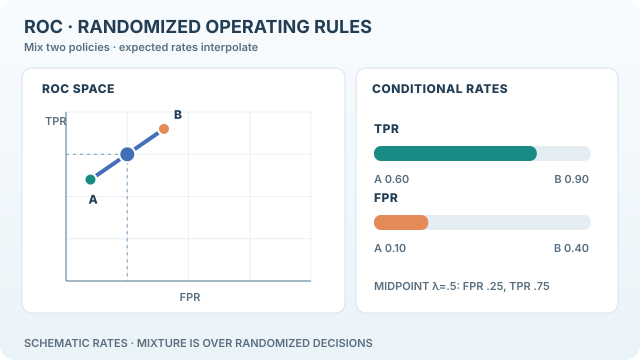
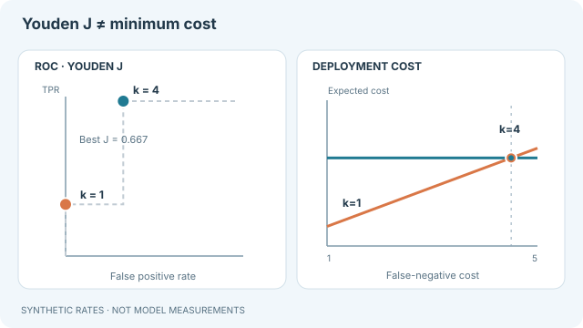
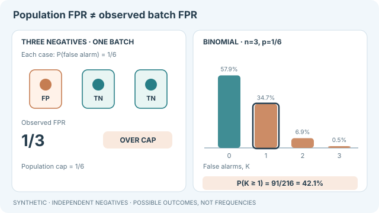
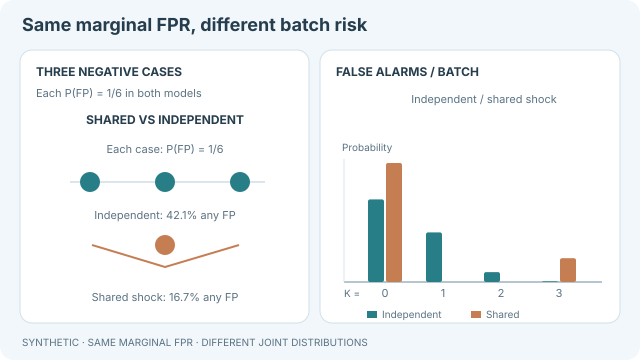
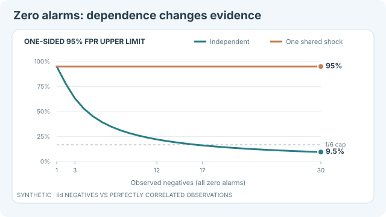
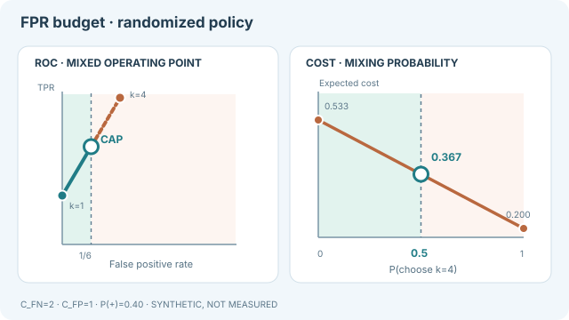

---
related:
  - engineering/evaluation
tags:
  - evaluation
  - metrics
  - classification
translation_reviewed: 2026-11-19
---

# ROC-AUC

ROC-AUC 是接收者操作特徵曲線（ROC 曲線）下的面積。曲線在決策門檻由高到低變動時，描繪真正例率對偽正例率的關係。曲線下面積概括了分數把正例與負例分開的能力，且不需要選定單一門檻。

## 定義

在每個門檻 $t$ 上，真正例率為 $TP/(TP+FN)$，偽正例率為 $FP/(FP+TN)$。ROC 曲線收集這些點，ROC-AUC 就是曲線下的面積。

以排序觀點解讀，ROC-AUC 等於隨機抽取正例的分數**嚴格高於**隨機抽取負例的機率，**再加上兩者同分機率的一半**。完美排序為 1.0；當正負例的分數來自相同且獨立的隨機分布時，AUC 的**期望值**是 0.5，但有限樣本的一次隨機排序不一定恰好得到 0.5（Fawcett, 2006）。

## 解讀

ROC-AUC 只需要分數，不需要依門檻得出的標籤，因此可以在不固定操作點的情況下比較模型。它取決於分數的排序，而不是分數的校準：模型的 ROC-AUC 可以很高，但機率的尺度可能嚴重失準。見[校準誤差](../probabilistic/calibration-error.md)。

## 何時使用

操作門檻尚未確定時，可使用 ROC-AUC 比較模型跨門檻的排序區辨能力。ROC-AUC 在數學上**不要求正負例數量相當**；但當正例盛行率低時，即使偽陽性率很小，仍可能產生大量誤報。因此應同時檢視精確率—召回率表現與部署族群的基準率。

## 範例

取四筆有分數的案例：兩個正例分數為 0.9 與 0.6，兩個負例分數為 0.8 與 0.3。共有四組正負配對，其中正例分數較高的有三組（0.9 對 0.8、0.9 對 0.3、0.6 對 0.3），只有一組較低（0.6 對 0.8）。因此 ROC-AUC 為 $3 / 4 = 0.75$。

## 動畫示範：門檻掃描與 ROC 曲線

*原創教學動畫（CC BY-SA 4.0）。* 這是與前面四筆資料範例**不同**的十筆人工設定樣本，正例位於排序第 **1、3、6** 名，其餘七筆為負例，且各筆分數互不相同。門檻下降時，每納入一筆正例，ROC 操作點便**向上**增加 $1/3$ 的真正例率（TPR）；每納入一筆負例，則**向右**增加 $1/7$ 的偽正例率（FPR）。前六筆納入後，$TP=3$、$FP=3$、$TPR=1$、$FPR=3/7$。完整排序的 21 組正負配對中有 17 組排序正確，因此 **ROC-AUC = $17/21 \approx 0.810$**。淡色線顯示全部門檻，彩色線段表示已掃描的部分。所有分數與標籤都是**人工示意，不是模型實測結果**。MkDocs 網站提供可使用鍵盤操作的播放／暫停按鈕；偏好減少動態效果時顯示靜態版。[GitHub 靜態預覽](../../../../assets/concept-animations/roc-threshold-sweep-still.svg)及[完整 SVG 動畫](../../../../assets/concept-animations/roc-threshold-sweep-motion.svg)可直接開啟，手機可橫向捲動。ROC 的排序解讀見 References 中的 Fawcett（2006）。

## 動畫示範：ROC-AUC 的正負樣本成對比較

*原創教學動畫（CC BY-SA 4.0）。* 此圖補足 ROC-AUC 的**排序機率解讀**，與前面的門檻掃描不同。四筆**人工示意**資料中，兩筆正例分數為 0.90、0.60，兩筆負例為 0.80、0.30，四組正負樣本配對共有**三勝、一負**，因此 `AUC = 3 / 4 = 0.75`。一般形式為 `AUC = (勝出組數 + 0.5 × 平手組數) / (正例數 × 負例數)`，分數相同的配對記半分。動畫依序揭露各配對，**尚未完成所有比較時的累積勝場不是最終 AUC**。靜態回退則展示完整矩陣。全部分數均非模型實測。MkDocs 網站提供可用鍵盤操作的播放／暫停控制，偏好減少動畫時顯示靜態圖。[GitHub 靜態預覽](../../../../assets/concept-animations/roc-pairwise-auc-still.svg)與[完整 SVG 動畫](../../../../assets/concept-animations/roc-pairwise-auc-motion.svg)均可直接開啟，手機請橫向捲動觀看。

## 動畫示範：低偽正例率區域的部分 ROC 面積

*原創教學動畫（CC BY-SA 4.0）。* 六筆分數各不相同的**人工示例**依序為 `+ − + − − −`，有兩筆正例與四筆負例。第一筆正例讓 TPR 升至 $1/2$ 而 FPR 維持 $0$；第一筆負例讓 FPR 增至 $1/4$，下一筆正例使 TPR 升至 $1$。八組正負配對中有七組排序正確，因此**完整 AUC 為 $7/8=0.875$**。只積分至 **FPR $\le 0.25$**，**未正規化的部分面積為 $0.25\times0.5=0.125$**。動畫讓截止值連續往右移動，呈現低誤報區域與全區間的差異。**原始部分面積不等於標準化部分 AUC**（例如 scikit-learn 的 `roc_auc_score(max_fpr=...)`）；所有數值均非模型實測。MkDocs 可用鍵盤播放／暫停，Reduced Motion 顯示靜態回退。[GitHub 靜態預覽](../../../../assets/concept-animations/roc-partial-area-still.svg) · [完整 SVG 動畫](../../../../assets/concept-animations/roc-partial-area-motion.svg)。手機可橫向捲動。

## 動畫示範：嚴格遞增分數轉換不改變 ROC-AUC

*原創教學動畫（CC BY-SA 4.0）。* 四筆**人工示意**分數分別為正例 **0.90、0.60**，負例 **0.80、0.30**。圓點從平方根轉換位置平滑移到三次方轉換位置，中間對應 $g_t(s)=(1-t)\sqrt{s}+t s^3$、$0\leq t\leq1$。每個轉換在 $[0,1]$ 上都**嚴格遞增**，因此所有正負配對的勝負關係不變，**ROC-AUC 始終為 $3/4=0.75$**。靜態回退圖以空心圓表示平方根位置、實心圓表示三次方位置。此性質**不代表機率已校準**，也不代表同一數值門檻下的預測標籤保持不變。這些分數並非模型實測值。MkDocs 提供鍵盤可操作的播放／暫停，減少動態效果時顯示靜態圖。[GitHub 靜態預覽](../../../../assets/concept-animations/roc-rank-transform-still.svg) · [完整 SVG 動畫](../../../../assets/concept-animations/roc-rank-transform-motion.svg)。手機可橫向捲動；排序解讀參見 References 的 Fawcett（2006）。

## 性質與變體

- **機率意義。** ROC-AUC 等於隨機一個正例的分數高於隨機一個負例的機率，分數相同時計為一半。這就是曼–惠特尼 U 統計量除以正負配對數。
- **不變性及必要假設。** 對分數做嚴格遞增轉換，ROC-AUC 不變。若僅發生**純先驗比例漂移**，且各類別內的分數條件分布不變，**母體** ROC 曲線與 AUC 不會因盛行率改變而變動，因為 TPR 與 FPR 都是類別條件率；但類別內的分數分布漂移可能改變兩者，有限樣本的 AUC 估計也仍有抽樣波動。
- **部分 AUC。** 只取 FPR 的某一段範圍（例如 0 到 0.1）計算面積，聚焦在低誤報的區域。
- **限制。** 正例稀少時，ROC-AUC 可以很高而精確率很差；它也不衡量校準。

## 常見陷阱

- **稀有正例。** 當負例遠多於正例時，即使有很多誤報，偽正例率仍然很小，因此 ROC-AUC 可能比模型對正例的實際表現看起來更好。Saito 與 Rehmsmeier（2015）指出，在這種情況下精確率—召回率的觀點更有資訊量。遇到稀有事件時，應改用 [PR-AUC](pr-auc.md)。
- **多類別使用。** 在 scikit-learn 中，多類別 ROC-AUC 必須明確設定 `multi_class` 參數為 `'ovr'` 或 `'ovo'`；預設值會引發錯誤。

## 相關指標

[PR-AUC](pr-auc.md)是對應的精確率—召回率版本。家族概述見[分類指標](index.md)。

## 動畫解說：ROC-AUC 的同分配對

*原創教學動畫，CC BY-SA 4.0 授權；GitHub 顯示靜態 SVG 回退。* [GitHub static preview](../../../../assets/concept-animations/roc-tie-half-credit-still.svg) · [Full SVG animation](../../../../assets/concept-animations/roc-tie-half-credit-motion.svg).

ROC-AUC 將正例與負例**分數相同**的配對計為半次排序成功。本例人工正例分數為 (0.90, 0.80)，負例分數為 (0.80, 0.20)，四組配對貢獻為 1、1、1/2、1，因此 $\mathrm{AUC}=(1+1+0.5+1)/4=0.875$。動畫逐一比較分數後呈現完整矩陣；減少動態效果時顯示最終靜態圖。數值只供數學說明，**並非模型實測**。MkDocs 可播放／暫停，窄螢幕可用鍵盤水平捲動。

## 動畫示範：兩個固定決策規則的隨機 ROC 混合

*原創教學動畫（CC BY-SA 4.0）。* 假設在相同目標族群中有兩個**固定**決策規則：A 的 `(FPR, TPR)=(0.10, 0.60)`，B 為 `(0.40, 0.90)`。對每筆新資料獨立以機率 `λ` 選擇 B，否則採用 A，則在各個真實類別條件下，**期望**偽正例率與真正例率為：

$$
\begin{gathered}
\mathrm{FPR}_{mix}=0.10+0.30\lambda,\\
\mathrm{TPR}_{mix}=0.60+0.30\lambda.
\end{gathered}
$$

動畫讓 `λ` 連續變動，操作點沿 A、B 的直線移動。`λ=0.5` 時，期望座標為 **(FPR 0.25, TPR 0.75)**。這是**在兩個固定規則間隨機選擇**，並非重新訓練、分數內插、機率校準，也不能保證每個有限樣本的比率完全等於期望值。此示意有助於理解 ROC 操作包絡中可由隨機規則組成的線段；理論背景參見 References 的 Fawcett（2006）。**所有數值為人工設定，非模型實測。** MkDocs 提供鍵盤播放／暫停與減少動態效果的靜態回退。[GitHub 靜態預覽](../../../../assets/concept-animations/roc-randomized-operating-mix-still.svg) · [完整 SVG 動畫](../../../../assets/concept-animations/roc-randomized-operating-mix-motion.svg)。手機可橫向捲動。

## 動畫示範：依錯誤成本選擇 ROC 操作點

*原創教學動畫（CC BY-SA 4.0）；所有辨識率與成本參數均為**人工示意，非模型或部署實測**。* 假設四筆互不相同的人工排序分數，標籤依序為 `+ − + −`，其中正例、負例各兩筆。納入前 $k=0,1,2,3,4$ 筆，得到條件式 $(FPR,TPR)$ 操作點 $(0,0)$、$(0,1/2)$、$(1/2,1/2)$、$(1/2,1)$、$(1,1)$。**另行假設**部署母體的正例比例 $p=0.25$，偽陰性成本 $C_{FN}=2$、偽陽性成本 $C_{FP}=1$，則每筆資料的預期錯誤成本為

$$
\begin{aligned}
L(k)&=C_{FN}p[1-TPR(k)]\\
&\quad+C_{FP}(1-p)FPR(k).
\end{aligned}
$$

五個門檻的成本依序為 **0.500、0.250、0.625、0.375、0.750**。動畫將目前門檻與 ROC 點同步標示；在此假設下，**$k=1$** 的成本最低。特別注意：四筆資料的正負比例各半，只用來建構示意性的**條件式**辨識率；$25\%$ 的部署盛行率是**獨立設定**，並非從這四筆資料推得。實際決策還需可靠的部署族群比例、錯誤成本及辨識率估計；**ROC-AUC 本身不會決定最佳分類門檻**。MkDocs 提供鍵盤播放／暫停、Reduced Motion 靜態圖；[GitHub 靜態預覽](../../../../assets/concept-animations/roc-cost-operating-point-still.svg) · [完整 SVG 動畫](../../../../assets/concept-animations/roc-cost-operating-point-motion.svg)。手機可橫向捲動。操作點的定義參考既有 References 中的 Fawcett（2006）。

混合動畫來回掃描機率參數，而非訓練時間。成本門檻則逐步離散前進並在循環結束時重設；ROC 連線只是參考，不代表非整數筆數的觀測。

## 動畫示範：ROC 操作點固定，精確率隨盛行率改變

*原創教學 SVG（CC BY-SA 4.0）。* 此圖是**人工母體比率的思想實驗**，不是訓練軌跡或部署實測結果。敏感度 $TPR=0.80$ 與偽陽性率 $FPR=0.10$ 維持不變，正例盛行率 $p$ 從 $0.05$ 變至 $0.60$，因此 ROC 操作點**不移動**，但陽性警報的精確率依貝氏法則改變：

$$
PPV(p)=\frac{0.80p}{0.80p+0.10(1-p)}.
$$

兩端的精確率分別約為 **0.296** 與 **0.923**。因此，只知道 ROC 操作點，而沒有部署族群的盛行率，無法推算陽性警報的精確率。**此動畫假設只有正負例先驗比例（盛行率）改變**，兩類內部的分數條件分布保持不變，固定決策規則的 TPR／FPR 才能維持原值。若任一類內部的分數分布也發生漂移，ROC 操作點亦可能改變；不能把任意部署環境的資料漂移都當成純盛行率改變。本圖與[精確率的基準率動畫](precision.md)互補：後者呈現陽性警報組成，本圖直接對照固定的 ROC 位置與變動的精確率。MkDocs 提供鍵盤可操作的播放／暫停控制，偏好減少動態效果時顯示靜態回退；手機可聚焦圖框後水平捲動。[GitHub 靜態預覽](../../../../assets/concept-animations/roc-pr-shift-still.svg) · [完整 SVG 動畫](../../../../assets/concept-animations/roc-pr-shift-motion.svg)。

## 動畫示範：Youden J 與部署錯誤成本的最佳門檻

*原創教學 SVG（CC BY-SA 4.0）。* 使用六筆**分數互不相同的人工標籤** `+ − + + − −`（正負例各三筆）。接受前四筆時，$TPR=1$、$FPR=1/3$，且 Youden 指標 $J=TPR-FPR=2/3$ 達最大值。但最大化 Youden J **不等於**在所有部署成本設定下讓預期損失最小。另行假設部署盛行率 $p=0.10$、偽陽性成本 $C_{FP}=1$，偽陰性成本 $C_{FN}$ 從 $1$ 掃描至 $5$：

$$
\begin{aligned}
L(k) &= C_{FN}p[1-TPR(k)]\\
&\quad+C_{FP}(1-p)FPR(k).
\end{aligned}
$$

接受前一筆時 $L(1)=C_{FN}/15$；接受前四筆時 $L(4)=0.30$。在**全部七個候選門檻** $k=0,\ldots,6$ 中，$C_{FN}=1$ 時最低損失門檻為 **$k=1$**（$0.0667$），$C_{FN}=5$ 時變成 **$k=4$**（$0.300$）；兩者在 $C_{FN}=4.5$ 時同分。在**動畫顯示的成本範圍** $1\le C_{FN}\le5$ 中，低於 4.5 時以 $k=1$ 最佳；等於 4.5 時兩者並列最佳；高於 4.5 時以 $k=4$ 最佳。另外五個候選門檻在此範圍內都無法優於這兩者中的較低成本，因此右側圖只繪製兩條可能成為最優解的損失曲線，而非全部七條。**Youden J 與成本最小化**在特定成本權重下可精確對應：若 $C_{FN}p=C_{FP}(1-p)=w$，則

$$
L(k)=w[1-J(k)].
$$

因此，只有在這些條件式辨識率適用於部署族群、且兩種錯誤的**有效權重相等**時，最大化 $J$ 才必然等於最小化預期損失。本例 $p=0.10$、$C_{FP}=1$，須 $C_{FN}=9$ 才符合權重相等，**超出**動畫掃描的 $1$ 至 $5$；在 $C_{FN}=5$ 時 $k=4$ 恰巧也讓 $J$ 最大，不代表兩個目標普遍相同。ROC 階梯來自六筆人工資料，而部署盛行率與成本為**另外指定的假設**；動畫是參數掃描，並非訓練時間或實際推論紀錄。MkDocs 可用鍵盤操作播放／暫停，偏好減少動態效果時提供靜態圖，手機可水平捲動。[GitHub 靜態預覽](../../../../assets/concept-animations/roc-youden-cost-still.svg) · [完整 SVG 動畫](../../../../assets/concept-animations/roc-youden-cost-motion.svg)。決策理論背景可參考文末 Fawcett（2006）。

## 動畫示範：先驗比例漂移如何切換最低成本門檻

*原創教學動畫（CC BY-SA 4.0）。* 前一項 PPV 動畫**固定決策規則**，這裡則在部署基準率改變後**重新最佳化門檻**。使用另一組人工排序 **+ − + + − −**，假設僅有正負例先驗比例改變，兩類內部的條件分數分布與 ROC 階梯維持不變。另行設定偽陰性成本 $C_{FN}=2$、偽陽性成本 $C_{FP}=1$。兩個非劣候選門檻的預期損失分別為：

$$
L(1;p)=\frac{4p}{3}.
$$

$$
L(4;p)=\frac{1-p}{3}.
$$

兩者在盛行率 $p=0.20$ 相交。針對這一對 ROC 操作點，一般化的切換條件為：

$$
p^*=\frac{C_{FP}}{2C_{FN}+C_{FP}}.
$$

除了讀取兩條成本曲線的交點，也可以直接從**兩個 ROC 操作點之間的斜率**推導策略切換。將較寬鬆的 $k=4$ 與 $k=1$ 比較，前者增加 $\Delta TPR=2/3$，同時增加 $\Delta FPR=1/3$。在部署盛行率為 $p$、兩類錯誤成本均嚴格為正的假設下，預期損失差為：

$$
\begin{aligned}
L(4;p)-L(1;p)
&=-C_{FN}p\,\Delta TPR\\
&\quad+C_{FP}(1-p)\,\Delta FPR.
\end{aligned}
$$

因此，當且僅當 $C_{FN}p\,\Delta TPR>C_{FP}(1-p)\,\Delta FPR$，亦即本例的 **$2C_{FN}p>C_{FP}(1-p)$** 時，$k=4$ 成本較低；相等時兩者並列。關鍵是 ROC 的**兩點割線斜率** $\Delta TPR/\Delta FPR=2$，而非單看 AUC。代入 $C_{FN}=2$、$C_{FP}=1$，即可得到 $p>0.20$ 的切換條件。這只是兩個人工候選策略及假設成本之間的比較，**不是**普遍適用的機率校準門檻，也不是部署實測規則。

當 **$p=0.10$**，接受前一筆的成本 **0.133** 低於前四筆的 **0.300**；當 **$p=0.40$**，前四筆的 **0.200** 低於前一筆的 **0.533**；在 **$p=0.20$** 時兩者同分。對於 $0<p<1$，其餘五個候選門檻都無法勝過這兩者中的較低損失。**切換的是最佳決策操作點，ROC 曲線本身沒有改變。** 動畫游標掃描人工參數，**不是模型訓練歷程或實測預測**；所有辨識率與成本均為示意假設。MkDocs 提供鍵盤可操作的播放／暫停及 Reduced Motion 靜態回退；手機可水平捲動。靜態圖直接呈現 20% 的交點，可在 GitHub 預覽。[GitHub 靜態預覽](../../../../assets/concept-animations/roc-prior-policy-still.svg) · [完整 SVG 動畫](../../../../assets/concept-animations/roc-prior-policy-motion.svg)。ROC 決策成本解讀參見 References 的 Fawcett（2006）。

## 為什麼隨機混合門檻不會同時勝過兩端策略

上方的**先驗比例與最佳門檻動畫**比較較嚴格的 $k=1$ 與較寬鬆的 $k=4$。另一種策略是對每筆未來資料獨立隨機選擇門檻：以機率 $\lambda$ 選 $k=4$，否則選 $k=1$，其中 $0\leq\lambda\leq1$。隨機選擇不能依賴尚未得知的真實類別。對這組人工排序，預期 ROC 操作率為：

$$
\begin{aligned}
\mathrm{TPR}_{\lambda}&=\frac{1+2\lambda}{3},\\
\mathrm{FPR}_{\lambda}&=\frac{\lambda}{3}.
\end{aligned}
$$

沿用前述對偽陰性與偽陽性錯誤機率呈**線性關係**的成本假設，混合策略的預期損失為：

$$
L_{\lambda}(p)=(1-\lambda)\frac{4p}{3}+\lambda\frac{1-p}{3}.
$$

當盛行率 $p=0.10$，各半混合（$\lambda=0.5$）的損失為 **0.217**，高於一律採 $k=1$ 的 **0.133**；當 $p=0.40$，各半混合的損失為 **0.367**，高於一律採 $k=4$ 的 **0.200**；當 $p=0.20$，所有混合比例均為 $4/15\approx0.267$。因此，隨機混合雖能產生中間的 ROC 操作點，**在無額外限制的線性預期成本最佳化中，卻無法同時嚴格優於兩個端點**。若另有最大容許誤報率等限制，中間的可行策略仍可能有價值。

### 有誤報率上限時，混合策略如何變得有用

假設相同的**六筆人工 ROC 範例**受到部署母體的 **FPR 不得超過 1/6** 的限制，盛行率為 **p = 0.40**，仍使用 **C_FN = 2、C_FP = 1**。若不考慮限制，成本最低的 **k = 4** 其 FPR 為 1/3，**不符合**限制；**k = 1** 的 FPR 為 0，雖然可行，但 TPR 只有 1/3。若對未知真實標籤獨立地隨機選取這兩種門檻，則：

$$
\mathrm{FPR}_{\lambda}=\frac{\lambda}{3}\leq\frac16
\quad\Longrightarrow\quad\lambda\leq\frac12,
\qquad\mathrm{TPR}_{1/2}=\frac23.
$$

在**這兩個門檻所構成的混合策略族**之內，取 **λ = 1/2** 能在上限內取得最高 TPR，並將線性預期成本降到 **11/30 ≈ 0.367**，低於可行的固定門檻 **k = 1** 之 **8/15 ≈ 0.533**。固定使用 **k = 4** 雖然只有 **1/5 = 0.200** 的預期成本，卻**違反限制**。這裡的 FPR 上限限制的是**母體條件錯誤率**，並非保證有限樣本一定只會出現特定數量的誤報。所有數值均為人工示意，不能解讀為模型量測，也不主張優於所有可能的決策規則。

**有限樣本與母體上限的差異。** 動畫中的 FPR 上限約束的是假設的*母體條件錯誤率*，不保證每個評估批次都符合。假設未來獨立取得三筆真實負例，每筆在此隨機規則下的誤報機率均為 $1/6$，則只要出現至少一筆誤報，觀察到的 FPR 至少為 $1/3$，超過 $1/6$ 的母體上限。精確機率為：

$$
P(\widehat{\mathrm{FPR}}>1/6\mid n_{-}=3)=1-(5/6)^3=91/216\approx0.421.
$$

因此，即使預期 FPR 恰好位於預算邊界，在上述人工且各筆獨立的假設下，三筆負例的小批次仍有約 **42.1%** 的機率觀察到超額 FPR。這不是統計信賴上界，也不能當成模型實際部署時達到假設 FPR 的證據。

### 有限批次 FPR 分布動畫：母體限制與四種可能的誤報數

*原創教學動畫（CC BY-SA 4.0）；所有條件均為人工假設，不是已訓練模型的實測結果。* 設 $K$ 為三筆**互相獨立的真實負例**中發生的誤報數，每筆誤報的假設機率為 $1/6$。依二項分布：

$$
P(K=k)=\binom{3}{k}\left(\frac16\right)^k\left(\frac56\right)^{3-k},\qquad k=0,1,2,3.
$$

四種誤報數的精確機率依序為 **125/216**、**75/216**、**15/216**、**1/216**；相對應的實際觀察 FPR 分別是 **0**、**1/3**、**2/3**、**1**。動畫依序展示**四種可能的誤報數**，以三個負例標記展示各誤報數的一種排列。**每種結果的顯示時間相同只是教學安排，不代表它們有相同機率**；固定的長條圖才呈現不同結果的機率大小。只要 $K\geq1$ 就超過 $1/6$ 母體上限，合計機率為 **91/216 ≈ 42.1%**。四個畫面代表不同批次的**可能結果**，不是模型訓練的連續步驟，也不是同一批次逐步累積誤報。MkDocs 提供鍵盤可操作的播放／暫停；偏好減少動畫者會看到完整分布與一個超額示例。手機可聚焦圖形容器並水平捲動。[GitHub 靜態預覽](../../../../assets/concept-animations/roc-fpr-batch-still.svg) · [完整 SVG 動畫](../../../../assets/concept-animations/roc-fpr-batch-motion.svg)。

### 零筆誤報仍無法證明母體 FPR 為零

*原創教學動畫（CC BY-SA 4.0）；全部是人工示意，不是模型實測。* 前一組動畫回答「**已知母體 FPR 時，有限樣本可能出現什麼結果？**」；本例反過來問：「**即使沒有觀察到任何誤報，未知母體 FPR 還可能有多大？**」假設 $n$ 筆真實負例相互獨立且分布相同，條件誤報機率 $p$ 未知，觀察到 $K=0$ 時，可由 $P_p(K=0)=(1-p)^n$ 反解 **Clopper–Pearson 單側 95% 精確信賴上界**：

$$
U_{0.95}(n)=1-0.05^{1/n},\qquad n>0,\ K=0.
$$

四個**假想**零誤報測試各有 **3、12、17、30** 筆負例，觀察 FPR 全都是 **0**，但精確上界分別約為 **63.2%、22.1%、16.2%、9.5%**。若假設母體 FPR 上限為 **1/6**，只有 **16** 筆負例且零誤報時仍不足以上界支持限制（$U_{0.95}(16)\approx17.1\%$）；增加至 **17** 筆且仍為零誤報，上界才低於上限。零誤報條件下所需的最小整數樣本數為：

$$
n_{\min}=\left\lceil\frac{\log(0.05)}{\log(5/6)}\right\rceil=17.
$$

這是**頻率學派重複抽樣程序的涵蓋率**，不是「此系統有 95% 的後驗機率安全」，也不保證未來每個批次都符合上限。需注意負例是否獨立且具代表性，以及樣本數與停止規則是否預先指定；依資料結果動態停止應使用適當的序列推論。動畫切換的是**人工設定的樣本數情境**，不是模型訓練歷程。MkDocs 有鍵盤可操作的播放／暫停與減少動態效果回退，手機可聚焦並水平捲動。[GitHub 靜態預覽](../../../../assets/concept-animations/roc-fpr-zero-alarms-still.svg) · [完整 SVG 動畫](../../../../assets/concept-animations/roc-fpr-zero-alarms-motion.svg)。原始方法見 References 中 Clopper 與 Pearson（1934）。

## 誤報之間不獨立時會發生什麼事

*原創 SVG 教學動畫與 GitHub 靜態對照（CC BY-SA 4.0）。* 前面的有限批次二項分布與 Clopper–Pearson 信賴上界都要求**真實負例的觀察相互獨立**。比較三筆真實負例的兩種**人工設定聯合分布**，讓每一筆的*邊際*誤報機率都維持 $p=1/6$：

- **各筆誤報獨立：** $K\sim\mathrm{Binomial}(3,1/6)$，因此 $P(K\geq1)=91/216\approx42.1\%$。
- **三筆共用同一次衝擊：** 只抽取一次 $Z\sim\mathrm{Bernoulli}(1/6)$，三筆是否誤報都等於 $Z$。此時 $K=3Z$，故 $P(K\geq1)=1/6\approx16.7\%$。

兩種情況的 $E[K/3]$ 都是 $1/6$，但**有限批次誤報數的聯合分布不同**。在這個特定例子裡，完全正相關使「至少一筆誤報」機率下降，卻使經驗誤報率的變異數從 $5/108$ **增加至** $5/36$；不能概括宣稱相關性一定降低風險。若將共用衝擊的批次誤當成三個獨立伯努利試驗，前面的二項分布推論與精確信賴上界便不適用。**所有數值均為人工示意，非模型或部署實測。** 動畫變換的是**兩種資料生成假設**，不是模型訓練過程或實際部署隨時間變化。MkDocs 提供鍵盤可操作的播放／暫停；無法播放或偏好減少動態效果時，靜態回退圖同時呈現兩種分布。手機上可聚焦並水平捲動。[GitHub 靜態預覽](../../../../assets/concept-animations/roc-fpr-dependence-still.svg) · [完整 SVG 動畫](../../../../assets/concept-animations/roc-fpr-dependence-motion.svg)。

### 獨立與共同衝擊之間：明確的批次混合模型

上圖的長條連續變化，可以對應到一種**明確定義的批次層級混合模型**，而不是任意相關性都會產生的分布。每個批次先獨立抽取 $B\sim\mathrm{Bernoulli}(\rho)$。若 $B=0$，就各自獨立抽出三筆誤報機率 $p=1/6$ 的伯努利結果；若 $B=1$，則只抽取**一次**伯努利共同衝擊，並將結果複製到三筆資料。**整個批次只選一次生成機制**，不是每筆資料重新選一次。因此誤報數的機率分布，正好是動畫兩端分布的凸組合：

$$
P_{\rho}(K=k)=(1-\rho)P_{\mathrm{iid}}(K=k)+\rho P_{\mathrm{shared}}(K=k).
$$

在**這個特定人工模型**中，$0\leq\rho\leq1$ 也恰好是任意兩筆不同誤報指標之間的成對相關係數，而每筆邊際 FPR 始終是 $1/6$。動畫中途的長條可以對應到有效的假想聯合分布，但**不是從資料估計得到的相關係數**。三筆負例時：

$$
\begin{aligned}
P_{\rho}(K\geq1)&=(1-\rho)\frac{91}{216}+\rho\frac16,\\
\operatorname{Var}_{\rho}(K/3)&=\frac{5}{108}(1+2\rho),\\
n_{\mathrm{eff,var}}&=\frac{3}{1+2\rho}.
\end{aligned}
$$

當 $\rho=1/2$ 時，至少一筆誤報的機率為 $127/432\approx29.4\%$，經驗 FPR 變異數是 $5/54$。雖然實際記錄三筆資料，**僅就平均值的變異數而言**，相當於 $1.5$ 筆獨立觀察。對這個模型中任意 $n$ 筆可交換誤報指標，有 $n_{\mathrm{eff,var}}=n/[1+(n-1)\rho]$；若記錄三十筆且 $\rho=1/2$，則相當於 $60/31\approx1.94$ 筆。這個有效樣本數**只匹配平均值的變異數**，不是整數的伯努利試驗次數，也**不能**直接代入 Clopper–Pearson 精確二項分布信賴區間。下一組動畫會進一步對照兩個端點模型下，觀察零誤報的實際概似。

### 動畫：三十筆完全相依資料，不等於三十次獨立試驗

*原創人工示意 SVG 動畫及靜態回退（CC BY-SA 4.0），並非模型實測。* 前圖比較**邊際 FPR 相同**時不同的誤報數聯合分布。本圖反過來研究：觀察到**零筆誤報**後，三十筆真實負例究竟提供多少資訊？若明確假設 $X_1,\ldots,X_{30}\overset{\mathrm{iid}}{\sim}\mathrm{Bernoulli}(p)$，零誤報的概似是 $(1-p)^{30}$，可以得到單側 95% Clopper–Pearson 信賴上界。若改成**完全共同衝擊**的人工模型 $X_1=\cdots=X_{30}=Z$，$Z\sim\mathrm{Bernoulli}(p)$，即使記錄三十筆資料，也只有*一次獨立衝擊*：

$$
\begin{aligned}
P_p(K=0\mid \mathrm{iid})&=(1-p)^{30},&
U_{\mathrm{iid}}&=1-0.05^{1/30}\approx0.095;\\
P_p(K=0\mid \mathrm{shared})&=1-p,&
U_{\mathrm{shared}}&=1-0.05=0.95.
\end{aligned}
$$

兩個上界都針對**人工假設的零誤報觀察**，但各自只在相應的抽樣模型成立時有效。圖中的 $1/6$ FPR 限制是示意規格，**不是實測部署保證**。在共同衝擊模型且真實 $p=1/6$ 時，若誤把三十筆視為獨立、套用二項分布信賴上界，發生零誤報的機率是 $5/6$，這時上界 **無法涵蓋**真實 $p$。此程序的實際涵蓋率因此只有 **$1/6$（16.7%）**，而不是宣稱的 95%；若全部三十筆都誤報，上界則為 1，會涵蓋 $p$。這個精確結論**僅限於完全相依的極端人工模型**，不能直接套用於任意程度的相關性；一般相依情境需要合適的抽樣模型、獨立群組或其他有效推論方法。動畫增加的是**記錄的零誤報負例數**，不是模型訓練時間。MkDocs 提供鍵盤播放／暫停；Reduced Motion 顯示完整兩條曲線；手機可以聚焦圖框並水平捲動。[GitHub 靜態預覽](../../../../assets/concept-animations/roc-fpr-shared-bound-still.svg) · [完整 SVG 動畫](../../../../assets/concept-animations/roc-fpr-shared-bound-motion.svg)。二項分布反解取自文末 Clopper–Pearson（1934），共同衝擊比較為原創數學示例。

### 從獨立到共同衝擊：信賴上界的實際涵蓋率

前面的動畫比較兩個端點；同一個**明確定義的批次層級混合模型**也能連續連接它們：對整批三十筆記錄，以機率 $1-\rho$ 採用獨立伯努利生成，以機率 $\rho$ 採用完全共同衝擊。當人工設定的真實 $p=1/6$，每筆記錄的邊際 FPR 雖不變，觀察到零誤報的機率卻會隨相依程度增加。若仍錯誤套用獨立樣本的 Clopper–Pearson 單側 95% 信賴上界，其**實際重複抽樣涵蓋率**為：

$
\begin{aligned}
P_{\rho}(K=0)&=(1-\rho)(5/6)^{30}+\rho(5/6),\\
q_{\mathrm{iid}}&=P_{\mathrm{Bin}(30,1/6)}(K\leq1)
=(5/6)^{30}+30(1/6)(5/6)^{29},\\
\mathrm{Coverage}_{\rho}&=(1-\rho)(1-q_{\mathrm{iid}})+\rho/6.
\end{aligned}
$

在**這個特定** $n=30$、$p=1/6$ 的例子中，若觀察誤報數為 **0 或 1**，錯用獨立二項分布反解出的單側上界都會低於真實 $1/6$，因此無法涵蓋真實參數。實際涵蓋率由 **$\rho=0$ 的 97.05%**，降至 **$\rho=0.5$ 的 56.86%**，再降至 **$\rho=1$ 的 16.67%**。名義上 95% 的涵蓋率是以獨立抽樣模型正確為前提，**不會自動延續至相關資料**。

這裡每個批次只選一次生成機制，不是每筆記錄獨立混合；$\rho$ 僅在此特定人工模型中同時代表機制混合權重與成對相關係數，不能當成通用相關性修正或實際估計值。所有數字均由假設推導，**不是部署實測結果**。前一組動畫以兩端的信賴上界曲線說明相同三十筆記錄可能具有不同資訊量，這段涵蓋率計算則精確呈現使用錯誤概似模型的後果。

*原創教學動畫（CC BY-SA 4.0）；所有機率、錯誤率及成本均為人工示意，非模型或部署實測。* 標記在 $\lambda=0$ 到 $1$ 之間連續來回移動，顯示無限制時成本更低的右端策略已經**違反 FPR 上限**。當 $\lambda=0.5$，空心圓代表此**兩門檻混合策略族內**最低成本的可行選擇：$\mathrm{FPR}=1/6$、$\mathrm{TPR}=2/3$、$L=11/30$。底色區隔可行區與超出上限的區域。動畫變化的是**策略混合機率**，不是模型訓練時間。MkDocs 提供可由鍵盤操作的播放／暫停；偏好減少動態效果時呈現靜態邊界結果。手機可聚焦圖片容器並水平捲動。[GitHub 靜態預覽](../../../../assets/concept-animations/roc-fpr-budget-mix-still.svg) · [完整 SVG 動畫](../../../../assets/concept-animations/roc-fpr-budget-mix-motion.svg)。

前文的[隨機化 ROC 決策規則靜態預覽](../../../../assets/concept-animations/roc-randomized-operating-mix-still.svg)與[完整動畫](../../../../assets/concept-animations/roc-randomized-operating-mix-motion.svg)，使用的是**不同的人工操作率**，只用來說明相同的插值機制，不可把數值與這組六筆排序混用。所有辨識率與成本均為示意假設，不是部署量測；相關決策背景參見文末 Fawcett（2006）。

## 參考文獻

### 開創性論文

- Clopper, C. J. & Pearson, E. S. (1934). The use of confidence or fiducial limits illustrated in the case of the binomial. *Biometrika* 26(4), 404–413. https://doi.org/10.1093/biomet/26.4.404 — 二項分布精確信賴界限的原始方法，此處用於零誤報的單側上界。

- Fawcett, T. (2006). An introduction to ROC analysis. *Pattern Recognition Letters* 27(8), 861–874. https://doi.org/10.1016/j.patrec.2005.10.010 — 說明 ROC 曲線與 AUC 的建構、解讀與常見誤用。
- Saito, T. & Rehmsmeier, M. (2015). The precision-recall plot is more informative than the ROC plot when evaluating binary classifiers on imbalanced datasets. *PLoS ONE* 10(3). https://doi.org/10.1371/journal.pone.0118432 — 比較不平衡資料上的 ROC 曲線與精確率—召回率曲線。

### 文章與文件

- scikit-learn contributors. *roc_auc_score*. https://scikit-learn.org/stable/modules/generated/sklearn.metrics.roc_auc_score.html — API 參考，說明如何從預測分數計算 ROC AUC，並包含二元與多類別的用法。

### 補充來源

- scikit-learn contributors. *Metrics and scoring: quantifying the quality of predictions*. https://scikit-learn.org/stable/modules/model_evaluation.html — 分類、迴歸與排序評分器的概述，以及各自的適用時機。
- Murphy, K. P. *Probabilistic Machine Learning: An Introduction*. MIT Press, 2022. https://probml.github.io/pml-book/book1.html — 提供免費線上草稿的機率機器學習教科書。
- *The Elements of Statistical Learning: Data Mining, Inference, and Prediction*, 2nd edition. https://hastie.su.domains/ElemStatLearn/ — 統計學習的標準教科書，涵蓋其評估方法。
