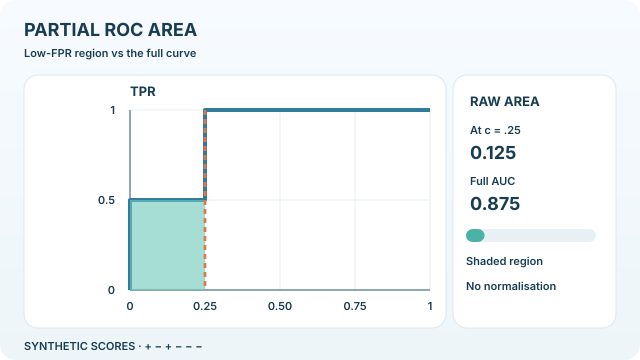
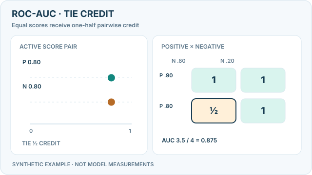
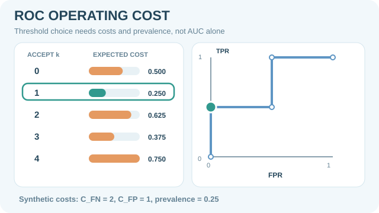
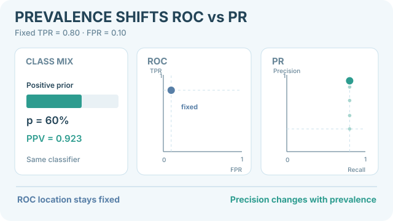

---
related:
  - engineering/evaluation
tags:
  - evaluation
  - metrics
  - classification
---

# ROC-AUC

ROC-AUC 是接收者操作特徵曲線（ROC 曲線）下的面積。曲線在決策門檻由高到低變動時，描繪真正例率對偽正例率的關係。曲線下面積概括了分數把正例與負例分開的能力，且不需要選定單一門檻。

## 定義

在每個門檻 $t$ 上，真正例率為 $TP/(TP+FN)$，偽正例率為 $FP/(FP+TN)$。ROC 曲線收集這些點，ROC-AUC 就是曲線下的面積。

更精確地說，ROC-AUC 是獨立抽取一筆正例與一筆負例時，正例分數**嚴格較高的機率**，加上**平手機率的一半**。若排序與標籤獨立，ROC-AUC 的**期望值**是 0.5；有限樣本的一次隨機排序不一定恰好得到 0.5（Fawcett, 2006）。

## 解讀

ROC-AUC 只需要分數，不需要依門檻得出的標籤，因此可以在不固定操作點的情況下比較模型。它取決於分數的排序，而不是分數的校準：模型的 ROC-AUC 可以很高，但機率的尺度可能嚴重失準。見[校準誤差](../probabilistic/calibration-error.md)。

## 何時使用

ROC-AUC 適合在尚未選定決策門檻時比較分數排序能力，**不要求正負例數量相當**：ROC 座標分別以正例與負例為條件計算。但正例極少時，統計估計可能有很大的不確定性；應報告類別筆數與不確定性，並在誤報或稀有正例重要時，一併檢查**精確率—召回率曲線**及相關的低 FPR 區域。

## 範例

取四筆有分數的案例：兩個正例分數為 0.9 與 0.6，兩個負例分數為 0.8 與 0.3。共有四組正負配對，其中正例分數較高的有三組（0.9 對 0.8、0.9 對 0.3、0.6 對 0.3），只有一組較低（0.6 對 0.8）。因此 ROC-AUC 為 $3 / 4 = 0.75$。

## 動畫示範：門檻掃描與 ROC 曲線

*原創教學動畫（CC BY-SA 4.0）。* 這是與前面四筆資料範例**不同**的十筆人工設定樣本，正例位於排序第 **1、3、6** 名，其餘七筆為負例，且各筆分數互不相同。門檻下降時，每納入一筆正例，ROC 操作點便**向上**增加 $1/3$ 的真正例率（TPR）；每納入一筆負例，則**向右**增加 $1/7$ 的偽正例率（FPR）。前六筆納入後，$TP=3$、$FP=3$、$TPR=1$、$FPR=3/7$。完整排序的 21 組正負配對中有 17 組排序正確，因此 **ROC-AUC = $17/21 \approx 0.810$**。淡色線顯示全部門檻，彩色線段表示已掃描的部分。所有分數與標籤都是**人工示意，不是模型實測結果**。MkDocs 網站提供可使用鍵盤操作的播放／暫停按鈕；偏好減少動態效果時顯示靜態版。[GitHub 靜態預覽](../../../../assets/concept-animations/roc-threshold-sweep-still.svg)及[完整 SVG 動畫](../../../../assets/concept-animations/roc-threshold-sweep-motion.svg)可直接開啟，手機可橫向捲動。ROC 的排序解讀見 References 中的 Fawcett（2006）。

## 動畫示範：ROC-AUC 的正負樣本成對比較

*原創教學動畫（CC BY-SA 4.0）。* 此圖補足 ROC-AUC 的**排序機率解讀**，與前面的門檻掃描不同。四筆**人工示意**資料中，兩筆正例分數為 0.90、0.60，兩筆負例為 0.80、0.30，四組正負樣本配對共有**三勝、一負**，因此 `AUC = 3 / 4 = 0.75`。一般形式為 `AUC = (勝出組數 + 0.5 × 平手組數) / (正例數 × 負例數)`，分數相同的配對記半分。動畫依序揭露各配對，**尚未完成所有比較時的累積勝場不是最終 AUC**。靜態回退則展示完整矩陣。全部分數均非模型實測。MkDocs 網站提供可用鍵盤操作的播放／暫停控制，偏好減少動畫時顯示靜態圖。[GitHub 靜態預覽](../../../../assets/concept-animations/roc-pairwise-auc-still.svg)與[完整 SVG 動畫](../../../../assets/concept-animations/roc-pairwise-auc-motion.svg)均可直接開啟，手機請橫向捲動觀看。

## 動畫示範：低偽正例率區域的部分 ROC 面積

*原創教學動畫（CC BY-SA 4.0）。* 六筆分數各不相同的**人工示例**依序為 `+ − + − − −`，有兩筆正例與四筆負例。第一筆正例讓 TPR 升至 $1/2$ 而 FPR 維持 $0$；第一筆負例讓 FPR 增至 $1/4$，下一筆正例使 TPR 升至 $1$。八組正負配對中有七組排序正確，因此**完整 AUC 為 $7/8=0.875$**。只積分至 **FPR $\le 0.25$**，**未正規化的部分面積為 $0.25\times0.5=0.125$**。動畫讓截止值連續往右移動，呈現低誤報區域與全區間的差異。**原始部分面積不等於標準化部分 AUC**（例如 scikit-learn 的 `roc_auc_score(max_fpr=...)`）；所有數值均非模型實測。MkDocs 可用鍵盤播放／暫停，Reduced Motion 顯示靜態回退。[GitHub 靜態預覽](../../../../assets/concept-animations/roc-partial-area-still.svg) · [完整 SVG 動畫](../../../../assets/concept-animations/roc-partial-area-motion.svg)。手機可橫向捲動。

## 動畫示範：嚴格遞增分數轉換不改變 ROC-AUC

*原創教學動畫（CC BY-SA 4.0）。* 四筆**人工示意**分數分別為正例 **0.90、0.60**，負例 **0.80、0.30**。圓點從平方根轉換位置平滑移到三次方轉換位置，中間對應 $g_t(s)=(1-t)\sqrt{s}+t s^3$、$0\leq t\leq1$。每個轉換在 $[0,1]$ 上都**嚴格遞增**，因此所有正負配對的勝負關係不變，**ROC-AUC 始終為 $3/4=0.75$**。靜態回退圖以空心圓表示平方根位置、實心圓表示三次方位置。此性質**不代表機率已校準**，也不代表同一數值門檻下的預測標籤保持不變。這些分數並非模型實測值。MkDocs 提供鍵盤可操作的播放／暫停，減少動態效果時顯示靜態圖。[GitHub 靜態預覽](../../../../assets/concept-animations/roc-rank-transform-still.svg) · [完整 SVG 動畫](../../../../assets/concept-animations/roc-rank-transform-motion.svg)。手機可橫向捲動；排序解讀參見 References 的 Fawcett（2006）。

## 性質與變體

- **機率意義。** ROC-AUC 等於隨機一個正例的分數高於隨機一個負例的機率，分數相同時計為一半。這就是曼–惠特尼 U 統計量除以正負配對數。
- **不變性。** 對分數做任何嚴格遞增的轉換，數值都不變。它也不受盛行率影響，因為 TPR 與 FPR 都是各類別內的比例。
- **部分 AUC。** 只取 FPR 的某一段範圍（例如 0 到 0.1）計算面積，聚焦在低誤報的區域。
- **限制。** 正例稀少時，ROC-AUC 可以很高而精確率很差；它也不衡量校準。

## 常見陷阱

- **稀有正例。** 當負例遠多於正例時，即使有很多誤報，偽正例率仍然很小，因此 ROC-AUC 可能比模型對正例的實際表現看起來更好。Saito 與 Rehmsmeier（2015）指出，在這種情況下精確率—召回率的觀點更有資訊量。遇到稀有事件時，應改用 [PR-AUC](pr-auc.md)。
- **多類別使用。** 在 scikit-learn 中，多類別 ROC-AUC 必須明確設定 `multi_class` 參數為 `'ovr'` 或 `'ovo'`；預設值會引發錯誤。

## 相關指標

[PR-AUC](pr-auc.md)是對應的精確率—召回率版本。家族概述見[分類指標](index.md)。

## 動畫解說：ROC-AUC 的同分配對

*原創教學動畫，CC BY-SA 4.0 授權；GitHub 顯示靜態 SVG 回退。* [GitHub static preview](../../../../assets/concept-animations/roc-tie-half-credit-still.svg) · [Full SVG animation](../../../../assets/concept-animations/roc-tie-half-credit-motion.svg).

ROC-AUC 將正例與負例**分數相同**的配對計為半次排序成功。本例人工正例分數為 (0.90, 0.80)，負例分數為 (0.80, 0.20)，四組配對貢獻為 1、1、1/2、1，因此 $\mathrm{AUC}=(1+1+0.5+1)/4=0.875$。動畫逐一比較分數後呈現完整矩陣；減少動態效果時顯示最終靜態圖。數值只供數學說明，**並非模型實測**。MkDocs 可播放／暫停，窄螢幕可用鍵盤水平捲動。

## 動畫示範：兩個固定決策規則的隨機 ROC 混合

*原創教學動畫（CC BY-SA 4.0）。* 假設在相同目標族群中有兩個**固定**決策規則：A 的 `(FPR, TPR)=(0.10, 0.60)`，B 為 `(0.40, 0.90)`。對每筆新資料獨立以機率 `λ` 選擇 B，否則採用 A，則在各個真實類別條件下，**期望**偽正例率與真正例率為：

$\mathrm{FPR}_{mix}=0.10+0.30\lambda$，$\mathrm{TPR}_{mix}=0.60+0.30\lambda$。

動畫讓 `λ` 連續變動，操作點沿 A、B 的直線移動。`λ=0.5` 時，期望座標為 **(FPR 0.25, TPR 0.75)**。這是**在兩個固定規則間隨機選擇**，並非重新訓練、分數內插、機率校準，也不能保證每個有限樣本的比率完全等於期望值。此示意有助於理解 ROC 操作包絡中可由隨機規則組成的線段；理論背景參見 References 的 Fawcett（2006）。**所有數值為人工設定，非模型實測。** MkDocs 提供鍵盤播放／暫停與減少動態效果的靜態回退。[GitHub 靜態預覽](../../../../assets/concept-animations/roc-randomized-operating-mix-still.svg) · [完整 SVG 動畫](../../../../assets/concept-animations/roc-randomized-operating-mix-motion.svg)。手機可橫向捲動。

## 動畫示範：依錯誤成本選擇 ROC 操作點

*原創教學動畫（CC BY-SA 4.0）；所有辨識率與成本參數均為**人工示意，非模型或部署實測**。* 假設四筆互不相同的人工排序分數，標籤依序為 `+ − + −`，其中正例、負例各兩筆。納入前 $k=0,1,2,3,4$ 筆，得到條件式 $(FPR,TPR)$ 操作點 $(0,0),(0,1/2),(1/2,1/2),(1/2,1),(1,1)$。**另行假設**部署母體的正例比例 $p=0.25$，偽陰性成本 $C_{FN}=2$、偽陽性成本 $C_{FP}=1$，則每筆資料的預期錯誤成本為

$$
L(k)=C_{FN}p[1-TPR(k)]+C_{FP}(1-p)FPR(k).
$$

五個門檻的成本依序為 **0.500、0.250、0.625、0.375、0.750**。動畫將目前門檻與 ROC 點同步標示；在此假設下，**$k=1$** 的成本最低。特別注意：四筆資料的正負比例各半，只用來建構示意性的**條件式**辨識率；$25\%$ 的部署盛行率是**獨立設定**，並非從這四筆資料推得。實際決策還需可靠的部署族群比例、錯誤成本及辨識率估計；**ROC-AUC 本身不會決定最佳分類門檻**。MkDocs 提供鍵盤播放／暫停、Reduced Motion 靜態圖；[GitHub 靜態預覽](../../../../assets/concept-animations/roc-cost-operating-point-still.svg) · [完整 SVG 動畫](../../../../assets/concept-animations/roc-cost-operating-point-motion.svg)。手機可橫向捲動。操作點的定義參考既有 References 中的 Fawcett（2006）。

## 動畫示範：盛行率改變時 ROC 固定、精確率改變

*原創人工示意動畫（CC BY-SA 4.0）。* 固定條件式 TPR = 0.80 與 FPR = 0.10，讓正例盛行率依序採用**五個離散且精確的狀態**：5%、10%、20%、40%、60%。ROC 操作點維持在 (0.10, 0.80)，PR 座標的召回率仍是 0.80，但精確率變成

\[
\operatorname{PPV}(p)=\frac{0.80p}{0.80p+0.10(1-p)}.
\]

五種狀態的精確率依序為 **0.296、0.471、0.667、0.842、0.923**。以上是母體比例的**人工數學示意，不是模型實測**；條件式辨識率不變僅是假設，不能保證分布轉移後仍然成立。動畫採離散狀態，避免將非線性關係錯誤呈現為線性內插。MkDocs 提供鍵盤可操作的播放／暫停，偏好減少動態效果者可觀看靜態圖；手機請聚焦後水平捲動。[GitHub 靜態預覽](../../../../assets/concept-animations/roc-pr-prevalence-still.svg) · [完整 SVG 動畫](../../../../assets/concept-animations/roc-pr-prevalence-motion.svg)。

## 動畫示範：Youden J 最大與部署成本最小的門檻未必相同

*原創人工示意動畫（CC BY-SA 4.0）。* 六筆分數互不相同的人工案例，其排序標籤依序為 `+ + − − − +`，正負例各三筆。對七個門檻位置 `k = 0, ..., 6`，分別計算

\[
J(k)=\operatorname{TPR}(k)-\operatorname{FPR}(k)
\]

及

\[
L(k)=5(0.40)[1-\operatorname{TPR}(k)]+(0.60)\operatorname{FPR}(k).
\]

**k = 2 時 J = 2/3 最大**。若額外假設**部署正例比例是 0.40**、漏報成本為 5、誤報成本為 1，則**k = 6 時預期成本 L = 0.60 最低**，低於 k = 2 的 `L = 2/3`。成本單位是每次決策的假設損失，TPR／FPR 則由人工排序資料估算。因此條件式辨識率所偏好的門檻，不必然是部署損失最低的門檻。**以上並非模型實測結果。** MkDocs 提供鍵盤可操作的播放／暫停；偏好減少動態效果時展示兩個最適點的靜態圖。手機請聚焦後橫向捲動。[GitHub 靜態預覽](../../../../assets/concept-animations/roc-youden-cost-still.svg) · [完整 SVG 動畫](../../../../assets/concept-animations/roc-youden-cost-motion.svg)。

## 參考文獻

### 開創性論文

- Fawcett, T. (2006). An introduction to ROC analysis. *Pattern Recognition Letters* 27(8), 861–874. https://doi.org/10.1016/j.patrec.2005.10.010 — 說明 ROC 曲線與 AUC 的建構、解讀與常見誤用。
- Saito, T. & Rehmsmeier, M. (2015). The precision-recall plot is more informative than the ROC plot when evaluating binary classifiers on imbalanced datasets. *PLoS ONE* 10(3). https://doi.org/10.1371/journal.pone.0118432 — 比較不平衡資料上的 ROC 曲線與精確率—召回率曲線。

### 文章與文件

- scikit-learn contributors. *roc_auc_score*. https://scikit-learn.org/stable/modules/generated/sklearn.metrics.roc_auc_score.html — API 參考，說明如何從預測分數計算 ROC AUC，並包含二元與多類別的用法。

### 補充來源

- scikit-learn contributors. *Metrics and scoring: quantifying the quality of predictions*. https://scikit-learn.org/stable/modules/model_evaluation.html — 分類、迴歸與排序評分器的概述，以及各自的適用時機。
- Murphy, K. P. *Probabilistic Machine Learning: An Introduction*. MIT Press, 2022. https://probml.github.io/pml-book/book1.html — 提供免費線上草稿的機率機器學習教科書。
- *The Elements of Statistical Learning: Data Mining, Inference, and Prediction*, 2nd edition. https://hastie.su.domains/ElemStatLearn/ — 統計學習的標準教科書，涵蓋其評估方法。
