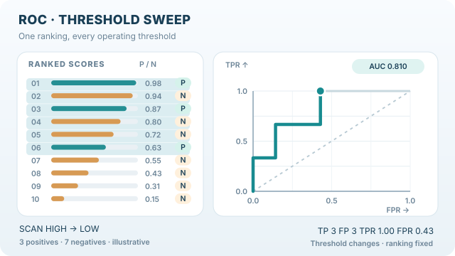
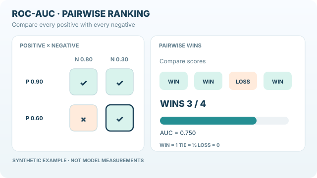
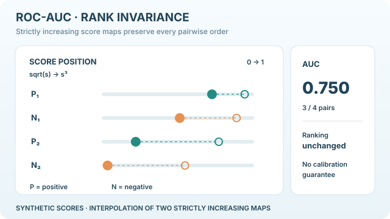

---
related:
  - engineering/evaluation
tags:
  - evaluation
  - metrics
  - classification
translation_reviewed: 2026-11-19
---

# ROC-AUC

ROC-AUC 是接收者操作特徵曲線（ROC 曲線）下的面積。曲線在決策門檻由高到低變動時，描繪真正例率對偽正例率的關係。曲線下面積概括了分數把正例與負例分開的能力，且不需要選定單一門檻。

## 定義

在每個門檻 $t$ 上，真正例率為 $TP/(TP+FN)$，偽正例率為 $FP/(FP+TN)$。ROC 曲線收集這些點，ROC-AUC 就是曲線下的面積。

以排序觀點解讀，ROC-AUC 等於隨機抽取正例的分數**嚴格高於**隨機抽取負例的機率，**再加上兩者同分機率的一半**。完美排序為 1.0；當正負例的分數來自相同且獨立的隨機分布時，AUC 的**期望值**是 0.5，但有限樣本的一次隨機排序不一定恰好得到 0.5（Fawcett, 2006）。

## 解讀

ROC-AUC 只需要分數，不需要依門檻得出的標籤，因此可以在不固定操作點的情況下比較模型。它取決於分數的排序，而不是分數的校準：模型的 ROC-AUC 可以很高，但機率的尺度可能嚴重失準。見[校準誤差](../probabilistic/calibration-error.md)。

## 何時使用

操作門檻尚未確定時，可使用 ROC-AUC 比較模型跨門檻的排序區辨能力。ROC-AUC 在數學上**不要求正負例數量相當**；但當正例盛行率低時，即使偽陽性率很小，仍可能產生大量誤報。因此應同時檢視精確率—召回率表現與部署族群的基準率。

## 範例

取四筆有分數的案例：兩個正例分數為 0.9 與 0.6，兩個負例分數為 0.8 與 0.3。共有四組正負配對，其中正例分數較高的有三組（0.9 對 0.8、0.9 對 0.3、0.6 對 0.3），只有一組較低（0.6 對 0.8）。因此 ROC-AUC 為 $3 / 4 = 0.75$。

## 動畫示範：門檻掃描與 ROC 曲線

*原創教學動畫（CC BY-SA 4.0）。* 這是與前面四筆資料範例**不同**的十筆人工設定樣本，正例位於排序第 **1、3、6** 名，其餘七筆為負例，且各筆分數互不相同。門檻下降時，每納入一筆正例，ROC 操作點便**向上**增加 $1/3$ 的真正例率（TPR）；每納入一筆負例，則**向右**增加 $1/7$ 的偽正例率（FPR）。前六筆納入後，$TP=3$、$FP=3$、$TPR=1$、$FPR=3/7$。完整排序的 21 組正負配對中有 17 組排序正確，因此 **ROC-AUC = $17/21 \approx 0.810$**。淡色線顯示全部門檻，彩色線段表示已掃描的部分。所有分數與標籤都是**人工示意，不是模型實測結果**。MkDocs 網站提供可使用鍵盤操作的播放／暫停按鈕；偏好減少動態效果時顯示靜態版。[GitHub 靜態預覽](../../../../assets/concept-animations/roc-threshold-sweep-still.svg)及[完整 SVG 動畫](../../../../assets/concept-animations/roc-threshold-sweep-motion.svg)可直接開啟，手機可橫向捲動。ROC 的排序解讀見 References 中的 Fawcett（2006）。

## 動畫示範：ROC-AUC 的正負樣本成對比較

*原創教學動畫（CC BY-SA 4.0）。* 此圖補足 ROC-AUC 的**排序機率解讀**，與前面的門檻掃描不同。四筆**人工示意**資料中，兩筆正例分數為 0.90、0.60，兩筆負例為 0.80、0.30，四組正負樣本配對共有**三勝、一負**，因此 `AUC = 3 / 4 = 0.75`。一般形式為 `AUC = (勝出組數 + 0.5 × 平手組數) / (正例數 × 負例數)`，分數相同的配對記半分。動畫依序揭露各配對，**尚未完成所有比較時的累積勝場不是最終 AUC**。靜態回退則展示完整矩陣。全部分數均非模型實測。MkDocs 網站提供可用鍵盤操作的播放／暫停控制，偏好減少動畫時顯示靜態圖。[GitHub 靜態預覽](../../../../assets/concept-animations/roc-pairwise-auc-still.svg)與[完整 SVG 動畫](../../../../assets/concept-animations/roc-pairwise-auc-motion.svg)均可直接開啟，手機請橫向捲動觀看。

## 動畫示範：低偽正例率區域的部分 ROC 面積

*原創教學動畫（CC BY-SA 4.0）。* 六筆分數各不相同的**人工示例**依序為 `+ − + − − −`，有兩筆正例與四筆負例。第一筆正例讓 TPR 升至 $1/2$ 而 FPR 維持 $0$；第一筆負例讓 FPR 增至 $1/4$，下一筆正例使 TPR 升至 $1$。八組正負配對中有七組排序正確，因此**完整 AUC 為 $7/8=0.875$**。只積分至 **FPR $\le 0.25$**，**未正規化的部分面積為 $0.25\times0.5=0.125$**。動畫讓截止值連續往右移動，呈現低誤報區域與全區間的差異。**原始部分面積不等於標準化部分 AUC**（例如 scikit-learn 的 `roc_auc_score(max_fpr=...)`）；所有數值均非模型實測。MkDocs 可用鍵盤播放／暫停，Reduced Motion 顯示靜態回退。[GitHub 靜態預覽](../../../../assets/concept-animations/roc-partial-area-still.svg) · [完整 SVG 動畫](../../../../assets/concept-animations/roc-partial-area-motion.svg)。手機可橫向捲動。

## 動畫示範：嚴格遞增分數轉換不改變 ROC-AUC

*原創教學動畫（CC BY-SA 4.0）。* 四筆**人工示意**分數分別為正例 **0.90、0.60**，負例 **0.80、0.30**。圓點從平方根轉換位置平滑移到三次方轉換位置，中間對應 $g_t(s)=(1-t)\sqrt{s}+t s^3$、$0\leq t\leq1$。每個轉換在 $[0,1]$ 上都**嚴格遞增**，因此所有正負配對的勝負關係不變，**ROC-AUC 始終為 $3/4=0.75$**。靜態回退圖以空心圓表示平方根位置、實心圓表示三次方位置。此性質**不代表機率已校準**，也不代表同一數值門檻下的預測標籤保持不變。這些分數並非模型實測值。MkDocs 提供鍵盤可操作的播放／暫停，減少動態效果時顯示靜態圖。[GitHub 靜態預覽](../../../../assets/concept-animations/roc-rank-transform-still.svg) · [完整 SVG 動畫](../../../../assets/concept-animations/roc-rank-transform-motion.svg)。手機可橫向捲動；排序解讀參見 References 的 Fawcett（2006）。

## 性質與變體

- **機率意義。** ROC-AUC 等於隨機一個正例的分數高於隨機一個負例的機率，分數相同時計為一半。這就是曼–惠特尼 U 統計量除以正負配對數。
- **不變性及必要假設。** 對分數做嚴格遞增轉換，ROC-AUC 不變。若僅發生**純先驗比例漂移**，且各類別內的分數條件分布不變，**母體** ROC 曲線與 AUC 不會因盛行率改變而變動，因為 TPR 與 FPR 都是類別條件率；但類別內的分數分布漂移可能改變兩者，有限樣本的 AUC 估計也仍有抽樣波動。
- **部分 AUC。** 只取 FPR 的某一段範圍（例如 0 到 0.1）計算面積，聚焦在低誤報的區域。
- **限制。** 正例稀少時，ROC-AUC 可以很高而精確率很差；它也不衡量校準。

## 常見陷阱

- **稀有正例。** 當負例遠多於正例時，即使有很多誤報，偽正例率仍然很小，因此 ROC-AUC 可能比模型對正例的實際表現看起來更好。Saito 與 Rehmsmeier（2015）指出，在這種情況下精確率—召回率的觀點更有資訊量。遇到稀有事件時，應改用 [PR-AUC](pr-auc.md)。
- **多類別使用。** 在 scikit-learn 中，多類別 ROC-AUC 必須明確設定 `multi_class` 參數為 `'ovr'` 或 `'ovo'`；預設值會引發錯誤。

## 相關指標

[PR-AUC](pr-auc.md)是對應的精確率—召回率版本。家族概述見[分類指標](index.md)。

## 動畫解說：ROC-AUC 的同分配對

*原創教學動畫，CC BY-SA 4.0 授權；GitHub 顯示靜態 SVG 回退。* [GitHub static preview](../../../../assets/concept-animations/roc-tie-half-credit-still.svg) · [Full SVG animation](../../../../assets/concept-animations/roc-tie-half-credit-motion.svg).

ROC-AUC 將正例與負例**分數相同**的配對計為半次排序成功。本例人工正例分數為 (0.90, 0.80)，負例分數為 (0.80, 0.20)，四組配對貢獻為 1、1、1/2、1，因此 $\mathrm{AUC}=(1+1+0.5+1)/4=0.875$。動畫逐一比較分數後呈現完整矩陣；減少動態效果時顯示最終靜態圖。數值只供數學說明，**並非模型實測**。MkDocs 可播放／暫停，窄螢幕可用鍵盤水平捲動。

## 動畫示範：兩個固定決策規則的隨機 ROC 混合

*原創教學動畫（CC BY-SA 4.0）。* 假設在相同目標族群中有兩個**固定**決策規則：A 的 `(FPR, TPR)=(0.10, 0.60)`，B 為 `(0.40, 0.90)`。對每筆新資料獨立以機率 `λ` 選擇 B，否則採用 A，則在各個真實類別條件下，**期望**偽正例率與真正例率為：

$$
\begin{gathered}
\mathrm{FPR}_{mix}=0.10+0.30\lambda,\\
\mathrm{TPR}_{mix}=0.60+0.30\lambda.
\end{gathered}
$$

動畫讓 `λ` 連續變動，操作點沿 A、B 的直線移動。`λ=0.5` 時，期望座標為 **(FPR 0.25, TPR 0.75)**。這是**在兩個固定規則間隨機選擇**，並非重新訓練、分數內插、機率校準，也不能保證每個有限樣本的比率完全等於期望值。此示意有助於理解 ROC 操作包絡中可由隨機規則組成的線段；理論背景參見 References 的 Fawcett（2006）。**所有數值為人工設定，非模型實測。** MkDocs 提供鍵盤播放／暫停與減少動態效果的靜態回退。[GitHub 靜態預覽](../../../../assets/concept-animations/roc-randomized-operating-mix-still.svg) · [完整 SVG 動畫](../../../../assets/concept-animations/roc-randomized-operating-mix-motion.svg)。手機可橫向捲動。

## 動畫示範：依錯誤成本選擇 ROC 操作點

*原創教學動畫（CC BY-SA 4.0）；所有辨識率與成本參數均為**人工示意，非模型或部署實測**。* 假設四筆互不相同的人工排序分數，標籤依序為 `+ − + −`，其中正例、負例各兩筆。納入前 $k=0,1,2,3,4$ 筆，得到條件式 $(FPR,TPR)$ 操作點 $(0,0)$、$(0,1/2)$、$(1/2,1/2)$、$(1/2,1)$、$(1,1)$。**另行假設**部署母體的正例比例 $p=0.25$，偽陰性成本 $C_{FN}=2$、偽陽性成本 $C_{FP}=1$，則每筆資料的預期錯誤成本為

$$
\begin{aligned}
L(k)&=C_{FN}p[1-TPR(k)]\\
&\quad+C_{FP}(1-p)FPR(k).
\end{aligned}
$$

五個門檻的成本依序為 **0.500、0.250、0.625、0.375、0.750**。動畫將目前門檻與 ROC 點同步標示；在此假設下，**$k=1$** 的成本最低。特別注意：四筆資料的正負比例各半，只用來建構示意性的**條件式**辨識率；$25\%$ 的部署盛行率是**獨立設定**，並非從這四筆資料推得。實際決策還需可靠的部署族群比例、錯誤成本及辨識率估計；**ROC-AUC 本身不會決定最佳分類門檻**。MkDocs 提供鍵盤播放／暫停、Reduced Motion 靜態圖；[GitHub 靜態預覽](../../../../assets/concept-animations/roc-cost-operating-point-still.svg) · [完整 SVG 動畫](../../../../assets/concept-animations/roc-cost-operating-point-motion.svg)。手機可橫向捲動。操作點的定義參考既有 References 中的 Fawcett（2006）。

混合動畫來回掃描機率參數，而非訓練時間。成本門檻則逐步離散前進並在循環結束時重設；ROC 連線只是參考，不代表非整數筆數的觀測。

## 動畫示範：ROC 操作點固定，精確率隨盛行率改變

*原創教學 SVG（CC BY-SA 4.0）。* 此圖是**人工母體比率的思想實驗**，不是訓練軌跡或部署實測結果。敏感度 $TPR=0.80$ 與偽陽性率 $FPR=0.10$ 維持不變，正例盛行率 $p$ 從 $0.05$ 變至 $0.60$，因此 ROC 操作點**不移動**，但陽性警報的精確率依貝氏法則改變：

$$
PPV(p)=\frac{0.80p}{0.80p+0.10(1-p)}.
$$

兩端的精確率分別約為 **0.296** 與 **0.923**。因此，只知道 ROC 操作點，而沒有部署族群的盛行率，無法推算陽性警報的精確率。**此動畫假設只有正負例先驗比例（盛行率）改變**，兩類內部的分數條件分布保持不變，固定決策規則的 TPR／FPR 才能維持原值。若任一類內部的分數分布也發生漂移，ROC 操作點亦可能改變；不能把任意部署環境的資料漂移都當成純盛行率改變。本圖與[精確率的基準率動畫](precision.md)互補：後者呈現陽性警報組成，本圖直接對照固定的 ROC 位置與變動的精確率。MkDocs 提供鍵盤可操作的播放／暫停控制，偏好減少動態效果時顯示靜態回退；手機可聚焦圖框後水平捲動。[GitHub 靜態預覽](../../../../assets/concept-animations/roc-pr-shift-still.svg) · [完整 SVG 動畫](../../../../assets/concept-animations/roc-pr-shift-motion.svg)。

## 動畫示範：Youden J 與部署錯誤成本的最佳門檻

*原創教學 SVG（CC BY-SA 4.0）。* 使用六筆**分數互不相同的人工標籤** `+ − + + − −`（正負例各三筆）。接受前四筆時，$TPR=1$、$FPR=1/3$，且 Youden 指標 $J=TPR-FPR=2/3$ 達最大值。但最大化 Youden J **不等於**在所有部署成本設定下讓預期損失最小。另行假設部署盛行率 $p=0.10$、偽陽性成本 $C_{FP}=1$，偽陰性成本 $C_{FN}$ 從 $1$ 掃描至 $5$：

$$
\begin{aligned}
L(k) &= C_{FN}p[1-TPR(k)]\\
&\quad+C_{FP}(1-p)FPR(k).
\end{aligned}
$$

接受前一筆時 $L(1)=C_{FN}/15$；接受前四筆時 $L(4)=0.30$。在**全部七個候選門檻** $k=0,\ldots,6$ 中，$C_{FN}=1$ 時最低損失門檻為 **$k=1$**（$0.0667$），$C_{FN}=5$ 時變成 **$k=4$**（$0.300$）；兩者在 $C_{FN}=4.5$ 時同分。在**動畫顯示的成本範圍** $1\le C_{FN}\le5$ 中，低於 4.5 時以 $k=1$ 最佳；等於 4.5 時兩者並列最佳；高於 4.5 時以 $k=4$ 最佳。另外五個候選門檻在此範圍內都無法優於這兩者中的較低成本，因此右側圖只繪製兩條可能成為最優解的損失曲線，而非全部七條。**Youden J 與成本最小化**在特定成本權重下可精確對應：若 $C_{FN}p=C_{FP}(1-p)=w$，則

$$
L(k)=w[1-J(k)].
$$

因此，只有在這些條件式辨識率適用於部署族群、且兩種錯誤的**有效權重相等**時，最大化 $J$ 才必然等於最小化預期損失。本例 $p=0.10$、$C_{FP}=1$，須 $C_{FN}=9$ 才符合權重相等，**超出**動畫掃描的 $1$ 至 $5$；在 $C_{FN}=5$ 時 $k=4$ 恰巧也讓 $J$ 最大，不代表兩個目標普遍相同。ROC 階梯來自六筆人工資料，而部署盛行率與成本為**另外指定的假設**；動畫是參數掃描，並非訓練時間或實際推論紀錄。MkDocs 可用鍵盤操作播放／暫停，偏好減少動態效果時提供靜態圖，手機可水平捲動。[GitHub 靜態預覽](../../../../assets/concept-animations/roc-youden-cost-still.svg) · [完整 SVG 動畫](../../../../assets/concept-animations/roc-youden-cost-motion.svg)。決策理論背景可參考文末 Fawcett（2006）。

## 動畫示範：先驗比例漂移如何切換最低成本門檻

*原創教學動畫（CC BY-SA 4.0）。* 前一項 PPV 動畫**固定決策規則**，這裡則在部署基準率改變後**重新最佳化門檻**。使用另一組人工排序 **+ − + + − −**，假設僅有正負例先驗比例改變，兩類內部的條件分數分布與 ROC 階梯維持不變。另行設定偽陰性成本 $C_{FN}=2$、偽陽性成本 $C_{FP}=1$。兩個非劣候選門檻的預期損失分別為：

$$
L(1;p)=\frac{4p}{3}.
$$

$$
L(4;p)=\frac{1-p}{3}.
$$

兩者在盛行率 $p=0.20$ 相交。針對這一對 ROC 操作點，一般化的切換條件為：

$$
p^*=\frac{C_{FP}}{2C_{FN}+C_{FP}}.
$$

除了讀取兩條成本曲線的交點，也可以直接從**兩個 ROC 操作點之間的斜率**推導策略切換。將較寬鬆的 $k=4$ 與 $k=1$ 比較，前者增加 $\Delta TPR=2/3$，同時增加 $\Delta FPR=1/3$。在部署盛行率為 $p$、兩類錯誤成本均嚴格為正的假設下，預期損失差為：

$$
\begin{aligned}
L(4;p)-L(1;p)
&=-C_{FN}p\,\Delta TPR\\
&\quad+C_{FP}(1-p)\,\Delta FPR.
\end{aligned}
$$

因此，當且僅當 $C_{FN}p\,\Delta TPR>C_{FP}(1-p)\,\Delta FPR$，亦即本例的 **$2C_{FN}p>C_{FP}(1-p)$** 時，$k=4$ 成本較低；相等時兩者並列。關鍵是 ROC 的**兩點割線斜率** $\Delta TPR/\Delta FPR=2$，而非單看 AUC。代入 $C_{FN}=2$、$C_{FP}=1$，即可得到 $p>0.20$ 的切換條件。這只是兩個人工候選策略及假設成本之間的比較，**不是**普遍適用的機率校準門檻，也不是部署實測規則。

當 **$p=0.10$**，接受前一筆的成本 **0.133** 低於前四筆的 **0.300**；當 **$p=0.40$**，前四筆的 **0.200** 低於前一筆的 **0.533**；在 **$p=0.20$** 時兩者同分。對於 $0<p<1$，其餘五個候選門檻都無法勝過這兩者中的較低損失。**切換的是最佳決策操作點，ROC 曲線本身沒有改變。** 動畫游標掃描人工參數，**不是模型訓練歷程或實測預測**；所有辨識率與成本均為示意假設。MkDocs 提供鍵盤可操作的播放／暫停及 Reduced Motion 靜態回退；手機可水平捲動。靜態圖直接呈現 20% 的交點，可在 GitHub 預覽。[GitHub 靜態預覽](../../../../assets/concept-animations/roc-prior-policy-still.svg) · [完整 SVG 動畫](../../../../assets/concept-animations/roc-prior-policy-motion.svg)。ROC 決策成本解讀參見 References 的 Fawcett（2006）。

## 為什麼隨機混合門檻不會同時勝過兩端策略

上方的**先驗比例與最佳門檻動畫**比較較嚴格的 $k=1$ 與較寬鬆的 $k=4$。另一種策略是對每筆未來資料獨立隨機選擇門檻：以機率 $\lambda$ 選 $k=4$，否則選 $k=1$，其中 $0\leq\lambda\leq1$。隨機選擇不能依賴尚未得知的真實類別。對這組人工排序，預期 ROC 操作率為：

$
\begin{aligned}
\mathrm{TPR}_{\lambda}&=\frac{1+2\lambda}{3},\\
\mathrm{FPR}_{\lambda}&=\frac{\lambda}{3}.
\end{aligned}
$

沿用前述對偽陰性與偽陽性錯誤機率呈**線性關係**的成本假設，混合策略的預期損失為：

$
L_{\lambda}(p)=(1-\lambda)\frac{4p}{3}+\lambda\frac{1-p}{3}.
$

當盛行率 $p=0.10$，各半混合（$\lambda=0.5$）的損失為 **0.217**，高於一律採 $k=1$ 的 **0.133**；當 $p=0.40$，各半混合的損失為 **0.367**，高於一律採 $k=4$ 的 **0.200**；當 $p=0.20$，所有混合比例均為 $4/15\approx0.267$。因此，隨機混合雖能產生中間的 ROC 操作點，**在無額外限制的線性預期成本最佳化中，卻無法同時嚴格優於兩個端點**。若另有最大容許誤報率等限制，中間的可行策略仍可能有價值。

前文的[隨機化 ROC 決策規則靜態預覽](../../../../assets/concept-animations/roc-randomized-operating-mix-still.svg)與[完整動畫](../../../../assets/concept-animations/roc-randomized-operating-mix-motion.svg)，使用的是**不同的人工操作率**，只用來說明相同的插值機制，不可把數值與這組六筆排序混用。所有辨識率與成本均為示意假設，不是部署量測；相關決策背景參見文末 Fawcett（2006）。

## 參考文獻

### 開創性論文

- Fawcett, T. (2006). An introduction to ROC analysis. *Pattern Recognition Letters* 27(8), 861–874. https://doi.org/10.1016/j.patrec.2005.10.010 — 說明 ROC 曲線與 AUC 的建構、解讀與常見誤用。
- Saito, T. & Rehmsmeier, M. (2015). The precision-recall plot is more informative than the ROC plot when evaluating binary classifiers on imbalanced datasets. *PLoS ONE* 10(3). https://doi.org/10.1371/journal.pone.0118432 — 比較不平衡資料上的 ROC 曲線與精確率—召回率曲線。

### 文章與文件

- scikit-learn contributors. *roc_auc_score*. https://scikit-learn.org/stable/modules/generated/sklearn.metrics.roc_auc_score.html — API 參考，說明如何從預測分數計算 ROC AUC，並包含二元與多類別的用法。

### 補充來源

- scikit-learn contributors. *Metrics and scoring: quantifying the quality of predictions*. https://scikit-learn.org/stable/modules/model_evaluation.html — 分類、迴歸與排序評分器的概述，以及各自的適用時機。
- Murphy, K. P. *Probabilistic Machine Learning: An Introduction*. MIT Press, 2022. https://probml.github.io/pml-book/book1.html — 提供免費線上草稿的機率機器學習教科書。
- *The Elements of Statistical Learning: Data Mining, Inference, and Prediction*, 2nd edition. https://hastie.su.domains/ElemStatLearn/ — 統計學習的標準教科書，涵蓋其評估方法。
