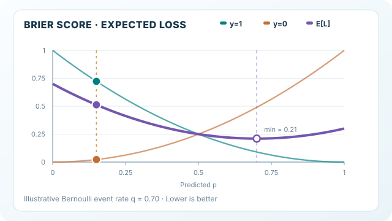

---
related:
  - engineering/evaluation
tags:
  - evaluation
  - metrics
  - calibration
translation_reviewed: 2026-11-12
---

# Brier 分數

Brier 分數是每個預測機率與觀察到的結果之間的平均平方差。它是均方誤差在機率上的對應版本，而且有上界，因此單一錯誤預測不會像[對數損失](log-loss.md)那樣主導結果。

## 定義

對於二元結果 $y \in \{0, 1\}$ 與預測機率 $p$，在 $n$ 個樣本上取平均：

$$\text{Brier} = \frac{1}{n} \sum_{i=1}^{n} (p_i - y_i)^2$$

數值越低越好。對每個樣本都預測 $p = 0.5$，得分為 0.25，這是一個簡單的基準。只有當每個預測都正確且完全確定時，分數才為 0。

## 動態解說：Brier 期望風險

*原創教學動畫，CC BY-SA 4.0。MkDocs 網站可播放／暫停；窄螢幕可將圖像區域設為鍵盤焦點並水平捲動。GitHub 顯示完整靜態圖。* [查看完整 SVG 動畫](../../../../assets/concept-animations/brier-expected-risk-motion.svg)。

以真實事件機率 $q=0.70$ 的**人工伯努利示例**而言，正例與負例的平方損失分別是 $(1-p)^2$ 和 $p^2$。紫色曲線按照**結果機率**加權，而非從資料集量測：

$\mathbb E[L(p,Y)] = 0.7(1-p)^2+0.3p^2 = (p-0.7)^2+0.21.$

預測機率 $p$ 移動時，兩種可能結果的損失同步改變。期望值在 $p=q=0.70$ 時最小，為 **0.21**，而不是零；剩餘的 $q(1-q)$ 是二元結果本身無法消除的變異。這些數字並非模型訓練或實測結果。

## 解讀

由於平方誤差有上界，一次自信的錯誤至多只讓該樣本的損失為 1，而對數損失則沒有上限。Brier 分數是一個恰當的評分規則，因此回報真實機率時它會最小化。

## 何時使用

當機率被直接使用、需要一個有界的單一指標，或預測中的離群值不應主導結果時，使用 Brier 分數。

## 範例

沿用同樣的預測，平方誤差分別為 $0.01$、$0.64$、$0.09$ 與 $0.16$。Brier 分數為其平均，即 $0.225$。與對數損失不同，平方誤差有上界，因此單一自信的錯誤對每個案例的貢獻最多為 1。

## 性質與變體

- **適當評分規則。** Brier 分數是預測機率與 0/1 結果之間的平均平方差。其期望值在預測等於真實機率時最小，因此與對數損失一樣獎勵誠實的機率。
- **有上界。** 二元結果中，每個案例的貢獻介於 0 與 1 之間，因此單一極端錯誤不會像在對數損失中那樣主導總和。
- **技能分數。** 與永遠輸出盛行率 $\pi$ 的預測相比，可得 Brier 技能分數 $1 - \mathrm{BS} / \mathrm{BS}_{\mathrm{ref}}$，其中 $\mathrm{BS}_{\mathrm{ref}} = \pi(1 - \pi)$。正值表示模型優於固定基準。
- **限制。** 懲罰是二次的，因此對稀有且自信的錯誤反應較弱，在安全關鍵的場合可能不夠。

## 常見陷阱

- **稀有事件。** 對於稀有結果，一個總是預測小常數機率的模型，Brier 分數也會很低，但並不具備真正的預測能力。應以基礎比率 $p_{\text{base}}(1 - p_{\text{base}})$ 作為基準比較。
- **只看排序。** 此分數衡量的是機率的品質。模型即使能很好地排序案例，若機率失準，分數仍會很差。

## 相關指標

[對數損失](log-loss.md)對自信錯誤的懲罰更重。[校準誤差](calibration-error.md)則單獨分離出校準的部分。家族概述見[機率指標](index.md)。

## 參考文獻

### 文章與文件

- scikit-learn contributors. *brier_score_loss*. https://scikit-learn.org/stable/modules/generated/sklearn.metrics.brier_score_loss.html — API 參考，將此分數描述為預測機率與實際結果之間的平均平方差。
- scikit-learn contributors. *Metrics and scoring: quantifying the quality of predictions*. https://scikit-learn.org/stable/modules/model_evaluation.html — 使用預測機率的評分器概述。

### 補充來源

- Murphy, K. P. *Probabilistic Machine Learning: An Introduction*. MIT Press, 2022. https://probml.github.io/pml-book/book1.html — 提供免費線上草稿的機率機器學習教科書。
- Niculescu-Mizil, A. & Caruana, R. (2005). Predicting good probabilities with supervised learning. ICML. https://doi.org/10.1145/1102351.1102430 — 比較常見分類器的機率校準，以及校準方法的效果。
- *The Elements of Statistical Learning: Data Mining, Inference, and Prediction*, 2nd edition. https://hastie.su.domains/ElemStatLearn/ — 統計學習的標準教科書，涵蓋其評估方法。
