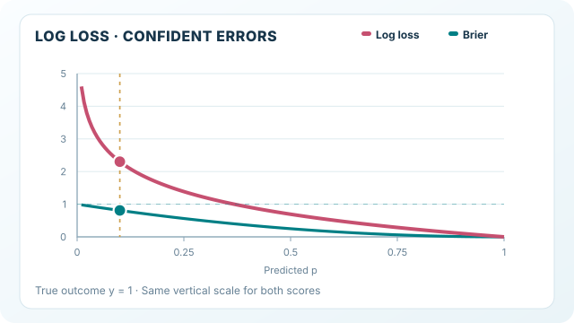

---
related:
  - engineering/evaluation
tags:
  - evaluation
  - metrics
  - calibration
translation_reviewed: 2026-11-12
---

# 對數損失

對數損失又稱交叉熵損失，是模型對真實標籤所指定的機率的負對數概似之平均值。它獎勵那些對正確結果給出高權重的預測機率，並且嚴厲懲罰自信的錯誤。

## 定義

對於二元標籤 $y \in \{0, 1\}$ 與預測機率 $p = \Pr(y = 1)$，單一樣本的損失為

$$L_{\log}(y, p) = -\big(y \log p + (1 - y) \log(1 - p)\big)$$

回報的數值是所有樣本的平均。邏輯迴歸與神經網路分類器在訓練時最小化的，正是這個量。

## 動態解說：過度自信的錯誤

*原創教學動畫，CC BY-SA 4.0。MkDocs 播放器支援播放／暫停；手機可將圖像區域設為鍵盤焦點並水平捲動。GitHub 顯示完整靜態曲線。* [查看完整 SVG 動畫](../../../../assets/concept-animations/log-loss-tail-penalty-motion.svg)。

對單筆**人工示意**的真正例（$y=1$），圖中以**相同的縱軸刻度**比較 $-\ln p$ 與 $(1-p)^2$，並讓預測正例機率 $p$ 從 0.95 降到 0.01。在 $p=0.10$ 時，對數損失為 $2.303$、Brier 損失為 $0.81$；在 $p=0.01$ 時則分別為 $4.605$ 與 $0.9801$。兩條曲線沒有另外縮放以誇大差異。圖形止於 $p=0.01$，因為 $p\to0^+$ 時 $-\ln p\to\infty$，Brier 損失則不超過 1。所有數字均為解析式計算，**不是模型實測結果**。

## 解讀

對每個樣本都預測 $p = 0.5$，對數損失為 $\log 2 \approx 0.693$，這是一個有用的基準。一個自信的錯誤預測，例如對真正例給出 $p = 0.01$，單獨就要付出 $-\log 0.01 \approx 4.6$ 的代價，因此少數這類案例就可能主導平均值。數值越低越好，而且數值同時取決於類別比例與模型本身。

## 何時使用

當需要比較同一資料上的機率模型，或監控一個其機率會餵給後續決策的模型時，使用對數損失。由於它是一個恰當的評分規則，模型若回報其真實機率，就能使期望值最小化。

## 範例

取四個預測機率 $p = (0.9, 0.8, 0.3, 0.6)$，真實標籤為 $y = (1, 0, 0, 1)$。各案例的損失分別為 $0.105$、$1.609$、$0.357$ 與 $0.511$，其平均 $0.646$ 即為對數損失。第二個案例自信地預測錯誤，主導了總和。

## 性質與變體

- **適當評分規則。** 對數損失是伯努利模型的負對數似然。期望值 $-\mathbb{E}[\,y \log q + (1 - y) \log(1 - q)\,]$ 在 $q$ 等於真實機率時最小，因此它獎勵誠實的機率預測。
- **無上界。** 對真正例預測機率恰好為 0，損失會是無限大，因此實作上通常把機率截斷在 $[\epsilon, 1 - \epsilon]$。截斷常數是一項約定，應一併報告。
- **多類別。** 輸出為 softmax 時，同樣的量即為各類別上的交叉熵。
- **限制。** 少數自信的錯誤就可能主導平均值，因此模型可以排序良好，對數損失卻很差。

## 常見陷阱

- **離群值。** 單一極端的錯誤預測就能大幅拉高平均值。若要把機率限制在 0 與 1 之外，應說明所用的界限。
- **目標混雜。** 對數損失同時結合了排序與校準。若要判斷是哪一方出問題，應與[校準誤差](calibration-error.md)一起閱讀。

## 相關指標

[Brier 分數](brier-score.md)是對應的平方誤差版本。家族概述見[機率指標](index.md)。

## 參考文獻

### 文章與文件

- scikit-learn contributors. *log_loss*. https://scikit-learn.org/stable/modules/generated/sklearn.metrics.log_loss.html — API 參考，給出二元與多類別的定義，並附有範例。
- scikit-learn contributors. *Metrics and scoring: quantifying the quality of predictions*. https://scikit-learn.org/stable/modules/model_evaluation.html — 說明對數損失屬於使用預測機率的評分器。

### 補充來源

- Murphy, K. P. *Probabilistic Machine Learning: An Introduction*. MIT Press, 2022. https://probml.github.io/pml-book/book1.html — 提供免費線上草稿的機率機器學習教科書。
- Guo, C. et al. (2017). On calibration of modern neural networks. ICML. https://arxiv.org/abs/1706.04599 — 顯示現代網路過度自信，並說明溫度縮放可以修正這一點。
- *The Elements of Statistical Learning: Data Mining, Inference, and Prediction*, 2nd edition. https://hastie.su.domains/ElemStatLearn/ — 統計學習的標準教科書，涵蓋其評估方法。
