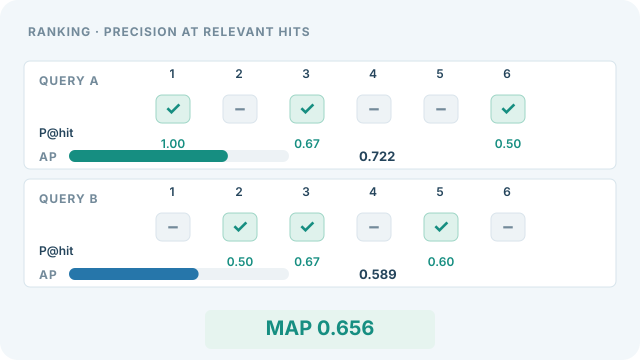

---
related:
  - engineering/evaluation
tags:
  - evaluation
  - metrics
  - ranking
---

# 平均精確率均值

平均精確率均值（MAP）是各查詢的平均精確率（average precision）再對所有查詢取平均。單一查詢的平均精確率，是排序列表中每個出現相關項目的位置上，精確率的平均。MAP 以二元相關性標籤來總結排序品質。

## 定義

對於一個查詢，設排序列表為 $1..N$，$P(k)$ 為前 $k$ 個結果中的精確率，且若第 $k$ 個項目相關則 $\text{rel}(k) = 1$。則

$$\text{AP} = \frac{1}{R} \sum_{k=1}^{N} P(k)\, \text{rel}(k)$$

其中 $R$ 是相關項目的數量。MAP 是所有查詢的 AP 平均。參考文獻中的 Manning 等人章節以此方式定義平均精確率。

請注意，scikit-learn 的 `average_precision_score` 是對一組分數計算 AP，即精確率—召回率曲線下面積的階梯式形式，對單一排序而言是同一個概念（見參考文獻）。

## 解讀

當相關項目被一致地放在前面時，MAP 會很高。它也獎勵找出所有相關項目，因為從未被檢索到的相關項目，對總和沒有任何貢獻。

## 何時使用

在相關性為是或否、且每個相關項目都重要的資訊檢索基準中，使用 MAP。當相關性有多個等級，或只有前幾名結果重要時，應改用 [NDCG](ndcg.md)。

## 視覺解讀：由兩個查詢得到 MAP

  

*原創教學視覺，CC BY-SA 4.0。* 此原創連續動畫不只顯示單一 AP，而是計算兩個查詢後再取平均。查詢 A 的二元相關性為 $(1,0,1,0,0,1)$，相關位置 1、3、6 的精確率為 $1$、$2/3$、$1/2$，所以 $\mathrm{AP}_A=0.722$。查詢 B 為 $(0,1,1,0,1,0)$，相關位置 2、3、5 的精確率為 $1/2$、$2/3$、$3/5$，故 $\mathrm{AP}_B=0.589$，而 $\mathrm{MAP}=(\mathrm{AP}_A+\mathrm{AP}_B)/2=0.656$。橘色外框隨名次移動；只有相關項目才增加 AP 的貢獻，灰色不相關項目不加分。每個查詢右側標示的是**最終 AP**；長條依序累積。所有資料與數值皆為人工設計、由公式驗算的教材示例，並非模型輸出。

網站可使用播放／暫停按鈕（鍵盤 Enter／Space），啟用降低動態效果偏好時預設顯示靜態預覽；手機可聚焦圖像區後以方向鍵橫向捲動。GitHub 直接顯示靜態圖。 [靜態 SVG 預覽](../../../../assets/concept-animations/map-precision-at-hits-still.svg)；[完整 SVG 動畫](../../../../assets/concept-animations/map-precision-at-hits-motion.svg)。

## 範例

取一個查詢，排序後的二元相關性標籤為 $(1, 0, 1, 0, 0, 1)$，其中 1 表示相關。在三個相關位置上的精確率分別為 $1/1$、$2/3$ 與 $3/6$。平均精確率為 $(1 + 2/3 + 1/2) / 3 \approx 0.72$。多個查詢的 MAP 就是這些值的平均。

## 性質與變體

- **二元相關性與召回率。** AP 除以 $R$（相關項目總數），而不是除以檢索到的數量。因此沒被檢索到的相關項目會拉低分數，使 MAP 對召回率敏感。
- **截斷變體。** MAP@$k$ 只計入前 $k$ 個結果中的相關項目。分母依慣例可為相關項目總數或 $k$，應說明採用的慣例。
- **幾何平均。** GMAP 取各查詢 AP 的幾何平均，對接近零的查詢懲罰更重。
- **限制。** MAP 假設判斷是完整的。未被標註的相關項目會被當作不相關，使分數偏低。

## 常見陷阱

- **查詢權重。** MAP 對每個查詢給予相同權重，因此少數有很多相關項目的查詢不會主導結果。應報告查詢數量。
- **判斷不完整。** 若有些相關項目沒有被標記，MAP 會被低估。這是測試集合的特性，不是排序本身的問題。

## 相關指標

[NDCG](ndcg.md)使用分級相關性，並依位置折損。家族概述見[排序指標](index.md)。

## 參考文獻

### 文章與文件

- Manning, C. D., Raghavan, P. & Schütze, H. *Evaluation of ranked retrieval results*, online edition of *Introduction to Information Retrieval*. https://nlp.stanford.edu/IR-book/html/htmledition/evaluation-of-ranked-retrieval-results-1.html — 為單一排序列表定義平均精確率，MAP 即是對查詢取平均。
- scikit-learn contributors. *average_precision_score*. https://scikit-learn.org/stable/modules/generated/sklearn.metrics.average_precision_score.html — 由分數計算平均精確率的 API 參考，以及其階梯式公式。

### 補充來源

- scikit-learn contributors. *Metrics and scoring: quantifying the quality of predictions*. https://scikit-learn.org/stable/modules/model_evaluation.html — 分類、迴歸與排序評分器的概述，以及各自的適用時機。
- Robertson, S. (2008). A new interpretation of average precision. 收於 *SIGIR 2008 論文集*。https://doi.org/10.1145/1390334.1390453 — 為平均精確率提出新的詮釋，並將其視為單一數字的檢索指標。
- Järvelin, K. & Kekäläinen, J. (2002). Cumulated gain-based evaluation of IR techniques. *ACM Transactions on Information Systems*。https://doi.org/10.1145/582415.582418 — 提出折扣累積增益，這是 NDCG 的基礎。
