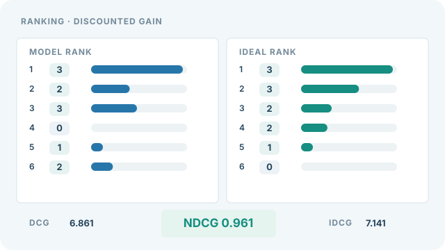

---
related:
  - engineering/evaluation
tags:
  - evaluation
  - metrics
  - ranking
---

# NDCG

正規化折損累積增益（NDCG）對排序列表的評分方式是：把每個項目的相關性加總，依其在列表中出現的位置折損，最後除以同一組項目的最佳可能分數。它的值介於 0 與 1 之間。

## 定義

對一組預測分數，項目依分數排序。每個項目的貢獻是其真實相關性除以位置的對數，因此排在越後面的項目權重越小。折損累積增益（DCG）是這些貢獻的總和。NDCG 是把 DCG 除以理想 DCG，後者是依真實相關性排序所得的值。

在 scikit-learn 中，`ndcg_score` 接受真實相關性與預測分數，並可選擇截斷值 $k$，只計算前 $k$ 個項目（見參考文獻）。

## 解讀

NDCG 為 1.0 表示排序已是理想的。由於每個位置都有折損，把一個高度相關的項目從第 1 名移到第 5 名，代價比從第 50 名移到第 54 名更大。此指標可以使用分級的相關性（例如 0 到 10），這是 MAP 做不到的。

## 何時使用

在搜尋與推薦中比較排序時使用 NDCG，特別是當相關性有多個等級，或只有前幾名結果重要時。此時應設定截斷值 $k$，並一併報告。

## 視覺解讀：逐名次累積 NDCG

  

*原創教學視覺，CC BY-SA 4.0。* 此原創連續動畫使用與上方範例相同的六個相關性等級 $(3,2,3,0,1,2)$。藍色長條是模型排序在各名次的線性折損貢獻 $\mathrm{rel}_i/\log_2(i+1)$；綠色是理想排序 $(3,3,2,2,1,0)$。橘色指示器沿名次移動，長條逐步伸展，最後得到 $\mathrm{DCG}=6.861$、$\mathrm{IDCG}=7.141$ 與 $\mathrm{NDCG}\approx0.961$。畫面底部顯示的是完整排序的**最終分數**，不是每一影格的中途累積值。這些數值是人工設計且可由公式重算的示意數值，並非實際搜尋系統的評測結果。

網站可使用播放／暫停按鈕（鍵盤 Enter／Space），啟用降低動態效果偏好時預設顯示靜態預覽；手機可聚焦圖像區後以方向鍵橫向捲動。GitHub 直接顯示靜態圖。 [靜態 SVG 預覽](../../../../assets/concept-animations/ndcg-position-discount-still.svg)；[完整 SVG 動畫](../../../../assets/concept-animations/ndcg-position-discount-motion.svg)。

## 範例

取六個項目，依模型排序後的分級相關性為 $(3, 2, 3, 0, 1, 2)$。折扣累積增益為 $\mathrm{DCG} = \sum_{i=1}^{6} \mathrm{rel}_i / \log_2(i + 1) \approx 6.86$。理想排序 $(3, 3, 2, 2, 1, 0)$ 的值為 $\mathrm{IDCG} \approx 7.14$，因此 NDCG 為 $6.86 / 7.14 \approx 0.96$。

## 性質與變體

- **增益與折扣。** 增益為相關性，折扣 $1 / \log_2(i + 1)$ 隨排名 $i$ 下降。Järvelin 與 Kekäläinen（2002）提出這一系列折扣累積增益。Scikit-learn 採用線性增益；網路搜尋常用指數增益 $2^{\mathrm{rel}} - 1$，更重視高等級的結果。
- **正規化。** 除以理想 DCG 後，同一組項目的最佳排序得 1，因此不同相關項目數的查詢之間可以比較。
- **截斷變體。** NDCG@$k$ 只在前 $k$ 個位置上計算 DCG 與理想 DCG，因此只衡量列表的前段。
- **限制。** 折扣的底數與增益函數都是慣例。兩篇論文報告的「NDCG」可能使用不同定義，因此應說明公式。

## 常見陷阱

- **依查詢正規化。** NDCG 先對每個查詢計算，再取平均。沒有相關項目的查詢需要說明採用的慣例。
- **截斷值。** $k = 10$ 與考慮所有項目的結果，回答的是不同問題。應連同分數一起報告截斷值。

## 相關指標

[MAP](map.md)使用二元相關性，並對相關項目的精確率取平均。家族概述見[排序指標](index.md)。

## 參考文獻

### 文章與文件

- scikit-learn contributors. *ndcg_score*. https://scikit-learn.org/stable/modules/generated/sklearn.metrics.ndcg_score.html — API 參考，給出定義、前 $k$ 名選項與範例。
- Manning, C. D., Raghavan, P. & Schütze, H. *Evaluation of ranked retrieval results*, online edition of *Introduction to Information Retrieval*. https://nlp.stanford.edu/IR-book/html/htmledition/evaluation-of-ranked-retrieval-results-1.html — 說明排序檢索的評估，這是發展折損增益指標的情境。

### 補充來源

- scikit-learn contributors. *Metrics and scoring: quantifying the quality of predictions*. https://scikit-learn.org/stable/modules/model_evaluation.html — 分類、迴歸與排序評分器的概述，以及各自的適用時機。
- scikit-learn contributors. *average_precision_score*. https://scikit-learn.org/stable/modules/generated/sklearn.metrics.average_precision_score.html — 由預測分數計算平均精確率的 API 參考，附階梯式公式。
- Wang, Y., Wang, L., Li, Y., He, D., Chen, W. & Liu, T.-Y. (2013). A theoretical analysis of NDCG type ranking measures. arXiv:1304.6480. https://arxiv.org/abs/1304.6480 — 對 NDCG 類排序指標及其位置折扣的理論分析。
