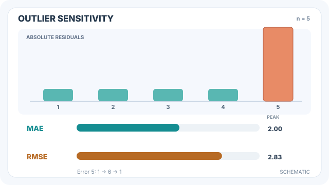

---
related:
  - engineering/evaluation
tags:
  - evaluation
  - metrics
  - regression
---

# 平均絕對誤差

平均絕對誤差（MAE）是預測值與真實值之差的絕對值之平均。它與目標值的單位相同，並且對每一單位的誤差一視同仁，無論誤差大小。

## 定義

$$\text{MAE} = \frac{1}{n} \sum_{i=1}^{n} |\hat{y}_i - y_i|$$

完美的模型得分為 0。這個數值代表典型的誤差大小，因此 MAE 為 2 表示預測平均差 2 個單位。

## 動畫解讀：線性誤差與平方誤差的差異

*原創教學動畫，CC BY-SA 4.0。GitHub 顯示高誤差狀態的靜態圖；MkDocs 網站可播放或暫停，手機版可聚焦後水平捲動。* [完整 SVG 動畫](../../../../assets/concept-animations/outlier-mae-rmse-motion.svg)。

在**人工示意**的五筆資料中，四個絕對殘差固定為 1，最後一筆從 1 連續增加到 6，再返回 1。MAE 由 $1$ 線性上升至 $(4+6)/5=2$；RMSE 則從 $1$ 上升至 $\sqrt{(4+6^2)/5}=\sqrt8\approx2.83$。右側數字是**峰值**，不是即時量測讀值；此處沒有訓練或評測模型。

## 解讀

由於 MAE 隨每個誤差線性增長，少數非常大的誤差只會按比例影響結果，而不會佔主導地位。它的最小化者是誤差的中位數，因此以 MAE 訓練的模型會預測接近條件中位數的值，而不是平均值。Willmott 與 Matsuura（2005）主張，這使 MAE 成為衡量平均模型表現較自然的指標。

## 何時使用

當誤差的代價與誤差大小成正比，而且結果需要以目標值的單位回報時，使用 MAE。若目標值中的離群值是真實存在的，但不應主導分數，MAE 也是合理的預設選擇。

## 範例

取真實值 $(3, -0.5, 2, 7)$ 與預測值 $(2.5, 0, 2, 8)$。絕對誤差為 $0.5, 0.5, 0, 1$，因此 MAE 為其平均 $0.5$。最大的誤差 1 所貢獻的，等於兩個 0.5 誤差的總和。

## 性質與變體

- **最小化者。** 使平均絕對誤差最小的常數是目標值的中位數，而使平方誤差最小的常數是平均數。因此 MAE 反映的是典型誤差，而非平均誤差。
- **單位與穩健性。** MAE 與目標值的單位相同，且隨誤差大小線性增加，因此相較於 RMSE，單一離群值的影響有限。
- **相對變體。** MAPE 把每個誤差除以真實值：$\frac{100\%}{n}\sum |y - \hat y| / |y|$。目標值為零時未定義；它也不對稱，低估的誤差最多為 100%，高估則無上限。
- **限制。** MAE 依賴尺度，若要比較以不同單位衡量的目標，需先做正規化。

## 常見陷阱

- **尺度。** 不同單位的目標值之間不能比較 MAE。應將目標值正規化，或改用如 [R²](r-squared.md) 這類相對指標來跨任務比較。
- **接近零的目標值。** 以 MAE 為基礎的相對誤差，在真實值接近零時需要小心；絕對形式可以避開這個問題，但看不出比例上的誤差。

## 相關指標

[RMSE](rmse.md) 是平方誤差的對應指標，對大誤差的懲罰更重。家族概述見[迴歸指標](index.md)。

## 參考文獻

### 文章與文件

- Willmott, C. J. & Matsuura, K. (2005). Advantages of the mean absolute error (MAE) over the root mean square error (RMSE) in assessing average model performance. *Climate Research* 30, 79–82. https://www.int-res.com/abstracts/cr/v30/n1/p79-82/ — 主張以 MAE 衡量平均模型誤差。
- scikit-learn contributors. *mean_absolute_error*. https://scikit-learn.org/stable/modules/generated/sklearn.metrics.mean_absolute_error.html — 迴歸損失的 API 參考，附有範例。

### 補充來源

- scikit-learn contributors. *Metrics and scoring: quantifying the quality of predictions*. https://scikit-learn.org/stable/modules/model_evaluation.html — 分類、迴歸與排序評分器的概述，以及各自的適用時機。
- scikit-learn contributors. *mean_squared_error*. https://scikit-learn.org/stable/modules/generated/sklearn.metrics.mean_squared_error.html — 均方誤差的 API 參考，即 RMSE 的平方形式，附有範例。
- Murphy, K. P. *Probabilistic Machine Learning: An Introduction*. MIT Press, 2022. https://probml.github.io/pml-book/book1.html — 提供免費線上草稿的機率機器學習教科書。
