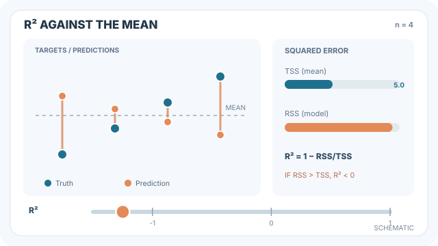

---
related:
  - engineering/evaluation
tags:
  - evaluation
  - metrics
  - regression
translation_reviewed: 2026-11-15
---

# R²（決定係數）

$R^2$ 比較模型的平方誤差與一個永遠預測真實值平均數的基準所產生的誤差。它可以解讀為模型所解釋的變異比例，而且無單位，因此可以跨不同尺度的目標值比較。

## 定義

$$R^2 = 1 - \frac{\sum_{i}(y_i - \hat{y}_i)^2}{\sum_{i}(y_i - \bar{y})^2}$$

其中 $\bar{y}$ 是真實值的平均數。完美的模型得分為 1.0。一個永遠預測 $\bar{y}$ 的模型得分為 0.0，比它還差的模型得分為負數。scikit-learn 的文件給出一個例子：預測值與真實值完全相反時，得分為 −3.0（見參考文獻）。

## 動畫解讀：與預測平均數的基準相比

*原創教學動畫，CC BY-SA 4.0。GitHub 顯示比平均數基準更差的靜態狀態；MkDocs 提供播放／暫停與鍵盤可聚焦的水平捲動。* [完整 SVG 動畫](../../../../assets/concept-animations/r2-mean-baseline-motion.svg)。

取**人工設定**的目標值 $y=(1,2,3,4)$，其平均數為 $\bar y=2.5$，因此 $\mathrm{TSS}=5$。預測值 $\hat y_i=y_i+k(\bar y-y_i)$ 由平均數基準（$k=1$、$R^2=0$）移向完美預測（$k=0$、$R^2=1$），再變成比基準更差的預測（$k=1.5$、$\mathrm{RSS}=11.25$、$R^2=-1.25$），最後返回。由於 $\mathrm{RSS}=5k^2$，因此 $R^2=1-k^2$，下方指示點隨公式移動。本動畫不是模型訓練軌跡，也不是實測評分。

### 互動實驗：跨越平均數基準

調整 $k$（0 至 1.5），即可重新計算四個預測值、殘差平方和與 $R^2=1-k^2$。當 $k=0$，預測與真實值相同；$k=1$ 時等於只預測平均數的基準（$R^2=0$）；$k=1.5$ 時得分為 $-1.25$。藍色圓點為固定真實值、橘色圓點為變動預測值，虛線表示真實值平均數。支援播放／暫停、單步、重設、調速、鍵盤操作與減少動態效果設定。**這是決定性人工示例，不是模型訓練軌跡。** GitHub 可直接閱讀前方的靜態圖。

預測點下方的 **TSS** 與 **RSS** 長條使用相同的固定尺度，垂直虛線標示 TSS = 5。當 $k=1$，兩條等長（$\mathrm{RSS}=\mathrm{TSS}$，故 $R^2=0$）；當 $k>1$，RSS 超過 TSS，$R^2$ 因而變成負數。這些長條代表平方和，**不是實測評分軌跡**。

## 解讀

$R^2$ 回答的問題與 MAE 或 RMSE 不同。後兩者說明誤差有多大；$R^2$ 說明模型是否比平均值做得更好。當目標值的變異很小時，即使 RMSE 也很小，$R^2$ 仍可能很低，因此兩者應一起解讀。

## 何時使用

當要總結模型解釋了多少目標值的變異，或要在同一資料上比較模型時，使用 $R^2$。若要判斷預測在使用者關心的單位下準不準，它就較不適用。

## 範例

取真實值 $(3, -0.5, 2, 7)$ 與預測值 $(2.5, 0, 2, 8)$，真實值的平均為 $2.875$，總平方和為 $29.19$，殘差平方和為 $1.5$，因此 $R^2 = 1 - 1.5 / 29.19 \approx 0.949$。這裡模型解釋了約 95% 的變異，但這個數字本身無法說明 0.5 單位的誤差是否可以接受。

## 性質與變體

- **分解。** $R^2 = 1 - \mathrm{SS}_{\mathrm{res}} / \mathrm{SS}_{\mathrm{tot}}$。對含截距項、以最小平方法擬合並在訓練資料上評估的模型，$R^2$ 介於 0 與 1 之間，且等於預測值與目標值相關係數的平方。在簡單線性迴歸中，它等於 $x$ 與 $y$ 的皮爾森相關係數平方。
- **樣本外。** 在保留的資料上，$R^2$ 可以是負值，因為預測可能比測試集平均值還差。訓練集上的數值不是樣本外的分數。
- **調整與預測變體。** 調整後 $R^2$ 會懲罰預測變數的個數。預測用的 $R^2$（常寫為 $Q^2$）使用保留資料的預測，若目標是預測，應報告這個。
- **限制。** 高 $R^2$ 不能揭露偏差，也不能證明關係是線性的或模型是正確的。

## 常見陷阱

- **測試集的變異。** $R^2$ 取決於測試目標值的變異。同樣的誤差，在一個資料集上可能得高分，在另一個變異較大的資料集上卻得低分。
- **非線性與樣本外使用。** 在保留資料上，$R^2$ 可能為負數，它並不以零為下界。
- **不是擬合的保證。** $R^2$ 高並不表示模型正確，只表示相對於目標值的分散程度，誤差很小。

## 相關指標

[MAE](mae.md)與 [RMSE](rmse.md) 以目標值的單位給出誤差。家族概述見[迴歸指標](index.md)。

## 參考文獻

### 文章與文件

- scikit-learn contributors. *r2_score*. https://scikit-learn.org/stable/modules/generated/sklearn.metrics.r2_score.html — API 參考，給出定義、最佳值 1.0、負值的意義與範例。
- scikit-learn contributors. *Metrics and scoring: quantifying the quality of predictions*. https://scikit-learn.org/stable/modules/model_evaluation.html — 迴歸評分器的概述與用法。

### 補充來源

- Murphy, K. P. *Probabilistic Machine Learning: An Introduction*. MIT Press, 2022. https://probml.github.io/pml-book/book1.html — 提供免費線上草稿的機率機器學習教科書。
- scikit-learn contributors. *mean_squared_error*. https://scikit-learn.org/stable/modules/generated/sklearn.metrics.mean_squared_error.html — 均方誤差的 API 參考，即 RMSE 的平方形式，附有範例。
- *The Elements of Statistical Learning: Data Mining, Inference, and Prediction*, 2nd edition. https://hastie.su.domains/ElemStatLearn/ — 統計學習的標準教科書，涵蓋其評估方法。
