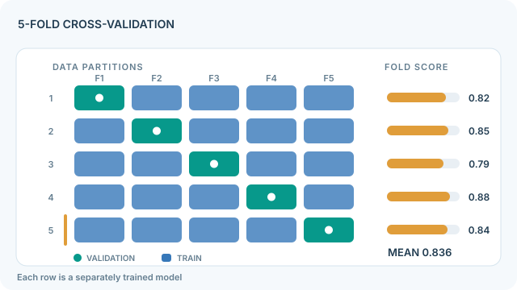

---
related:
  - engineering/evaluation
  - theory/evaluation/protocols/index.md
tags:
  - evaluation
  - protocols
  - statistics
---

# Cross-Validation

Cross-validation estimates how well a model generalises by training and testing it on several different splits of the same data, then averaging the results. It makes better use of small datasets than one train-test split, and it was introduced as a way to choose and assess predictive models without spending all the data on a single test set (Stone, 1974).

## Procedure

In k-fold cross-validation, the data is divided into k folds. Each fold is held out once as the test set while the model trains on the others, and the k scores are averaged. Stratified folds keep the class proportions the same in every fold, which matters when classes are imbalanced. Group folds keep all examples from one unit, such as one patient, in the same fold.

## Animated five-fold walkthrough

[View original continuously animated SVG](../../../../assets/concept-animations/cv-fold-rotation-motion.svg)

Columns F1–F5 represent disjoint data partitions and **each row is a freshly fitted model**: the teal cell is its held-out validation fold, while the four blue cells supply training data. The scan marker moves through five separate fits; it does **not** mean one model trains incrementally across the rows. Illustrative fold scores $0.82, 0.85, 0.79, 0.88, 0.84$ average to $0.836$; they are **not measured scores**. When cross-validation is used for hyperparameter selection, use a separate outer evaluation loop (nested CV) rather than reporting the selection score as unbiased test performance. Play/Pause works with keyboard controls on MkDocs; the 640-pixel figure can be scrolled on narrow screens.

[Open GitHub-readable static fallback](../../../../assets/concept-animations/cv-fold-rotation-still.svg). *Original instructional figure, CC BY-SA 4.0.*

## Choosing hyperparameters

Cross-validation is also used to choose settings. When that is done, the outer loop must be separate from the inner loop that selects settings, or the reported score will be optimistic. A nested design uses an inner loop for selection and an outer loop for the final estimate.

## Reporting

State the number of folds, whether the folds are stratified or grouped, whether the folds are shuffled, and the spread of the fold scores as well as their mean. Each fold has its own variance, so the mean alone does not show how stable the result is.

## Limitations

- **Dependence between folds.** Duplicate or related examples split across folds inflate the estimate.
- **Time order.** Shuffled folds are invalid for forecasting, where only earlier data may train a model that predicts later data.
- **Overlap with training.** Folds reused across many comparisons can favour whichever method was tuned on them.

## Related

- [Protocols overview](../index.md) describes the splits in more detail.
- [Paired bootstrap](paired-bootstrap.md) estimates uncertainty for the difference between two methods.

## References

### Seminal papers

- Stone, M. (1974). *Cross-Validatory Choice and Assessment of Statistical Predictions*. Journal of the Royal Statistical Society: Series B. https://doi.org/10.1111/j.2517-6161.1974.tb00994.x — Introduces cross-validation as a method for choosing and assessing predictive models.

### Articles and documentation

- scikit-learn contributors. *Cross-validation: evaluating estimator performance*. https://scikit-learn.org/stable/modules/cross_validation.html — Explains k-fold, stratified, group and time-aware splitting.
- Liang, P. et al. (2022). *Holistic Evaluation of Language Models*. arXiv. https://arxiv.org/abs/2211.09110 — Evaluates models across scenarios and metrics, so a single split can hide trade-offs.

### Additional sources

- Recht, B. et al. (2019). *Do ImageNet Classifiers Generalize to ImageNet?* arXiv. https://arxiv.org/abs/1902.10811 — Shows that a re-collected test set can reveal fit to the original collection.
- Raji, I. D. & Bender, E. M. et al. (2021). *AI and the Everything in the Whole Wide World Benchmark*. arXiv. https://arxiv.org/abs/2111.15366 — Examines construct validity and the limits of broad claims from benchmarks.
- Chollet, F. (2019). *On the Measure of Intelligence*. arXiv. https://arxiv.org/abs/1911.01547 — Argues that skill on a fixed task is a weak measure of intelligence.
