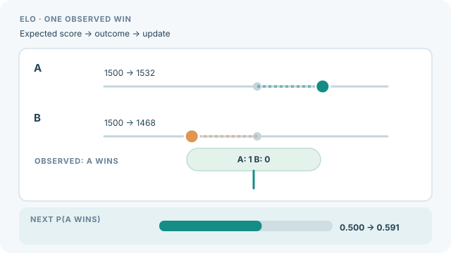

---
related:
  - engineering/evaluation
  - theory/evaluation/protocols/index.md
tags:
  - evaluation
  - protocols
  - statistics
---

# Elo Rating and Arenas

Elo rating and arenas rank systems from pairwise outcomes: a judge, human or model, picks the better of two answers, and each win or loss moves the ratings. The rating model is a Bradley-Terry model, which estimates a strength for each system from the probability that one beats another (Bradley & Terry, 1952). Chatbot Arena applies this to human preferences on open-ended prompts (Chiang et al., 2024).

## Procedure

Each comparison records a winner or a tie. The strengths are fitted so that the predicted win probabilities match the observed outcomes, and the Elo scale is one way to present them. Systems are often paired at random, and pairs are sometimes weighted towards close contests to use the data efficiently. Confidence intervals come from resampling the comparisons, which is a case of the bootstrap described in [paired bootstrap](paired-bootstrap.md).

### Visual walkthrough

  

*Original continuous teaching diagram, CC BY-SA 4.0. On the website use Play/Pause (or Enter/Space on the button). For an **illustrative online Elo update**, both ratings start at 1500, the expected score is 0.5, and **K=64**. After observing one decisive win by A, the rule R′ = R + K(S − E) gives A=1532 and B=1468; the next predicted probability is 1/(1+10^((1468−1532)/400)) ≈ 0.591. **This is a constructed example, not actual arena data.** A fitted Bradley–Terry ranking or bootstrap confidence interval is a separate estimation procedure; the animation does not claim arena systems update their ratings this way. [GitHub-readable still](../../../../assets/concept-animations/elo-online-update-still.svg).*

## Reporting

Report the number of comparisons, the sampling of pairs, the rating model, the confidence intervals and how ties were handled. Ranks that differ by a small margin are often statistically indistinguishable, so the interval matters more than the order.

## Limitations

- **Prompt mix.** The ranking reflects the prompts that were sampled, which may not match the uses that matter.
- **Judge bias.** When the judges are models, their biases carry over to the ranking (Zheng et al., 2023).
- **Model updates.** A changing set of systems and a changing rating scale make old ratings hard to compare.

## Related

- [LLM as judge](llm-as-judge.md) supplies the judgements that many arenas use.
- [Protocols overview](../index.md) lists the other protocol methods.

## References

### Seminal papers

- Bradley, R. A. & Terry, M. E. (1952). *Rank Analysis of Incomplete Block Designs: I. The Method of Paired Comparisons*. Biometrika. https://doi.org/10.2307/2334029 — Introduces the model that gives each item a strength from pairwise outcomes.
- Chiang, W.-L. et al. (2024). *Chatbot Arena: An Open Platform for Evaluating LLMs by Human Preference*. arXiv. https://arxiv.org/abs/2403.04132 — Ranks language models from crowdsourced pairwise preferences.

### Articles and documentation

- Zheng, L. et al. (2023). *Judging LLM-as-a-Judge with MT-Bench and Chatbot Arena*. arXiv. https://arxiv.org/abs/2306.05685 — Compares model-based judges with human preferences and reports their biases.

### Additional sources

- Liang, P. et al. (2022). *Holistic Evaluation of Language Models*. arXiv. https://arxiv.org/abs/2211.09110 — Evaluates models across scenarios and metrics to expose trade-offs.
- Raji, I. D. & Bender, E. M. et al. (2021). *AI and the Everything in the Whole Wide World Benchmark*. arXiv. https://arxiv.org/abs/2111.15366 — Examines construct validity and the limits of broad claims from benchmarks.
