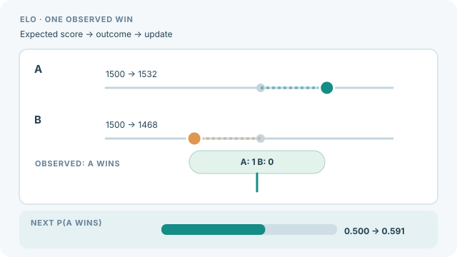

# Elo 評分與競技場

Elo 評分與競技場從成對結果為系統排名：評審（人類或模型）從兩個答案中挑出較好的一個，每次勝負都會改變評分。評分模型是 Bradley-Terry 模型，它根據一方擊敗另一方的機率，估計每個系統的強度（Bradley & Terry, 1952）。Chatbot Arena 把這套方法用於開放式提示上的人類偏好（Chiang et al., 2024）。

## 程序

每一次比較記錄勝者或平手。強度的擬合目標，是讓預測的勝率與觀察到的結果相符；Elo 尺度只是呈現方式之一。系統通常隨機配對，有時也會偏重勢均力敵的比賽，以有效運用資料。信賴區間可由重抽樣比較結果得到，這是 [配對自助法](paired-bootstrap.md) 所述自助法的一個例子。

### 動態示意

  

*原創連續教學動畫，CC BY-SA 4.0。網站可用播放／暫停按鈕及 Enter／Space 操作。此為**線上 Elo 更新的人工示例**：兩者初始分數均為 1500，預期得分 0.5，並設 K=64。A 贏得一次比較後，依 R′ = R + K(S − E)，A 更新為 1532、B 為 1468；下一次 A 的預期勝率為 1/(1+10^((1468−1532)/400)) ≈ 0.591。**所有數值皆非競技場實測。** 以 Bradley–Terry 模型重新擬合排名，以及用 Bootstrap 估計信賴區間，都是不同的估計程序；本圖不暗示所有競技場都採逐局 Elo 更新。[GitHub 靜態預覽](../../../../assets/concept-animations/elo-online-update-still.svg)。*

## 報告

報告比較次數、配對的抽樣方式、評分模型、信賴區間，以及平手的處理方式。排名相差很小的系統，通常在統計上無法區分，因此區間比順序更重要。

## 限制

- **提示組合。** 排名反映的是被抽樣的提示，未必符合真正重要的用途。
- **評審偏誤。** 若評審是模型，它們的偏誤會延續到排名中（Zheng et al., 2023）。
- **模型更新。** 系統組合與評分尺度不斷變動，使舊的評分難以比較。

## 相關

- [LLM 作為評審](llm-as-judge.md) 提供許多競技場所使用的判定。
- [評估協定概述](../index.md) 列出其他協定方法。

## 參考文獻

### 開創性論文

- Bradley, R. A. & Terry, M. E. (1952). *Rank Analysis of Incomplete Block Designs: I. The Method of Paired Comparisons*. Biometrika. https://doi.org/10.2307/2334029 — 介紹從成對結果為每個項目給定強度的模型。
- Chiang, W.-L. et al. (2024). *Chatbot Arena: An Open Platform for Evaluating LLMs by Human Preference*. arXiv. https://arxiv.org/abs/2403.04132 — 從眾包的成對偏好為語言模型排名。

### 文章與文件

- Zheng, L. et al. (2023). *Judging LLM-as-a-Judge with MT-Bench and Chatbot Arena*. arXiv. https://arxiv.org/abs/2306.05685 — 比較以模型為基礎的評審與人類偏好，並報告其偏誤。

### 補充來源

- Liang, P. et al. (2022). *Holistic Evaluation of Language Models*. arXiv. https://arxiv.org/abs/2211.09110 — 跨情境與指標評估模型，揭露其取捨。
- Raji, I. D. & Bender, E. M. et al. (2021). *AI and the Everything in the Whole Wide World Benchmark*. arXiv. https://arxiv.org/abs/2111.15366 — 探討構念效度，以及由基準推出廣泛結論的限制。
