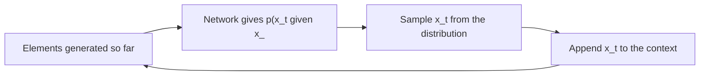

# Autoregressive Generative Models

Autoregressive generative models write the probability of a whole object as a product of predictions, each conditioned on the parts before it, \(p(x)=\prod_t p(x_t\mid x_{<t})\). They generate data by sampling one part at a time. The same recipe drives language models, pixel-level image models such as PixelCNN, audio models such as WaveNet, and the Transformer decoders that now model image and audio tokens.

## Overview

Any joint distribution can be split into conditionals by the chain rule of probability. The split is only useful if each conditional can be learned, and autoregressive models learn them with a single network that reads the previous elements in a fixed order. Training is then ordinary maximum likelihood, so the model gives an exact value for the likelihood of every example. This is the property that separates autoregressive models from [VAEs](../vae/index.md) and [GANs](../gan/index.md), and it is why the family appears in the [Generative Models](../index.md) overview.

The price is generation speed. During training, every conditional can be computed at once, because the true earlier values are known. During sampling, each new element must be drawn before the next can be predicted, so generating a sequence of length \(T\) takes \(T\) passes through the network. [Diffusion models](../diffusion/index.md) make the opposite trade-off, refining a whole object over a fixed number of steps.

Next-token prediction is the same model applied to text. A [large language model](../../models/llm/index.md) is an autoregressive model over tokens, and its training objective is the log-likelihood defined above. The family has therefore been applied to text, speech, images, video and music, and the methods differ mainly in what the "elements" are and how the conditionals are computed.

## Key concepts

- **Factorisation**: a joint distribution over an ordered sequence, \(p(x_1,\dots,x_T)=\prod_t p(x_t\mid x_{<t})\). The order is a modelling choice, and for images and audio it is usually fixed, such as raster order or time order.
- **Causal masking**: a constraint that stops the prediction at position \(t\) from seeing positions \(t\) and later. It is enforced with masked convolutions, causal convolutions or a triangular attention mask.
- **Parallel training and sequential sampling**: masked architectures compute all conditionals in one pass during training, but sample one element per pass at generation time.
- **Discrete outputs**: each conditional is a softmax over a finite set of values, such as 256 intensity levels or a vocabulary of tokens.
- **Tokenisers**: many models work on discrete units rather than raw data. Text is split into [tokens](../../models/llm/tokenisation/index.md), while images and audio can be mapped to tokens by a learned quantiser, such as the [VQ-VAE](../vae/vq-vae/index.md).
- **Bits per dimension**: the negative log-likelihood in base 2 divided by the number of values in an example. It is the usual score for pixel-level and waveform-level models.

## How it works

The model defines the probability of a sequence \(x = (x_1,\dots,x_T)\) as

\[
p(x) = \prod_{t=1}^{T} p_\theta\big(x_t \mid x_{<t}\big)
\]

and is trained by minimising the negative log-likelihood, \(-\sum_t \log p_\theta(x_t\mid x_{<t})\), over a dataset. The network that computes each conditional may be a masked convolution, a dilated causal convolution or a Transformer with causal attention. Whatever the architecture, generation follows the same loop:

Two design choices decide most of the behaviour. The first is the tokeniser or input representation, which fixes the sequence length. Pixels, colour palettes, waveform samples and learned codes give sequences of very different lengths for the same content. The second is the context the network can use, the receptive field for a convolution or the attention span for a Transformer. A larger context captures longer-range structure, but at higher cost per step.

## Key methods

Three landmark methods show how the choices above play out for pixels and audio samples. Each has its own page with the problem, equations, results and limitations.

| Method | Year | Data | Architecture | Main idea |
|---|---|---|---|---|
| [PixelCNN](pixelcnn/index.md) | 2016 | Image pixels | Masked convolutions | Predict each pixel from earlier pixels in raster order, with parallel training |
| [WaveNet](wavenet/index.md) | 2016 | Raw audio samples | Dilated causal convolutions | Predict each waveform sample, with a receptive field of hundreds of milliseconds |
| [Image GPT](image-gpt/index.md) | 2020 | Low-resolution pixels or colour tokens | Transformer decoder | Predict pixels with no convolutional structure, and learn features for classification |

PixelCNN and WaveNet keep the convolutional inductive biases of their inputs, while Image GPT removes them. Token-based systems, such as VQ-VAE priors and audio language models, apply the same objective to learned codes, which keeps sequences short.

## Connections

- **Language.** The language case is the [large language models](../../models/llm/index.md) page, and the tokens it uses are covered in [Tokenisation](../../models/llm/tokenisation/index.md). This page does not repeat that material.
- **Speech and audio.** Waveform models such as WaveNet, codec-token models and speech language models are surveyed in [Speech and audio](../../models/speech/index.md).
- **Discrete codes.** The [VQ-VAE](../vae/vq-vae/index.md) learns the codes that PixelCNN and WaveNet-style priors model, and Image GPT uses a VQ-VAE for its higher-resolution inputs.
- **Flows.** [Masked autoregressive flows](../normalising-flows/masked-autoregressive-flow/index.md) use the same masking to evaluate densities in one pass, while sampling stays sequential. Inverse autoregressive flows reverse that trade-off, and Parallel WaveNet uses one to match a WaveNet.
- **Masked prediction.** BERT-style models predict masked positions from both sides rather than from the past only. The alternative is covered in [Masked prediction](../../paradigms/self-supervised/masked-prediction/index.md).
- **Brain and mind.** Predictive processing gives the closest brain link. Schrimpf et al. (2021) found that language models that predict the next word better also predict brain measurements better across datasets, and Goldstein et al. (2022) found that the brain makes continuous next-word predictions before each word arrives.[^1] See [Language in the brain](../../../brain-mind/language-in-brain/index.md) and [Predictive coding](../../../brain-mind/predictive-coding/index.md).

## Applications

- **Language and code.** Autoregressive language models generate text, code and dialogue, as described in [Large language models](../../models/llm/index.md).
- **Speech.** WaveNet was rated as more natural than the best parametric and concatenative systems of its time (van den Oord et al., 2016). Its faster distilled version, Parallel WaveNet, was deployed in Google Assistant (van den Oord et al., 2017). Codec-token models such as VALL-E (Wang et al., 2023) synthesise speech from a short prompt.
- **Images.** Transformers over text and image tokens generate images from prompts (Ramesh et al., 2021). Image GPT's pixel-trained features reach 96.3% linear-probe accuracy on CIFAR-10 (Chen et al., 2020).
- **Music.** Jukebox models VQ-VAE codes with autoregressive Transformers, producing songs that stay coherent for minutes (Dhariwal et al., 2020).
- **Compression.** A model that assigns probability to data gives a code for it, with arithmetic coding close to the ideal length. This is why bits per dimension is a compression score.[^2]

## Open questions

- **Speed against likelihood.** Sequential sampling is the main cost. Whether distillation, parallel decoding or non-autoregressive models can keep the quality of the sequential model is an active question.
- **Choice of order and tokens.** A fixed raster or time order is a convenience. How much the order and the tokeniser limit what the model can represent is not settled.
- **Long-range structure.** Music and long speech need coherence over minutes. Whether next-token models can learn it at scale, or need hierarchical codes, is debated.
- **Brain evidence.** The brain-model results are correlational. Whether the brain uses prediction in the same way as these models is open.

[^1]: These studies compare model activations with brain recordings during natural language. They show that the two share a predictive structure, not that the brain runs the same algorithm as a Transformer or that it generates speech autoregressively.
[^2]: The correspondence is approximate. Arithmetic coding adds a small overhead above the ideal code length, which the PixelRNN paper also mentions.

## References

### Seminal papers

- van den Oord, A., Kalchbrenner, N. & Kavukcuoglu, K. (2016). *Pixel Recurrent Neural Networks*. ICML (PMLR 48). https://arxiv.org/abs/1601.06759 — Introduces PixelRNN and PixelCNN, pixel-by-pixel autoregressive models of natural images.
- van den Oord, A. et al. (2016). *WaveNet: A Generative Model for Raw Audio*. arXiv. https://arxiv.org/abs/1609.03499 — Autoregressive model of raw speech and music waveforms built from dilated causal convolutions.
- Graves, A. (2013). *Generating Sequences With Recurrent Neural Networks*. arXiv. https://arxiv.org/abs/1308.0850 — Shows that recurrent networks predicting one value at a time generate long sequences of text and handwriting.
- Brown, T. B. et al. (2020). *Language Models are Few-Shot Learners*. arXiv. https://arxiv.org/abs/2005.14165 — Scales an autoregressive Transformer language model to 175 billion parameters and tests few-shot prompting.
- Chen, M. et al. (2020). *Generative Pretraining From Pixels*. ICML (PMLR 119). https://proceedings.mlr.press/v119/chen20s.html — Trains a GPT-2-style Transformer to predict pixels, and reports features that work for classification.
- van den Oord, A., Vinyals, O. & Kavukcuoglu, K. (2017). *Neural Discrete Representation Learning*. arXiv. https://arxiv.org/abs/1711.00937 — Learns discrete codes that an autoregressive prior can model to generate images and speech.
- Ramesh, A. et al. (2021). *Zero-Shot Text-to-Image Generation*. arXiv. https://arxiv.org/abs/2102.12092 — A Transformer that models text and image tokens as one autoregressive stream.
- Borsos, Z. et al. (2022). *AudioLM: a Language Modeling Approach to Audio Generation*. arXiv. https://arxiv.org/abs/2209.03143 — Casts audio generation as language modelling over discrete semantic and acoustic tokens.

### Surveys and textbooks

- Bond-Taylor, S., Leach, A., Long, Y. & Willcocks, C. G. (2021). *Deep Generative Modelling: A Comparative Review of VAEs, GANs, Normalizing Flows, Energy-Based and Autoregressive Models*. arXiv. https://arxiv.org/abs/2103.04922 — Compares autoregressive models with the other deep generative families and their trade-offs.

### Articles and documentation

- Schrimpf, M. et al. (2021). The neural architecture of language: Integrative modeling converges on predictive processing. *PNAS*. https://doi.org/10.1073/pnas.2105646118 — Links next-word prediction in language models to human brain responses during language processing.
- Goldstein, A. et al. (2022). Shared computational principles for language processing in humans and deep language models. *Nature Neuroscience*. https://doi.org/10.1038/s41593-022-01026-4 — Reports continuous next-word prediction and surprise signals in human brain recordings.
