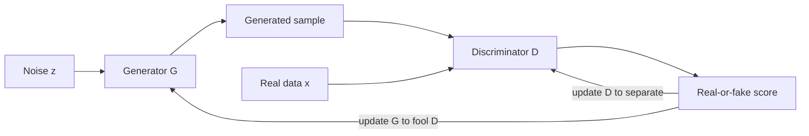

# Generative Adversarial Networks

A generative adversarial network (GAN) trains two neural networks against each other: a **generator** that turns random noise into samples, and a **discriminator** that tries to tell generated samples from real data. The generator improves by learning to fool the discriminator. GANs were a leading route to realistic image synthesis for several years. Diffusion models now lead many image tasks, but GANs remain useful where fast sampling matters.

## Overview

Goodfellow et al. (2014) introduced GANs as a way to estimate a generative model without writing down a likelihood, without Markov chains and without approximate inference. The paper explains the idea with an analogy: a team of counterfeiters tries to produce banknotes that a police unit cannot tell apart from real ones. Each side improves in response to the other.

Among the families of [Generative Models](../index.md), GANs trade stable training for fast sampling: one forward pass through the generator. Training, however, is a two-player game and can be unstable. [Diffusion models](../diffusion/index.md) take the opposite trade: a simple regression objective, but many denoising steps at sampling time.

## Key concepts

- **Generator** \(G\): a function that maps a noise vector \(z\), drawn from a simple prior \(p_z\), to a sample \(G(z)\). The distribution of these samples, \(p_g\), is defined implicitly, so the generator has no explicit density.
- **Discriminator** \(D\): a function that outputs the probability that its input came from the training data rather than from the generator.
- **Minimax game**: the two networks optimise one value function in opposite directions. The discriminator maximises it and the generator minimises it.
- **Nash equilibrium**: a state in which neither player gains by changing its own parameters alone. In the ideal case the discriminator outputs one half for every input.
- **Mode collapse**: the generator produces only a few kinds of output and covers part of the data distribution. Arjovsky et al. (2017) list it among the problems their alternative objective addresses.
- **Lipschitz constraint**: a limit on how fast a function can change with its input. Several GAN variants constrain the discriminator, or critic, in this way to keep training stable.
- **Conditional GAN**: a GAN in which both networks also receive extra information, such as a class label or an input image (Mirza & Osindero, 2014).

## How it works

The original objective is a minimax problem over a value function \(V(D, G)\):

\[
\min_G \max_D V(D, G) = \mathbb{E}_{x \sim p_{\text{data}}}\big[\log D(x)\big] + \mathbb{E}_{z \sim p_z}\big[\log\big(1 - D(G(z))\big)\big]
\]

The discriminator maximises this value, so it assigns high scores to real data and low scores to generated data. The generator minimises the second term, which pushes its samples toward regions the discriminator labels as real. For a fixed generator, the best discriminator is \(D^*(x) = p_{\text{data}}(x) / (p_{\text{data}}(x) + p_g(x))\). Substituting it back shows that the criterion equals a constant plus twice the Jensen–Shannon divergence between the data and generator distributions, so the global optimum is reached when \(p_g = p_{\text{data}}\) (Goodfellow et al., 2014).

The networks cannot be optimised to completion at every step, so training alternates between updates. The paper's minibatch procedure is:

1. Sample a minibatch of noise vectors and a minibatch of real examples.
2. Update the discriminator by ascending the stochastic gradient of \(\log D(x) + \log(1 - D(G(z)))\).
3. Repeat steps 1 and 2 a number of times, \(k\), before updating the generator. The paper used \(k = 1\) in its experiments.
4. Sample a fresh minibatch of noise vectors and update the generator.

Early in training the discriminator can reject generated samples with high confidence, so the term \(\log(1 - D(G(z)))\) saturates and gives the generator little gradient. The paper therefore suggests training the generator to maximise \(\log D(G(z))\) instead, which has the same fixed point and stronger early gradients.

## Key methods

Three landmark methods are compared below. Each has its own page with the problem, core idea, equations or algorithm, results and limitations.

| Method | Year | What it changes | Main idea |
|---|---|---|---|
| [Original GAN](original-gan/index.md) | 2014 | Defines the adversarial framework | A minimax game between two multilayer perceptrons, trained by backpropagation |
| [DCGAN](dcgan/index.md) | 2015 | Convolutional architecture | Architectural rules, such as strided convolutions and batch normalisation, that make convolutional GANs train stably on images |
| [Wasserstein GAN](wgan/index.md) | 2017 | Training objective | Replaces the Jensen–Shannon-based criterion with the Wasserstein-1 distance, estimated by a critic whose weights are clipped |

Other refinements have no separate page. Spectral normalisation (Miyato et al., 2018) rescales each discriminator weight matrix to unit spectral norm. StyleGAN, described under [Applications](#applications), changes the generator instead.

## Connections

- **Generative modelling:** GANs are one family in the wider [Generative Models](../index.md) overview, contrasted there with autoregressive models, VAEs, flows and [diffusion models](../diffusion/index.md).
- **Density estimation:** GANs do not give a likelihood, so they sit outside the likelihood-based methods in [Density Estimation and Generative Models](../../paradigms/unsupervised/density-and-generative-models/index.md).
- **Convolutional networks:** image GANs are built from the layers in [Convolutional Networks](../../models/cnn/index.md).
- **Brain and mind:** the nearest brain-inspired ancestors of GANs are the Helmholtz machine (Dayan et al., 1995) and the wake–sleep algorithm (Hinton et al., 1995). Both train a generative model together with a recognition model, using bottom-up and top-down connections. The adversarial competition in GANs has no established counterpart in cortex. The link to the brain is conceptual: perception as inference over a generative model is developed in [Predictive Coding](../../../brain-mind/predictive-coding/index.md).
- **Creative work:** GAN-based image synthesis is a central tool in [Art & Creativity](../../../applications/creative/index.md).

[^1]: The analogy between the wake–sleep algorithm and modern generative-model training is suggestive rather than established. Neither the Helmholtz machine nor wake–sleep is a model of a specific cortical circuit.

## Applications

- **Face and object synthesis.** StyleGAN (Karras et al., 2019) borrows ideas from style transfer. Its generator starts from a learned constant and injects style at each layer, which separates high-level attributes, such as pose and identity, from stochastic detail, such as freckles and hair. A successor (Karras et al., 2020) refines the design. Progressive growing (Karras et al., 2018) trained the generator and discriminator at increasing resolution and produced CelebA images at 1024 × 1024.
- **Image-to-image translation.** pix2pix (Isola et al., 2017) uses a conditional GAN on paired images, for example to map label maps to photographs. CycleGAN (Zhu et al., 2017) learns translation between domains without paired examples, using a cycle-consistency loss.

## Open questions

- **Convergence.** Mescheder et al. (2018) show that unregularised GAN training need not converge when the data and generator distributions are not absolutely continuous, and that instance noise and zero-centred gradient penalties help.
- **Evaluation.** Without a likelihood, quality has to be judged indirectly. The Fréchet Inception Distance (FID) compares the statistics of image features from real and generated samples (Heusel et al., 2017).[^2] It is widely used, but one number cannot capture every failure mode, such as memorisation or lack of diversity.
- **Fidelity against variety.** Brock et al. (2019) show that a truncation trick on the input noise trades sample fidelity against variety. Keeping both at very large scale remains a research problem.
- **Role against diffusion.** It is unclear whether GANs can match diffusion models at large scale while keeping one-step sampling.

[^2]: FID is computed from Gaussian fits to Inception features, so its value depends on the feature extractor and sample size. Comparisons are meaningful only under the same protocol.

## References

### Seminal papers

- Goodfellow, I. et al. (2014). *Generative Adversarial Nets*. NeurIPS. https://arxiv.org/abs/1406.2661 — Introduces the adversarial framework, minimax objective and training procedure analysed here.
- Arjovsky, M. & Bottou, L. (2017). *Towards Principled Methods for Training Generative Adversarial Networks*. ICLR. https://arxiv.org/abs/1701.04862 — Analyses why GAN training is unstable and why the original objective saturates.
- Radford, A., Metz, L. & Chintala, S. (2015). *Unsupervised Representation Learning with Deep Convolutional Generative Adversarial Networks*. ICLR. https://arxiv.org/abs/1511.06434 — Gives the architectural guidelines of DCGAN and shows learned features for classification.
- Arjovsky, M., Chintala, S. & Bottou, L. (2017). *Wasserstein GAN*. ICML. https://arxiv.org/abs/1701.07875 — Replaces the divergence in the GAN objective with the Wasserstein-1 distance, giving more useful gradients.
- Gulrajani, I. et al. (2017). *Improved Training of Wasserstein GANs*. NeurIPS. https://arxiv.org/abs/1704.00028 — Replaces weight clipping in the critic with a gradient penalty for more stable training.
- Mirza, M. & Osindero, S. (2014). *Conditional Generative Adversarial Nets*. arXiv. https://arxiv.org/abs/1411.1784 — Feeds a label into both networks, showing that GANs can generate digits conditioned on their class.
- Miyato, T. et al. (2018). *Spectral Normalization for Generative Adversarial Networks*. ICLR. https://arxiv.org/abs/1802.05957 — Stabilises the discriminator by constraining the spectral norm of each weight matrix to control its Lipschitz constant.
- Karras, T. et al. (2018). *Progressive Growing of GANs for Improved Quality, Stability, and Variation*. ICLR. https://arxiv.org/abs/1710.10196 — Grows both networks progressively in resolution, producing high-resolution CelebA images.
- Karras, T. et al. (2019). *A Style-Based Generator Architecture for Generative Adversarial Networks*. CVPR. https://arxiv.org/abs/1812.04948 — Introduces StyleGAN, a generator that separates high-level attributes from stochastic variation and allows scale-specific control.
- Karras, T. et al. (2020). *Analyzing and Improving the Image Quality of StyleGAN*. CVPR. https://arxiv.org/abs/1912.04958 — Redesigns StyleGAN normalisation and adds a path-length regulariser to improve image quality.
- Isola, P. et al. (2017). *Image-to-Image Translation with Conditional Adversarial Networks*. CVPR. https://arxiv.org/abs/1611.07004 — Presents pix2pix, a conditional GAN that learns a general mapping between paired images.
- Zhu, J.-Y. et al. (2017). *Unpaired Image-to-Image Translation using Cycle-Consistent Adversarial Networks*. ICCV. https://arxiv.org/abs/1703.10593 — Presents CycleGAN, which learns translation between domains without paired examples using a cycle-consistency loss.
- Mescheder, L., Geiger, A. & Nowozin, S. (2018). *Which Training Methods for GANs do actually Converge?* ICML. https://arxiv.org/abs/1801.04406 — Shows counterexamples to unregularised GAN convergence and analyses which regularisers converge.
- Heusel, M. et al. (2017). *GANs Trained by a Two Time-Scale Update Rule Converge to a Local Nash Equilibrium*. NeurIPS. https://arxiv.org/abs/1706.08500 — Proposes the two time-scale update rule and the Fréchet Inception Distance used to evaluate GAN samples.
- Brock, A., Donahue, J. & Simonyan, K. (2019). *Large Scale GAN Training for High Fidelity Natural Image Synthesis*. ICLR. https://arxiv.org/abs/1809.11096 — Trains GANs at large scale and shows a truncation trick that trades fidelity against variety.
- Dayan, P. et al. (1995). The Helmholtz Machine. *Neural Computation*. https://doi.org/10.1162/neco.1995.7.5.889 — Introduces a hierarchical generative model trained by maximising a lower bound, which the authors relate to cortical pathways.
- Hinton, G. E. et al. (1995). The "Wake-Sleep" Algorithm for Unsupervised Neural Networks. *Science*. https://doi.org/10.1126/science.7761831 — Trains a multilayer stochastic network with alternating wake and sleep phases, using recognition and generative connections.

### Surveys and textbooks

- Creswell, A. et al. (2018). *Generative Adversarial Networks: An Overview*. IEEE Signal Processing Magazine. https://doi.org/10.1109/MSP.2017.2765202 — A review of GAN objectives, architectures and applications for signal-processing readers.

### Lectures and videos

- Goodfellow, I. (2016). *NIPS 2016 Tutorial: Generative Adversarial Networks*. arXiv. https://arxiv.org/abs/1701.00160 — The author's tutorial on how GANs work, how they compare with other models, and the research frontier.
