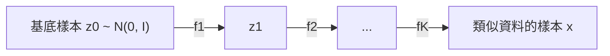

# 正規化流

正規化流是一種生成模型，它透過一連串可逆且可微分的映射，把簡單的機率分布轉換為複雜的分布。由於每個映射都可以求逆，而且它對體積的影響可以計算，因此同一個網路既能給出資料的精確似然，也能精確取樣。

## 概述

大多數生成模型都需要在某些方面妥協。變分自編碼器最佳化似然的一個下界。[GAN](../gan/index.md) 能產生樣本，但沒有可計算的密度。[擴散模型](../diffusion/index.md)則以變分下界來訓練。自回歸模型可以給出精確的似然，但每次只生成一個變數。正規化流的目標是同時做到精確似然與平行計算，代價是對網路架構的限制。

構造方式很簡單。從簡單的分布（通常是標準高斯）抽取基底樣本，再套用可逆映射。變數變換公式用基底的密度與映射在局部的體積變化，給出輸出的密度。Dinh 等人（2014）提出 NICE，作為用於密度估計的深度模型；之後的 [RealNVP](realnvp/index.md) 與 [Glow](glow/index.md) 則把這個想法應用到影像。Rezende 與 Mohamed（2015）指出，流也能為[變分推論](../../probabilistic/variational-inference/index.md)提供更豐富的近似後驗分布，相關內容見[正規化流後驗](../../probabilistic/variational-inference/normalising-flow-posteriors/index.md)。

## 核心概念

- **雙射**：一種一對一且映成的映射，其反函數也可微分。正規化流由雙射構成。
- **基底分布**：一個簡單的密度，例如標準高斯，取樣從它開始。
- **變數變換**：把基底變數的密度與其像的密度連結起來的規則。它包含雅可比行列式的絕對值，衡量局部的體積變化。
- **雅可比行列式**：一個 \(D \times D\) 矩陣的行列式。直接計算的成本大約是 \(O(D^3)\)，因此實用的流會選擇雅可比矩陣具有簡單結構的映射。
- **耦合層**：用向量中某一部分的函數來更新另一部分的層。其雅可比矩陣是三角的。[RealNVP](realnvp/index.md) 與 [Glow](glow/index.md) 都使用耦合層。
- **自回歸變換**：每個輸出只依賴前面的輸入的映射，其雅可比矩陣也是三角的。[遮罩自回歸流](masked-autoregressive-flow/index.md)由這種變換構成。
- **連續流**：以常微分方程（ODE）的解定義的映射。對數密度的變化由雅可比矩陣之跡決定，而非行列式。[FFJORD](ffjord/index.md) 是其中的代表性方法。
- **去量化**：像素值與其他離散資料並不是連續的密度，因此模型會先加入雜訊，或把數值映射到連續空間。[^1]

## 運作方式

把模型寫成 \(K\) 個可逆映射的串連，把基底樣本 \(z_0\) 帶到類似資料的變數 \(x = z_K\)：

\[
z_k = f_k(z_{k-1}), \qquad z_0 \sim p_0
\]

變數變換公式給出 \(x\) 的對數密度，等於基底的對數密度減去各層對數行列式之和：

\[
\log p(x) = \log p_0(z_0) - \sum_{k=1}^{K} \log\left|\det \frac{\partial f_k}{\partial z_{k-1}}\right|
\]

這裡 \(z_0\) 是鏈把它映射到 \(x\) 的基底值，因此必須透過逆映射來還原。訓練時，選擇參數以最大化資料的平均對數似然。由於似然是精確的，損失就是它的負值，可以使用一般的梯度最佳化方法。

因此設計有三項要求：每個映射都要有足夠的表達能力，其逆映射要容易計算，其對數行列式也要容易計算。各個代表性方法的差別，就在於如何同時滿足這三項要求：

在連續流中，求和會變成積分。沿一條軌跡，對數密度的變化率由動力學雅可比矩陣之跡的負值給出，Chen 等人（2018）把這個恆等式稱為瞬時變數變換。

## 關鍵方法

下面比較四個代表性方法。每個方法都有自己的頁面，內容包括方程式、報告的結果與限制。

| 方法 | 年份 | 核心設計 | 密度計算 | 取樣 |
|---|---|---|---|---|
| [RealNVP](realnvp/index.md) | 2016 | 多尺度架構中的仿射耦合層 | 一次平行計算 | 一次平行計算 |
| [Glow](glow/index.md) | 2018 | Actnorm、可逆 1×1 卷積與耦合層 | 一次平行計算 | 一次平行計算 |
| [遮罩自回歸流](masked-autoregressive-flow/index.md) | 2017 | 自回歸的仿射變換 | 一次平行計算 | \(D\) 次依序計算 |
| [FFJORD](ffjord/index.md) | 2018 | 搭配跡估計器的連續流 | 一次 ODE 求解 | 一次 ODE 求解 |

此表顯示了主要的取捨。耦合流在兩個方向上都很快，但每個映射都受到限制，以保持雅可比矩陣為三角。自回歸流計算密度很快，但取樣必須依序進行。連續流取消了對動力學的結構限制，代價是需要求解 ODE。

## 連結

- **變分推論。**流可以作為近似後驗分布，並以證據下界而非資料似然來訓練。見[正規化流後驗](../../probabilistic/variational-inference/normalising-flow-posteriors/index.md)。
- **密度估計。**正規化流屬於基於似然的模型，與[密度估計與生成模型](../../paradigms/unsupervised/density-and-generative-models/index.md)中的其他估計器同屬一類。
- **流匹配與擴散。**連續流的形式就是連續正規化流（Chen 等人，2018）。以最大似然訓練它，意味著每一步都要求解 ODE，成本很高。[流匹配](../flow-matching/index.md)則以迴歸方式擬合已知目標的速度場，訓練時不需模擬 ODE（Lipman 等人，2022）。Albergo 與 Vanden-Eijnden（2022）同樣以二次損失學習連續流，並避免對 ODE 求解器做反向傳播。Tong 等人（2023）把條件流匹配推廣到連續流。
- **自回歸模型。**語言模型所用的自回歸分解，正是[遮罩自回歸流](masked-autoregressive-flow/index.md)所逆轉的分解。大多數這類模型所用的架構，見[Transformer](../../models/transformer/index.md)。
- **大腦與心智。**目前尚未發現任何神經迴路實作正規化流，因此與大腦的連結只是概念性的。感知可以被理解為以內部生成模型進行的推論，而流使這樣的模型變得明確，其密度可以直接計算。見[預測編碼](../../../brain-mind/predictive-coding/index.md)。

## 應用

- **密度估計。**MAF 與 RealNVP 在表格資料集與自然影像切片上接受評估，見各方法頁面。
- **影像合成與操控。**Glow 報告了大型影像的逼真合成與操控（Kingma 與 Dhariwal，2018）。生成模型在創作上的更廣泛應用，見[藝術與創作](../../../applications/creative/index.md)。
- **語音。**Parallel WaveNet 訓練一個前饋的逆自回歸流去匹配已訓練的 WaveNet，生成語音的速度是實時的 20 倍以上（van den Oord 等人，2017）。
- **分子模擬。**Boltzmann generator 學習一個可逆的座標變換，把簡單分布映射到多體系統的平衡分布，因此能一步取得平衡樣本（Noé 等人，2019）。見[生命科學](../../../applications/life-science/index.md)。

## 未解問題

- **表達能力與結構的取捨。**每一種加速都會限制映射。更有彈性、同時又容易求逆的變換（例如樣條）能否在大型資料集上縮小與自回歸模型和擴散模型的差距，目前尚無定論（Durkan 等人，2019；Ho 等人，2019）。
- **規模。**奠基性論文中的影像結果，所用資料集的解析度最高為 256 × 256 像素。正規化流能否在最大規模的文字生成影像與影片任務上，與擴散模型和自回歸 Transformer 相匹敵，仍是有待比較的問題。
- **連續流的成本。**連續流在訓練時需要求解 ODE，而跡估計器會增加變異。流匹配與隨機插值降低了這項成本，但它們在精確似然上的取捨仍在研究之中。

## 參考文獻

### 開創性論文

- Rezende, D. J. & Mohamed, S. (2015). *Variational Inference with Normalizing Flows*. ICML. https://arxiv.org/abs/1505.05770 — 以可逆映射的組合建構靈活的近似後驗，並在深度潛在高斯模型中訓練它們。
- Dinh, L., Krueger, D. & Bengio, Y. (2014). *NICE: Non-linear Independent Components Estimation*. arXiv. https://arxiv.org/abs/1410.8516 — 提出雅可比行列式為平凡的深度可逆映射，用於建模複雜密度。
- Dinh, L., Sohl-Dickstein, J. & Bengio, S. (2016). *Density estimation using Real NVP*. arXiv. https://arxiv.org/abs/1605.08803 — 提出會改變體積的仿射耦合層，在自然影像上給出精確的似然與取樣。
- Papamakarios, G., Pavlakou, T. & Murray, I. (2017). *Masked Autoregressive Flow for Density Estimation*. NeurIPS. https://arxiv.org/abs/1705.07057 — 把自回歸變換堆疊成能平行計算密度的流，並推廣了 RealNVP。
- Kingma, D. P. & Dhariwal, P. (2018). *Glow: Generative Flow with Invertible 1x1 Convolutions*. NeurIPS. https://arxiv.org/abs/1807.03039 — 在耦合流中加入 actnorm 與可逆 1×1 卷積，改善影像基準上的對數似然。
- Chen, R. T. Q., Rubanova, Y., Bettencourt, J. & Duvenaud, D. (2018). *Neural Ordinary Differential Equations*. NeurIPS. https://arxiv.org/abs/1806.07366 — 以 ODE 定義連續正規化流，並以 ODE 求解器進行最大似然訓練。
- Grathwohl, W., Chen, R. T. Q., Bettencourt, J., Sutskever, I. & Duvenaud, D. (2018). *FFJORD: Free-form Continuous Dynamics for Scalable Reversible Generative Models*. arXiv. https://arxiv.org/abs/1810.01367 — 以 Hutchinson 跡估計器，使連續流的動力學可以是不受限制的神經網路。
- Lipman, Y., Chen, R. T. Q., Ben-Hamu, H., Nickel, M. & Le, M. (2022). *Flow Matching for Generative Modeling*. arXiv. https://arxiv.org/abs/2210.02747 — 以迴歸固定條件路徑的向量場來訓練連續正規化流，訓練時不需模擬流。
- Albergo, M. S. & Vanden-Eijnden, E. (2022). *Building Normalizing Flows with Stochastic Interpolants*. arXiv. https://arxiv.org/abs/2209.15571 — 以簡單的二次損失學習連續流，避免對 ODE 求解器做反向傳播。
- Durkan, C., Bekasov, A., Murray, I. & Papamakarios, G. (2019). *Neural Spline Flows*. NeurIPS. https://arxiv.org/abs/1906.04032 — 以單調有理二次樣條取代仿射變換，使每個映射在保持可解析求逆的同時更具彈性。
- Ho, J., Chen, X., Srinivas, A., Duan, Y. & Abbeel, P. (2019). *Flow++: Improving Flow-Based Generative Models with Variational Dequantization and Architecture Design*. ICML. https://arxiv.org/abs/1902.00275 — 研究流的三個設計選擇，包括均勻去量化與仿射耦合，並加以改進。
- Tong, A. et al. (2023). *Improving and generalizing flow-based generative models with minibatch optimal transport*. arXiv. https://arxiv.org/abs/2302.00482 — 把條件流匹配推廣為連續正規化流的免模擬目標函數。

### 綜述與教科書

- Papamakarios, G., Nalisnick, E., Rezende, D. J., Mohamed, S. & Lakshminarayanan, B. (2019). *Normalizing Flows for Probabilistic Modeling and Inference*. arXiv. https://arxiv.org/abs/1912.02762 — 從機率建模與推論的角度綜述正規化流，包括表達能力與設計取捨。
- Kobyzev, I., Prince, S. J. D. & Brubaker, M. A. (2021). *Normalizing Flows: An Introduction and Review of Current Methods*. IEEE Transactions on Pattern Analysis and Machine Intelligence. https://doi.org/10.1109/TPAMI.2020.2992934 — 對正規化流的建構與用於分布學習的文獻做全面回顧。

### 文章與文件

- Noé, F., Olsson, S., Köhler, J. & Wu, H. (2019). *Boltzmann generators: Sampling equilibrium states of many-body systems with deep learning*. Science. https://doi.org/10.1126/science.aaw1147 — 以學習得到的可逆變換，生成分子系統中無偏的一步平衡樣本。
- van den Oord, A. et al. (2017). *Parallel WaveNet: Fast High-Fidelity Speech Synthesis*. arXiv. https://arxiv.org/abs/1711.10433 — 把依序生成的 WaveNet 蒸餾成前饋流，生成語音的速度快於實時。

[^1]: 以不同去量化方案報告的每維位元數並不能直接比較，因為每種方案定義的連續密度都不同。
