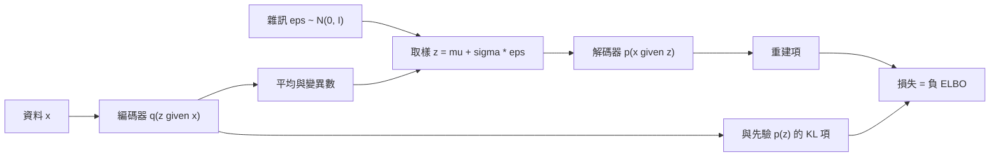

# 變分自編碼器

變分自編碼器（variational autoencoder, VAE）是一種潛變數生成模型。編碼器把每個資料點映射為一個緊湊編碼上的分布，解碼器再把編碼映回資料，訓練時則最大化資料似然的一個變分下界。由於編碼空間具有結構，它可以被取樣與內插；其離散變體 VQ-VAE 則是現代影像生成器的重要組成部分。

## 概述

自編碼器把輸入壓縮成編碼，再由編碼重建輸入。變分自編碼器讓這個過程具有機率性：編碼器輸出的是編碼上的分布，而非單一點，而且編碼會被拉向一個簡單的先驗，通常是標準高斯分布。訓練完成後，只要從先驗抽出一個編碼再解碼，就能產生新資料。Kingma 與 Welling（2013）以及 Rezende、Mohamed 與 Wierstra（2014）提出了這個模型與其訓練方法。完整的界與估計量推導，見變分推論章節中的[變分自編碼器](../../probabilistic/variational-inference/variational-autoencoder/index.md)頁面。本頁著重於潛在空間、已知的失效模式與主要變體。

VAE 是[生成模型](../index.md)概述中的一個家族。與 GAN 相比，它的目標函數基於似然，並具有顯式的編碼器，因此既能生成資料，也能把資料映射到潛在空間。代價是逐像素的重建損失傾向於對各種合理輸出取平均，使解碼出的影像常比 GAN 或擴散模型的樣本模糊。下面所述的離散變體改變了編碼的先驗；在其上加入自回歸模型後，它曾被用來生成 128 × 128 的彩色影像（Oord 等人，2017）。

## 核心概念

- **潛變數與先驗**：隱藏編碼 \(z\)，其先驗為簡單的 \(p(z)=\mathcal N(0, I)\)。模型假設每個資料點 \(x\) 都是由某個編碼生成的。
- **編碼器與解碼器**：編碼器 \(q_\phi(z\mid x)\)（又稱識別模型）近似編碼的後驗分布。解碼器 \(p_\theta(x\mid z)\) 描述編碼如何產生資料。
- **證據下界（ELBO）**：訓練目標，是 \(\log p_\theta(x)\) 的下界。它包含重建項與 Kullback–Leibler（KL）項，後者使編碼接近先驗。
- **重參數化技巧**：把樣本寫成編碼器輸出與不依賴參數之雜訊的確定性函數，即 \(z=\mu_\phi(x)+\sigma_\phi(x)\odot\varepsilon\)，其中 \(\varepsilon\sim\mathcal N(0, I)\)。如此，梯度便能穿過取樣步驟。
- **後驗塌陷**：某些或全部潛在維度的編碼器輸出與先驗一致，解碼器則忽略這些維度。KL 項趨近於零，編碼幾乎不攜帶資訊。當解碼器很強大時，例如自回歸文字模型，這是眾所周知的問題（Bowman 等人，2016）。
- **解耦**：希望每個潛在維度只捕捉資料中一個獨立的變異因子，例如某物件的位置或尺度。Locatello 等人（2019）認為，無監督的解耦需要模型或資料中的歸納偏置。
- **離散編碼**：從有限的學習向量碼本中選出的潛變數，而非從連續分布中取樣。

## 運作方式

對每個資料點，訓練時最大化 ELBO：

\[
\mathcal{L}(\theta,\phi;x) = \mathbb{E}_{q_\phi(z\mid x)}\big[\log p_\theta(x\mid z)\big] - \mathrm{KL}\big(q_\phi(z\mid x)\,\|\,p(z)\big)
\]

第一項鼓勵忠實地重建，第二項懲罰與先驗不同的編碼。對於高斯編碼器與先驗，KL 項有閉式解，因此只需以取樣估計重建項。重參數化技巧使該樣本對編碼器參數 \(\phi\) 可微。

有兩種變體改變了這個目標或編碼的形式：

- **加權 KL 項。** [β-VAE](beta-vae/index.md)把 KL 項乘以一個因子 \(\beta\)。數值越大，編碼越被推向更緊湊、因式分解的形式，代價是重建品質下降。Burgess 等人（2018）把這種效果分析為對潛在瓶頸所能承載資訊量的限制。
- **離散編碼。** [VQ-VAE](vq-vae/index.md)以對學習碼本的最近鄰查找取代高斯後驗。不可微分的查找步驟以直通梯度繞過；自編碼器訓練後，另外再訓練一個模型學習編碼上的先驗。

## 主要方法

下面比較兩個具代表性的變體。每個方法各有一頁，包含問題、方程式或演算法、結果與限制。原始 VAE 見[其獨立頁面](../../probabilistic/variational-inference/variational-autoencoder/index.md)，兩者都以它為基準。

| 方法 | 年份 | 改變了什麼 | 主要想法 |
|---|---|---|---|
| [β-VAE](beta-vae/index.md) | 2017 | KL 項的權重 | 把 KL 項乘以 \(\beta > 1\)，有利於可對齊獨立因子的因式分解編碼，代價是重建品質下降 |
| [VQ-VAE](vq-vae/index.md) | 2017 | 離散潛在編碼 | 把每個編碼器輸出量化為最近的碼本向量，之後再對編碼擬合自回歸先驗 |

## 與其他主題的連結

- **變分推論：**ELBO、重參數化技巧與攤銷推論是通用工具，詳見[變分推論](../../probabilistic/variational-inference/index.md)。
- **自編碼器：**VAE 是機率化的自編碼器。Hinton 與 Salakhutdinov（2006）的深度自編碼器是其確定性的前身，其學到的瓶頸表徵見[自編碼器與表徵](../../paradigms/unsupervised/autoencoders-and-representations/index.md)。
- **潛在擴散與影像分詞器：**[潛在擴散模型](../diffusion/latent-diffusion.md)在擴散之前先以自編碼器壓縮影像。Rombach 等人（2022）以 KL 懲罰或向量量化來正則化該自編碼器。VQGAN（Esser 等人，2021）為影像學習離散碼本，並以 Transformer 對其編碼序列建模。離散編碼在影像中扮演的角色，類似語言模型中的詞元；見[分詞（Tokenisation）](../../models/llm/tokenisation/index.md)。不過影像編碼是從像素學得的，而非來自固定詞彙。
- **大腦與心智：**Helmholtz 機器（Dayan 等人，1995）與醒睡演算法（Hinton 等人，1995）會同時訓練生成模型與識別模型，而 VAE 的編碼器扮演的正是識別模型的角色。[預測編碼](../../../brain-mind/predictive-coding/index.md)中以推論解釋知覺的觀點，在神經科學中提出了相同的想法。Olshausen 與 Field（1996）顯示，從自然影像學得的稀疏編碼會產生類似初級視覺皮層簡單細胞的感受野，這正是緊湊、因式分解編碼的動機之一；見[稀疏編碼（Olshausen & Field, 1996）](../../../brain-mind/computational-neuroscience/sparse-coding/index.md)。[^1]

## 應用

- **高解析度影像生成。** VQ-VAE-2（Razavi 等人，2019）建構了一個多層次的離散編碼階層，每一層各有自回歸先驗。作者報告其樣本在多個資料集上可與 GAN 媲美。
- **語音。** Oord 等人（2017）在原始語音實驗中，於編碼上訓練 WaveNet 先驗，產生可辨認出字詞與片語的樣本。
- **生成器的詞元網格。** 離散自編碼器提供 Transformer 式生成器所建模的詞元網格，VQGAN 即為一例。

## 未解問題

- **資訊豐富的潛在編碼。** Lucas 等人（2019）指出，在線性 VAE 中，後驗塌陷來自邊際似然的局部極大值，而非 ELBO 本身。這個解釋在具有強大解碼器的深度模型中能走多遠，仍未確定。
- **解耦的衡量。** 解耦通常以合成資料集中已知的真實因子來評分。這類分數能否預測真實資料上的實用性，尚未有定論。
- **樣本品質。** NVAE（Vahdat & Kautz, 2020）等分層 VAE 的設計目標之一，是提升樣本品質。VAE 能否在大規模下追上最好的擴散模型，目前並不清楚。
- **碼本的使用率。** 離散碼本只有在其中的條目都被使用時才有用。如何在訓練中讓整個碼本保持被使用，是離散變體的實務問題。

[^1]: 醒睡演算法與現代生成模型訓練之間的類比是有啟發性的，但尚未確立。Helmholtz 機器與醒睡演算法都不是特定皮層迴路的模型。

## 參考文獻

### 開創性論文

- Kingma, D. P. & Welling, M. (2013). *Auto-Encoding Variational Bayes*. arXiv. https://arxiv.org/abs/1312.6114 — 提出 VAE、變分界的重參數化估計量，以及共享的識別模型。
- Rezende, D. J., Mohamed, S. & Wierstra, D. (2014). *Stochastic Backpropagation and Approximate Inference in Deep Generative Models*. arXiv. https://arxiv.org/abs/1401.4082 — 為深度潛變數模型推導同樣的重參數化梯度，並引入近似後驗的識別模型。
- Hinton, G. E. & Salakhutdinov, R. R. (2006). Reducing the Dimensionality of Data with Neural Networks. *Science*. https://doi.org/10.1126/science.1127647 — 顯示深度自編碼器能學到比主成分分析更好的低維編碼。
- Oord, A. van den, Vinyals, O. & Kavukcuoglu, K. (2017). *Neural Discrete Representation Learning*. arXiv. https://arxiv.org/abs/1711.00937 — 提出 VQ-VAE，學習離散碼本以及編碼上的自回歸先驗。
- Bowman, S. R. et al. (2016). *Generating Sentences from a Continuous Space*. arXiv. https://arxiv.org/abs/1511.06349 — 針對句子的 RNN 型 VAE，是研究後驗塌陷的重要文獻。
- Burgess, C. P. et al. (2018). *Understanding disentangling in β-VAE*. arXiv. https://arxiv.org/abs/1804.03599 — 以率失真的觀點解釋 β-VAE 的解耦，並提出容量排程。
- Higgins, I. et al. (2018). *Towards a Definition of Disentangled Representations*. arXiv. https://arxiv.org/abs/1812.02230 — 依據世界的變換，提出解耦表徵的正式定義。
- Esser, P., Rombach, R. & Ommer, B. (2021). *Taming Transformers for High-Resolution Image Synthesis*. CVPR. https://arxiv.org/abs/2012.09841 — 為影像學習卷積式 VQ 碼本，並以 Transformer 對其編碼建模。
- Rombach, R. et al. (2022). *High-Resolution Image Synthesis with Latent Diffusion Models*. CVPR. https://arxiv.org/abs/2112.10752 — 在自編碼器的潛在空間中進行擴散，正則化方式可採 KL 或向量量化。
- Dayan, P. et al. (1995). The Helmholtz Machine. *Neural Computation*. https://doi.org/10.1162/neco.1995.7.5.889 — 提出以識別模型配合最大化下界來訓練的階層式生成模型。
- Hinton, G. E. et al. (1995). The "Wake-Sleep" Algorithm for Unsupervised Neural Networks. *Science*. https://doi.org/10.1126/science.7761831 — 以交替的醒與睡階段訓練多層隨機網路，同時使用識別與生成連接。
- Olshausen, B. A. & Field, D. J. (1996). Emergence of simple-cell receptive field properties by learning a sparse code for natural images. *Nature*. https://doi.org/10.1038/381607a0 — 顯示從自然影像學得的稀疏編碼，會產生類似視覺皮層簡單細胞的感受野。
- Locatello, F. et al. (2019). *Challenging Common Assumptions in the Unsupervised Learning of Disentangled Representations*. ICML. https://arxiv.org/abs/1811.12359 — 主張無監督解耦需要歸納偏置，並大規模測試多種方法。
- Lucas, J. et al. (2019). *Don't Blame the ELBO! A Linear VAE Perspective on Posterior Collapse*. NeurIPS. https://arxiv.org/abs/1911.02469 — 分析線性 VAE 的後驗塌陷，並與機率主成分分析建立關聯。
- Vahdat, A. & Kautz, J. (2020). *NVAE: A Deep Hierarchical Variational Autoencoder*. NeurIPS. https://arxiv.org/abs/2007.03898 — 設計深度分層 VAE，目標是縮小其與其他基於似然模型之間的樣本品質差距。
- Razavi, A., van den Oord, A. & Vinyals, O. (2019). *Generating Diverse High-Fidelity Images with VQ-VAE-2*. arXiv. https://arxiv.org/abs/1906.00446 — 以離散編碼的階層與自回歸先驗擴展 VQ-VAE，用於大規模影像生成。

### 綜述與教科書

- Kingma, D. P. & Welling, M. (2019). *An Introduction to Variational Autoencoders*. Foundations and Trends in Machine Learning. https://arxiv.org/abs/1906.02691 — 兩位作者對 VAE 與其延伸的入門介紹。
- Doersch, C. (2016). *Tutorial on Variational Autoencoders*. arXiv. https://arxiv.org/abs/1606.05908 — 從第一原理解釋 VAE 目標與重參數化的教學文章，不預設讀者具備變分貝氏方法的背景。
