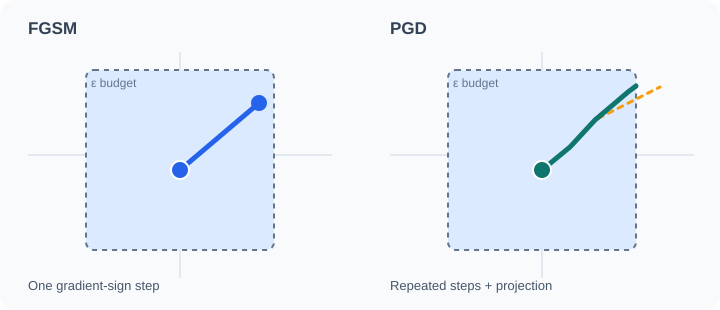

# Fast Gradient Sign Method

The fast gradient sign method (FGSM) is a one-step attack that perturbs an input in the direction of the sign of the loss gradient with respect to the input, by a fixed size \(\epsilon\). Part of [Adversarial examples and robustness](index.md).

## Overview

FGSM is the simplest effective attack on a differentiable classifier. It needs one gradient computation and no search, so it is fast enough to use inside training. Goodfellow et al. (2015) introduced it and used it to argue that adversarial examples arise from the linear behaviour of high-dimensional models.

## Key concepts

- **Perturbation budget \(\epsilon\)**: the largest allowed change to each input component, measured in the \(\ell_\infty\) norm.
- **Loss gradient**: the derivative of the training loss with respect to the input, not the parameters.
- **Sign operation**: each nonzero gradient component contributes a perturbation of magnitude \(\epsilon\) before input-domain clipping; a zero component contributes no change. Components clipped at the valid input boundary may move by less than \(\epsilon\).

## How it works

Given an input \(x\), label \(y\), loss \(J(\theta,x,y)\) and parameters \(\theta\), the adversarial input is

\[
\tilde{x} = x + \epsilon\,\mathrm{sign}\big(\nabla_x J(\theta, x, y)\big).
\]

Clipping \(\tilde{x}\) to the valid input range, such as \([0,1]\) for images, keeps the example a valid input. Goodfellow et al. (2015) show that a linear model is especially vulnerable, because the perturbation adds up across many input dimensions and changes the output by \(\epsilon\|w\|_1\).

### FGSM versus iterative PGD: trajectory

*Original schematic animation.* The left panel shows one gradient-sign update; the right panel shows several smaller updates inside an illustrated \(\ell_\infty\) perturbation budget. The dashed orange segment is an unprojected candidate update from the last teal feasible iterate; the purple segment shows coordinate-wise clipping back to the right-hand budget boundary. The teal endpoint is the pre-candidate iterate, **not** the projection result. Positions, directions, and timing are illustrative, **not measured model outputs**. The full paths remain visible in GitHub's static SVG preview. Motion may be disabled by the viewer's browser; the geometry is still readable.

**Read the motion in three phases:** during 0–2.5 s, the blue FGSM marker completes its sole step while teal PGD iterates advance within the budget. During 2.5–3.5 s, the orange candidate follows an *unconstrained* gradient update and can leave the feasible set. During 3.5–5 s, the purple marker returns that candidate to the feasible boundary by projection; this return is **not another gradient step**. The faint complete trajectories are a static preview, not a claim that all updates happen simultaneously. This five-second SVG plays once without play/pause or seek controls; readers who need to inspect a phase can use the static geometry and this timeline.

**Reading the FGSM endpoint correctly.** The blue trajectory now reaches the *upper-right corner* of the illustrated \(\ell_\infty\) budget rectangle. This represents a full FGSM sign step for two nonzero gradient components pointing toward that corner, without input-domain clipping. The figure's screen coordinates and arrow lengths are schematic, not measured gradients; an input-domain boundary or zero gradient component can yield a different endpoint. The independent numerical example below uses a different hypothetical sign pattern and is **not** a coordinate readout from this drawing.

**What the purple projection actually constrains.** For an image with valid input range \([0,1]\), an \(\ell_\infty\)-bounded PGD update projects the orange candidate \(z\) onto the intersection \(\mathcal{S}=[0,1]^d\cap\{u:\|u-x\|_\infty\le\epsilon\}\), not merely onto the image range. Coordinate \(i\) is clipped to \([\max(0,x_i-\epsilon),\min(1,x_i+\epsilon)]\). The drawing shows a two-dimensional slice with an active right-hand budget boundary; the horizontal purple return is a **schematic instance**, not a claim that every PGD projection is horizontal. Projection changes feasibility without recomputing the loss gradient.

**A coordinate-exact FGSM comparison (schematic).** With \(x=(0.50,0.50)\), \(\epsilon=0.20\), and input-loss gradient \(g=(+2,-3)\), the untargeted sign update gives \(x+\epsilon\operatorname{sign}(g)=(0.70,0.30)\), exactly the lower-right corner of the feasible square. Its result depends on the **signs**, not the magnitudes 2 and 3; multiplying both gradient components by any positive constant leaves this step unchanged. In contrast, a PGD update of size \(\alpha=0.10\) from the same point with the same local sign would first reach \((0.60,0.40)\). Further PGD signs must be recomputed at the current iterate, so the illustration's later turns cannot be inferred from this single gradient. All values here are invented for instruction, not model measurements.

**Worked projection example (schematic).** Let \(x=(0.50,0.50)\), \(\epsilon=0.20\), and the unprojected candidate be \(z=(0.82,0.63)\). The feasible coordinate intervals are both \([0.30,0.70]\), so \(\Pi_{\mathcal S}(z)=(0.70,0.63)\): only the first coordinate is clipped, producing a horizontal return like the purple segment. If instead \(z=(0.82,0.81)\), both coordinates are clipped to \((0.70,0.70)\); the projection is diagonal. These numbers are illustrative, not measurements from a trained model.

## Variants

- **Targeted FGSM** moves the input toward a chosen wrong label rather than away from the true label.
- **Iterative FGSM** repeats smaller steps, which gives a stronger attack and is the basis of PGD (Kurakin et al., 2017; see [PGD and adversarial training](pgd-adversarial-training.md)).
- **Single-step adversarial training** trains on FGSM examples. It is cheap but can suffer from catastrophic overfitting to the single-step attack, where robustness to multi-step attacks collapses during training (Wong et al., 2020).

## Results and limits

- FGSM reduces the accuracy of undefended image classifiers sharply at small budgets, which is the result that drew attention to the problem (Goodfellow et al., 2015).
- It is a weak attack for defended models, because one linear step can miss the adversarial region. Carlini and Wagner (2017) show that stronger attacks break many defences that resist FGSM, and Athalye et al. (2018) show that some apparent robustness comes from gradient masking that disappears under adaptive attacks.
- The sign operation is a heuristic for \(\ell_\infty\) attacks, and it does not directly give the smallest perturbation that changes the label.

## Applications

- **Robustness evaluation**: a fast baseline for reporting accuracy under attack.
- **Adversarial training**: generating training examples cheaply inside the training loop.
- **Teaching**: the standard first example of a gradient-based attack.

## Open questions

- Why single-step attacks sometimes lose effectiveness on adversarially trained models, and how to avoid catastrophic overfitting, remain under study.
- Whether linear explanations describe the behaviour of very deep networks well is still debated.

## References

### Seminal papers

- Goodfellow, I. J., Shlens, J. & Szegedy, C. (2015). Explaining and harnessing adversarial examples. In *International Conference on Learning Representations*. arXiv:1412.6572. https://arxiv.org/abs/1412.6572 — Introduces FGSM and the linearity explanation.
- Szegedy, C. et al. (2014). Intriguing properties of neural networks. arXiv:1312.6199. https://arxiv.org/abs/1312.6199 — The earlier demonstration that small perturbations change network outputs.
- Carlini, N. & Wagner, D. (2017). Towards evaluating the robustness of neural networks. In *2017 IEEE Symposium on Security and Privacy*, 39–57. https://doi.org/10.1109/SP.2017.49 — Shows that stronger attacks defeat defences that resist FGSM.
- Kurakin, A., Goodfellow, I. & Bengio, S. (2017). Adversarial machine learning at scale. In *International Conference on Learning Representations*. arXiv:1611.01236. https://arxiv.org/abs/1611.01236 — Proposes iterative FGSM-style attacks and adversarial training at ImageNet scale.
- Athalye, A., Carlini, N. & Wagner, D. (2018). Obfuscated gradients give a false sense of security: circumventing defenses to adversarial examples. In *Proceedings of the 35th International Conference on Machine Learning*, PMLR 80. arXiv:1802.00420. https://arxiv.org/abs/1802.00420 — Shows how gradient masking hides weak robustness from FGSM-style gradient attacks.
- Wong, E., Rice, L. & Kolter, J. Z. (2020). Fast is better than free: revisiting adversarial training. In *International Conference on Learning Representations*. arXiv:2001.03994. https://arxiv.org/abs/2001.03994 — Analyses catastrophic overfitting in single-step adversarial training.

### Surveys and textbooks

- Madry, A., Makelov, A., Schmidt, L., Tsipras, D. & Vladu, A. (2018). Towards deep learning models resistant to adversarial attacks. In *International Conference on Learning Representations*. arXiv:1706.06083. https://arxiv.org/abs/1706.06083 — Uses iterated FGSM-style attacks to train robust models.
- Murphy, K. P. (2022). *Probabilistic Machine Learning: An Introduction*. MIT Press. https://github.com/probml/pml-book — Repository for Murphy's textbook series; background on gradient-based adversarial attacks.
