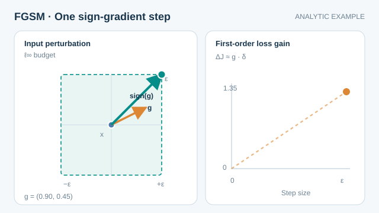

# 快速梯度符號法

快速梯度符號法（FGSM）是一種單步攻擊：沿著損失對輸入之梯度的符號方向，以固定大小 \(\epsilon\) 擾動輸入。本頁是[對抗樣本與穩健性](index.md)的一部分。

## 概述

對可微分的分類器而言，FGSM 是最簡單且有效的攻擊。它只需計算一次梯度，不需搜尋，因此快到可以放在訓練過程中使用。Goodfellow 等人（2015）提出此方法，並藉由它主張對抗樣本來自高維模型的線性行為。

## 關鍵概念

- **擾動預算 \(\epsilon\)**：每個輸入分量允許的最大改變，以 \(\ell_\infty\) 範數衡量。
- **損失梯度**：訓練損失對輸入的導數，而非對參數的導數。
- **符號運算**：只保留梯度每個分量的方向，使每個像素都以完整預算移動。

## 運作方式

給定輸入 \(x\)、標籤 \(y\)、損失 \(J(\theta,x,y)\) 與參數 \(\theta\)，對抗輸入為

\[
\tilde{x} = x + \epsilon\,\mathrm{sign}\big(\nabla_x J(\theta, x, y)\big).
\]

將 \(\tilde{x}\) 裁剪到有效的輸入範圍內（例如影像的 \([0,1]\)），可使樣本維持為有效輸入。Goodfellow 等人（2015）顯示，線性模型特別脆弱，因為擾動會在許多輸入維度上累加，使輸出改變 \(\epsilon\|w\|_1\)。

### 動畫解說

*原創連續教學動畫，CC BY-SA 4.0。* 此**二維解析式示例**假設損失梯度為 $g=(0.90,0.45)$、$\ell_\infty$ 預算為 $\epsilon=1$，並使用一階近似 $\Delta J\approx g^\top\delta$。橘色箭頭代表實際梯度方向；青綠色位移**只取梯度各分量的符號**，因此 $\delta(t)=t(1,1)$，其中 $0\leq t\leq1$。一階近似的損失增量從 0 增加至 $1.35$。在此局部線性近似與單純方框限制下，符號步是精確的最大化方向；但它不保證最大化非線性模型的真實損失，合法像素範圍的裁切也可能縮短步長。**數值並非模型實測梯度或攻擊成功率。** MkDocs 網站提供播放／暫停與減少動態效果的靜態回退；窄螢幕可使用觸控或鍵盤左右捲動。[GitHub 可閱讀的靜態預覽](../../../assets/concept-animations/fgsm-sign-step-still.svg)。

## 變體

- **目標式 FGSM** 把輸入推向選定的錯誤標籤，而非遠離真實標籤。
- **迭代式 FGSM** 重複較小的步伐，攻擊較強，也是 PGD 的基礎（Kurakin 等人，2017；見[投影梯度下降與對抗訓練](pgd-adversarial-training.md)）。
- **單步對抗訓練** 以 FGSM 樣本進行訓練。它成本低，但可能因單步攻擊而出現災難性過擬合，即訓練期間對多步攻擊的穩健性崩潰（Wong 等人，2020）。

## 結果與限制

- 在小預算下，FGSM 使未防禦的影像分類器準確率大幅下降，這個結果引起了人們對此問題的注意（Goodfellow 等人，2015）。
- 對於有防禦的模型，它是較弱的攻擊，因為單一線性步伐可能錯過對抗區域。Carlini 與 Wagner（2017）顯示，能抵抗 FGSM 的許多防禦會被更強的攻擊打破；Athalye 等人（2018）則顯示，部分表面上的穩健性來自梯度遮蔽，在適應性攻擊下會消失。
- 符號運算是 \(\ell_\infty\) 攻擊的啟發式作法，並不直接給出能改變標籤的最小擾動。

## 應用

- **穩健性評估**：用來回報攻擊下準確率的快速基準。
- **對抗訓練**：在訓練迴圈中低成本地產生訓練樣本。
- **教學**：基於梯度的攻擊中的標準入門範例。

## 開放問題

- 為什麼單步攻擊有時在對抗訓練後的模型上失去效果，以及如何避免災難性過擬合，仍在研究中。
- 線性解釋能否很好地描述非常深的網路，仍有爭議。

## 參考文獻

### 奠基性論文

- Goodfellow, I. J., Shlens, J. & Szegedy, C. (2015). Explaining and harnessing adversarial examples. In *International Conference on Learning Representations*. arXiv:1412.6572. https://arxiv.org/abs/1412.6572 — 提出 FGSM 與線性解釋。
- Szegedy, C. et al. (2014). Intriguing properties of neural networks. arXiv:1312.6199. https://arxiv.org/abs/1312.6199 — 較早展示小擾動會改變網路輸出。
- Carlini, N. & Wagner, D. (2017). Towards evaluating the robustness of neural networks. In *2017 IEEE Symposium on Security and Privacy*, 39–57. https://doi.org/10.1109/SP.2017.49 — 顯示較強的攻擊能打破能抵抗 FGSM 的防禦。
- Kurakin, A., Goodfellow, I. & Bengio, S. (2017). Adversarial machine learning at scale. In *International Conference on Learning Representations*. arXiv:1611.01236. https://arxiv.org/abs/1611.01236 — 提出迭代式 FGSM 風格的攻擊，並在 ImageNet 規模上進行對抗訓練。
- Athalye, A., Carlini, N. & Wagner, D. (2018). Obfuscated gradients give a false sense of security: circumventing defenses to adversarial examples. In *Proceedings of the 35th International Conference on Machine Learning*, PMLR 80. arXiv:1802.00420. https://arxiv.org/abs/1802.00420 — 說明梯度遮蔽如何對 FGSM 式的梯度攻擊隱藏了薄弱的穩健性。
- Wong, E., Rice, L. & Kolter, J. Z. (2020). Fast is better than free: revisiting adversarial training. In *International Conference on Learning Representations*. arXiv:2001.03994. https://arxiv.org/abs/2001.03994 — 分析單步對抗訓練中的災難性過擬合。

### 綜述與教科書

- Madry, A., Makelov, A., Schmidt, L., Tsipras, D. & Vladu, A. (2018). Towards deep learning models resistant to adversarial attacks. In *International Conference on Learning Representations*. arXiv:1706.06083. https://arxiv.org/abs/1706.06083 — 以迭代的 FGSM 式攻擊訓練穩健模型。
- Murphy, K. P. (2022). *Probabilistic Machine Learning: An Introduction*. MIT Press. https://github.com/probml/pml-book — Murphy 教科書系列的儲存庫；基於梯度的對抗攻擊的一般背景。
