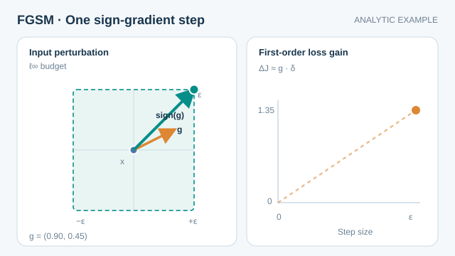

# 快速梯度符號法

快速梯度符號法（FGSM）是一種單步攻擊：沿著損失對輸入之梯度的符號方向，以固定大小 \(\epsilon\) 擾動輸入。本頁是[對抗樣本與穩健性](index.md)的一部分。

## 概述

對可微分的分類器而言，FGSM 是最簡單且有效的攻擊。它只需計算一次梯度，不需搜尋，因此快到可以放在訓練過程中使用。Goodfellow 等人（2015）提出此方法，並藉由它主張對抗樣本來自高維模型的線性行為。

## 關鍵概念

- **擾動預算 \(\epsilon\)**：每個輸入分量允許的最大改變，以 \(\ell_\infty\) 範數衡量。
- **損失梯度**：訓練損失對輸入的導數，而非對參數的導數。
- **符號運算**：在輸入值域裁剪之前，每個非零梯度分量產生大小為 \(\epsilon\) 的擾動；梯度為零的分量不變。若碰到輸入合法值域邊界，實際變化量可能小於 \(\epsilon\)。

## 運作方式

給定輸入 \(x\)、標籤 \(y\)、損失 \(J(\theta,x,y)\) 與參數 \(\theta\)，對抗輸入為

$$
\begin{gathered}
g=\nabla_x J(\theta,x,y),\\
\tilde{x}=x+\epsilon\,\mathrm{sign}(g).
\end{gathered}
$$

將 \(\tilde{x}\) 裁剪到有效的輸入範圍內（例如影像的 \([0,1]\)），可使樣本維持為有效輸入。Goodfellow 等人（2015）顯示，線性模型特別脆弱，因為擾動會在許多輸入維度上累加，使輸出改變 \(\epsilon\|w\|_1\)。

### 動畫解說

*原創連續教學動畫，CC BY-SA 4.0。* 此**二維解析式示例**假設損失梯度為 $g=(0.90,0.45)$、$\ell_\infty$ 預算為 $\epsilon=1$，並使用一階近似 $\Delta J\approx g^\top\delta$。橘色箭頭代表實際梯度方向；青綠色位移**只取梯度各分量的符號**，因此 $\delta(t)=t(1,1)$，其中 $0\leq t\leq1$。一階近似的損失增量從 0 增加至 $1.35$。在此局部線性近似與單純方框限制下，符號步是精確的最大化方向；但它不保證最大化非線性模型的真實損失，合法像素範圍的裁切也可能縮短步長。**數值並非模型實測梯度或攻擊成功率。** MkDocs 網站提供播放／暫停與減少動態效果的靜態回退；窄螢幕可使用觸控或鍵盤左右捲動。[GitHub 可閱讀的靜態預覽](../../../assets/concept-animations/fgsm-sign-step-still.svg)。

動畫時間讓同一符號方向的尺度來回變化，不是重複執行 FGSM，也不表示最佳化過程中的損失下降。橙色箭頭表示梯度方向，不是另一個擾動。若梯度分量為零，符號也為零，該座標不變；有效輸入範圍的裁切也可能使位移小於完整預算。

### FGSM 與迭代式 PGD 的路徑比較

這幅並排圖聚焦單步、候選點與投影的操作順序；它與分開呈現梯度符號和多步損失路徑的圖互補，並非可互換的數值軌跡。圖形保留原尺寸，窄螢幕可聚焦圖框後使用左右方向鍵，或以觸控水平捲動。

*原創示意動畫。* 左側呈現一次梯度符號更新；右側呈現受 \(\ell_\infty\) 擾動預算限制的多次小步更新。橘色虛線表示從最後一個青綠色可行迭代點出發、尚未投影的候選更新；紫色線段才表示將該候選點逐座標裁剪回右側擾動預算邊界。青綠色路徑終點是候選更新之前的迭代點，**不是投影結果**。位置、方向與時間皆為**教學示意，並非模型實測結果**。GitHub 停用 SVG 動畫時，完整路徑仍可直接閱讀。

**依時間閱讀動畫的三個階段：**0–2.5 秒，藍色 FGSM 標記完成唯一一次更新，青綠色 PGD 迭代點則在擾動預算內前進；2.5–3.5 秒，橘色候選點沿著**尚未施加限制**的梯度更新方向移動，可能越過可行域；3.5–5 秒，紫色標記將候選點投影回可行域邊界，這個返回動作**不是另一次梯度更新**。淡色完整路徑僅供靜態預覽，不表示所有更新同時發生。此 SVG 動畫播放五秒後停止，沒有播放／暫停或進度控制；需要逐階段檢視時，可對照靜態路徑與上述時間說明。

**正確解讀 FGSM 終點。** 藍色路徑現在抵達圖中 \(\ell_\infty\) 擾動預算的**右上角**，示意兩個梯度分量皆非零、方向朝向該角落，且不受輸入值域裁剪影響時的完整 FGSM 符號步伐。圖上的畫面座標及箭頭長度是教學示意，並非實際梯度數值；若發生輸入值域裁剪或某個梯度分量為零，終點就可能不同。下方數值範例使用另一組假設的梯度符號，**不是**從這張圖量測得到的座標。

**紫色投影實際施加的限制。** 對有效輸入範圍為 \([0,1]\) 的影像，採用 \(\ell_\infty\) 擾動預算的 PGD，必須將橘色候選點 \(z\) 投影至輸入值域與擾動預算的**交集**：\(\mathcal{S}=[0,1]^d\cap\{u:\|u-x\|_\infty\le\epsilon\}\)，而非僅裁剪到影像值域。第 \(i\) 個座標須限制於 \([\max(0,x_i-\epsilon),\min(1,x_i+\epsilon)]\)。圖中僅呈現二維切面，且右側擾動預算邊界正在發揮限制作用；紫色水平返回是**特定示意情況**，不代表所有 PGD 投影都沿水平方向進行。投影只負責恢復可行性，不會重新計算損失梯度。

**可精確計算的 FGSM 對照（教學示意）。** 設 \(x=(0.50,0.50)\)、\(\epsilon=0.20\)，輸入損失梯度為 \(g=(+2,-3)\)，則非目標式符號更新得到 \(x+\epsilon\operatorname{sign}(g)=(0.70,0.30)\)，恰好位於可行正方形的右下角。結果取決於梯度的**正負號**，而不是 2 與 3 的數值大小；只要將兩個梯度分量同乘正數，這一步就不變。相較之下，若 PGD 從相同起點使用步長 \(\alpha=0.10\) 且當下符號相同，第一步只會到 \((0.60,0.40)\)。後續 PGD 步驟必須在目前迭代點重新計算梯度符號，不能從這個單一步驟推定圖中後續轉折。上述數值均為自行設定的教學示意，非模型實測。

**投影數值範例（教學示意）。** 設 \(x=(0.50,0.50)\)、\(\epsilon=0.20\)，未投影候選點為 \(z=(0.82,0.63)\)。兩個座標的可行區間皆為 \([0.30,0.70]\)，因此 \(\Pi_{\mathcal S}(z)=(0.70,0.63)\)：只有第一個座標被裁剪，投影方向便如紫色線段所示，呈水平返回。若改為 \(z=(0.82,0.81)\)，兩個座標都須裁剪至 \((0.70,0.70)\)，投影方向則是斜向。上述數值僅供理解，並非訓練模型的實測資料。

## 變體

- **目標式 FGSM** 把輸入推向選定的錯誤標籤，而非遠離真實標籤。
- **迭代式 FGSM** 重複較小的步伐，攻擊較強，也是 PGD 的基礎（Kurakin 等人，2017；見[投影梯度下降與對抗訓練](pgd-adversarial-training.md)）。
- **單步對抗訓練** 以 FGSM 樣本進行訓練。它成本低，但可能因單步攻擊而出現災難性過擬合，即訓練期間對多步攻擊的穩健性崩潰（Wong 等人，2020）。

## 結果與限制

- 在小預算下，FGSM 使未防禦的影像分類器準確率大幅下降，這個結果引起了人們對此問題的注意（Goodfellow 等人，2015）。
- 對於有防禦的模型，它是較弱的攻擊，因為單一線性步伐可能錯過對抗區域。Carlini 與 Wagner（2017）顯示，能抵抗 FGSM 的許多防禦會被更強的攻擊打破；Athalye 等人（2018）則顯示，部分表面上的穩健性來自梯度遮蔽，在適應性攻擊下會消失。
- 符號運算是 \(\ell_\infty\) 攻擊的啟發式作法，並不直接給出能改變標籤的最小擾動。

## 應用

- **穩健性評估**：用來回報攻擊下準確率的快速基準。
- **對抗訓練**：在訓練迴圈中低成本地產生訓練樣本。
- **教學**：基於梯度的攻擊中的標準入門範例。

## 開放問題

- 為什麼單步攻擊有時在對抗訓練後的模型上失去效果，以及如何避免災難性過擬合，仍在研究中。
- 線性解釋能否很好地描述非常深的網路，仍有爭議。

## 參考文獻

### 奠基性論文

- Goodfellow, I. J., Shlens, J. & Szegedy, C. (2015). Explaining and harnessing adversarial examples. In *International Conference on Learning Representations*. arXiv:1412.6572. https://arxiv.org/abs/1412.6572 — 提出 FGSM 與線性解釋。
- Szegedy, C. et al. (2014). Intriguing properties of neural networks. arXiv:1312.6199. https://arxiv.org/abs/1312.6199 — 較早展示小擾動會改變網路輸出。
- Carlini, N. & Wagner, D. (2017). Towards evaluating the robustness of neural networks. In *2017 IEEE Symposium on Security and Privacy*, 39–57. https://doi.org/10.1109/SP.2017.49 — 顯示較強的攻擊能打破能抵抗 FGSM 的防禦。
- Kurakin, A., Goodfellow, I. & Bengio, S. (2017). Adversarial machine learning at scale. In *International Conference on Learning Representations*. arXiv:1611.01236. https://arxiv.org/abs/1611.01236 — 提出迭代式 FGSM 風格的攻擊，並在 ImageNet 規模上進行對抗訓練。
- Athalye, A., Carlini, N. & Wagner, D. (2018). Obfuscated gradients give a false sense of security: circumventing defenses to adversarial examples. In *Proceedings of the 35th International Conference on Machine Learning*, PMLR 80. arXiv:1802.00420. https://arxiv.org/abs/1802.00420 — 說明梯度遮蔽如何對 FGSM 式的梯度攻擊隱藏了薄弱的穩健性。
- Wong, E., Rice, L. & Kolter, J. Z. (2020). Fast is better than free: revisiting adversarial training. In *International Conference on Learning Representations*. arXiv:2001.03994. https://arxiv.org/abs/2001.03994 — 分析單步對抗訓練中的災難性過擬合。

### 綜述與教科書

- Madry, A., Makelov, A., Schmidt, L., Tsipras, D. & Vladu, A. (2018). Towards deep learning models resistant to adversarial attacks. In *International Conference on Learning Representations*. arXiv:1706.06083. https://arxiv.org/abs/1706.06083 — 以迭代的 FGSM 式攻擊訓練穩健模型。
- Murphy, K. P. (2022). *Probabilistic Machine Learning: An Introduction*. MIT Press. https://github.com/probml/pml-book — Murphy 教科書系列的儲存庫；基於梯度的對抗攻擊的一般背景。
