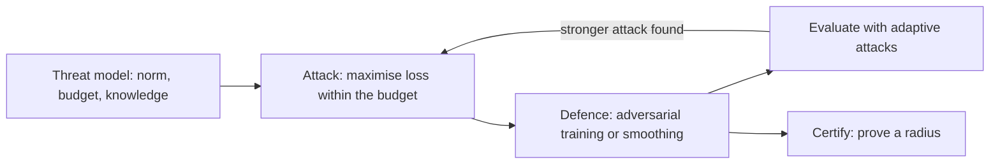

# Adversarial Examples and Robustness

An adversarial example is an input changed by a perturbation too small for a person to notice, yet enough to make a trained model confidently wrong. Adversarial robustness studies how to make models resist such inputs, how to measure that resistance honestly, and what it costs in accuracy.

## Overview

Szegedy et al. (2013) showed that deep image classifiers could be pushed to wrong answers by imperceptible changes to their inputs. Later work found the same vulnerability in many other settings, and it found that the wrong predictions often come with high confidence (Goodfellow et al., 2014).

The field has been shaped by an arms race. Many defences were published, and many were broken by stronger attacks that adapted to them. Athalye et al. (2018) examined the defences at ICLR 2018 and found that seven of nine relied on obfuscated gradients; their attacks circumvented six completely and one partly. Croce and Hein (2020) later reported that, for all but one of more than fifty published defences they tested, robust accuracy was lower than the original papers claimed. Evaluation is therefore as difficult as building defences.

Robustness also has a price. A model can be made robust to small perturbations and still lose accuracy on clean data, and Tsipras et al. (2018) show that this tension can be proved in a simple setting. The topic connects to [uncertainty and calibration](../uncertainty-and-calibration/index.md), since confident errors on adversarial inputs are a calibration failure, and to [generalisation](../../paradigms/supervised/generalization-theory/index.md), since robust learning has its own sample-size requirements.

## Key concepts

- **Adversarial example.** An input \(x' = x + \delta\) whose perturbation \(\delta\) lies within a small set, such as \(\|\delta\|_\infty \le \varepsilon\), and which the model classifies differently from \(x\).
- **Threat model.** The full specification of an attack: the perturbation set, the attacker's goal (any wrong answer, or a chosen one), and the attacker's knowledge. In a white-box attack the attacker sees the model's gradients. In a black-box attack the attacker only queries it.
- **Transferability.** An adversarial example crafted against one model often fools another. Papernot et al. (2016) used this to build black-box attacks, by training a substitute model and crafting examples against it.
- **Robust accuracy and standard accuracy.** Robust accuracy is the accuracy on perturbed inputs within the threat model. Standard accuracy is the accuracy on clean inputs.
- **Gradient masking.** A defence that makes gradients uninformative can look robust to gradient attacks without being robust. Athalye et al. (2018) show this effect and how to get around it.
- **Certified robustness.** A proof that no perturbation in the threat model can change the prediction, valid for a stated radius.

## How it works

Attack and defence are a two-player game. The attacker chooses a perturbation within the budget to maximise the loss. The defender chooses parameters to minimise the loss on those worst-case inputs. This is captured by the robust objective

\[
\min_\theta \; \mathbb{E}_{(x,y)\sim\mathcal{D}} \Big[ \max_{\|\delta\|\le\varepsilon} L(f_\theta(x+\delta), y) \Big].
\]

The inner maximisation is the attack. Its standard approximations are the single-step [FGSM](fgsm/index.md) and the iterated projected gradient method, which is also the core of adversarial training. A defence is best judged by attacks its designers did not anticipate, so the evaluation step is part of the method.

Three families of defence follow from this picture. Adversarial training uses the inner attack during learning. Certified methods prove a guarantee for a stated radius, typically at a cost in accuracy or compute. Detection methods try to flag adversarial inputs, but most have been shown to fail under adaptive attacks (Carlini et al., 2019), which is why the evaluation loop in the diagram matters.

## Key methods

Three landmark methods are compared here. Each has its own page with the detail.

| Method | Kind | What it does | Page |
|---|---|---|---|
| Fast Gradient Sign Method (Goodfellow et al., 2014) | Attack | One gradient-sign step of fixed size inside the \(\ell_\infty\) ball | [FGSM](fgsm/index.md) |
| PGD and adversarial training (Madry et al., 2017) | Attack and defence | Many projected steps as the inner attack, trained in a min–max objective | [PGD and adversarial training](pgd-adversarial-training/index.md) |
| Randomized smoothing (Cohen et al., 2019) | Certified defence | Averages predictions under Gaussian noise to certify an \(\ell_2\) radius | [Randomized smoothing](randomized-smoothing/index.md) |

FGSM is cheap and underlies the linearity explanation, but it is weak against a defender who anticipates it. PGD is a much stronger attack and the usual basis of adversarial training, at several times the training cost. Randomized smoothing is the only one of the three that gives a guarantee, and it is limited to \(\ell_2\) perturbations.

## Connections

The brain offers a useful comparison for this topic. Adversarial fragility is one of the notable differences between deep vision models and human perception, which is discussed in [visual perception](../../../brain-mind/visual-perception/index.md). Geirhos et al. (2018) showed that ImageNet-trained CNNs rely strongly on texture, and that training for shape bias improves robustness to some image distortions. Elsayed et al. (2018) found that examples transferred from vision models can also change the decisions of time-limited human observers, so people are not fully immune. Bowers et al. (2022) argue that such failures are among the reasons deep networks are poor models of human vision. See also [NeuroAI](../../../brain-mind/neuroai/index.md).

Language models bring a different kind of attack. Inputs are discrete tokens, not pixels, so gradient steps must be adapted. Zou et al. (2023) found adversarial suffixes that transfer across models, and [LLM security](../../../engineering/llm-security/index.md) covers this, together with prompt injection and jailbreaks, in detail.

Evaluation methods, including the adaptive attacks needed to test any defence, are described in [evaluation](../../../engineering/evaluation/index.md).

## Applications

- **Benchmarking.** Standard evaluation suites, such as the RobustBench leaderboard built on AutoAttack (Croce et al., 2020), let image classifiers be compared under fixed threat models.
- **Physical-world perception.** Kurakin et al. (2016) showed that adversarial images remain misclassified after camera capture, which matters for [autonomous driving](../../../applications/autonomous-driving/index.md) and similar systems.
- **Certified classifiers.** Cohen et al. (2019) produced an ImageNet classifier with a certified guarantee, a reference point for what certification can achieve at scale.
- **Security systems.** Any classifier that an adversary can probe, including those used in [cybersecurity](../../../applications/cybersecurity/index.md), faces the same threat model.

## Open questions

- **Why do adversarial examples exist?** Goodfellow et al. (2014) point to the linear behaviour of networks. Ilyas et al. (2019) argue that the features models use are predictive but non-robust, a different account that does not depend on linearity.
- **Is the accuracy trade-off inherent?** Zhang et al. (2019) split robust error into a natural classification error and a boundary error, and designed a training objective that trades the two off. Whether this trade-off can be removed is unresolved.
- **How much data is needed?** Schmidt et al. (2018) show that robust learning can require substantially more samples than standard learning, which may explain part of the difficulty.
- **How can evaluation be trusted?** Carlini et al. (2019) give guidance on evaluating defences, and the gap between claimed and measured robustness suggests that the question is still open.

## References

### Seminal papers

- Szegedy, C. et al. (2013). *Intriguing properties of neural networks*. arXiv. https://arxiv.org/abs/1312.6199 — First shows that imperceptible input perturbations can change the output of deep image classifiers.
- Goodfellow, I. J., Shlens, J. & Szegedy, C. (2014). *Explaining and Harnessing Adversarial Examples*. arXiv. https://arxiv.org/abs/1412.6572 — Introduces FGSM and argues that the linearity of networks explains adversarial vulnerability.
- Papernot, N. et al. (2016). *Transferability in Machine Learning: from Phenomena to Black-Box Attacks using Adversarial Samples*. arXiv. https://arxiv.org/abs/1605.07277 — Studies transferability and builds black-box attacks through substitute models.
- Carlini, N. & Wagner, D. (2016). *Towards Evaluating the Robustness of Neural Networks*. arXiv. https://arxiv.org/abs/1608.04644 — Introduces stronger optimisation-based attacks that defeat defensive distillation.
- Madry, A. et al. (2017). *Towards Deep Learning Models Resistant to Adversarial Attacks*. arXiv. https://arxiv.org/abs/1706.06083 — Frames robustness as min–max optimisation, with PGD as the training attack.
- Kurakin, A., Goodfellow, I. J. & Bengio, S. (2016). *Adversarial examples in the physical world*. arXiv. https://arxiv.org/abs/1607.02533 — Shows that adversarial images captured by a cell-phone camera remain misclassified in large numbers.
- Zhang, H. et al. (2019). *Theoretically Principled Trade-off between Robustness and Accuracy*. arXiv. https://arxiv.org/abs/1901.08573 — Splits robust error into natural and boundary error, and proposes the TRADES training objective.
- Tsipras, D. et al. (2018). *Robustness May Be at Odds with Accuracy*. arXiv. https://arxiv.org/abs/1805.12152 — Shows a provable tension between standard accuracy and adversarial robustness in a simple setting.
- Cohen, J. M., Rosenfeld, E. & Kolter, J. Z. (2019). *Certified Adversarial Robustness via Randomized Smoothing*. arXiv. https://arxiv.org/abs/1902.02918 — Proves a tight \(\ell_2\) guarantee for Gaussian smoothing and reports certified accuracy on ImageNet.

### Surveys and textbooks

- Akhtar, N. & Mian, A. (2018). *Threat of Adversarial Attacks on Deep Learning in Computer Vision: A Survey*. arXiv. https://arxiv.org/abs/1801.00553 — Surveys attack methods, the threat they pose and the defences proposed in computer vision.
- Bai, T. et al. (2021). *Recent Advances in Adversarial Training for Adversarial Robustness*. arXiv. https://arxiv.org/abs/2102.01356 — Surveys adversarial training and the generalisation problems it raises.

### Articles and documentation

- Athalye, A., Carlini, N. & Wagner, D. (2018). *Obfuscated Gradients Give a False Sense of Security*. arXiv. https://arxiv.org/abs/1802.00420 — Identifies gradient masking as a source of false security and breaks several ICLR 2018 defences.
- Schmidt, L. et al. (2018). *Adversarially Robust Generalization Requires More Data*. arXiv. https://arxiv.org/abs/1804.11285 — Proves a sample-complexity gap between robust and standard learning, with image experiments.
- Croce, F. & Hein, M. (2020). *Reliable evaluation of adversarial robustness with an ensemble of diverse parameter-free attacks*. arXiv. https://arxiv.org/abs/2003.01690 — Introduces AutoAttack, which finds lower robust accuracy than many published defences report.
- Croce, F. et al. (2020). *RobustBench: a standardized adversarial robustness benchmark*. arXiv. https://arxiv.org/abs/2010.09670 — Describes the leaderboard and library for standardised robustness evaluation.
- Carlini, N. et al. (2019). *On Evaluating Adversarial Robustness*. arXiv. https://arxiv.org/abs/1902.06705 — Gives methodological guidance for evaluating defences and their common pitfalls.
- Geirhos, R. et al. (2018). *ImageNet-trained CNNs are biased towards texture; increasing shape bias improves accuracy and robustness*. arXiv. https://arxiv.org/abs/1811.12231 — Shows that CNNs rely on texture more than people do, and that shape bias improves robustness to distortions.
- Bowers, J. S. et al. (2022). Deep problems with neural network models of human vision. *Behavioral and Brain Sciences*. https://doi.org/10.1017/S0140525X22002813 — Argues that deep networks are weak models of human vision, citing among other failures their adversarial fragility.
- Elsayed, G. F. et al. (2018). *Adversarial Examples that Fool both Computer Vision and Time-Limited Humans*. arXiv. https://arxiv.org/abs/1802.08195 — Shows that examples transferred from vision models also change the decisions of time-limited human observers.
- Ilyas, A. et al. (2019). *Adversarial Examples Are Not Bugs, They Are Features*. arXiv. https://arxiv.org/abs/1905.02175 — Attributes adversarial vulnerability to non-robust but predictive features in the data.
- Zou, A. et al. (2023). *Universal and Transferable Adversarial Attacks on Aligned Language Models*. arXiv. https://arxiv.org/abs/2307.15043 — Finds adversarial suffixes by gradient search that transfer across prompts and to closed models.
