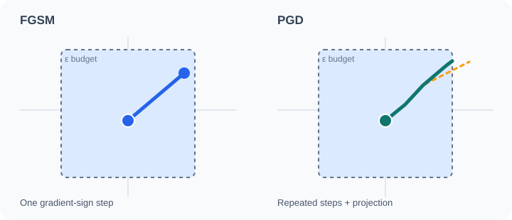

# Projected Gradient Descent and Adversarial Training

Projected gradient descent (PGD) is an iterative attack that repeats small gradient steps and projects the perturbed input back into the allowed budget after each step. Adversarial training uses PGD examples as training data, which Madry et al. (2018) showed to be a strong defence. Part of [Adversarial examples and robustness](index.md).

## Overview

A single FGSM step can miss higher-loss regions. PGD repeatedly updates the candidate and projects it into the feasible set; optional random starts and multiple independent restarts can strengthen the search, but neither is required for every PGD implementation. Madry et al. (2018) framed robust training as a min–max problem: minimise over the parameters the worst-case loss over perturbations within the budget.

## Key concepts

- **Projection**: after each step, the perturbation is clipped back into the \(\epsilon\)-ball around the clean input.
- **Random start**: the attack begins at a random point in the ball, which helps it escape flat regions of the loss.
- **Min–max objective**: \(\min_\theta \mathbb{E}\big[\max_{\|\delta\|\le\epsilon} J(\theta,x+\delta,y)\big]\).

## How it works

PGD may start from the clean input \(x^{(0)}=x\), or optionally from a random feasible point \(x^{(0)}=x+\eta\). For an \(\ell_\infty\) budget and bounded inputs, define the feasible set \(\mathcal C=\{z:\|z-x\|_\infty\le\epsilon\}\cap[0,1]^d\) (omit the domain intersection when inputs are unbounded). Each attack step is

\[
x^{(t+1)}=\Pi_{\mathcal C}\!\Big(x^{(t)}+\alpha\,\mathrm{sign}\big(\nabla_x J(\theta,x^{(t)},y)\big)\Big),
\]

where \(\Pi_{\mathcal C}\) projects onto the feasible set (both the perturbation budget and input domain) and \(\alpha\) is the step size. Adversarial training computes this inner maximisation for each minibatch and updates the parameters on the resulting examples. The approach is expensive, because each training step needs several gradient computations.

### Why projection matters

*Original schematic animation.* FGSM (left) makes one gradient-sign step. PGD (right) uses repeated steps; the orange dashed extension represents a proposed update outside the allowed \(\ell_\infty\) region, whereas the teal path shows feasible iterates before that candidate step. The purple endpoint marks the projected result on the boundary. This is a **conceptual illustration, not a numerical attack trace or measured loss landscape**. The paths are permanently drawn so GitHub's non-animated SVG preview preserves the explanation. The purple dotted segment shows the candidate being clipped horizontally to the feasible boundary in this schematic 2D view; actual $\ell_\infty$ projection clips each coordinate independently.

The five-second sequence is read in order: feasible teal updates finish at 2.5 s; the orange candidate moves outside the budget from 2.5–3.5 s; then the purple projection returns to the boundary from 3.5–5 s. The candidate and projection are **one PGD update**, not two separate gradient steps. The animated purple return is a **visual interpolation of a projection operation**, not an additional gradient-ascent trajectory or a time-consuming physical motion: mathematically, projection maps the candidate directly to its feasible endpoint. The final endpoint remains visible when animation is unavailable or reduced motion is requested.

For an \(\ell_\infty\) budget, projection is **coordinate-wise clipping** rather than movement along the drawn trajectory: \(\Pi_{\mathcal B_\epsilon(x)}(z)_i=\min(x_i+\epsilon,\max(x_i-\epsilon,z_i))\). If the input also has a valid range (for example, pixel values in \([0,1]\)), the update must respect the intersection with that range. As a schematic one-coordinate example with clean value \(0.50\), \(\epsilon=0.10\), and an unprojected candidate \(0.64\), projection returns \(0.60\). These are illustrative values, not measurements. The figure does not depict random initialisation, a loss surface, or literal gradient directions; in a real PGD run, the gradient is recomputed at each iterate.

For bounded inputs, the feasible interval for coordinate \(i\) is \([\max(0,x_i-\epsilon),\min(1,x_i+\epsilon)]\), assuming the input domain is \([0,1]\). The projection is therefore clipping to this *intersection*, not merely clipping to the perturbation budget.

**Two-coordinate check (illustrative, not measured).** Let \(x=(0.95,0.20)\), \(\epsilon=0.10\), and the unprojected candidate be \(z=(1.08,0.04)\). The feasible intervals are \([0.85,1.00]\) and \([0.10,0.30]\), respectively, so projection yields \((1.00,0.10)\). This example exercises *both* the input-domain bound and the perturbation budget. For the \(\ell_\infty\) attack shown here, the gradient-*sign* update is a step of ascent on the attack loss; the subsequent clipping is the projection, not another gradient step.

### Why the feasible set is a box

The rectangular budget boundary in the animation represents a two-dimensional **\(\ell_\infty\)** ball, not a generic constraint for every PGD attack. For an \(\ell_2\) budget, the feasible region is circular in two dimensions and an out-of-budget candidate \(z\) (ignoring additional input-domain constraints) is projected radially:

\[
\Pi_{\mathcal B^{(2)}_\epsilon(x)}(z)=x+(z-x)\min\!\left(1,\frac{\epsilon}{\|z-x\|_2}\right).
\]

The radial formula is interpreted as the identity when \(z=x\), avoiding division by zero. This expression projects onto the **unconstrained \(\ell_2\) ball only**. If the input is also bounded, the feasible set is the intersection of that ball and the input domain; applying radial projection and then clipping coordinates is not, in general, the Euclidean projection onto the intersection. The SVG does not depict this additional constrained optimisation. Unlike the \(\ell_\infty\) gradient-sign step shown above, a common \(\ell_2\)-constrained attack takes a gradient direction normalised by its \(\ell_2\) norm before projecting; the projection formula alone does not specify the ascent rule. For example, with \(x=(0,0)\), \(\epsilon=1\), and \(z=(1.2,1.6)\), the \(\ell_2\) projection is \((0.6,0.8)\); coordinate-wise \(\ell_\infty\) clipping would instead produce \((1,1)\). These are **illustrative calculations, not model measurements**. The SVG intentionally depicts only the \(\ell_\infty\) case; its horizontal purple return must not be interpreted as the projection rule for other norms.

### Two projected iterations (illustrative)

Consider a one-dimensional input with clean value \(x=0.50\), \(\epsilon=0.10\), step size \(\alpha=0.08\), and feasible interval \([0.40,0.60]\). Start at \(x^{(0)}=0.50\). If the gradient sign at the first iterate is \(+1\), the candidate is \(0.58\) and projection leaves \(x^{(1)}=0.58\). If the gradient sign recomputed at \(x^{(1)}\) is again \(+1\), the next candidate is \(0.66\), but projection gives \(x^{(2)}=0.60\). The gradient signs are **hypothetical**, not evaluated from a model. This trace makes clear that PGD projects **after every update**, not only at the end, and that the projected endpoint may differ from the unprojected candidate. The schematic SVG conveys the same distinction geometrically without claiming these particular numbers.

### Why postponing projection changes the trajectory (illustrative)

Projection is part of **each** PGD iteration, not an optional final clean-up. Continue the one-dimensional example above with hypothetical gradient signs \(+1,+1,-1\), while holding those signs fixed solely to compare the update rules. With \(x=0.50\), \(\epsilon=0.10\), and \(\alpha=0.08\), correct per-step projection gives the iterates \(0.50 \rightarrow 0.58 \rightarrow 0.60 \rightarrow 0.52\). If the same candidate increments are instead accumulated *without* intermediate projection, the states are \(0.50 \rightarrow 0.58 \rightarrow 0.66 \rightarrow 0.58\); projecting only at the end yields \(0.58\), **not** \(0.52\). The unprojected second state also violates the perturbation budget. These are synthetic arithmetic traces, not evaluated gradients or model measurements. In a real attack, omitting projection also changes the point where subsequent gradients are evaluated, so the two gradient-sign sequences need not remain equal. The orange candidate and purple return in the animation illustrate why the projection must be applied before the next iteration.

## Variants

- **TRADES** trains with a loss that balances clean accuracy against the change in output under attack, which gives a different accuracy–robustness trade-off.
- **Free adversarial training** reuses the gradient from one pass to make the attack cheaper.
- **Fast adversarial training** uses a single FGSM step with random initialisation to save compute, with the risk of catastrophic overfitting noted in [FGSM](fgsm.md).

## Results and limits

- PGD adversarial training produced models with much higher robust accuracy on image benchmarks than standard training (Madry et al., 2018).
- Clean accuracy usually falls as robustness rises, which Tsipras et al. (2019) explain as an inherent trade-off in some settings.
- Robust accuracy depends on the attack used for evaluation. Carlini and Wagner (2017) show that defences trained against one attack can fail against a stronger one.
- Training cost is several times that of standard training, and the gains need to be weighed against that cost.

## Applications

- **Robust image classifiers** for settings where small noise can change decisions.
- **Benchmarking**: PGD with many steps and random restarts is a standard evaluation attack.
- **Transfer to other domains**: adversarial training ideas are applied to speech, text embeddings and graphs, with the same cost issues.

## Open questions

- The right budget and attack for training in each domain is not settled, and robustness does not always transfer to new attack types.
- Reducing the cost of adversarial training without losing robustness remains a research goal.

## References

### Seminal papers

- Madry, A., Makelov, A., Schmidt, L., Tsipras, D. & Vladu, A. (2018). Towards deep learning models resistant to adversarial attacks. In *International Conference on Learning Representations*. arXiv:1706.06083. https://arxiv.org/abs/1706.06083 — Introduces PGD attacks and min–max adversarial training.
- Goodfellow, I. J., Shlens, J. & Szegedy, C. (2015). Explaining and harnessing adversarial examples. In *International Conference on Learning Representations*. arXiv:1412.6572. https://arxiv.org/abs/1412.6572 — Introduces the gradient-based attack and the first adversarial training experiments.
- Carlini, N. & Wagner, D. (2017). Towards evaluating the robustness of neural networks. In *2017 IEEE Symposium on Security and Privacy*, 39–57. https://doi.org/10.1109/SP.2017.49 — Shows that stronger attacks break defences evaluated only against weaker ones.

### Surveys and textbooks

- Tsipras, D., Santurkar, S., Engstrom, L., Turner, A. & Madry, A. (2019). Robustness may be at odds with accuracy. In *International Conference on Learning Representations*. arXiv:1805.12152. https://arxiv.org/abs/1805.12152 — Explains the accuracy–robustness trade-off that adversarial training exhibits.
- Cohen, J., Rosenfeld, E. & Kolter, Z. (2019). Certified adversarial robustness via randomized smoothing. In *Proceedings of the 36th International Conference on Machine Learning*, PMLR 97. https://proceedings.mlr.press/v97/cohen19c.html — Compares empirical adversarial training with certified guarantees.
- Murphy, K. P. (2022). *Probabilistic Machine Learning: An Introduction*. MIT Press. https://github.com/probml/pml-book — Free textbook; covers adversarial training as a min–max problem.
