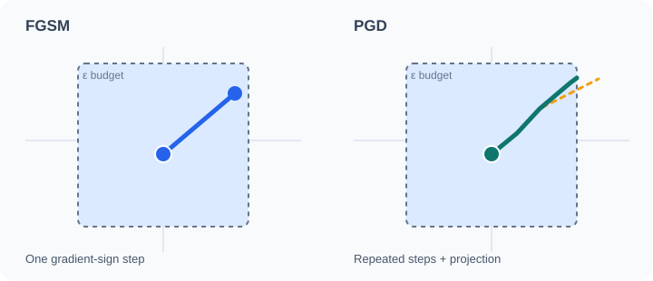

# 投影梯度下降與對抗訓練

投影梯度下降（PGD）是一種迭代攻擊：重複小幅的梯度步伐，並在每步之後把擾動投影回允許的預算之內。對抗訓練則以 PGD 樣本作為訓練資料，Madry 等人（2018）證明這是一種強的防禦。本頁是[對抗樣本與穩健性](index.md)的一部分。

## 概述

單步 FGSM 可能錯過較高損失的區域。PGD 反覆更新候選點並投影回可行集合；可選擇加入隨機起點及多次獨立重啟，以提高搜尋到較強對抗樣本的機會，但並非每種 PGD 實作都必須採用。Madry 等人（2018）把穩健訓練表述為極小極大問題：對參數取極小，同時對預算內的擾動取最壞情況的損失。

## 關鍵概念

- **投影**：每一步之後，把擾動裁回以乾淨輸入為中心的 \(\epsilon\) 球內。
- **隨機起點**：攻擊從球內的隨機點開始，有助於跳出損失函數的平坦區域。
- **極小極大目標**：\(\min_\theta \mathbb{E}\big[\max_{\|\delta\|\le\epsilon} J(\theta,x+\delta,y)\big]\)。

## 運作方式

PGD 可以從乾淨輸入 \(x^{(0)}=x\) 開始，也可以選擇在可行集合內隨機初始化 \(x^{(0)}=x+\eta\)。若採 \(\ell_\infty\) 擾動預算且輸入值域為 \([0,1]^d\)，定義可行集合 \(\mathcal C=\{z:\|z-x\|_\infty\le\epsilon\}\cap[0,1]^d\)（若輸入無界，則省略值域交集）。每次攻擊更新為

\[
x^{(t+1)}=\Pi_{\mathcal C}\!\Big(x^{(t)}+\alpha\,\mathrm{sign}\big(\nabla_x J(\theta,x^{(t)},y)\big)\Big),
\]

其中 \(\Pi_{\mathcal C}\) 表示投影到可行集合（同時滿足擾動預算與輸入值域），\(\alpha\) 為步長。對抗訓練在每個小批次上計算這個內層最大化，並以得到的樣本更新參數。此方法成本高，因為每個訓練步需要多次計算梯度。

### 為何每一步都需要投影

*原創示意動畫。* FGSM（左）只做一次梯度符號更新；PGD（右）採多次小步更新。橘色虛線延伸表示超出 \(\ell_\infty\) 可行範圍的候選步驟，青綠色路徑表示候選更新前的可行迭代點，紫色終點才是投影回邊界的結果。這是**概念示意，不是數值攻擊軌跡或實測損失地形**。路徑保持可見，因此 GitHub 的非動畫預覽也能傳達概念。 紫色點線示意在此二維視圖中，將候選點水平裁剪回可行邊界；實際的 $\ell_\infty$ 投影則是對各座標獨立裁剪。

五秒動畫應依時間順序閱讀：青綠色可行更新於 2.5 秒結束；橘色候選點在 2.5–3.5 秒移出預算範圍；紫色投影於 4–5 秒返回可行邊界。**橘色候選更新與紫色投影屬於同一次 PGD 更新**，不是兩次獨立的梯度步驟。若無法播放動畫或啟用減少動態效果，仍可從固定顯示的終點與路徑理解運算。

在 \(\ell_\infty\) 擾動預算下，投影是**逐座標裁剪**，並非沿著圖中路徑移動：\(\Pi_{\mathcal B_\epsilon(x)}(z)_i=\min(x_i+\epsilon,\max(x_i-\epsilon,z_i))\)。若輸入另有合法範圍（例如像素值 \([0,1]\)），更新還必須符合兩者的交集。以單一座標為示意：乾淨輸入值為 \(0.50\)、\(\epsilon=0.10\)，未投影的候選值為 \(0.64\)，則投影後為 \(0.60\)。這些是**教學假設數值，並非實測**。圖中未呈現隨機初始化、損失曲面或真實梯度方向；實際 PGD 每一步都會在當前迭代點重新計算梯度。

若輸入值域為 \([0,1]\)，第 \(i\) 個座標的可行區間是 \([\max(0,x_i-\epsilon),\min(1,x_i+\epsilon)]\)。因此投影應裁剪至**輸入合法值域與擾動預算的交集**，不能只考慮 \(\epsilon\) 預算。

**雙座標驗算（教學假設，非實測）。** 設 \(x=(0.95,0.20)\)、\(\epsilon=0.10\)，未投影候選點為 \(z=(1.08,0.04)\)。兩個座標的可行區間分別為 \([0.85,1.00]\) 與 \([0.10,0.30]\)，因此投影結果是 \((1.00,0.10)\)。此例同時呈現輸入值域限制與擾動預算限制。在圖示的 \(\ell_\infty\) 攻擊中，梯度**符號**更新是沿攻擊損失上升的步驟；後續裁剪才是投影，並非另一個梯度更新。

### 連續兩步投影驗算（教學假設）

考慮一維乾淨輸入 \(x=0.50\)、\(\epsilon=0.10\)、步長 \(\alpha=0.08\)，可行區間為 \([0.40,0.60]\)。從 \(x^{(0)}=0.50\) 開始。假設第一步的梯度符號為 \(+1\)，候選值為 \(0.58\)，投影後仍為 \(x^{(1)}=0.58\)。若在 \(x^{(1)}\) **重新計算**的梯度符號也為 \(+1\)，第二步候選值為 \(0.66\)，投影後則得到 \(x^{(2)}=0.60\)。此處梯度符號均為**假設，並未執行模型推論或梯度計算**。這個例子說明 PGD 是**每一步更新後立即投影**，而非只在最後投影一次；投影後的點也可能不同於未投影候選點。SVG 以幾何方式呈現相同概念，但不代表圖中採用這組數值。

## 變體

- **TRADES** 以兼顧乾淨準確率與攻擊下輸出變化的損失進行訓練，得到不同的準確率與穩健性取捨。
- **免費對抗訓練**重用一次傳遞的梯度，以降低攻擊的成本。
- **快速對抗訓練**使用帶隨機初始化的單步 FGSM 以節省計算，但有[FGSM](fgsm.md)頁中提到的災難性過擬合風險。

## 結果與限制

- PGD 對抗訓練在影像基準上產生的模型，其穩健準確率遠高於標準訓練（Madry 等人，2018）。
- 穩健性提高時，乾淨準確率通常會下降，Tsipras 等人（2019）將其解釋為某些設定中固有的取捨。
- 穩健準確率取決於評估所用的攻擊。Carlini 與 Wagner（2017）顯示，只針對較弱攻擊訓練的防禦，可能被更強的攻擊打破。
- 訓練成本是標準訓練的數倍，收益需與這個成本權衡。

## 應用

- **穩健的影像分類器**：用於小幅雜訊就可能改變判斷的情境。
- **基準測試**：使用多步與多次隨機重啟的 PGD，是標準的評估攻擊。
- **遷移到其他領域**：對抗訓練的想法已應用於語音、文字嵌入與圖資料，成本問題也相同。

## 開放問題

- 各領域訓練時應採用的預算與攻擊尚無定論，而穩健性也未必能遷移到新的攻擊類型。
- 在不損失穩健性的前提下降低對抗訓練的成本，仍是研究目標。

## 參考文獻

### 奠基性論文

- Madry, A., Makelov, A., Schmidt, L., Tsipras, D. & Vladu, A. (2018). Towards deep learning models resistant to adversarial attacks. In *International Conference on Learning Representations*. arXiv:1706.06083. https://arxiv.org/abs/1706.06083 — 提出 PGD 攻擊與極小極大的對抗訓練。
- Goodfellow, I. J., Shlens, J. & Szegedy, C. (2015). Explaining and harnessing adversarial examples. In *International Conference on Learning Representations*. arXiv:1412.6572. https://arxiv.org/abs/1412.6572 — 提出基於梯度的攻擊與最早的對抗訓練實驗。
- Carlini, N. & Wagner, D. (2017). Towards evaluating the robustness of neural networks. In *2017 IEEE Symposium on Security and Privacy*, 39–57. https://doi.org/10.1109/SP.2017.49 — 顯示更強的攻擊會打破僅以較弱攻擊評估的防禦。

### 綜述與教科書

- Tsipras, D., Santurkar, S., Engstrom, L., Turner, A. & Madry, A. (2019). Robustness may be at odds with accuracy. In *International Conference on Learning Representations*. arXiv:1805.12152. https://arxiv.org/abs/1805.12152 — 說明對抗訓練所呈現的準確率與穩健性取捨。
- Cohen, J., Rosenfeld, E. & Kolter, Z. (2019). Certified adversarial robustness via randomized smoothing. In *Proceedings of the 36th International Conference on Machine Learning*, PMLR 97. https://proceedings.mlr.press/v97/cohen19c.html — 比較經驗性的對抗訓練與認證保證。
- Murphy, K. P. (2022). *Probabilistic Machine Learning: An Introduction*. MIT Press. https://github.com/probml/pml-book — 免費教科書；把對抗訓練視為極小極大問題。
