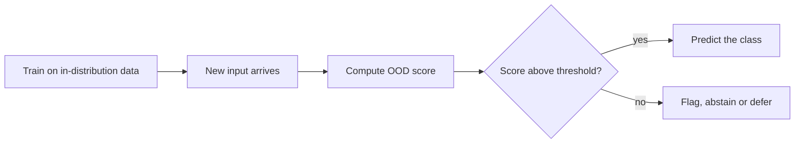

# Out-of-Distribution Detection and Distribution Shift

Distribution shift is the change in data between training and deployment. Out-of-distribution (OOD) detection asks whether a particular input comes from outside the distribution a model was trained on, so that a system can flag it, abstain or hand it to a person. Both matter because a classifier that is accurate on its own test set can be confidently wrong once the inputs change. This page is part of [Machine Learning](../index.md).

## Overview

Supervised learning usually assumes that training and deployment data come from the same distribution. In practice they often do not: scanners differ between hospitals, seasons change, cameras move, and language drifts. Recht et al. (2019) rebuilt test sets for CIFAR-10 and ImageNet by closely following the original procedures, and accuracy fell by 3% to 15% on CIFAR-10 and by 11% to 14% on ImageNet.[^1]

There are two related questions. The first is whether a model stays accurate under shift; domain adaptation and robust training address it, and the [domain adaptation](../../paradigms/transfer/domain-adaptation/index.md) page covers the transfer side. The second is whether the model can tell that an input is unfamiliar. A detector does not make the classifier more accurate, but it lets a system decline to act on such inputs.

OOD detection overlaps with anomaly detection, novelty detection, outlier detection and open-set recognition. Yang et al. (2021) note that these fields developed in isolation and often use the same words with different meanings. Open-set recognition (Scheirer et al., 2013) is the most direct variant: a classifier must assign known classes correctly and reject inputs from classes it never saw. The [anomaly detection](../../paradigms/unsupervised/anomaly-detection/index.md) page covers the wider family.

## Key concepts

- **In-distribution (ID) and out-of-distribution (OOD).** An input is in-distribution if it comes from the distribution the model was trained on. A photograph of a cat is in-distribution for a cat classifier and OOD for a model trained only on cars.
- **Covariate shift.** The distribution of inputs changes while the rule linking inputs to labels stays the same (Shimodaira, 2000).
- **Label shift and concept shift.** Label shift changes the class frequencies; concept shift changes the rule that maps inputs to labels. Moreno-Torres et al. (2012) give a unified view of these kinds of dataset shift.
- **Scoring function.** A number computed for each input, where higher means more typical. A threshold turns the score into an accept or reject decision.
- **AUROC and FPR at 95% TPR.** AUROC measures how well ID and OOD scores are ordered. FPR at 95% TPR is the fraction of OOD inputs accepted when 95% of ID inputs are accepted.
- **Shortcut learning.** A model relies on a rule that works on the benchmark but fails under harder conditions (Geirhos et al., 2020). A spurious correlation, such as a background that predicts the label in training, is a common source of such rules.

## How it works

A typical detector takes a trained classifier and adds a scoring step at test time. The score is compared with a threshold chosen on validation data.

The simplest score is the maximum softmax probability. For logits $f_k(x)$, the score is

$$
s(x) = \max_k \frac{\exp f_k(x)}{\sum_j \exp f_j(x)},
$$

and the input is flagged when $s(x) < \tau$. The detector is evaluated on an ID set and an OOD set. The two sets of scores are compared using AUROC, and FPR at 95% TPR is read at the threshold that accepts 95% of ID inputs. Methods differ mainly in the score they compute.

Under covariate shift, training data can be reweighted to estimate performance on the test distribution. If $p$ is the training input density and $q$ the test density, the test risk is

$$
R_q(f) = \mathbb{E}_{x \sim p}\!\left[\frac{q(x)}{p(x)}\, L\big(f(x), y\big)\right].
$$

Benchmarks pair a familiar dataset with a different one, from very different pairs such as CIFAR-10 and street-view house numbers to harder pairs with similar images and new classes. ImageNet-C (Hendrycks and Dietterich, 2019) applies corruptions such as noise and blur. WILDS (Koh et al., 2020) collects ten datasets with natural shifts, including tumour images from different hospitals and camera-trap images from different sites. On these datasets, standard training gives substantially lower out-of-distribution than in-distribution performance.

## Key methods

Three landmark scores are compared here. Each has its own page.

| Method | Score | Idea | Page |
|---|---|---|---|
| Maximum softmax probability | Largest softmax output | Low confidence suggests an unfamiliar input. The baseline others are measured against | [Maximum softmax probability](max-softmax-probability/index.md) |
| Mahalanobis distance | Distance to the nearest class in feature space | Unfamiliar inputs fall far from every class-conditional Gaussian | [Mahalanobis distance](mahalanobis-distance/index.md) |
| Energy score | Log-sum-exp of the logits | Keeps the overall logit magnitude, which the softmax removes | [Energy score](energy-score/index.md) |

Other approaches include ODIN, which adds temperature scaling and a small input perturbation (Liang et al., 2017), and Generalized ODIN, which avoids tuning on OOD data (Hsu et al., 2020). Outlier Exposure trains the detector against a separate set of outliers (Hendrycks et al., 2018).

## Connections

[Domain adaptation](../../paradigms/transfer/domain-adaptation/index.md) and OOD detection share a vocabulary of shift. Domain adaptation usually has unlabelled target data during training; OOD detection usually meets the new inputs only at deployment. [Generalisation theory](../../paradigms/supervised/generalization-theory/index.md) assumes that training and test data are drawn from one distribution, which shift breaks.

Overconfidence links this page to [uncertainty quantification and calibration](../uncertainty-and-calibration/index.md), where Ovadia et al. (2019) found that calibration fitted on in-distribution data falls short under dataset shift.

Adversarial inputs are another kind of unfamiliar input. Lee et al. (2018) test the same detector on OOD samples and adversarial attacks. See [adversarial examples and robustness](../adversarial-robustness/index.md).

Shortcut learning is the case in which a network is right for the wrong reason. Geirhos et al. (2019) showed that ImageNet-trained CNNs rely strongly on texture rather than shape, in contrast to human behaviour. The [shape bias in CNNs](../../../brain-mind/visual-perception/geirhos-2019/index.md) page covers the human comparison.

The brain also detects deviance automatically. The mismatch negativity is a response in auditory cortex to a sound that breaks a regular sequence, and it occurs without the listener attending to the sounds (Näätänen et al., 2007). It is a built-in novelty signal of the kind OOD detection tries to build into a classifier. The [predictive coding](../../../brain-mind/predictive-coding/index.md) page describes the brain as comparing incoming signals with predictions. Whether a network can use a comparable signal is open.

## Applications

- **Medical imaging.** A model trained at one hospital may meet scanners and patients from another. See [healthcare](../../../applications/healthcare/index.md).
- **Autonomous driving.** A vehicle should recognise an unusual object or scene and hand control to a person when it cannot decide safely. See [autonomous driving](../../../applications/autonomous-driving/index.md).
- **Fraud and security.** Unfamiliar transactions or traffic can signal new attacks, usually treated as [anomaly detection](../../paradigms/unsupervised/anomaly-detection/index.md).

## Open questions

- **Definitions.** The overlapping fields use different terms, and benchmark comparisons depend on what counts as OOD for a given application.
- **Access to outliers.** Some methods train on outliers (Hendrycks et al., 2018) and others avoid them (Hsu et al., 2020). Tuning on OOD examples that would be unavailable in deployment can make results look better than they are.
- **Closed-set accuracy.** Vaze et al. (2021) report that open-set performance correlates strongly with closed-set accuracy, which raises the question of how much separate detection machinery is needed.
- **Spurious features.** Nagarajan et al. (2020) show that models can fail under shift even on easy linear tasks, and a detector may not notice when the cause is a feature that looks normal.

[^1]: The figures are those reported in the abstract of Recht et al. (2019), for the new test sets compared with the original ones.

## References

### Seminal papers

- Shimodaira, H. (2000). *Improving predictive inference under covariate shift by weighting the log-likelihood function*. *Journal of Statistical Planning and Inference*. https://doi.org/10.1016/S0378-3758(00)00115-4 — Reweights training data to correct inference under covariate shift.
- Scheirer, W. J., de Rezende Rocha, A., Sapkota, A. & Boult, T. E. (2013). *Toward Open Set Recognition*. *IEEE Transactions on Pattern Analysis and Machine Intelligence*. https://doi.org/10.1109/TPAMI.2012.256 — Formalises open-set recognition: accept known classes, reject unknown ones.
- Hendrycks, D. & Gimpel, K. (2016). *A Baseline for Detecting Misclassified and Out-of-Distribution Examples in Neural Networks*. arXiv. https://arxiv.org/abs/1610.02136 — Proposes the maximum softmax probability baseline (ICLR 2017).
- Liang, S., Li, Y. & Srikant, R. (2017). *Enhancing The Reliability of Out-of-distribution Image Detection in Neural Networks*. arXiv. https://arxiv.org/abs/1706.02690 — Introduces ODIN, using temperature scaling and small input perturbations (ICLR 2018).
- Lee, K., Lee, K., Lee, H. & Shin, J. (2018). *A Simple Unified Framework for Detecting Out-of-Distribution Samples and Adversarial Attacks*. arXiv. https://arxiv.org/abs/1807.03888 — Mahalanobis distance to class-conditional Gaussians, for OOD and adversarial inputs (NeurIPS 2018).
- Liu, W., Wang, X., Owens, J. D. & Li, Y. (2020). *Energy-based Out-of-distribution Detection*. arXiv. https://arxiv.org/abs/2010.03759 — Replaces the softmax score with an energy score from the logits (NeurIPS 2020).
- Geirhos, R. et al. (2020). *Shortcut Learning in Deep Neural Networks*. arXiv. https://arxiv.org/abs/2004.07780 — Treats many failures of deep networks as shortcut learning (*Nature Machine Intelligence*).

### Surveys and textbooks

- Yang, J., Zhou, K., Li, Y. & Liu, Z. (2021). *Generalized Out-of-Distribution Detection: A Survey*. arXiv. https://arxiv.org/abs/2110.11334 — Surveys OOD detection and the related problems, and how they differ.
- Moreno-Torres, J. G. et al. (2012). *A unifying view on dataset shift in classification*. *Pattern Recognition*. https://doi.org/10.1016/j.patcog.2011.06.019 — Gives a common taxonomy of covariate, prior and concept shift.
- Näätänen, R., Paavilainen, P., Rinne, T. & Alho, K. (2007). The mismatch negativity (MMN) in basic research of central auditory processing: A review. *Clinical Neurophysiology*. https://doi.org/10.1016/j.clinph.2007.04.026 — Reviews the mismatch negativity, an automatic response to deviant sounds.

### Articles and documentation

- Koh, P. W. et al. (2020). *WILDS: A Benchmark of in-the-Wild Distribution Shifts*. arXiv. https://arxiv.org/abs/2012.07421 — Ten datasets with natural shifts across hospitals and camera traps (ICML 2021).
- Recht, B., Roelofs, R., Schmidt, L. & Shankar, V. (2019). *Do ImageNet Classifiers Generalize to ImageNet?* arXiv. https://arxiv.org/abs/1902.10811 — New CIFAR-10 and ImageNet test sets, and the accuracy drop on them.
- Hendrycks, D. & Dietterich, T. (2019). *Benchmarking Neural Network Robustness to Common Corruptions and Perturbations*. arXiv. https://arxiv.org/abs/1903.12261 — Introduces ImageNet-C and ImageNet-P corruption benchmarks.
- Hendrycks, D., Mazeika, M. & Dietterich, T. (2018). *Deep Anomaly Detection with Outlier Exposure*. arXiv. https://arxiv.org/abs/1812.04606 — Trains detectors against auxiliary outliers (ICLR 2019).
- Hsu, Y.-C., Shen, Y., Jin, H. & Kira, Z. (2020). *Generalized ODIN: Detecting Out-of-distribution Image without Learning from Out-of-distribution Data*. arXiv. https://arxiv.org/abs/2002.11297 — Frees ODIN from tuning on outlier data.
- Vaze, S., Han, K., Vedaldi, A. & Zisserman, A. (2021). *Open-Set Recognition: a Good Closed-Set Classifier is All You Need?* arXiv. https://arxiv.org/abs/2110.06207 — Shows open-set recognition tracks closed-set accuracy.
- Nagarajan, V., Andreassen, A. & Neyshabur, B. (2020). *Understanding the Failure Modes of Out-of-Distribution Generalization*. arXiv. https://arxiv.org/abs/2010.15775 — Spurious correlations cause failures under shift, even in easy tasks.
- Ovadia, Y. et al. (2019). *Can You Trust Your Model's Uncertainty? Evaluating Predictive Uncertainty Under Dataset Shift*. arXiv. https://arxiv.org/abs/1906.02530 — Benchmarks predictive uncertainty and calibration under dataset shift.
- Geirhos, R. et al. (2019). *ImageNet-trained CNNs are biased towards texture; increasing shape bias improves accuracy and robustness*. arXiv. https://arxiv.org/abs/1811.12231 — ImageNet-trained CNNs prefer texture to shape; stylised training helps.
