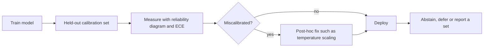

# Uncertainty Quantification and Calibration

Uncertainty quantification attaches a measure of doubt to a model's predictions. Calibration asks whether that doubt is honest: among the cases a model labels as 90% likely, about 90% should turn out to be right.

## Overview

A prediction is hard to use without a sense of how reliable it is. A classifier that says "malignant" is useful, but a clinician needs to know whether that label is a near-certainty or a near coin toss. A driving system needs to know when its perception is unreliable. Two problems are often mixed up here. The first is **calibration**: whether a model's confidence numbers match how often it is right. The second is **uncertainty quantification** in the wider sense: separating what the data cannot tell us from what the model has not yet learned, and returning answers with a measure of doubt or a guarantee.

Guo et al. (2017) reported that modern neural networks, unlike those from a decade earlier, are poorly calibrated, and that depth, width, weight decay and batch normalisation all influence how wrong their confidence tends to be. A network can be highly accurate and still systematically overconfident. The topic rests on [probabilistic and Bayesian methods](../../probabilistic/index.md), which give a principled language for uncertainty, and it depends on [evaluation](../../paradigms/supervised/evaluation-and-validation/index.md) to decide whether a model's stated doubt is actually useful.

## Key concepts

- **Calibration.** A model is calibrated if, among the predictions it makes with confidence \(p\), a fraction \(p\) are correct: \(P(\hat{Y} = Y \mid \hat{p} = p) = p\) for every \(p\).
- **Reliability diagram.** A plot that groups predictions into confidence bins and shows the observed accuracy in each bin against the bin's average confidence. A calibrated model lies on the diagonal.
- **Expected calibration error (ECE).** A single summary: the average gap between confidence and accuracy, weighted by bin size. Its value depends on how the bins are chosen.
- **Proper scoring rule.** A loss, such as log loss or the Brier score, that is minimised only by honest probabilities, rewarding predictions that are both calibrated and sharp (Gneiting and Raftery, 2007).
- **Aleatoric uncertainty.** Irreducible noise in the data itself, such as overlapping classes, sensor noise or labels that disagree. More data does not remove it.
- **Epistemic uncertainty.** Uncertainty about the model, caused by limited data or by many parameter settings that fit the data equally well. It can in principle be reduced with more data, and it is typically largest on inputs unlike the training set. Kendall and Gal (2017) model the two side by side in computer vision.
- **Prediction set.** Instead of one label, a method returns a set of labels that contains the true one with a chosen probability. [Conformal prediction](conformal-prediction/index.md) produces such sets with formal guarantees.

## How it works

Most uncertainty work follows three stages, shown below. A model is trained. A held-out calibration set is used to measure miscalibration and, if needed, to fit a correction. The corrected outputs are then checked on new data and used for decisions, such as abstaining or passing a case to a human.

Uncertainty can be split into the two kinds described above. For regression, let the network predict a mean \(\mu_\theta(x)\) and a variance \(\sigma^2_\theta(x)\), both of which depend on the parameters \(\theta\). The law of total variance then gives

\[
\operatorname{Var}[y \mid x] = \underbrace{\mathbb{E}_\theta\big[\sigma^2_\theta(x)\big]}_{\text{aleatoric}} + \underbrace{\operatorname{Var}_\theta\big[\mu_\theta(x)\big]}_{\text{epistemic}}.
\]

For classification, the total predictive entropy splits in the same way into an expected entropy term, read as aleatoric, and a mutual information term between the label and the parameters, read as epistemic. Both decompositions require a distribution over \(\theta\). The exact Bayesian predictive distribution is

\[
p(y \mid x, \mathcal{D}) = \int p(y \mid x, \theta)\, p(\theta \mid \mathcal{D})\, d\theta,
\]

and this integral is intractable for deep networks. Bayesian neural networks (BNNs) place a distribution over the weights and approximate the integral, for example with variational inference, as in Blundell et al. (2015). Two cheaper approximations are used widely: [MC dropout](mc-dropout/index.md) and [deep ensembles](deep-ensembles/index.md). Wilson and Izmailov (2020) argue that deep ensembles provide an effective approximation to Bayesian marginalisation.

For calibration, the most common fix is post-hoc. A single scalar divides the network's logits before the softmax. This is [temperature scaling](temperature-scaling/index.md), which Guo et al. (2017) found surprisingly effective on most of the datasets they studied. Calibration is measured with ECE, computed from the binned predictions:

\[
\text{ECE} = \sum_{m=1}^{M} \frac{|B_m|}{n}\,\bigl|\operatorname{acc}(B_m) - \operatorname{conf}(B_m)\bigr|,
\]

where \(B_m\) is the set of predictions in bin \(m\) and \(n\) is the total number of predictions.

[Conformal prediction](conformal-prediction/index.md) takes a different route. It does not try to make the probabilities right. It uses a calibration set to choose a threshold on a nonconformity score and returns every label that passes it. If the calibration and test data are exchangeable, the sets contain the truth with probability at least \(1-\alpha\), whatever the underlying model.

## Key methods

Four landmark approaches are compared here. Each has its own page with the detail.

| Method | Kind of uncertainty | What it does | Page |
|---|---|---|---|
| Temperature scaling | Calibration, post-hoc | Fits one temperature on held-out data and rescales the logits | [Temperature scaling](temperature-scaling/index.md) |
| Deep ensembles | Epistemic, approximate | Trains several networks from different starting points and averages their predictions | [Deep ensembles](deep-ensembles/index.md) |
| MC dropout | Epistemic, approximate | Keeps dropout active at test time and averages many stochastic passes | [MC dropout](mc-dropout/index.md) |
| Conformal prediction | Coverage guarantee | Wraps any model so that it returns sets with a stated coverage | [Conformal prediction](conformal-prediction/index.md) |

Temperature scaling is the cheapest and is applied after training. Ensembles are the most expensive, since they train several networks. MC dropout reuses one trained network, at the price of a coarse approximation. Conformal prediction gives guarantees the other three do not, but only in a marginal sense.

## Connections

[Probabilistic methods](../../probabilistic/index.md) hold the Bayesian foundations, and their section on Bayesian deep learning overlaps with this page. [Active learning](../../paradigms/active/index.md) uses uncertainty to choose which examples to label. [Uncertainty sampling](../../paradigms/active/uncertainty-sampling/index.md) is only as good as the uncertainty it reads, so miscalibration directly degrades the choice of labels.

The brain also has to act under uncertainty. Knill and Pouget (2004) argue that neural coding and computation represent uncertainty explicitly, and that much of perception can be described as approximate Bayesian inference. Ernst and Banks (2002) found that people combine visual and haptic cues in proportion to their reliability, close to the statistically optimal weighting. Fleming and Lau (2014) review how to measure metacognition, meaning how well a person's confidence tracks their own accuracy, which is essentially the calibration question asked of a model. For the human side, see [cognitive science](../../../brain-mind/cognitive-science/index.md), [predictive coding](../../../brain-mind/predictive-coding/index.md) and [heuristics and biases](../../../brain-mind/cognitive-science/heuristics-and-biases/index.md).

## Applications

- **Medical diagnosis.** Calibrated probabilities and conformal prediction sets let a system report a range of plausible diagnoses, or defer when uncertainty is high. Angelopoulos and Bates (2021) name medical diagnostics as a setting that demands uncertainty quantification. See [Healthcare](../../../applications/healthcare/index.md).
- **Autonomous driving.** When perception reports how confident it is, a planner can treat doubtful detections more cautiously. See [Autonomous driving](../../../applications/autonomous-driving/index.md).
- **Finance and risk.** Pricing and exposure decisions depend on calibrated probabilities. See [Finance](../../../applications/finance/index.md).
- **Human-AI teams.** The confidence a system displays affects how much people rely on it, so calibration is part of [trust in automation](../../../society/human-ai-interaction/trust-in-automation/index.md).

## Open questions

- **Calibration under shift.** Ovadia et al. (2019) show that calibration fitted on in-distribution data degrades when inputs change. Keeping calibration accurate on new distributions, without new labels, remains difficult.
- **Marginal versus conditional guarantees.** Conformal guarantees hold on average over inputs. Lei et al. (2016) prove finite-sample marginal coverage for regression. Coverage for a particular subgroup or a particular input is a harder target.
- **Language models.** Whether the token probabilities of a language model, or a confidence that the model states in words, are well calibrated is an active question.
- **Splitting uncertainty.** Separating aleatoric from epistemic uncertainty in practice depends on how the model and the data are defined. Hüllermeier and Waegeman (2021) review the concepts and the methods built on them.

## References

### Seminal papers

- Guo, C., Pleiss, G., Sun, Y. & Weinberger, K. Q. (2017). *On Calibration of Modern Neural Networks*. ICML. https://arxiv.org/abs/1706.04599 — Shows that modern networks are poorly calibrated, and that temperature scaling is a simple and effective post-hoc fix.
- Niculescu-Mizil, A. & Caruana, R. (2005). Predicting good probabilities with supervised learning. ICML. https://doi.org/10.1145/1102351.1102430 — Compares how different learners produce calibrated probabilities, and how post-hoc calibration changes them.
- Gneiting, T. & Raftery, A. E. (2007). Strictly proper scoring rules, prediction, and estimation. *Journal of the American Statistical Association*. https://doi.org/10.1198/016214506000001437 — Develops the theory of scoring rules that reward honest probabilistic forecasts, the basis of calibration assessment.
- Blundell, C., Cornebise, J., Kavukcuoglu, K. & Wierstra, D. (2015). Weight uncertainty in neural networks. ICML. https://arxiv.org/abs/1505.05424 — Bayes by Backprop, which learns a distribution over network weights with a variational objective.
- Kendall, A. & Gal, Y. (2017). What uncertainties do we need in Bayesian deep learning for computer vision? NeurIPS. https://arxiv.org/abs/1703.04977 — Models aleatoric and epistemic uncertainty together for segmentation and depth regression, with loss functions built on the split.
- Lei, J., G'Sell, M., Rinaldo, A., Tibshirani, R. J. & Wasserman, L. (2016). Distribution-free predictive inference for regression. arXiv. https://arxiv.org/abs/1604.04173 — Develops split and full conformal inference for regression, with finite-sample marginal coverage.
- Knill, D. C. & Pouget, A. (2004). The Bayesian brain: the role of uncertainty in neural coding and computation. *Trends in Neurosciences*. https://doi.org/10.1016/j.tins.2004.10.007 — Review arguing that the brain represents uncertainty and performs approximately Bayesian computation.
- Ernst, M. O. & Banks, M. S. (2002). Humans integrate visual and haptic information in a statistically optimal fashion. *Nature*. https://doi.org/10.1038/415429a — Shows that people combine sensory cues in proportion to their reliability.

### Surveys and textbooks

- Hüllermeier, E. & Waegeman, W. (2021). Aleatoric and epistemic uncertainty in machine learning: an introduction to concepts and methods. *Machine Learning*. https://arxiv.org/abs/1910.09457 — Introduces the distinction between aleatoric and epistemic uncertainty and the methods that quantify them.
- Gawlikowski, J. et al. (2021). A survey of uncertainty in deep neural networks. arXiv. https://arxiv.org/abs/2107.03342 — Surveys the types, sources and estimation methods of uncertainty in deep networks.
- Angelopoulos, A. N. & Bates, S. (2021). A gentle introduction to conformal prediction and distribution-free uncertainty quantification. arXiv. https://arxiv.org/abs/2107.07511 — A hands-on tutorial on conformal prediction, with worked Python examples and extensions to shift and time series.
- Fleming, S. M. & Lau, H. C. (2014). How to measure metacognition. *Frontiers in Human Neuroscience*. https://doi.org/10.3389/fnhum.2014.00443 — Reviews methods for measuring metacognition, meaning how well a person's confidence tracks their own accuracy.

### Articles and documentation

- Ovadia, Y. et al. (2019). Can you trust your model's uncertainty? Evaluating predictive uncertainty under dataset shift. NeurIPS. https://arxiv.org/abs/1906.02530 — Large benchmark of uncertainty methods under dataset shift, finding that traditional post-hoc calibration falls short.
- Wilson, A. G. & Izmailov, P. (2020). Bayesian deep learning and a probabilistic perspective of generalization. NeurIPS. https://arxiv.org/abs/2002.08791 — Argues that deep ensembles approximate Bayesian marginalisation, and that marginalisation improves calibration.
