# Forward-mode differentiation

Forward-mode differentiation propagates derivatives from the inputs to the outputs of a program, alongside the values themselves. For a chosen input direction it returns the directional derivative of every output in one pass. It is cheap when a function has few inputs, and it is the dual of [reverse mode](reverse-mode.md), which is cheap when a function has few outputs.

## Overview

The [automatic differentiation chapter](index.md) introduces both modes. This page covers forward mode: how it is computed, what it returns, and when it is the better choice.

## Problem

Many scientific and machine learning tasks need the sensitivity of a function's outputs to a few inputs, or the action of a Jacobian on a vector, rather than the full gradient of a scalar. Reverse mode is wasteful for these tasks, because it computes a row of the Jacobian for each output rather than a column for each input. The question is how to get directional derivatives directly and cheaply.

## Core idea

Attach a tangent to every intermediate value. If the input is perturbed along a direction $\dot{x}$, each intermediate value $v$ gets a tangent $\dot{v}$, and each elementary operation propagates tangents by its own differentiation rule. One forward pass returns the Jacobian-vector product $J\dot{x}$, the derivative of the output in that direction. Dual numbers give a compact way to express this: a value and its tangent are carried together as a pair, and arithmetic on pairs applies the chain rule automatically.

*Original four-stage teaching animation, CC BY-SA 4.0.* For the illustrative program $a=xy$, $b=x+x$, $z=a+b$ at $(x,y)=(2,3)$, seed the input direction $(\dot{x},\dot{y})=(1,0)$. The local rules give $\dot{a}=3$, $\dot{b}=2$ and $\dot{z}=5=J(1,0)^\top$. Follow the highlighted edges from **Seed** to **Tangents** to **JVP**; one pass gives a directional derivative, **not** the full Jacobian. Values are hand-computed teaching examples, not model measurements. The MkDocs player offers Play/Pause and a reduced-motion fallback; [view the GitHub-compatible static final state](../../../assets/concept-animations/forward-ad-jvp-still.svg).

## Equation

For an elementary operation $v = \phi(u)$, the tangent rule is

$$\dot{v} = \phi'(u)\, \dot{u}$$

For a composed program the tangents are multiplied through the graph in the same order as the program runs. The full Jacobian is recovered by one pass per input direction, using the standard basis vectors as $\dot{x}$, so its cost grows with the number of inputs.

## Results

Forward mode gives exact derivatives and needs no stored graph, so its memory use is close to that of the original program. The survey by Baydin and colleagues compares forward and reverse mode and explains when each applies [(Baydin et al., 2018)](https://arxiv.org/abs/1502.05767). Concrete timings depend on the implementation and are reported in the works the survey cites.

## Limitations

- The cost of a full Jacobian grows linearly with the number of inputs, so forward mode is inefficient for functions with many parameters and few outputs, such as a neural network loss.
- Forward mode computes one direction at a time. Higher-order products can be built from it, but the combinations need care to stay efficient.
- As with reverse mode, the derivative is correct along the path that the program executes, and it may not exist at non-smooth points.

## Connections

Forward mode is the efficient choice for sensitivity analysis and for Jacobian-vector products, and it composes with reverse mode to compute Hessian-vector products. The parent [chapter](index.md) explains how the two modes relate. Training with [backpropagation](../../deep-learning/index.md) uses reverse mode instead. The underlying calculus is in [Calculus](../index.md).

## Applications

Sensitivity analysis of simulations with few parameters, uncertainty propagation through a small number of inputs, and computing Hessian-vector products for second-order optimisation.

## Open questions

- How should forward mode be combined with reverse mode in large programs so that each part uses the cheaper mode?
- How can forward-mode tangents be propagated efficiently through control flow and numerical solvers?

## References

### Seminal papers

- Wengert, *A simple automatic derivative evaluation program*, Communications of the ACM (1964). https://doi.org/10.1145/355586.364791 — Early description of computing derivatives by forward propagation along a program.
- Pearlmutter and Siskind, *Reverse-mode AD in a functional framework: Lambda the ultimate backpropagator*, ACM Transactions on Programming Languages and Systems (2008). https://doi.org/10.1145/1330017.1330018 — Relates forward and reverse mode in a functional setting.

### Surveys and textbooks

- Griewank and Walther, *Evaluating Derivatives: Principles and Techniques of Algorithmic Differentiation*, SIAM (2008). https://doi.org/10.1137/1.9780898717761 — Standard textbook covering tangent-linear models and the cost of each mode.
- Baydin, Pearlmutter, Radul and Siskind, *Automatic differentiation in machine learning: a survey*, Journal of Machine Learning Research (2018). https://arxiv.org/abs/1502.05767 — Survey comparing forward and reverse mode.

### Articles and documentation

- Paszke et al., *PyTorch: An Imperative Style, High-Performance Deep Learning Library* (2019). https://arxiv.org/abs/1912.01703 — Describes a framework in which derivatives are computed by recording operations, a setting where forward mode is also used.
