# Forward-mode differentiation

Forward-mode differentiation propagates derivatives from the inputs to the outputs of a program, alongside the values themselves. For one chosen input direction it returns the directional derivative of every output in a single pass. It is cheap when a function has few inputs, and it is the dual of [reverse mode](reverse-mode.md), which is cheap when a function has few outputs.

## Overview

The [automatic differentiation chapter](index.md) introduces both modes. This page covers forward mode: what it computes, how the computation is organised, and when it is the better choice.

## Problem

Many scientific and machine learning tasks need how the outputs of a function respond to a few inputs, or the action of a Jacobian on a single vector, rather than the full gradient of a scalar. Reverse mode is wasteful for these tasks. It produces one row of the Jacobian per output, whereas these tasks need one column per input, or only one product. The question is how to obtain directional derivatives directly, without building the full Jacobian.

## Key concepts

- **Tangent**: the derivative of an intermediate value with respect to the chosen input direction. Every intermediate value carries one.
- **Seed**: the chosen input direction $\dot{x}$. It sets the starting tangents.
- **Jacobian-vector product (JVP)**: $J\dot{x}$, the derivative of the outputs along the seed direction.
- **Dual number**: a pair $(v, \dot{v})$ of a value and its tangent. Arithmetic on pairs applies the chain rule automatically.
- **Tangent-linear model**: the program obtained by running the original operations together with their tangent rules.

## Key methods

Forward mode and reverse mode are the two ways to apply the chain rule to a program. Each has its own page.

- [Forward-mode differentiation](forward-mode.md) (this page): one pass per input direction, so the cost grows with the number of inputs.
- [Reverse-mode differentiation](reverse-mode.md): one pass per output, so the cost grows with the number of outputs. It is the mode that implements backpropagation.

## How it works

Attach a tangent to every intermediate value. If the input is perturbed along a direction $\dot{x}$, each elementary operation transforms the tangents of its inputs by its own differentiation rule, in the same order in which the program runs. One forward pass returns $J\dot{x}$.

Dual numbers express this compactly. Each value is carried as a pair, and the rules for addition and multiplication are

$$(a,\dot{a}) + (b,\dot{b}) = (a+b,\ \dot{a}+\dot{b}), \qquad (a,\dot{a})\,(b,\dot{b}) = (ab,\ a\dot{b}+\dot{a}\,b).$$

Running any program on dual numbers, with the tangent part of each input set to the seed, returns the output values and the JVP in one run. No symbolic expression for the derivative is needed.


*Original four-stage teaching animation, CC BY-SA 4.0.* For the illustrative program $a=xy$, $b=x+x$, $z=a+b$ at $(x,y)=(2,3)$, seed the input direction $(\dot{x},\dot{y})=(1,0)$. The local rules give $\dot{a}=3$, $\dot{b}=2$ and $\dot{z}=5=J(1,0)^\top$. Follow the highlighted edges from **Seed** to **Tangents** to **JVP**; one pass gives a directional derivative, **not** the full Jacobian. Values are hand-computed teaching examples, not model measurements. The MkDocs player offers Play/Pause and a reduced-motion fallback; [view the GitHub-compatible static final state](../../../assets/concept-animations/forward-ad-jvp-still.svg).

The same example can be checked by hand. Since $z = xy + 2x$, the derivative with respect to $x$ is $\partial z/\partial x = y + 2 = 5$, which matches the tangent $\dot{z}=5$ computed above.

### Rotating the seed: a JVP measures a direction

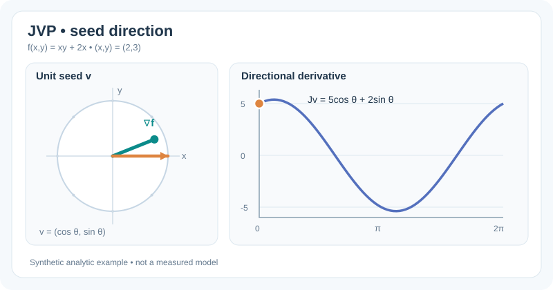

*Original CC BY-SA 4.0 teaching motion. [GitHub static preview](../../../assets/concept-animations/forward-ad-directional-jvp-still.svg) · [12-second animated SVG](../../../assets/concept-animations/forward-ad-directional-jvp-motion.svg).* At the same synthetic point \((x,y)=(2,3)\), the gradient of \(f(x,y)=xy+2x\) is \((5,2)\). A unit seed \(v(\theta)=(\cos\theta,\sin\theta)\) produces

\[
J_fv(\theta)=5\cos\theta+2\sin\theta.
\]

The orange arrow rotates counter-clockwise while the graph cursor follows the **corresponding analytic derivative**, not the function's output value. The examples \(\theta=0\) and \(\theta=\pi/2\) return **5** and **2**, respectively. The SVG approximates the smooth cursor trajectory with sampled points; the formula is exact. These are constructed derivatives, **not model measurements**. On MkDocs, use Play/Pause (including keyboard activation); reduced-motion users initially see the static preview.

### Basis seeds: assemble a complete two-column Jacobian

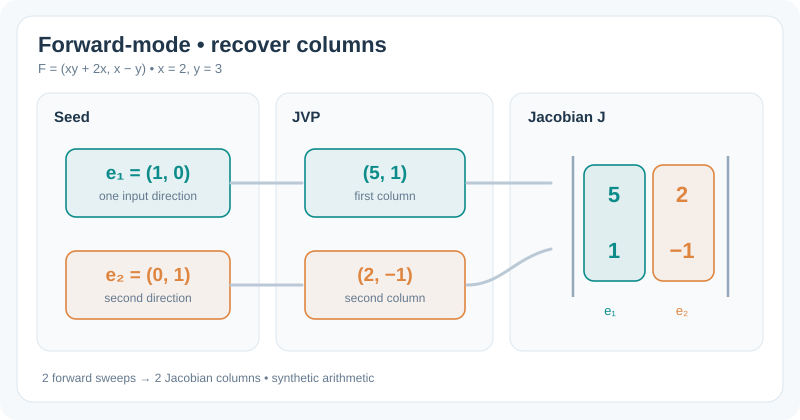

*Original CC BY-SA 4.0 teaching motion. [GitHub static preview](../../../assets/concept-animations/forward-ad-jacobian-columns-still.svg) · [12-second animated SVG](../../../assets/concept-animations/forward-ad-jacobian-columns-motion.svg).* Extend the synthetic example to the **two-output** map \(F(x,y)=(xy+2x,\ x-y)\). At \((2,3)\), its Jacobian is

\[
J_F=\begin{bmatrix}5&2\\1&-1\end{bmatrix},
\qquad J_Fe_1=(5,1)^\top,\quad J_Fe_2=(2,-1)^\top.
\]

Follow the teal first sweep and amber second sweep: each basis seed supplies **one column**, and the two results form \(J_F\). The animation shows causal data flow, not a runtime benchmark; a single arbitrary seed gives a JVP, **not both columns**. The MkDocs player supports Play/Pause and a reduced-motion still, but not single-stepping or seeking.

### Dual-number arithmetic: a nonlinear chain with a shortcut

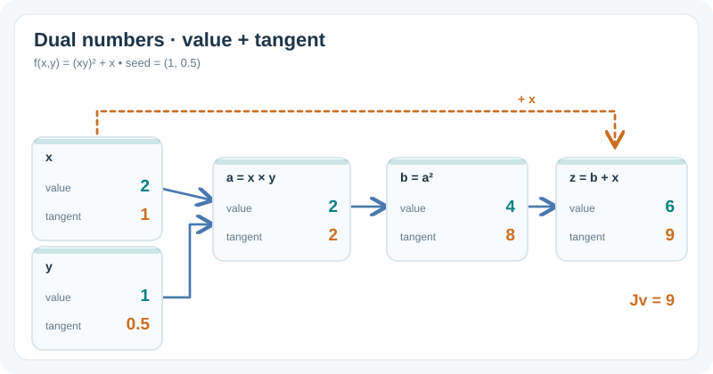

*Original CC BY-SA 4.0 animated calculation. [GitHub-readable static fallback](../../../assets/concept-animations/forward-ad-dual-chain-still.svg) · [animated SVG](../../../assets/concept-animations/forward-ad-dual-chain-motion.svg).* Consider \(f(x,y)=(xy)^2+x\) at the **synthetic** point \((2,1)\), with seed \((\dot x,\dot y)=(1,0.5)\). Each box shows a primal (teal) and its tangent (amber). The moving paths show how the direct skip connection from \(x\) and the nonlinear chain contribute to the same final JVP:

\[
\begin{aligned}
a&=xy=2,& \dot a&=y\dot x+x\dot y=1+1=2,\\
b&=a^2=4,& \dot b&=2a\dot a=8,\\
z&=b+x=6,& \dot z&=\dot b+\dot x=9.
\end{aligned}
\]

As a check, \(\nabla f(2,1)=(5,8)\), so \(\nabla f\cdot(1,0.5)=9\). The diagram represents **exact, hand-computed calculus**, not a measured model trace. On MkDocs, Play/Pause is available through the shared player; readers using reduced motion initially get the still image.

### Branch-sensitive differentiation: ReLU at a kink

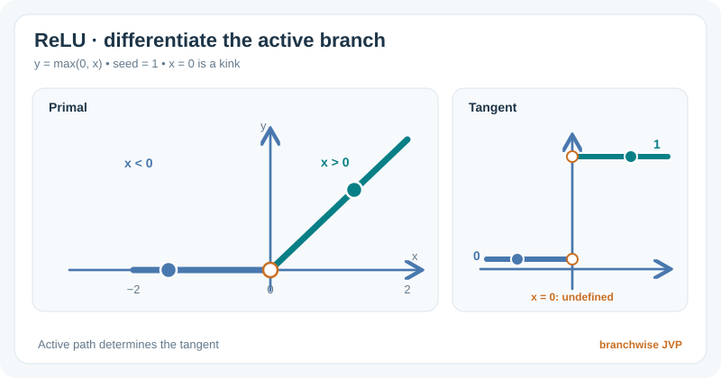

*Original CC BY-SA 4.0 branchwise teaching motion. [GitHub-readable static fallback](../../../assets/concept-animations/forward-ad-branch-kink-still.svg) · [animated SVG](../../../assets/concept-animations/forward-ad-branch-kink-motion.svg).* For \(y=\mathrm{ReLU}(x)=\max(0,x)\) and a unit tangent seed \(\dot x=1\), forward-mode AD follows the **executed branch**. Away from the kink,

\[
\dot y=
\begin{cases}
0,&x<0,\\
1,&x>0.
\end{cases}
\]

The linked primal and tangent panels animate the two regions. At **\(x=0\)** the classical derivative does **not** exist, so neither panel assigns a unique derivative there. One-sided directional derivatives may exist, but they do not define one linear Jacobian map at the kink; an AD implementation's returned tangent there depends on its derivative convention. This is a constructed mathematical example, not an empirical model result. The MkDocs player can pause the movement, and its reduced-motion fallback shows both branches simultaneously.

### Tangents through an iterative program

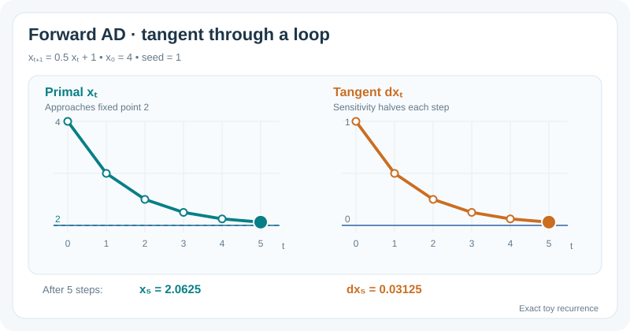

*Original CC BY-SA 4.0 teaching motion. [GitHub static fallback](../../../assets/concept-animations/forward-ad-loop-tangent-still.svg) · [12-second animated SVG](../../../assets/concept-animations/forward-ad-loop-tangent-motion.svg).* Consider the synthetic recurrence \(x_{t+1}=\tfrac12x_t+1\), initialized at \(x_0=4\). Seed the derivative of the **initial condition** with \(\dot x_0=\partial x_0/\partial x_0=1\), and keep the coefficient and constant fixed. One dual-number evaluation per iteration gives

\[
x_{t+1}=\tfrac12 x_t+1,\qquad \dot x_{t+1}=\tfrac12\dot x_t.
\]

The two synchronized curves show \(x_t=2+2^{1-t}\) approaching the fixed point \(2\) and \(\dot x_t=2^{-t}\) shrinking to zero. At \(t=5\), \(x_5=2.0625\) while \(\dot x_5=0.03125\). **Do not conflate state convergence with sensitivity:** the orange curve is the derivative with respect to the initial state, not the state itself. These are exact hand-calculated toy values, not measurements from a learned model. On MkDocs the shared player supports Play/Pause and keyboard activation; reduced-motion visitors initially see the still.

### Forward-over-reverse: differentiate the gradient along a direction

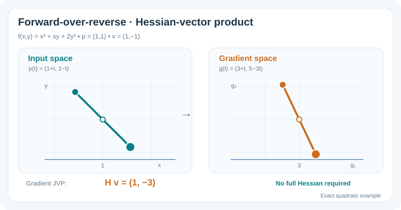

*Original CC BY-SA 4.0 teaching motion. [GitHub static fallback](../../../assets/concept-animations/forward-ad-hessian-vector-still.svg) · [12-second animated SVG](../../../assets/concept-animations/forward-ad-hessian-vector-motion.svg).* For the synthetic quadratic \(f(x,y)=x^2+xy+2y^2\), first obtain its gradient \(g(x,y)=\nabla f(x,y)=(2x+y,\ x+4y)\). At \(p=(1,1)\), follow the seed \(v=(1,-1)\). The left marker moves along \(p(t)=(1+t,1-t)\) while the right marker follows

\[
g(p(t))=(3+t,\ 5-3t),\qquad
\left.\frac{d}{dt}g(p(t))\right|_{t=0}
=H_f(p)v=(1,-3).
\]

This is the **JVP of the gradient**: a forward-mode directional derivative applied to a gradient function that can be obtained by reverse mode. No full Hessian matrix needs to be materialized. Both curves and the value \(H_f(p)v\) are exact analytic examples, not timing or model-training results. The plotted axes use separate schematic scales; the paired points depict corresponding parameter values, not comparable Euclidean distances. The MkDocs player supports Play/Pause and a reduced-motion still, not seek or single-step. For the general forward/reverse tradeoff, see [Griewank and Walther (2008)](https://doi.org/10.1137/1.9780898717761).

### Differentiating through a linear solve

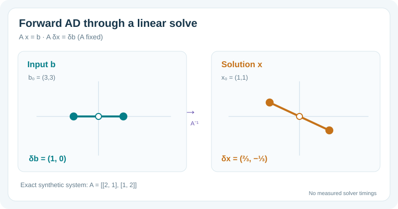

*Original CC BY-SA 4.0 teaching motion. [GitHub static preview](../../../assets/concept-animations/forward-ad-linear-solve-still.svg) · [12-second animated SVG](../../../assets/concept-animations/forward-ad-linear-solve-motion.svg).* A linear system need not be solved again for every infinitesimal input perturbation. For the **synthetic**, fixed matrix and input

\[
A=\begin{bmatrix}2&1\\1&2\end{bmatrix},\quad
b=\begin{bmatrix}3\\3\end{bmatrix},\quad
x=A^{-1}b=\begin{bmatrix}1\\1\end{bmatrix},
\]

differentiate \(Ax=b\) along the seed \(\dot b=(1,0)^\top\), keeping \(A\) fixed. Forward-mode differentiation propagates the tangent by solving \(A\dot x=\dot b\), which yields \(\dot x=(2/3,-1/3)^\top\). The synchronized dots trace \(b(t)=(3+t,3)\) and \(x(t)=(1+2t/3,1-t/3)\), so changing one input coordinate changes **both** solution coordinates. If \(A\) also depends on the input, the more general rule is \(A\dot x=\dot b-\dot A x\) for a nonsingular system. The panels use schematic independent scales. Values are exact toy arithmetic, **not measured solver timings**; use the MkDocs Play/Pause control or the reduced-motion still.

### Sparse Jacobian: pack independent seed columns

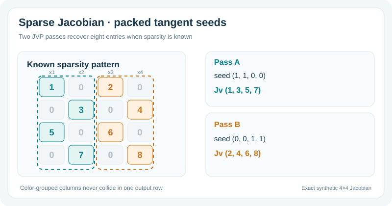

*Original CC BY-SA 4.0 teaching motion. [GitHub static preview](../../../assets/concept-animations/forward-ad-sparse-packing-still.svg) · [12-second animated SVG](../../../assets/concept-animations/forward-ad-sparse-packing-motion.svg).* A dense four-column Jacobian usually takes four one-hot JVP passes. **Known structural sparsity** can reduce the passes: when two selected columns never have nonzero entries in the same output row, their tangents can be seeded together without ambiguity. Consider the constructed Jacobian

\[
J=\begin{bmatrix}1&0&2&0\\0&3&0&4\\5&0&6&0\\0&7&0&8\end{bmatrix}.
\]

The highlighted teal seed \(s_A=(1,1,0,0)^\top\) gives \(Js_A=(1,3,5,7)^\top\); the amber seed \(s_B=(0,0,1,1)^\top\) gives \(Js_B=(2,4,6,8)^\top\). Because the sparsity pattern is known and each seed group has at most one nonzero contributor per row, these **two passes recover all eight nonzeros**. Without the structural pattern, a packed JVP generally cannot identify the contributing columns. The alternating highlight shows which entries a pass recovers, **not runtime speedup measurements**. The shared player supports keyboard-accessible Play/Pause and reduced-motion fallback; it does not add seeking or single-step controls.

### Softmax JVP: probability changes must sum to zero

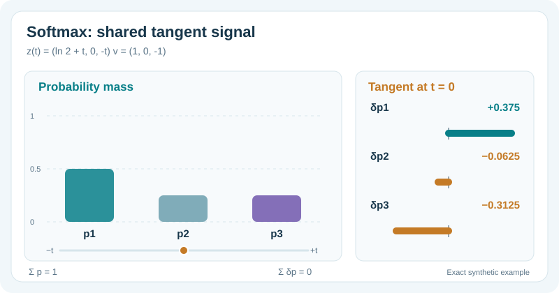

*Original CC BY-SA 4.0 teaching motion. [GitHub static fallback](../../../assets/concept-animations/forward-ad-softmax-tangent-still.svg) · [10-second animated SVG](../../../assets/concept-animations/forward-ad-softmax-tangent-motion.svg).* For a **synthetic**, three-class softmax, take $z(0)=(\ln 2,0,0)$, $p(0)=(1/2,1/4,1/4)$, and tangent seed $v=(1,0,-1)$. Each output depends on every logit through the normalization denominator. Differentiating the softmax gives

$$
\dot p_i=p_i\left(v_i-\sum_j p_jv_j\right),\qquad
\dot p(0)=(3/8,-1/16,-5/16).
$$

Since the probabilities always sum to one, their tangents necessarily sum to zero. The left-hand bars sample the **analytic** $p(t)=\mathrm{softmax}(\ln 2+t,0,-t)$ at five positions $t=(-0.8,0,0.8,0,-0.8)$ and interpolate between those samples while the orange indicator moves. Intermediate heights are a visual approximation, not exact softmax evaluations at every instant. The right-hand bars show the **exact** JVP specifically **at $t=0$**, not a continuously updated tangent. This is constructed mathematics, **not model measurements**. MkDocs provides keyboard-accessible Play/Pause and a reduced-motion still; step, seek and speed controls are not added. The general tangent-linear chain rule is detailed in [Griewank and Walther (2008)](https://doi.org/10.1137/1.9780898717761).

### Matrix-product JVP: two simultaneous tangent paths

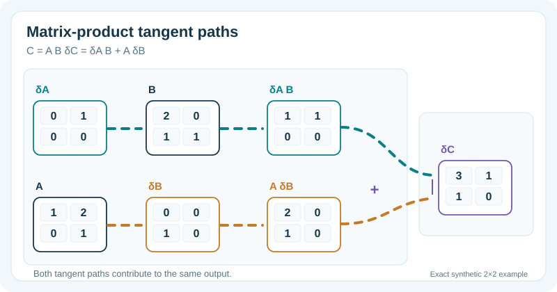

*Original CC BY-SA 4.0 teaching motion. [GitHub static fallback](../../../assets/concept-animations/forward-ad-matmul-tangent-still.svg) · [animated SVG](../../../assets/concept-animations/forward-ad-matmul-tangent-motion.svg).* For $C=AB$, both input operands may depend on the seed, so forward-mode AD requires the matrix-product rule

$$
\dot C=\dot A B+A\dot B.
$$

The exact **synthetic** 2×2 example uses $A=\begin{bmatrix}1&2\\0&1\end{bmatrix}$, $B=\begin{bmatrix}2&0\\1&1\end{bmatrix}$, $\dot A=\begin{bmatrix}0&1\\0&0\end{bmatrix}$ and $\dot B=\begin{bmatrix}0&0\\1&0\end{bmatrix}$. The teal path contributes $\dot AB=\begin{bmatrix}1&1\\0&0\end{bmatrix}$; the orange path contributes $A\dot B=\begin{bmatrix}2&0\\1&0\end{bmatrix}$, giving $\dot C=\begin{bmatrix}3&1\\1&0\end{bmatrix}$. Animated dashes show **both causal contributions concurrently**, not a measured execution trace or numerical speedup. The shared MkDocs player supports Play/Pause and a reduced-motion static fallback.

## Equation

For an elementary operation $v = \phi(u)$, the tangent rule is

$$\dot{v} = \phi'(u)\,\dot{u}.$$

For a program that computes $y = f(x)$, the tangent-linear model maps a seed $\dot{x}$ to $\dot{y} = J_f(x)\,\dot{x}$. Taking $\dot{x}$ to be each standard basis vector $e_1, \dots, e_n$ in turn recovers the columns of the Jacobian. A full $m \times n$ Jacobian therefore needs $n$ forward passes, one per input.

## Results

Forward mode gives exact derivatives, up to the rounding of the floating-point operations themselves. It does not need the graph of operations to be stored for a later replay, so intermediate values can be discarded once their tangents have been computed. Griewank and Walther analyse the tangent-linear model in detail, including its cost relative to the original program and the trade-off against reverse mode [(Griewank & Walther, 2008)](https://doi.org/10.1137/1.9780898717761).

The survey by Baydin and colleagues presents forward mode in its Section 3.1 and reverse mode in its Section 3.2. It states that computing the gradient of a scalar function with $n$ inputs by forward mode takes $n$ evaluations of the forward pass [(Baydin et al., 2015)](https://arxiv.org/abs/1502.05767). This page does not report benchmark timings, which depend on the implementation.

Early work described the same idea of evaluating a program's derivatives alongside its values [(Wengert, 1964)](https://doi.org/10.1145/355586.364791). Pearlmutter and Siskind present reverse-mode differentiation in a functional framework, which is the natural counterpart to this page [(Pearlmutter & Siskind, 2008)](https://doi.org/10.1145/1330017.1330018).

### Exact JVP versus centered finite differences

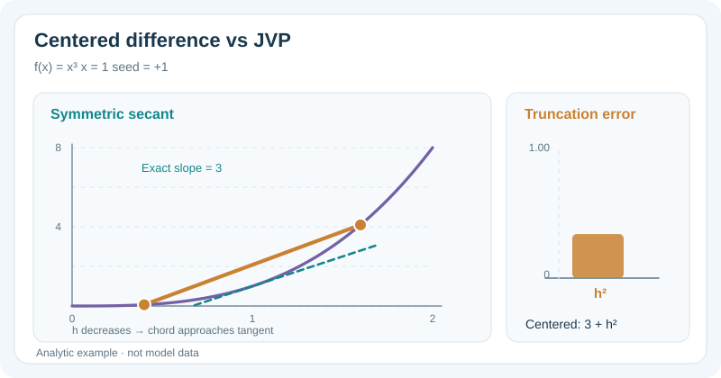

*Original CC BY-SA 4.0 teaching animation. [GitHub static preview](../../../assets/concept-animations/forward-ad-finite-difference-still.svg) · [12-second animated SVG](../../../assets/concept-animations/forward-ad-finite-difference-motion.svg).* For the **constructed** scalar function \(f(x)=x^3\) at \(x=1\), take the seed \(\dot x=1\). Forward AD returns the exact directional derivative \(J_f(1)\dot x=3\) (up to floating-point arithmetic in an implementation). A symmetric finite-difference approximation instead gives

\[
D_h=\frac{f(1+h)-f(1-h)}{2h}=3+h^2,\qquad D_h-J_f(1)\dot x=h^2.
\]

As \(h\) decreases from \(1\) to \(0.2\), the secant endpoints converge toward the point of tangency and the **truncation error** falls from \(1\) to \(0.04\); the animation then reverses to make the dependence visible. The purple curve is a sampled rendering of the exact cubic, while the equations are analytic. The diagram **does not model floating-point cancellation**, so it must not be read as claiming that an arbitrarily small finite-difference step is numerically optimal. These are illustrative values, not model measurements. The MkDocs player provides keyboard-accessible Play/Pause and a reduced-motion static fallback, not step/seek/speed controls.

### Normalization JVP: the radial component disappears

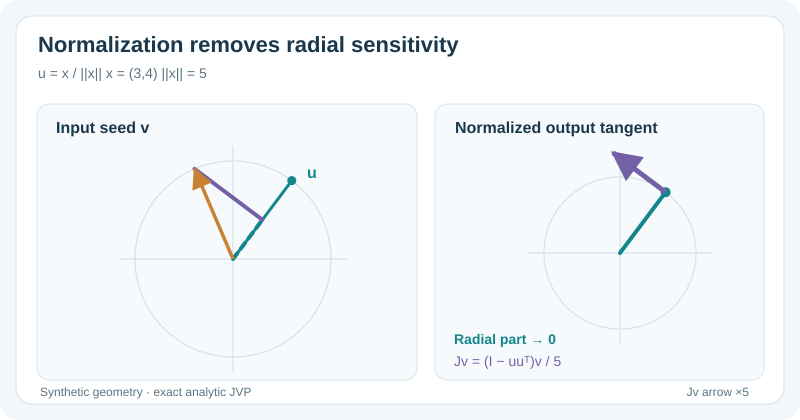

*Original CC BY-SA 4.0 teaching animation. [GitHub static preview](../../../assets/concept-animations/forward-ad-normalization-jvp-still.svg) · [12-second animated SVG](../../../assets/concept-animations/forward-ad-normalization-jvp-motion.svg).* For unit-vector normalization \(u(x)=x/\|x\|\) at a **nonzero** vector, the forward tangent is

\[
J_u(x)v=\frac{(I-uu^\top)v}{\|x\|}.
\]

At the synthetic input \(x=(3,4)\), set \(u=(3/5,4/5)\), its orthogonal unit vector \(q=(-4/5,3/5)\), and \(v(\theta)=\cos\theta\,u+\sin\theta\,q\). The resulting directional derivative is exactly \(J_u(x)v(\theta)=(\sin\theta/5)q\). The teal radial component is **annihilated**, while the purple tangential component survives. The animation samples the rotation of \(v\) and linearly interpolates the arrow endpoints between radial (zero JVP) and tangential (JVP norm \(1/5\)); its right-hand tangent arrow is **magnified fivefold for visibility**, not a change in the derivative. Intermediate arrow geometry approximates the exact rotation; the formulas and sampled frames are exact. The derivative formula is undefined at \(x=0\). These are analytic toy values, not empirical model traces. MkDocs provides Play/Pause, keyboard activation and a reduced-motion still.

## Limitations

- A full Jacobian grows linearly with the number of inputs. For a neural network loss with millions of parameters and a single output, forward mode would need one pass per parameter, which is why training uses reverse mode.
- Forward mode computes one direction at a time. Higher-order derivatives can be built from it, typically by combining it with reverse mode, but the combinations need care to stay efficient.
- Like reverse mode, it differentiates the path that the program actually executes. At non-smooth points, such as the kink of $|x|$ at zero, the derivative may not exist, and the result depends on the convention the implementation uses.

## Connections

Forward mode is the efficient choice for sensitivity analysis and for Jacobian-vector products. Combined with reverse mode, it gives Hessian-vector products, a standard device in second-order optimisation [(Griewank & Walther, 2008)](https://doi.org/10.1137/1.9780898717761). The parent [chapter](index.md) explains how the two modes relate. Training with [backpropagation](../../deep-learning/index.md) uses reverse mode, because a neural network loss has one output and very many inputs. The underlying calculus is in [Calculus](../index.md).

## Applications

- **Sensitivity analysis** of simulations with few input parameters, where one JVP per parameter gives the local response of the outputs [(Griewank & Walther, 2008)](https://doi.org/10.1137/1.9780898717761).
- **Uncertainty propagation** through a small number of inputs, where the tangent of each output gives its first-order sensitivity to the input uncertainty.
- **Hessian-vector products** for second-order optimisation, obtained by applying forward mode to a reverse-mode gradient [(Griewank & Walther, 2008)](https://doi.org/10.1137/1.9780898717761).

## Open questions

- How should forward and reverse mode be combined in large programs, so that each part of the program uses the cheaper mode?
- How can tangents be propagated efficiently through control flow and iterative numerical solvers, where the executed path can change with the input?

## References

### Seminal papers

- Wengert, *A simple automatic derivative evaluation program*, Communications of the ACM (1964). https://doi.org/10.1145/355586.364791 — Early description of evaluating a program's derivatives alongside its values.
- Pearlmutter and Siskind, *Reverse-Mode AD in a Functional Framework: Lambda the Ultimate Backpropagator*, ACM Transactions on Programming Languages and Systems (2008). https://doi.org/10.1145/1330017.1330018 — Reverse-mode differentiation in a functional framework, the counterpart to forward mode.
- Rumelhart, Hinton and Williams, *Learning representations by back-propagating errors*, Nature (1986). https://doi.org/10.1038/323533a0 — Popularised back-propagation, the reverse-mode computation used to train neural networks.

### Surveys and textbooks

- Griewank and Walther, *Evaluating Derivatives: Principles and Techniques of Algorithmic Differentiation*, SIAM (2008). https://doi.org/10.1137/1.9780898717761 — Standard textbook covering tangent-linear models, the cost of each mode, and second derivatives.
- Baydin, Pearlmutter, Radul and Siskind, *Automatic differentiation in machine learning: a survey*, arXiv (2015). https://arxiv.org/abs/1502.05767 — Survey of automatic differentiation for machine learning; Section 3.1 covers forward mode and Section 3.2 reverse mode.

### Articles and documentation

- Hascoët and Pascual, *The Tapenade automatic differentiation tool*, ACM Transactions on Mathematical Software (2013). https://doi.org/10.1145/2450153.2450158 — Describes Tapenade, an automatic differentiation tool, for readers who want a concrete implementation.
