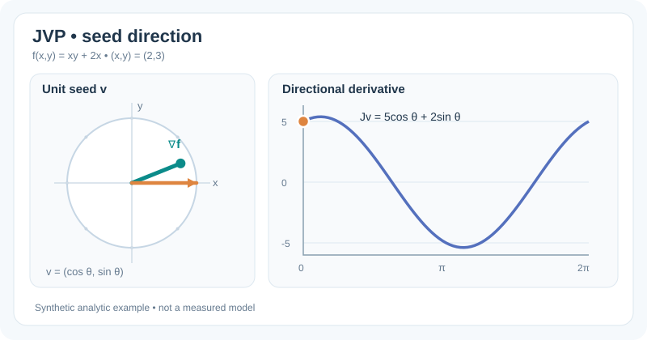
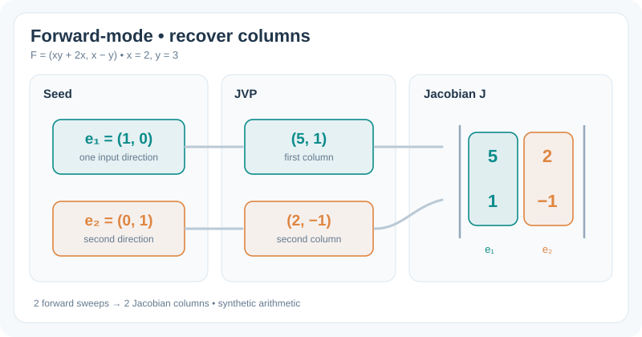
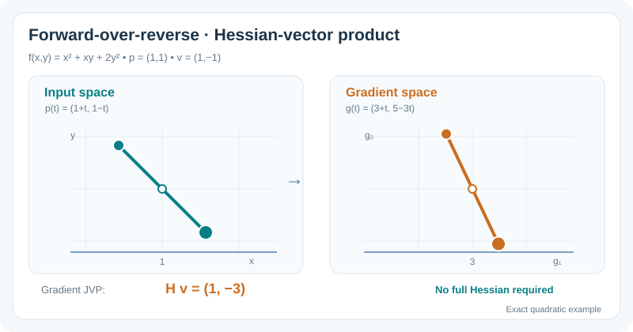
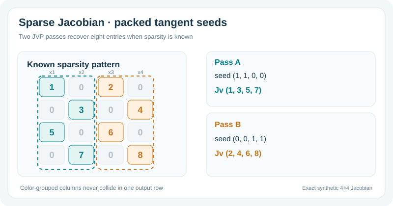
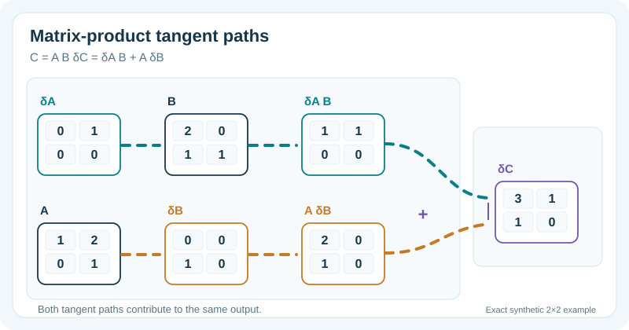
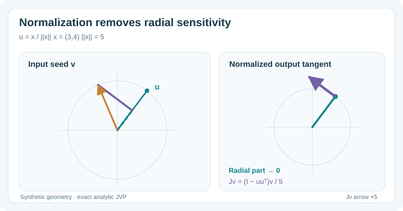

# 前向模式微分

前向模式微分把導數從程式的輸入傳播到輸出，與數值本身一同計算。對於選定的輸入方向，它在一次掃描中就能得到每個輸出的方向導數。當函數的輸入很少時，它的計算成本低；它也是[反向模式](reverse-mode.zh-TW.md)的對偶，後者在函數輸出很少時較為便宜。

## 概觀

[自動微分章節](index.zh-TW.md)介紹了兩種模式。本頁說明前向模式：它如何計算、如何組織計算，以及何時是較好的選擇。

## 問題

許多科學與機器學習任務需要的是函數輸出對少數輸入的反應，或雅可比矩陣作用於單一向量的結果，而不是純量的完整梯度。反向模式在這些任務上很浪費：它對每個輸出產生雅可比的一列，而這些任務需要的是每個輸入一欄，或只是一個乘積。問題在於如何在不建構完整雅可比的情況下，直接取得方向導數。

## 關鍵概念

- **切向量（tangent）**：中間值對所選輸入方向的導數。每個中間值都攜帶一個。
- **種子（seed）**：所選的輸入方向 $\dot{x}$，用來設定起始的切向量。
- **雅可比向量積（JVP）**：$J\dot{x}$，即輸出沿種子方向的導數。
- **對偶數（dual number）**：由數值與其切向量組成的配對 $(v, \dot{v})$。對這些配對做算術時會自動套用鏈式法則。
- **切線性模型（tangent-linear model）**：同時執行原始運算與其切向規則所得到的程式。

## 關鍵方法

前向模式與反向模式是將鏈式法則套用到程式上的兩種主要方式。每一種都有自己的頁面。

- [前向模式微分](forward-mode.zh-TW.md)（本頁）：每個輸入方向一次掃描，因此成本隨輸入數量成長。
- [反向模式微分](reverse-mode.zh-TW.md)：每個輸出一次掃描，因此成本隨輸出數量成長。它是實作反向傳播的模式。

## 運作方式

為每個中間值附上一個切向量。若輸入沿方向 $\dot{x}$ 被微擾，每個基本運算都會依其自身的微分規則，轉換其輸入的切向量，順序與程式執行的順序相同。一次前向掃描會回傳 $J\dot{x}$。

對偶數可以簡潔地表達這一點。每個數值以配對的形式攜帶，加法與乘法的規則為

$$(a,\dot{a}) + (b,\dot{b}) = (a+b,\ \dot{a}+\dot{b}), \qquad (a,\dot{a})\,(b,\dot{b}) = (ab,\ a\dot{b}+\dot{a}\,b).$$

在對偶數上執行任何程式，並將每個輸入的切向量部分設為種子，一次執行即可回傳輸出數值與 JVP。不需要導數的符號表達式。

*原創四階段教學動畫，CC BY-SA 4.0。* 以示意程式 $a=xy$、$b=x+x$、$z=a+b$，在 $(x,y)=(2,3)$ 設定輸入方向 $(\dot{x},\dot{y})=(1,0)$。局部規則得到 $\dot{a}=3$、$\dot{b}=2$、$\dot{z}=5=J(1,0)^\top$。依序觀察 **Seed → Tangents → JVP** 的高亮路徑：單次前向掃描取得的是**方向導數，而非完整雅可比矩陣**。數值皆為手算教學範例，並非模型實測。MkDocs 網站提供播放／暫停及減少動態效果的回退顯示；[GitHub 可直接閱讀的靜態最終狀態](../../../assets/concept-animations/forward-ad-jvp-still.svg)。

同一個例子也可以手算驗證。由於 $z = xy + 2x$，對 $x$ 的導數為 $\partial z/\partial x = y + 2 = 5$，與上面計算出的切向量 $\dot{z}=5$ 相符。

### 旋轉種子向量：JVP 衡量指定方向的變化率

*原創教學動畫，CC BY-SA 4.0。[GitHub 靜態預覽](../../../assets/concept-animations/forward-ad-directional-jvp-still.svg) · [12 秒 SVG 動畫](../../../assets/concept-animations/forward-ad-directional-jvp-motion.svg)。* 在相同的人工設定 \((x,y)=(2,3)\) 下，\(f(x,y)=xy+2x\) 的梯度是 \((5,2)\)。對單位種子向量 \(v(\theta)=(\cos\theta,\sin\theta)\)，可得

\[
J_fv(\theta)=5\cos\theta+2\sin\theta.
\]

橘色箭頭逆時針轉動，右側游標對應的是**解析求得的方向導數**，不是函數輸出值。\(\theta=0\) 與 \(\theta=\pi/2\) 的結果分別為 **5** 與 **2**。SVG 的平滑游標軌跡由取樣點近似，公式本身則是精確的。這些都是人工構造的微分數值，**不是模型實測**。MkDocs 提供播放／暫停與鍵盤操作；偏好減少動態效果的使用者預設看到靜態圖。

### 基底種子：逐欄組裝完整的雅可比矩陣

*原創教學動畫，CC BY-SA 4.0。[GitHub 靜態預覽](../../../assets/concept-animations/forward-ad-jacobian-columns-still.svg) · [12 秒 SVG 動畫](../../../assets/concept-animations/forward-ad-jacobian-columns-motion.svg)。* 將人工範例擴展為**雙輸出**函數 \(F(x,y)=(xy+2x,\ x-y)\)。在 \((2,3)\) 時，

\[
J_F=\begin{bmatrix}5&2\\1&-1\end{bmatrix},
\qquad J_Fe_1=(5,1)^\top,\quad J_Fe_2=(2,-1)^\top.
\]

依序觀察青綠色的第一次掃描與橘色的第二次掃描：每個基底種子只產生**一欄**，兩次結果才組成 \(J_F\)。這是資料與導數的傳遞示意，不是效能測試；任意一個種子方向的一次掃描只取得一個 JVP，**無法直接得到兩欄**。MkDocs 提供播放／暫停與減少動態效果的回退顯示，但沒有逐步執行或時間軸拖曳功能。

### 對偶數算術：含捷徑連線的非線性運算鏈

*原創教學動畫，CC BY-SA 4.0。[GitHub 靜態回退預覽](../../../assets/concept-animations/forward-ad-dual-chain-still.svg) · [SVG 動畫](../../../assets/concept-animations/forward-ad-dual-chain-motion.svg)。* 考慮人工設定的函數 \(f(x,y)=(xy)^2+x\)、輸入 \((2,1)\) 與種子 \((\dot x,\dot y)=(1,0.5)\)。每個方框同時呈現原始值（青綠色）與切向量（橘色），移動的連線表示直接由 \(x\) 通往最終加總的捷徑，以及非線性運算鏈的導數如何匯合：

\[
\begin{aligned}
a&=xy=2,& \dot a&=y\dot x+x\dot y=1+1=2,\\
b&=a^2=4,& \dot b&=2a\dot a=8,\\
z&=b+x=6,& \dot z&=\dot b+\dot x=9.
\end{aligned}
\]

可以另外以 \(\nabla f(2,1)=(5,8)\) 檢查，得到 \(\nabla f\cdot(1,0.5)=9\)。圖中的數值是**精確手算的示意範例**，不是模型實測。MkDocs 的共用播放器提供播放／暫停；偏好減少動畫的讀者預設看到靜態回退圖。

### 分支敏感微分：ReLU 的折點

*原創分支微分教學動畫，CC BY-SA 4.0。[GitHub 靜態回退預覽](../../../assets/concept-animations/forward-ad-branch-kink-still.svg) · [SVG 動畫](../../../assets/concept-animations/forward-ad-branch-kink-motion.svg)。* 對 \(y=\mathrm{ReLU}(x)=\max(0,x)\)，設定切向種子 \(\dot x=1\)，前向模式微分依照**實際執行的分支**運作。在折點之外，

\[
\dot y=
\begin{cases}
0,&x<0,\\
1,&x>0.
\end{cases}
\]

左側的原始值曲線與右側的切向量圖會同步改變。**\(x=0\)** 處不存在唯一的古典導數，因此圖中不指定該位置的唯一導數。即使單側方向導數存在，也無法在這個折點形成單一線性的 Jacobian；不同自動微分實作可能依選用的導數約定回傳不同結果。這是數學示意，並非模型實測。網站版可暫停動作，減少動態效果的回退圖則一次展示兩個分支。

### 迭代程式中的切向量傳播

*原創 CC BY-SA 4.0 教學動畫。[GitHub 靜態回退預覽](../../../assets/concept-animations/forward-ad-loop-tangent-still.svg) · [12 秒循環 SVG 動畫](../../../assets/concept-animations/forward-ad-loop-tangent-motion.svg)。* 考慮人工設定的遞迴式 \(x_{t+1}=\tfrac12x_t+1\)，初始值 \(x_0=4\)。針對**初始條件**指定切向種子 \(\dot x_0=\partial x_0/\partial x_0=1\)，其餘係數與常數保持固定。每次迭代沿對偶數同步傳遞：

\[
x_{t+1}=\tfrac12x_t+1,\qquad \dot x_{t+1}=\tfrac12\dot x_t.
\]

兩條曲線同步表示原始狀態 \(x_t=2+2^{1-t}\) 漸近固定點 \(2\)，但敏感度 \(\dot x_t=2^{-t}\) 持續衰減。到 \(t=5\)，\(x_5=2.0625\)，\(\dot x_5=0.03125\)。**狀態收斂與敏感度收斂是不同概念**：橘線表示輸出對初始狀態的導數，而非狀態值。這些數字來自可手算的精確示例，不是訓練模型的實測結果。MkDocs 網站沿用可用鍵盤操作的播放／暫停功能，偏好減少動態效果的使用者預設看到靜態回退圖。

### Forward-over-reverse：沿指定方向微分梯度

*原創 CC BY-SA 4.0 教學動畫。[GitHub 靜態回退預覽](../../../assets/concept-animations/forward-ad-hessian-vector-still.svg) · [12 秒循環 SVG 動畫](../../../assets/concept-animations/forward-ad-hessian-vector-motion.svg)。* 對人工二次函數 \(f(x,y)=x^2+xy+2y^2\)，先計算梯度 \(g(x,y)=\nabla f(x,y)=(2x+y,\ x+4y)\)。從 \(p=(1,1)\) 沿種子 \(v=(1,-1)\) 前進。左側圓點表示 \(p(t)=(1+t,1-t)\)，右側圓點同步表示

\[
g(p(t))=(3+t,\ 5-3t),\qquad
\left.\frac{d}{dt}g(p(t))\right|_{t=0}
=H_f(p)v=(1,-3).
\]

這相當於對**梯度函數求 JVP**：梯度可以由反向模式求得，再利用前向模式取得其指定方向導數，**不必顯式建立完整 Hessian 矩陣**。兩條軌跡與 \(H_f(p)v\) 都是解析式的確切值，不是運算時間或模型訓練結果。左右座標軸使用不同的示意尺度，兩個圓點代表同一參數位置下的對應結果，而非可直接比較的幾何距離。網站播放器可播放／暫停並提供減少動態效果的回退圖，但不支援跳格或逐步控制。一般性的前向／反向模式取捨可參考 [Griewank 與 Walther（2008）](https://doi.org/10.1137/1.9780898717761)。

### 對線性方程組求前向導數

*原創教學動畫，CC BY-SA 4.0。[GitHub 靜態回退預覽](../../../assets/concept-animations/forward-ad-linear-solve-still.svg) · [12 秒 SVG 動畫](../../../assets/concept-animations/forward-ad-linear-solve-motion.svg)。* 線性方程組的輸入出現無窮小擾動時，不必為每一個擾動都重新推導完整解。考慮**人工設定**、固定且可逆的矩陣：

\[
A=\begin{bmatrix}2&1\\1&2\end{bmatrix},\quad
b=\begin{bmatrix}3\\3\end{bmatrix},\quad
x=A^{-1}b=\begin{bmatrix}1\\1\end{bmatrix}.
\]

若令種子 \(\dot b=(1,0)^\top\)，且固定 \(A\)，對 \(Ax=b\) 微分後得到 \(A\dot x=\dot b\)，因此 \(\dot x=(2/3,-1/3)^\top\)。左右圓點同步顯示 \(b(t)=(3+t,3)\) 與 \(x(t)=(1+2t/3,1-t/3)\)：即使只擾動一個右側項座標，**解的兩個座標都可能變動**。當 \(A\) 也隨輸入改變時，非奇異系統的一般切向公式是 \(A\dot x=\dot b-\dot A x\)。兩個面板的座標尺度各自獨立，數值為可解析驗證的**數學示意，不是求解器效能實測**。MkDocs 網站沿用可用鍵盤操作的播放／暫停，並提供減少動態效果的回退圖。

### 稀疏 Jacobian：合併互不干擾的種子方向

*原創教學動畫，CC BY-SA 4.0。[GitHub 靜態回退預覽](../../../assets/concept-animations/forward-ad-sparse-packing-still.svg) · [12 秒 SVG 動畫](../../../assets/concept-animations/forward-ad-sparse-packing-motion.svg)。* 一般稠密四欄 Jacobian 需要四次單一基底方向的 JVP，但若**事先知道結構性稀疏模式**，便能在同一次掃描合併不會在同一輸出列出現非零值的欄位。考慮人工矩陣：

\[
J=\begin{bmatrix}1&0&2&0\\0&3&0&4\\5&0&6&0\\0&7&0&8\end{bmatrix}.
\]

青綠色種子 \(s_A=(1,1,0,0)^\top\) 得到 \(Js_A=(1,3,5,7)^\top\)；橘色種子 \(s_B=(0,0,1,1)^\top\) 得到 \(Js_B=(2,4,6,8)^\top\)。因為已知各欄的非零位置，且每個群組在任一輸出列最多只有一個非零貢獻者，**兩次掃描就能還原八個非零元素**。如果不知道稀疏模式，合併後的 JVP 一般無法判斷是哪個輸入欄位造成輸出。動畫交替強調每次掃描對應的元素，並非真實執行時間或加速比；共用播放器提供鍵盤操作的播放／暫停及減少動態效果回退，不支援跳格與單步控制。

### Softmax 的 JVP：機率變化量總和必須為零

*原創 CC BY-SA 4.0 教學動畫。[GitHub 靜態預覽](../../../assets/concept-animations/forward-ad-softmax-tangent-still.svg) · [10 秒循環 SVG](../../../assets/concept-animations/forward-ad-softmax-tangent-motion.svg)。* 考慮**人工設定**的三類 Softmax：$z(0)=(\ln 2,0,0)$、$p(0)=(1/2,1/4,1/4)$，種子方向為 $v=(1,0,-1)$。由於分母的正規化，每個輸出都受所有 logit 影響：

$
\dot p_i=p_i\left(v_i-\sum_jp_jv_j\right),\qquad
\dot p(0)=(3/8,-1/16,-5/16).
$

機率總和恆為 1，因此切向量的分量總和必須為 0。左側長條在五個位置以解析式 $p(t)=\mathrm{softmax}(\ln 2+t,0,-t)$ 取樣，並在取樣值之間內插，隨橘色指標連續變化；中間影格的長條高度是示意近似，**不是**每個時間點的精確 Softmax 計算。右側固定顯示 **$t=0$** 的精確 JVP，**不是**每個時間點的即時導數。數值完全來自人工數學範例，**不是模型實測**。MkDocs 可使用滑鼠或鍵盤操作播放／暫停，減少動態效果設定則以靜態圖呈現；本次未加入逐步、進度或速度控制。一般切線性鏈式法則參見 [Griewank 與 Walther（2008）](https://doi.org/10.1137/1.9780898717761)。

### 矩陣乘積 JVP：兩條切向量傳遞路徑

*原創 CC BY-SA 4.0 教學動畫。[GitHub 靜態預覽](../../../assets/concept-animations/forward-ad-matmul-tangent-still.svg) · [循環 SVG](../../../assets/concept-animations/forward-ad-matmul-tangent-motion.svg)。* 對矩陣乘積 $C=AB$，若兩個運算元都會隨種子方向改變，前向模式需同時保留兩條導數來源：

$
\dot C=\dot A B+A\dot B.
$

在**人工設定**的 2×2 範例中，$A=\begin{bmatrix}1&2\\0&1\end{bmatrix}$、$B=\begin{bmatrix}2&0\\1&1\end{bmatrix}$、$\dot A=\begin{bmatrix}0&1\\0&0\end{bmatrix}$、$\dot B=\begin{bmatrix}0&0\\1&0\end{bmatrix}$。青綠路徑得到 $\dot AB=\begin{bmatrix}1&1\\0&0\end{bmatrix}$，橘色路徑得到 $A\dot B=\begin{bmatrix}2&0\\1&0\end{bmatrix}$，相加為 $\dot C=\begin{bmatrix}3&1\\1&0\end{bmatrix}$。連續移動的虛線表示**兩項貢獻同時存在**，不是實際計算核心的執行追蹤或效能數據。網站播放器提供鍵盤可操作的播放／暫停與減少動態效果的回退預覽。

## 方程式

對於基本運算 $v = \phi(u)$，切向規則為

$$\dot{v} = \phi'(u)\,\dot{u}.$$

對於計算 $y = f(x)$ 的程式，切線性模型會把種子 $\dot{x}$ 映射為 $\dot{y} = J_f(x)\,\dot{x}$。依序取每個標準基向量 $e_1, \dots, e_n$ 作為 $\dot{x}$，即可恢復雅可比的各欄。因此完整的 $m \times n$ 雅可比需要 $n$ 次前向掃描，每個輸入一次。

## 結果

前向模式給出精確的導數，但受限於運算本身的浮點捨入誤差。它不需要儲存運算圖以供之後重播，因此中間值在其切向量計算完成後即可丟棄。Griewank 與 Walther 詳細分析了切線性模型，包括它相對於原程式的成本，以及它與反向模式之間的取捨 [(Griewank & Walther, 2008)](https://doi.org/10.1137/1.9780898717761)。

Baydin 等人的綜述在第 3.1 節介紹前向模式，在第 3.2 節介紹反向模式。綜述指出，以前向模式計算一個有 $n$ 個輸入的純量函數的梯度，需要 $n$ 次前向掃描 [(Baydin et al., 2015)](https://arxiv.org/abs/1502.05767)。本頁不報告基準測試的計時，因為這取決於實作。

更早的研究已描述了同樣的想法，也就是在計算程式數值的同時計算其導數 [(Wengert, 1964)](https://doi.org/10.1145/355586.364791)。Pearlmutter 與 Siskind 在函數式框架中提出反向模式微分，這是本頁的自然對應 [(Pearlmutter & Siskind, 2008)](https://doi.org/10.1145/1330017.1330018)。

### 精確 JVP 與中央有限差分的差異

*原創 CC BY-SA 4.0 教學動畫。[GitHub 靜態預覽](../../../assets/concept-animations/forward-ad-finite-difference-still.svg) · [12 秒循環動畫](../../../assets/concept-animations/forward-ad-finite-difference-motion.svg)。* 使用**人工設定**的函數 \(f(x)=x^3\)，於 \(x=1\) 沿種子方向 \(\dot x=1\) 微分。前向模式 AD 直接得到精確方向導數 \(J_f(1)\dot x=3\)（實際程式仍受浮點運算影響）。若採用中央有限差分：

\[
D_h=\frac{f(1+h)-f(1-h)}{2h}=3+h^2,\qquad D_h-J_f(1)\dot x=h^2.
\]

當 \(h\) 從 \(1\) 縮小到 \(0.2\)，兩個割線端點向切點靠近，**截斷誤差**從 \(1\) 降至 \(0.04\)；動畫接著反向演示。紫色曲線以取樣折線描繪精確三次函數，公式則是解析結果。動畫**未模擬浮點消去誤差**，不能據此宣稱有限差分的步長愈小愈好。所有數值皆為教學示意，不是模型實測。MkDocs 支援可由鍵盤操作的播放／暫停及低動態偏好靜態回退，未新增單步、進度拖曳或速度控制。

### 正規化 JVP：徑向擾動為何消失

*原創 CC BY-SA 4.0 教學動畫。[GitHub 靜態預覽](../../../assets/concept-animations/forward-ad-normalization-jvp-still.svg) · [12 秒循環動畫](../../../assets/concept-animations/forward-ad-normalization-jvp-motion.svg)。* 對**非零**向量進行單位向量正規化 \(u(x)=x/\|x\|\) 時，前向切向量為

\[
J_u(x)v=\frac{(I-uu^\top)v}{\|x\|}.
\]

人工設定 \(x=(3,4)\)、\(u=(3/5,4/5)\)，令其正交單位向量 \(q=(-4/5,3/5)\)，並使輸入種子 \(v(\theta)=\cos\theta\,u+\sin\theta\,q\) 旋轉。解析式給出 \(J_u(x)v(\theta)=(\sin\theta/5)q\)。青綠色的**徑向成分被消除**，紫色切向成分保留：當種子純粹沿徑向時 JVP 為零；當種子完全沿切向時 JVP 長度為 \(1/5\)。右側切向箭頭為了清晰而**放大五倍**，不是微分值被乘上五倍。\(x=0\) 處正規化與此微分公式皆未定義。這是解析式教學示例，不是模型訓練梯度實測。MkDocs 沿用播放／暫停、鍵盤操作與低動態靜態回退。

## 限制

- 完整雅可比的成本隨輸入數量線性成長。對於有數百萬個參數、只有一個輸出的神經網路損失，前向模式需要對每個參數做一次掃描，這正是訓練改用反向模式的原因。
- 前向模式一次只計算一個方向。高階導數可以由它建構，通常是與反向模式結合，但組合方式需要謹慎，才能保持效率。
- 與反向模式一樣，它微分的是程式實際執行的路徑。在非平滑點上，例如 $|x|$ 在零處的折點，導數可能不存在，而結果取決於實作所採用的約定。

## 關聯

對於敏感度分析與雅可比向量積，前向模式是有效率的選擇。與反向模式結合後，它可以得到 Hessian 向量積，這是二階最佳化中的常用手法 [(Griewank & Walther, 2008)](https://doi.org/10.1137/1.9780898717761)。上層[章節](index.zh-TW.md)說明了兩種模式的關係。訓練[反向傳播](../../deep-learning/index.zh-TW.md)則改用反向模式，因為神經網路的損失只有一個輸出，卻有非常多的輸入。背後的微積分見[微積分](../index.zh-TW.md)。

## 應用

- **敏感度分析**：對於輸入參數很少的模擬，每個參數一次 JVP 即可給出輸出的局部反應 [(Griewank & Walther, 2008)](https://doi.org/10.1137/1.9780898717761)。
- **不確定性傳播**：通過少量輸入傳播不確定性時，每個輸出的切向量給出它對輸入不確定性的一階敏感度。
- **Hessian 向量積**：對反向模式梯度套用前向模式即可得到，用於二階最佳化 [(Griewank & Walther, 2008)](https://doi.org/10.1137/1.9780898717761)。

## 開放問題

- 在大型程式中，前向模式應如何與反向模式結合，使程式的每個部分都使用較便宜的模式？
- 切向量應如何有效率地穿過控制流與迭代式數值求解器傳播？其執行路徑可能隨輸入而改變。

## 參考文獻

### 奠基性論文

- Wengert，*A simple automatic derivative evaluation program*，Communications of the ACM（1964）。https://doi.org/10.1145/355586.364791 — 早期描述在計算程式數值的同時計算其導數。
- Pearlmutter 與 Siskind，*Reverse-Mode AD in a Functional Framework: Lambda the Ultimate Backpropagator*，ACM Transactions on Programming Languages and Systems（2008）。https://doi.org/10.1145/1330017.1330018 — 在函數式框架中的反向模式微分，是前向模式的對應論文。
- Rumelhart、Hinton 與 Williams，*Learning representations by back-propagating errors*，Nature（1986）。https://doi.org/10.1038/323533a0 — 推廣了反向傳播，即用於訓練神經網路的反向模式計算。

### 綜述與教科書

- Griewank 與 Walther，*Evaluating Derivatives: Principles and Techniques of Algorithmic Differentiation*，SIAM（2008）。https://doi.org/10.1137/1.9780898717761 — 涵蓋切線性模型、各模式成本與二階導數的標準教科書。
- Baydin、Pearlmutter、Radul 與 Siskind，*Automatic differentiation in machine learning: a survey*，arXiv（2015）。https://arxiv.org/abs/1502.05767 — 機器學習中自動微分的綜述；第 3.1 節介紹前向模式，第 3.2 節介紹反向模式。

### 文章與文件

- Hascoët 與 Pascual，*The Tapenade automatic differentiation tool*，ACM Transactions on Mathematical Software（2013）。https://doi.org/10.1145/2450153.2450158 — 介紹自動微分工具 Tapenade，適合想了解具體實作的讀者。
