# 前向模式微分

前向模式微分把導數從程式的輸入傳播到輸出，與數值本身一同計算。對於選定的輸入方向，它在一次掃描中就能得到每個輸出的方向導數。當函數的輸入很少時，它的計算成本低；它也是[反向模式](reverse-mode.zh-TW.md)的對偶，後者在函數輸出很少時較為便宜。

## 概觀

[自動微分章節](index.zh-TW.md)介紹了兩種模式。本頁說明前向模式：它如何計算、如何組織計算，以及何時是較好的選擇。

## 問題

許多科學與機器學習任務需要的是函數輸出對少數輸入的反應，或雅可比矩陣作用於單一向量的結果，而不是純量的完整梯度。反向模式在這些任務上很浪費：它對每個輸出產生雅可比的一列，而這些任務需要的是每個輸入一欄，或只是一個乘積。問題在於如何在不建構完整雅可比的情況下，直接取得方向導數。

## 關鍵概念

- **切向量（tangent）**：中間值對所選輸入方向的導數。每個中間值都攜帶一個。
- **種子（seed）**：所選的輸入方向 $\dot{x}$，用來設定起始的切向量。
- **雅可比向量積（JVP）**：$J\dot{x}$，即輸出沿種子方向的導數。
- **對偶數（dual number）**：由數值與其切向量組成的配對 $(v, \dot{v})$。對這些配對做算術時會自動套用鏈式法則。
- **切線性模型（tangent-linear model）**：同時執行原始運算與其切向規則所得到的程式。

## 關鍵方法

前向模式與反向模式是將鏈式法則套用到程式上的兩種主要方式。每一種都有自己的頁面。

- [前向模式微分](forward-mode.zh-TW.md)（本頁）：每個輸入方向一次掃描，因此成本隨輸入數量成長。
- [反向模式微分](reverse-mode.zh-TW.md)：每個輸出一次掃描，因此成本隨輸出數量成長。它是實作反向傳播的模式。

## 運作方式

為每個中間值附上一個切向量。若輸入沿方向 $\dot{x}$ 被微擾，每個基本運算都會依其自身的微分規則，轉換其輸入的切向量，順序與程式執行的順序相同。一次前向掃描會回傳 $J\dot{x}$。

對偶數可以簡潔地表達這一點。每個數值以配對的形式攜帶，加法與乘法的規則為

$$(a,\dot{a}) + (b,\dot{b}) = (a+b,\ \dot{a}+\dot{b}), \qquad (a,\dot{a})\,(b,\dot{b}) = (ab,\ a\dot{b}+\dot{a}\,b).$$

在對偶數上執行任何程式，並將每個輸入的切向量部分設為種子，一次執行即可回傳輸出數值與 JVP。不需要導數的符號表達式。

*原創四階段教學動畫，CC BY-SA 4.0。* 以示意程式 $a=xy$、$b=x+x$、$z=a+b$，在 $(x,y)=(2,3)$ 設定輸入方向 $(\dot{x},\dot{y})=(1,0)$。局部規則得到 $\dot{a}=3$、$\dot{b}=2$、$\dot{z}=5=J(1,0)^\top$。依序觀察 **Seed → Tangents → JVP** 的高亮路徑：單次前向掃描取得的是**方向導數，而非完整雅可比矩陣**。數值皆為手算教學範例，並非模型實測。MkDocs 網站提供播放／暫停及減少動態效果的回退顯示；[GitHub 可直接閱讀的靜態最終狀態](../../../assets/concept-animations/forward-ad-jvp-still.svg)。

同一個例子也可以手算驗證。由於 $z = xy + 2x$，對 $x$ 的導數為 $\partial z/\partial x = y + 2 = 5$，與上面計算出的切向量 $\dot{z}=5$ 相符。

### 旋轉種子向量：JVP 衡量指定方向的變化率

*原創教學動畫，CC BY-SA 4.0。[GitHub 靜態預覽](../../../assets/concept-animations/forward-ad-directional-jvp-still.svg) · [12 秒 SVG 動畫](../../../assets/concept-animations/forward-ad-directional-jvp-motion.svg)。* 在相同的人工設定 \((x,y)=(2,3)\) 下，\(f(x,y)=xy+2x\) 的梯度是 \((5,2)\)。對單位種子向量 \(v(\theta)=(\cos\theta,\sin\theta)\)，可得

\[
J_fv(\theta)=5\cos\theta+2\sin\theta.
\]

橘色箭頭逆時針轉動，右側游標對應的是**解析求得的方向導數**，不是函數輸出值。\(\theta=0\) 與 \(\theta=\pi/2\) 的結果分別為 **5** 與 **2**。SVG 的平滑游標軌跡由取樣點近似，公式本身則是精確的。這些都是人工構造的微分數值，**不是模型實測**。MkDocs 提供播放／暫停與鍵盤操作；偏好減少動態效果的使用者預設看到靜態圖。

### 基底種子：逐欄組裝完整的雅可比矩陣

*原創教學動畫，CC BY-SA 4.0。[GitHub 靜態預覽](../../../assets/concept-animations/forward-ad-jacobian-columns-still.svg) · [12 秒 SVG 動畫](../../../assets/concept-animations/forward-ad-jacobian-columns-motion.svg)。* 將人工範例擴展為**雙輸出**函數 \(F(x,y)=(xy+2x,\ x-y)\)。在 \((2,3)\) 時，

\[
J_F=\begin{bmatrix}5&2\\1&-1\end{bmatrix},
\qquad J_Fe_1=(5,1)^\top,\quad J_Fe_2=(2,-1)^\top.
\]

依序觀察青綠色的第一次掃描與橘色的第二次掃描：每個基底種子只產生**一欄**，兩次結果才組成 \(J_F\)。這是資料與導數的傳遞示意，不是效能測試；任意一個種子方向的一次掃描只取得一個 JVP，**無法直接得到兩欄**。MkDocs 提供播放／暫停與減少動態效果的回退顯示，但沒有逐步執行或時間軸拖曳功能。

## 方程式

對於基本運算 $v = \phi(u)$，切向規則為

$$\dot{v} = \phi'(u)\,\dot{u}.$$

對於計算 $y = f(x)$ 的程式，切線性模型會把種子 $\dot{x}$ 映射為 $\dot{y} = J_f(x)\,\dot{x}$。依序取每個標準基向量 $e_1, \dots, e_n$ 作為 $\dot{x}$，即可恢復雅可比的各欄。因此完整的 $m \times n$ 雅可比需要 $n$ 次前向掃描，每個輸入一次。

## 結果

前向模式給出精確的導數，但受限於運算本身的浮點捨入誤差。它不需要儲存運算圖以供之後重播，因此中間值在其切向量計算完成後即可丟棄。Griewank 與 Walther 詳細分析了切線性模型，包括它相對於原程式的成本，以及它與反向模式之間的取捨 [(Griewank & Walther, 2008)](https://doi.org/10.1137/1.9780898717761)。

Baydin 等人的綜述在第 3.1 節介紹前向模式，在第 3.2 節介紹反向模式。綜述指出，以前向模式計算一個有 $n$ 個輸入的純量函數的梯度，需要 $n$ 次前向掃描 [(Baydin et al., 2015)](https://arxiv.org/abs/1502.05767)。本頁不報告基準測試的計時，因為這取決於實作。

更早的研究已描述了同樣的想法，也就是在計算程式數值的同時計算其導數 [(Wengert, 1964)](https://doi.org/10.1145/355586.364791)。Pearlmutter 與 Siskind 在函數式框架中提出反向模式微分，這是本頁的自然對應 [(Pearlmutter & Siskind, 2008)](https://doi.org/10.1145/1330017.1330018)。

## 限制

- 完整雅可比的成本隨輸入數量線性成長。對於有數百萬個參數、只有一個輸出的神經網路損失，前向模式需要對每個參數做一次掃描，這正是訓練改用反向模式的原因。
- 前向模式一次只計算一個方向。高階導數可以由它建構，通常是與反向模式結合，但組合方式需要謹慎，才能保持效率。
- 與反向模式一樣，它微分的是程式實際執行的路徑。在非平滑點上，例如 $|x|$ 在零處的折點，導數可能不存在，而結果取決於實作所採用的約定。

## 關聯

對於敏感度分析與雅可比向量積，前向模式是有效率的選擇。與反向模式結合後，它可以得到 Hessian 向量積，這是二階最佳化中的常用手法 [(Griewank & Walther, 2008)](https://doi.org/10.1137/1.9780898717761)。上層[章節](index.zh-TW.md)說明了兩種模式的關係。訓練[反向傳播](../../deep-learning/index.zh-TW.md)則改用反向模式，因為神經網路的損失只有一個輸出，卻有非常多的輸入。背後的微積分見[微積分](../index.zh-TW.md)。

## 應用

- **敏感度分析**：對於輸入參數很少的模擬，每個參數一次 JVP 即可給出輸出的局部反應 [(Griewank & Walther, 2008)](https://doi.org/10.1137/1.9780898717761)。
- **不確定性傳播**：通過少量輸入傳播不確定性時，每個輸出的切向量給出它對輸入不確定性的一階敏感度。
- **Hessian 向量積**：對反向模式梯度套用前向模式即可得到，用於二階最佳化 [(Griewank & Walther, 2008)](https://doi.org/10.1137/1.9780898717761)。

## 開放問題

- 在大型程式中，前向模式應如何與反向模式結合，使程式的每個部分都使用較便宜的模式？
- 切向量應如何有效率地穿過控制流與迭代式數值求解器傳播？其執行路徑可能隨輸入而改變。

## 參考文獻

### 奠基性論文

- Wengert，*A simple automatic derivative evaluation program*，Communications of the ACM（1964）。https://doi.org/10.1145/355586.364791 — 早期描述在計算程式數值的同時計算其導數。
- Pearlmutter 與 Siskind，*Reverse-Mode AD in a Functional Framework: Lambda the Ultimate Backpropagator*，ACM Transactions on Programming Languages and Systems（2008）。https://doi.org/10.1145/1330017.1330018 — 在函數式框架中的反向模式微分，是前向模式的對應論文。
- Rumelhart、Hinton 與 Williams，*Learning representations by back-propagating errors*，Nature（1986）。https://doi.org/10.1038/323533a0 — 推廣了反向傳播，即用於訓練神經網路的反向模式計算。

### 綜述與教科書

- Griewank 與 Walther，*Evaluating Derivatives: Principles and Techniques of Algorithmic Differentiation*，SIAM（2008）。https://doi.org/10.1137/1.9780898717761 — 涵蓋切線性模型、各模式成本與二階導數的標準教科書。
- Baydin、Pearlmutter、Radul 與 Siskind，*Automatic differentiation in machine learning: a survey*，arXiv（2015）。https://arxiv.org/abs/1502.05767 — 機器學習中自動微分的綜述；第 3.1 節介紹前向模式，第 3.2 節介紹反向模式。

### 文章與文件

- Hascoët 與 Pascual，*The Tapenade automatic differentiation tool*，ACM Transactions on Mathematical Software（2013）。https://doi.org/10.1145/2450153.2450158 — 介紹自動微分工具 Tapenade，適合想了解具體實作的讀者。
