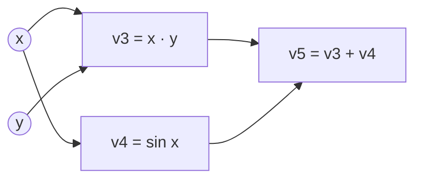

# Automatic Differentiation

Automatic differentiation (AD) computes exact derivatives of a function written as a computer program, by applying the chain rule to each elementary operation the program performs. It is the mechanism that gives a neural network its gradients, and it is built into the autograd systems of PyTorch and JAX.

## Overview

Training a neural network reduces a loss by adjusting its parameters, so it needs the derivative of the loss with respect to every parameter. Three routes are common:

- **Hand derivation**: exact, but tedious, error-prone and repeated whenever the model changes.
- **Numerical differentiation**: approximate each derivative by a finite difference, $\frac{f(x+h e_i)-f(x)}{h}$. It needs an extra evaluation per input, and rounding error makes the result approximate.
- **Automatic differentiation**: run the program while tracking derivatives of its intermediate values. The result is exact up to rounding, at a cost of a small constant multiple of one evaluation.

Baydin and colleagues (2015/2018) describe AD as a family of techniques, more general than backpropagation, for evaluating derivatives of numeric functions expressed as programs. It differs from symbolic differentiation, which manipulates formulas and can grow very large. The two landmark methods are [forward-mode AD](forward-mode/index.md) and [reverse-mode AD](reverse-mode/index.md), which differ in the order in which they multiply local derivatives.

## Key concepts

- **Elementary operation**: a basic step such as addition, multiplication, `sin` or a matrix product, whose local derivative is known in closed form.
- **Computational graph**: a directed graph whose nodes are intermediate values and whose edges record which values were computed from which.
- **Jacobian** $J$: the matrix of partial derivatives of an output vector with respect to an input vector.
- **Jacobian-vector product (JVP)**: $J\dot{x}$, the change in the outputs when the inputs move in a chosen direction $\dot{x}$. Forward mode computes JVPs.
- **Vector-Jacobian product (VJP)**: $\bar{y}^{\top}J$, which weights the outputs by $\bar{y}$ and returns a weighting on the inputs. Reverse mode computes VJPs.
- **Tape** (or trace): a record of the operations and intermediate values from the forward pass, kept for use in a later pass.
- **Higher-order derivative**: a derivative of a derivative, such as the Hessian of second derivatives.

## How it works

The starting point is the chain rule. If a program computes $y = f(g(x))$, then $dy/dx = f'(g(x))\,g'(x)$. A long program is a chain of such steps, and its derivative is a sum over all paths through the computational graph of products of local derivatives. AD organises that sum. Multiplying the local derivatives in the order of computation gives forward mode; multiplying them in reverse order gives reverse mode.

Take $f(x, y) = xy + \sin x$ at $(x, y) = (2, 3)$. The program computes these intermediate values:

| Node | Operation | Value |
|---|---|---|
| $v_1$ | $x$ | 2 |
| $v_2$ | $y$ | 3 |
| $v_3$ | $v_1 v_2$ | 6 |
| $v_4$ | $\sin v_1$ | 0.909 |
| $v_5$ | $v_3 + v_4$ | 6.909 |

**Forward mode** attaches a tangent $\dot v$ to each value and propagates it in the same order. Setting $\dot x = 1$ and $\dot y = 0$ gives $\dot v_3 = 3$, $\dot v_4 = \cos 2 \approx -0.416$ and $\dot v_5 = 2.584$, which is $\partial f/\partial x$. One pass yields one column of the Jacobian.

**Reverse mode** runs the forward pass first, then propagates adjoints $\bar v_k = \partial f/\partial v_k$ from the output backwards. From $\bar v_5 = 1$ the sum rule gives $\bar v_3 = \bar v_4 = 1$. Node $v_1$ collects $\bar v_3 v_2 + \bar v_4 \cos v_1 = 2.584$, and node $v_2$ gets $\bar v_3 v_1 = 2$. One backward pass returns the gradient with respect to both inputs.

| | Forward mode | Reverse mode |
|---|---|---|
| Natural product | JVP, $J\dot{x}$ | VJP, $\bar{y}^{\top}J$ |
| Passes for a full Jacobian | One per input | One per output |
| Extra memory | Only the current tangents | Intermediate values, stored for the backward pass |
| Best when | Few inputs, many outputs | Many inputs, few outputs, such as a scalar loss |

A training loss is a scalar that depends on millions of parameters, so reverse mode yields the whole gradient in one backward pass, which is why it dominates deep learning. Forward mode remains useful for few inputs.

### Backpropagation is the chain rule applied in reverse

Backpropagation is reverse-mode AD applied to a neural network's computational graph. Each layer contributes a known VJP rule, and the forward activations are stored and reused on the way back. Rumelhart, Hinton and Williams (1986) popularised the procedure for multilayer networks, and Schmidhuber (2014/2015) surveys the longer history of gradient-based learning. The [deep learning](../../deep-learning/index.md) page describes how it fits into training.

### Autodiff in PyTorch and JAX

Both frameworks track operations, but they capture programs differently.

- **PyTorch** records operations as they run. Tensors that require gradients carry a graph of the operations that produced them. Calling `backward()` on a scalar walks that graph in reverse, applies each operation's backward rule, and accumulates gradients in the parameters. Paszke and colleagues (2019) describe this imperative, Python-first design.
- **JAX** treats AD as a function transformation. `jax.grad`, `jax.jvp` and `jax.vjp` take a Python function and return a new function that computes the derivative. Transformations compose, so a Hessian can be obtained by differentiating a gradient. `jax.grad` is built on the VJP and `jax.jvp` on the JVP.

Elliott (2018) specifies reverse-mode AD without graphs, tapes or mutation, which suits functional programming. Recording a tape or transforming a function is a central design choice.

### Higher-order derivatives

AD can be applied to its own output. For a scalar function $f$, the Hessian-vector product $Hv = \nabla(\nabla f \cdot v)$ can be computed exactly without forming $H$. Pearlmutter (1994) showed how, at a cost comparable to a gradient. Such products underlie Hessian-free and curvature-aware optimisers, which connect to the [second-order methods](../../optimization/second-order.md) page.

### Memory and checkpointing

Reverse mode must keep the forward pass's intermediate values, which often limits model size. Gradient checkpointing stores only some and recomputes the rest. Chen and colleagues (2016) describe a scheme needing memory of order $\sqrt{n}$ for an $n$-layer network, at the cost of one extra forward pass per mini-batch. Their abstract reports cutting a 1,000-layer residual network from 48 GB to 7 GB of memory, with about 30% more running time.

## Key methods

Two methods carry the subject. Each has its own page with the equations, results and limitations.

| Method | What it computes | Cost pattern | Detail |
|---|---|---|---|
| Forward-mode AD | JVPs, by carrying tangents alongside values | One pass per input direction; no stored tape | [Forward-mode AD](forward-mode/index.md) |
| Reverse-mode AD (backpropagation) | VJPs, by sweeping adjoints backward | One backward pass per output; stores intermediates | [Reverse-mode AD](reverse-mode/index.md) |

## Connections

- [Deep learning](../../deep-learning/index.md) uses reverse-mode AD, under the name backpropagation, to train the architectures it describes.
- [Optimisation](../../optimization/index.md) consumes the gradients AD produces. The [Adam](../../optimization/adaptive/adam.md) update takes the gradient as input and does not depend on how it was computed.
- **Brain and mind.** Exact backpropagation needs a backward pathway that reuses the transposed forward weights, which neurons do not obviously have. Lillicrap and colleagues (2016) showed that error signals can travel through random, fixed feedback weights and still support learning. Predictive-coding networks offer another route without an exact backward pass; see the [predictive coding](../../../brain-mind/predictive-coding/index.md) page.
- Spiking neurons raise a related problem. Their firing threshold is not differentiable, so spiking networks substitute a surrogate derivative in the backward pass (Neftci et al., 2019). See [surrogate gradients](../../../brain-mind/snn-neuromorphic/surrogate-gradients/index.md) and [NeuroAI](../../../brain-mind/neuroai/index.md).

## Applications

- **Training neural networks** of every kind, from [Transformers](../../models/transformer/index.md) to convolutional networks. Any model built from differentiable primitives gets its gradients this way.
- **Scientific computing.** Baydin and colleagues (2015/2018) list computational fluid dynamics, atmospheric sciences and engineering design optimisation as application areas.
- **Continuous-depth models.** Neural ODEs treat a hidden state as the solution of a differential equation. Chen and colleagues (2018) backpropagate through an ODE solver at constant memory cost, using the adjoint method.

## Open questions

- **Memory and recomputation.** The best checkpointing schedule depends on the model and hardware.
- **Non-smooth and discrete programs.** Sorting, sampling, `argmax` and branching on values have no ordinary derivative. Estimators and surrogates give biased or high-variance gradients, and there is no agreed general solution. [Policy gradients](../../paradigms/reinforcement-learning/policy-gradient-and-actor-critic/index.md) are one answer for sampled actions.
- **Gradients without backpropagation.** Baydin and colleagues (2022) estimate gradients from forward-mode directional derivatives and report faster training in some cases. Whether such methods can match reverse mode at scale is open, and it bears on the biological question above.

## References

### Seminal papers

- Rumelhart, D. E., Hinton, G. E. & Williams, R. J. (1986). Learning representations by back-propagating errors. *Nature*. https://doi.org/10.1038/323533a0 — Popularises backpropagation for multilayer networks, the reverse-mode gradient method used to train deep networks.
- Pearlmutter, B. A. (1994). Fast Exact Multiplication by the Hessian. *Neural Computation*. https://doi.org/10.1162/neco.1994.6.1.147 — Shows how to multiply a Hessian by a vector exactly, without forming the matrix, using differentiation.
- Pearlmutter, B. A. & Siskind, J. M. (2008). Reverse-mode AD in a functional framework. *ACM Transactions on Programming Languages and Systems*. https://doi.org/10.1145/1330017.1330018 — Expresses reverse-mode AD in a functional language, including higher-order functions.
- Elliott, C. (2018). The simple essence of automatic differentiation. ICFP 2018. https://arxiv.org/abs/1804.00746 — Derives a graph-free, tape-free reverse-mode AD algorithm from a short specification.
- Chen, T., Xu, B., Zhang, C. & Guestrin, C. (2016). Training Deep Nets with Sublinear Memory Cost. https://arxiv.org/abs/1604.06174 — Gradient checkpointing, which trades recomputation for memory to train very deep networks.
- Chen, R. T. Q., Rubanova, Y., Bettencourt, J. & Duvenaud, D. (2018). Neural Ordinary Differential Equations. NeurIPS. https://arxiv.org/abs/1806.07366 — Backpropagation through an ODE solver with the adjoint method, at constant memory cost.
- Lillicrap, T. P., Cownden, D., Tweed, D. B. & Akerman, C. J. (2016). Random synaptic feedback weights support error backpropagation for deep learning. *Nature Communications*. https://doi.org/10.1038/ncomms13276 — Argues that random fixed feedback weights can replace the transposed forward weights in error backpropagation.
- Neftci, E. O., Mostafa, H. & Zenke, F. (2019). Surrogate Gradient Learning in Spiking Neural Networks. https://arxiv.org/abs/1901.09948 — Introduces surrogate gradient methods, which train spiking networks despite the non-differentiable spike.
- Baydin, A. G., Pearlmutter, B. A., Syme, D., Wood, F. & Torr, P. (2022). Gradients without Backpropagation. https://arxiv.org/abs/2202.08587 — Estimates gradients from forward-mode directional derivatives in a single forward run, and reports faster training in some cases.

### Surveys and textbooks

- Baydin, A. G., Pearlmutter, B. A., Radul, A. A. & Siskind, J. M. (2015/2018). Automatic differentiation in machine learning: a survey. *Journal of Machine Learning Research*. https://arxiv.org/abs/1502.05767 — Survey that defines the main differentiation techniques, including symbolic differentiation, and their relationships.
- Griewank, A. & Walther, A. (2008). *Evaluating Derivatives*. SIAM. https://doi.org/10.1137/1.9780898717761 — The standard reference on algorithmic differentiation, covering forward and reverse modes and checkpointing.
- Schmidhuber, J. (2014/2015). Deep Learning in Neural Networks: An Overview. *Neural Networks*. https://arxiv.org/abs/1404.7828 — Historical survey of deep learning, including the development of gradient-based training.

### Articles and documentation

- Paszke, A. et al. (2019). PyTorch: An Imperative Style, High-Performance Deep Learning Library. NeurIPS. https://arxiv.org/abs/1912.01703 — Describes PyTorch's design, a Python-first framework whose runtime includes the autograd engine.
