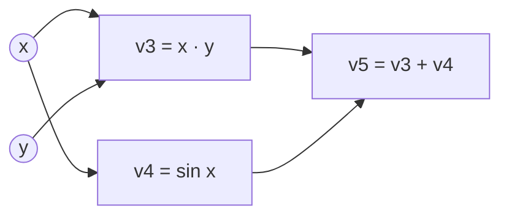

# 自動微分

自動微分（automatic differentiation，AD）會對以電腦程式撰寫的函數，計算精確的導數：對程式執行的每個基本運算套用連鎖律。它是神經網路取得梯度的機制，PyTorch 與 JAX 的 autograd 系統都內建了這項功能。

## 概述

訓練神經網路是藉由調整參數來降低損失，因此需要損失對每個參數的導數。常見的做法有三種：

- **手動推導**：寫出公式再程式實作。結果精確，但繁瑣又容易出錯，且每當模型改變就得重做。
- **數值微分**：以有限差分近似每個導數，$\frac{f(x+h e_i)-f(x)}{h}$。每個輸入都需要額外一次函數求值，而捨入誤差使結果只是近似。
- **自動微分**：執行程式時同步追蹤中間值的導數。除了浮點數的捨入誤差外結果是精確的，成本約為對程式求值一次的小常數倍。

Baydin 等人（2015/2018）將 AD 描述為一族技術，比反向傳播更一般，用來計算以程式表示的數值函數的導數。它不同於符號微分，後者是操作公式，對長程式可能產生非常龐大的運算式。兩種代表性方法是[前向模式 AD](forward-mode/index.md)與[反向模式 AD](reverse-mode/index.md)，它們的差別在於局部導數相乘的順序。

## 核心概念

- **基本運算**：加法、乘法、`sin` 或矩陣乘積等基本步驟，其局部導數已知且有封閉形式。
- **計算圖**：以有向圖表示，節點是中間值，邊記錄哪些值是由哪些值計算而來。
- **雅可比矩陣** $J$：輸出向量對輸入向量的偏導數矩陣。
- **雅可比-向量乘積（JVP）**：$J\dot{x}$，即輸入沿指定方向 $\dot{x}$ 移動時輸出的變化量。前向模式計算的是 JVP。
- **向量-雅可比乘積（VJP）**：$\bar{y}^{\top}J$，以 $\bar{y}$ 對輸出加權，並回傳對輸入的加權。反向模式計算的是 VJP。
- **磁帶（tape，或稱軌跡）**：前向計算中運算與中間值的紀錄，供之後的計算使用。
- **高階導數**：導數的導數，例如由二階偏導數組成的海森矩陣。

## 運作方式

出發點是連鎖律。若程式計算 $y = f(g(x))$，則 $dy/dx = f'(g(x))\,g'(x)$。長程式就是由許多這樣的步驟串成的鏈，其導數是計算圖中所有路徑上局部導數乘積的總和。AD 負責組織這個總和：若依計算順序相乘局部導數，得到前向模式；若依反向順序相乘，則得到反向模式。

以 $(x, y) = (2, 3)$ 計算 $f(x, y) = xy + \sin x$。程式會算出以下中間值：

| 節點 | 運算 | 數值 |
|---|---|---|
| $v_1$ | $x$ | 2 |
| $v_2$ | $y$ | 3 |
| $v_3$ | $v_1 v_2$ | 6 |
| $v_4$ | $\sin v_1$ | 0.909 |
| $v_5$ | $v_3 + v_4$ | 6.909 |

**前向模式**為每個值附加一個切線 $\dot v$，並以相同順序傳遞。設 $\dot x = 1$、$\dot y = 0$，可得 $\dot v_3 = 3$、$\dot v_4 = \cos 2 \approx -0.416$，以及 $\dot v_5 = 2.584$，即 $\partial f/\partial x$。一次計算得到雅可比矩陣的一欄。

**反向模式**先執行前向計算，再從輸出端反向傳遞伴隨值 $\bar v_k = \partial f/\partial v_k$。由 $\bar v_5 = 1$ 出發，依和的法則得 $\bar v_3 = \bar v_4 = 1$。節點 $v_1$ 收集 $\bar v_3 v_2 + \bar v_4 \cos v_1 = 2.584$，節點 $v_2$ 得到 $\bar v_3 v_1 = 2$。一次反向掃描即可得到對兩個輸入的梯度。

| | 前向模式 | 反向模式 |
|---|---|---|
| 自然計算的乘積 | JVP，$J\dot{x}$ | VJP，$\bar{y}^{\top}J$ |
| 取得完整雅可比矩陣所需次數 | 每個輸入一次 | 每個輸出一次 |
| 額外記憶體 | 只需當下的切線 | 中間值，須為反向計算而保存 |
| 適用情況 | 輸入少、輸出多 | 輸入多、輸出少，例如純量損失 |

訓練損失是一個純量，卻依賴數百萬個參數，因此反向模式只需一次反向計算就能得到完整梯度，這也是它主導深度學習的原因。前向模式在輸入很少時仍然有用。

### 反向傳播就是反向套用的連鎖律

反向傳播就是對神經網路的計算圖套用反向模式 AD。每一層都貢獻一條已知的 VJP 規則，前向的激活值會被保存，並在反向過程中重複使用。Rumelhart、Hinton 與 Williams（1986）推廣了這個程序，用於多層網路；Schmidhuber（2014/2015）則綜述了基於梯度的學習在更長時期的歷史。[深度學習](../../deep-learning/index.md)頁說明它在訓練中的位置。

### PyTorch 與 JAX 中的自動微分

兩個框架都會追蹤運算，但擷取程式的方式不同。

- **PyTorch** 在運算執行時即時記錄。需要梯度的張量會攜帶一張圖，記錄產生它們的運算。對純量呼叫 `backward()` 會沿著這張圖反向走訪，套用每個運算儲存的反向規則，並把梯度累加到參數上。Paszke 等人（2019）描述了這種命令式、以 Python 為核心的設計。
- **JAX** 把自動微分視為函數變換。`jax.grad`、`jax.jvp` 與 `jax.vjp` 接收一個 Python 函數，回傳一個計算其導數的新函數。這些變換可以組合，例如對梯度再微分即可得到海森矩陣。`jax.grad` 建立在 VJP 上，`jax.jvp` 則建立在 JVP 上。

Elliott（2018）給出一種不使用圖、磁帶或變異操作的反向模式 AD 規格，適合函數式程式設計。記錄磁帶還是轉換函數，是 AD 系統的核心設計選擇。

### 高階導數

AD 可以套用在自己的輸出上。對純量函數 $f$，海森-向量乘積 $Hv = \nabla(\nabla f \cdot v)$ 可以精確計算，而無須形成矩陣 $H$。Pearlmutter（1994）展示了其方法，成本與一次梯度計算相當。這類乘積是無海森矩陣最佳化器與曲率感知最佳化器的基礎，並與[二階方法](../../optimization/second-order.md)頁相連。

### 記憶體與檢查點

反向模式必須保留前向計算的中間值，這往往會限制模型的規模。梯度檢查點只保存其中一部分，其餘在反向過程中重新計算。Chen 等人（2016）描述的方案對 $n$ 層網路只需 $\sqrt{n}$ 階的記憶體，代價是每個小批次多一次前向計算。他們的摘要報告，將一個 1,000 層殘差網路的記憶體從 48 GB 降到 7 GB，運行時間約增加 30%。

## 關鍵方法

有兩種方法是本主題的核心。各自的頁面都有方程式、結果與限制。

| 方法 | 計算內容 | 成本模式 | 詳情 |
|---|---|---|---|
| 前向模式 AD | JVP，沿著數值攜帶切線 | 每個輸入方向一次計算；不需保存磁帶 | [前向模式 AD](forward-mode/index.md) |
| 反向模式 AD（反向傳播） | VJP，反向掃過伴隨值 | 每個輸出一次反向計算；需保存中間值 | [反向模式 AD](reverse-mode/index.md) |

## 關聯

- [深度學習](../../deep-learning/index.md)以反向模式 AD（即反向傳播）訓練它所描述的各種架構。
- [最佳化](../../optimization/index.md)使用 AD 產生的梯度。例如 [Adam](../../optimization/adaptive/adam.md) 的更新以梯度為輸入，並不在乎梯度如何計算。
- **腦與心智。** 精確的反向傳播需要一條反向路徑重用前向權重的轉置，而神經元未必具備這樣的結構。Lillicrap 等人（2016）指出，誤差訊號可以經由隨機、固定的回饋權重傳遞，仍能支持學習。預測編碼網路則提供另一條不需精確反向計算的路徑，見[預測編碼](../../../brain-mind/predictive-coding/index.md)頁。
- 脈衝神經元帶來相關的問題。其發放門檻不可微分，因此脈衝網路在反向過程中以代理導數取代（Neftci 等人，2019）。見[代理梯度](../../../brain-mind/snn-neuromorphic/surrogate-gradients/index.md)與[NeuroAI](../../../brain-mind/neuroai/index.md)。

## 應用

- **訓練各種神經網路**，從 [Transformer](../../models/transformer/index.md) 到卷積網路。任何由可微分基本運算組成的模型都以這種方式取得梯度。
- **科學計算。** Baydin 等人（2015/2018）列舉的應用領域包括計算流體力學、大氣科學與工程設計最佳化。
- **連續深度模型。** 神經常微分方程式把隱藏狀態視為微分方程的解。Chen 等人（2018）以伴隨方法，在固定記憶體成本下透過 ODE 求解器反向傳播。

## 開放問題

- **記憶體與重新計算。** 最佳的檢查點排程取決於模型與硬體，目前沒有通用的答案。
- **非平滑與離散程式。** 排序、取樣、`argmax` 以及依數值分支等運算沒有一般意義下的導數。估計量與代理方法給出有偏或高變異的梯度，目前沒有公認的通用解法。對於取樣動作，強化學習的[策略梯度](../../paradigms/reinforcement-learning/policy-gradient-and-actor-critic/index.md)方法是一種解答。
- **不經反向傳播的梯度。** Baydin 等人（2022）從前向模式的方向導數估計梯度，並報告在部分情況下訓練較快。這類方法能否在大規模上媲美反向模式仍是開放問題，也與上面的生物學問題相關。

## 參考文獻

### 開創性論文

- Rumelhart, D. E., Hinton, G. E. & Williams, R. J. (1986). Learning representations by back-propagating errors. *Nature*. https://doi.org/10.1038/323533a0 — 推廣多層網路的反向傳播，即訓練深度網路所用的反向模式梯度方法。
- Pearlmutter, B. A. (1994). Fast Exact Multiplication by the Hessian. *Neural Computation*. https://doi.org/10.1162/neco.1994.6.1.147 — 說明如何藉由微分，精確計算海森矩陣與向量的乘積，而不必形成整個矩陣。
- Pearlmutter, B. A. & Siskind, J. M. (2008). Reverse-mode AD in a functional framework. *ACM Transactions on Programming Languages and Systems*. https://doi.org/10.1145/1330017.1330018 — 以函數式語言表達反向模式 AD，包括高階函數。
- Elliott, C. (2018). The simple essence of automatic differentiation. ICFP 2018. https://arxiv.org/abs/1804.00746 — 從簡短的規格推導出不使用圖、磁帶的反向模式 AD 演算法。
- Chen, T., Xu, B., Zhang, C. & Guestrin, C. (2016). Training Deep Nets with Sublinear Memory Cost. https://arxiv.org/abs/1604.06174 — 梯度檢查點，以重新計算換取記憶體，用於訓練極深的網路。
- Chen, R. T. Q., Rubanova, Y., Bettencourt, J. & Duvenaud, D. (2018). Neural Ordinary Differential Equations. NeurIPS. https://arxiv.org/abs/1806.07366 — 以伴隨方法透過 ODE 求解器反向傳播，記憶體成本固定。
- Lillicrap, T. P., Cownden, D., Tweed, D. B. & Akerman, C. J. (2016). Random synaptic feedback weights support error backpropagation for deep learning. *Nature Communications*. https://doi.org/10.1038/ncomms13276 — 主張隨機、固定的回饋權重可以取代誤差反向傳播中前向權重的轉置。
- Neftci, E. O., Mostafa, H. & Zenke, F. (2019). Surrogate Gradient Learning in Spiking Neural Networks. https://arxiv.org/abs/1901.09948 — 介紹代理梯度方法，使脈衝網路在脈衝不可微分的情況下仍能訓練。
- Baydin, A. G., Pearlmutter, B. A., Syme, D., Wood, F. & Torr, P. (2022). Gradients without Backpropagation. https://arxiv.org/abs/2202.08587 — 在單次前向計算中，由前向模式的方向導數估計梯度，並報告部分情況下訓練較快。

### 綜述與教科書

- Baydin, A. G., Pearlmutter, B. A., Radul, A. A. & Siskind, J. M. (2015/2018). Automatic differentiation in machine learning: a survey. *Journal of Machine Learning Research*. https://arxiv.org/abs/1502.05767 — 綜述，定義主要的微分技術（包括符號微分）及其相互關係。
- Griewank, A. & Walther, A. (2008). *Evaluating Derivatives*. SIAM. https://doi.org/10.1137/1.9780898717761 — 演算法微分的標準參考書，涵蓋前向與反向模式以及檢查點。
- Schmidhuber, J. (2014/2015). Deep Learning in Neural Networks: An Overview. *Neural Networks*. https://arxiv.org/abs/1404.7828 — 深度學習的歷史綜述，包括基於梯度的訓練之發展。

### 文章與文件

- Paszke, A. 等人（2019）。PyTorch: An Imperative Style, High-Performance Deep Learning Library. NeurIPS. https://arxiv.org/abs/1912.01703 — 描述 PyTorch 的設計，這是一個以 Python 為核心的框架，其執行環境包含 autograd 引擎。
