# Reverse-mode differentiation

Reverse-mode differentiation computes the gradient of a scalar output with respect to all inputs in one backward sweep over a program, after one forward sweep that records the intermediate values. When the output is a scalar and the inputs are many, as with the loss of a neural network and its parameters, this is far cheaper than computing one directional derivative per input. Backpropagation is this method applied to a neural network.

## Overview

The [automatic differentiation chapter](index.md) describes the two modes. This page covers reverse mode, which is the one that trains large models. It is best understood as the chain rule applied from the output towards the inputs, carrying a sensitivity for each intermediate value.

## Problem

Suppose a function $f: \mathbb{R}^n \to \mathbb{R}$ maps millions of parameters to a loss. The gradient has $n$ components. Forward mode produces one component per pass, so a full gradient costs about $n$ passes. Training a model would then take a time proportional to its number of parameters for every update, which is impractical.

## Core idea

Reverse mode works in two phases. The forward phase runs the program and stores each intermediate value $v_i$ in a computational graph. The reverse phase starts with the adjoint of the output, $\bar{y} = 1$, and walks the graph backwards. At each node it uses the local derivatives of the operation to pass the adjoint to its inputs, adding contributions where a value is used more than once:

$$\bar{v}_j = \sum_{i \in \text{children}(j)} \bar{v}_i \,\frac{\partial v_i}{\partial v_j}$$

Each adjoint is a vector-Jacobian product. The point is that the gradient with respect to all inputs is produced by one backward sweep whose cost is a small constant multiple of evaluating the function, a result known as the cheap gradient principle [(Griewank and Walther, 2008)](https://doi.org/10.1137/1.9780898717761).



*Original four-stage teaching animation, CC BY-SA 4.0.* The same illustrative program $a=xy$, $b=x+x$, $z=a+b$ at $(x,y)=(2,3)$ first records the primal values. Seeding $\bar{z}=1$ sends $\bar{a}=\bar{b}=1$ backwards; the two paths into $x$ contribute $y\bar{a}=3$ and $2\bar{b}=2$, which **must be added**, giving $\bar{x}=5$, while $\bar{y}=x\bar{a}=2$. This one reverse sweep yields $\nabla f=(5,2)$ for a scalar output, not a claim about a model's measured gradients. The MkDocs player offers Play/Pause and a reduced-motion fallback; [view the GitHub-compatible static final state](../../../assets/concept-animations/reverse-ad-vjp-still.svg).

## Equation

For a vector-valued operation $y = g(x)$ with Jacobian $J$, the adjoint rule maps the output sensitivity $\bar{y}$ to an input sensitivity without forming $J$:

$$\bar{x} = J^{\top} \bar{y}$$

For a layer $y = Wx + b$ with a loss $L$, this gives $\bar{W} = \bar{y}\, x^{\top}$ and $\bar{x} = W^{\top} \bar{y}$. Chaining these rules through the graph is exactly backpropagation [(Rumelhart et al., 1986)](https://doi.org/10.1038/323533a0).

## Execution model: a concrete reverse sweep

Consider the straight-line program $u=xy$, $v=x+x$, and $L=u+v$. At $x=2$, $y=3$, the primal trace records $u=6$, $v=4$, and $L=10$. Initialise the output cotangent to $\\bar L=1$. The addition node sends one unit to both $u$ and $v$. The multiplication node sends $y\\bar u=3$ to $x$ and $x\\bar u=2$ to $y$; the two uses of $x$ in $v$ send two further units to $x$. Thus the accumulated cotangents are $\\bar x=5$ and $\\bar y=2$.

This example exposes an important implementation distinction: a computational graph is not necessarily a tree. An input can feed several downstream operations. A reverse implementation must **sum** cotangents from all uses, rather than overwriting an earlier contribution. For tensor-valued nodes, the same rule holds with local vector-Jacobian products (VJPs) instead of scalar partial derivatives. The output seed may also be a non-unit vector when differentiating a vector-valued function against a chosen output cotangent.

A practical tape-based engine records, for each differentiable operation, its inputs, any saved forward values needed by the derivative rule, and a pullback closure. In reverse topological order it calls each pullback with the output cotangent and accumulates the returned input cotangents. This is the implementation-level connection between the calculus described by Baydin et al. and imperative frameworks such as PyTorch.[^1][^2]

```text
values, tape = evaluate_forward(program, inputs)
cotangent[loss] = 1
for node in reverse_topological_order(tape):
    if node has no accumulated cotangent: continue
    contributions = node.pullback(cotangent[node], saved_values[node])
    for input, contribution in contributions:
        cotangent[input] += contribution
return cotangent[inputs]
```

The pseudocode omits storage allocation, tensor aliasing, mutation checks, broadcasting reductions, and distributed execution. These are not optional details in a production autodiff engine: for example, the derivative of a broadcast addition must reduce the incoming cotangent over broadcast dimensions to recover the original input shape.

## Complexity and memory accounting

Let $C_f$ denote the cost of evaluating a differentiable scalar-output program and let $n$ be its number of scalar inputs. Computing all $n$ gradient components by separate forward-mode basis directions generally requires work proportional to $nC_f$, whereas reverse mode evaluates the primal program and propagates cotangents in one reverse traversal. For standard elementary operations with inexpensive pullbacks, gradient evaluation has work comparable to a small multiple of $C_f$. This is a **work** comparison, not a guarantee that any particular implementation is a fixed number of times faster: memory traffic, control flow, custom operations, and device synchronisation affect wall-clock performance.[^1][^3]

Reverse mode also changes the space budget. A pullback may require an input, an output, a mask, or other intermediate information from the forward execution. Keeping all saved tensors alive can make peak activation memory grow with the unrolled computation, even when the final gradient tensor is small. Activation checkpointing retains selected boundaries and recomputes discarded intermediate activations on demand. It reduces storage at the expense of additional forward work, and its effectiveness depends on the graph structure and recomputation schedule.[^3]

For a function $f: \\mathbb{R}^n\\to\\mathbb{R}^m$, one reverse sweep computes $J_f(x)^\\top v$ for a chosen $v\\in\\mathbb{R}^m$. Constructing the **entire** Jacobian may require up to $m$ reverse sweeps, not one. Conversely, forward mode computes $J_f(x)u$ for a chosen input direction $u$. The appropriate mode therefore depends on the shape of the requested derivative, not simply on whether a neural network is involved.[^1]

## Differentiability contracts and failure modes

A numerical program may contain operations whose mathematical derivatives are undefined, discontinuous, or poorly conditioned. At a ReLU kink, for instance, a framework adopts a documented derivative convention rather than recovering a unique classical derivative. For integer indexing, argmax, and discrete sampling, ordinary reverse mode cannot propagate a useful gradient through the discrete decision itself. Surrogate gradients and continuous relaxations change the optimisation problem; they are modelling choices rather than exact differentiation of the original discrete operation.

In-place mutation can invalidate values saved for a pullback. Detaching a tensor intentionally severs a gradient path. Accidentally treating a parameter as a constant, or silently converting an intermediate to a non-differentiable representation, can likewise produce missing gradients without a syntax error. A robust training pipeline should check that expected parameters receive finite gradients, and should distinguish an intentionally absent gradient from a numerical zero.[^2]

Gradient checking is useful for small smooth examples: compare the reverse-mode result with central finite differences over several step sizes, or compare a directional derivative $u^\\top\\nabla f(x)$ against a perturbation along $u$. Finite differences are a diagnostic, not a ground truth: truncation and floating-point cancellation can disagree with correct automatic derivatives. Tests should avoid non-smooth points, stochastic nondeterminism, and operations with stateful side effects.[^1]

## Key methods

- [Reverse-mode differentiation](reverse-mode.md): tape-based adjoint accumulation for scalar objectives, as developed on this page.
- [Forward-mode differentiation](forward-mode.md): propagates tangents alongside primal values and is preferable for a small number of input directions.

## Practical interpretation

In neural-network training, the optimiser does not differentiate the entire training procedure automatically. A conventional training step differentiates the current loss with respect to current parameters; the optimiser then consumes those gradients and updates the parameters. Differentiating **through** an optimiser step, as in some meta-learning settings, requires retaining or reconstructing the relevant update computation and choosing how its state is represented. The distinction matters when interpreting higher-order gradients and memory costs.

The central guarantee is local and compositional: provided the executed primitive operations have correct derivative rules and the program respects their differentiability contracts, reverse accumulation implements the chain rule for the executed computation. It does not, by itself, ensure that a chosen loss is appropriate, that gradients are numerically well scaled, or that optimisation will converge.[^1][^4]

## Results

The reverse-mode gradient is exact up to floating-point rounding, unlike finite differences, which trade truncation error against rounding error. The survey by Baydin and colleagues reviews how reverse mode is used across machine learning and compares it with forward mode and with symbolic differentiation [(Baydin et al., 2018)](https://arxiv.org/abs/1502.05767). Specific runtime comparisons are in that survey and in the frameworks it covers.

## Limitations

- Reverse mode must store the intermediate values of the forward pass, so memory grows with the length of the computation. For long sequences or deep models this can dominate the cost.
- Checkpointing trades memory for recomputation: some intermediate values are discarded and recomputed during the reverse sweep. The schedule that minimises the extra work is a known optimisation problem [(Griewank and Walther, 2008)](https://doi.org/10.1137/1.9780898717761).
- Control flow with data-dependent branches is differentiated along the path that was executed. The gradient is correct for that path, but the function may be non-differentiable at the branch boundaries.

## Connections

Reverse mode is the mechanism behind [backpropagation](../../deep-learning/index.md), and the gradients it produces drive the optimisers used in training. Its dual, forward mode, is covered in [Forward-mode differentiation](forward-mode.md). The sensitivity notation is in [Notation and symbols](../../../reference/notation/index.md).

## Applications

Training neural networks of any architecture, gradient-based optimisation of simulators, and sensitivity analysis in scientific computing where the output is a scalar objective.

## Open questions

- How should reverse mode be organised for very long sequences, where storing the forward pass is infeasible?
- Can the graph be built and differentiated efficiently for programs with dynamic structure and discrete choices?

## References

### Seminal papers

- Rumelhart, Hinton and Williams, *Learning representations by back-propagating errors*, Nature (1986). https://doi.org/10.1038/323533a0 — Popularises backpropagation, which is reverse mode applied to layered networks.
- Pearlmutter and Siskind, *Reverse-mode AD in a functional framework: Lambda the ultimate backpropagator*, ACM Transactions on Programming Languages and Systems (2008). https://doi.org/10.1145/1330017.1330018 — Reverse mode as a program transformation in a functional setting.

### Surveys and textbooks

- Baydin, Pearlmutter, Radul and Siskind, *Automatic differentiation in machine learning: a survey*, Journal of Machine Learning Research (2018). https://arxiv.org/abs/1502.05767 — Survey of both modes and their use in machine learning.
- Griewank and Walther, *Evaluating Derivatives: Principles and Techniques of Algorithmic Differentiation*, SIAM (2008). https://doi.org/10.1137/1.9780898717761 — Standard textbook covering the cheap gradient principle and checkpointing.
- Goodfellow, Bengio and Courville, *Deep Learning*, MIT Press (2016). https://www.deeplearningbook.org/ — Explains backpropagation in the context of training neural networks.

### Articles and documentation

- Paszke et al., *PyTorch: An Imperative Style, High-Performance Deep Learning Library* (2019). https://arxiv.org/abs/1912.01703 — Describes a framework that records the graph during the forward pass and replays it in reverse.

[^1]: Baydin et al. (2018), *Automatic differentiation in machine learning: a survey*, linked in References.
[^2]: Paszke et al. (2019), *PyTorch*, linked in References.
[^3]: Griewank and Walther (2008), *Evaluating Derivatives*, linked in References.
[^4]: Goodfellow et al. (2016), *Deep Learning*, linked in References.
