# 反向模式微分

反向模式微分在一次前向執行並記錄中間值之後，只需對程式做一次反向掃描，就能計算純量輸出對所有輸入的梯度。當輸出是純量、輸入數量很多時（例如神經網路的損失與其參數），這比對每個輸入各算一次方向導數便宜得多。反向傳播就是把這個方法套用到神經網路上。

## 概觀

[自動微分章節](index.zh-TW.md)描述了兩種模式。本頁說明反向模式，也就是訓練大型模型所用的模式。它可以理解為鏈式法則從輸出往輸入套用，並為每個中間值攜帶一個敏感度。

## 問題

假設一個函數 $f: \mathbb{R}^n \to \mathbb{R}$ 把數百萬個參數映射到一個損失。梯度有 $n$ 個分量。前向模式每次只能算出一個分量，因此完整梯度需要大約 $n$ 次掃描。訓練模型時，每次更新的時間就會與參數數量成正比，這在實務上不可行。

## 核心想法

反向模式分為兩個階段。前向階段執行程式，並把每個中間值 $v_i$ 儲存在計算圖中。反向階段從輸出的伴隨值 $\bar{y} = 1$ 開始，沿圖往回走。在每個節點，它利用該運算的局部導數，把伴隨值傳給輸入；若某個值被多次使用，則累加各項貢獻：

$$\bar{v}_j = \sum_{i \in \text{children}(j)} \bar{v}_i \,\frac{\partial v_i}{\partial v_j}$$

每個伴隨值都是一個向量雅可比積。重點在於，所有輸入的梯度只靠一次反向掃描就能得到，而其成本是計算函數本身的一個小常數倍，這個結果稱為廉價梯度原理 [(Griewank and Walther, 2008)](https://doi.org/10.1137/1.9780898717761)。

*原創四階段教學動畫，CC BY-SA 4.0。* 使用相同的示意程式 $a=xy$、$b=x+x$、$z=a+b$ 與 $(x,y)=(2,3)$。先計算並保留中間值，再從 $\bar{z}=1$ 反向傳播，得到 $\bar{a}=\bar{b}=1$。兩條回到 $x$ 的路徑分別貢獻 $y\bar{a}=3$ 與 $2\bar{b}=2$，**必須累加**成 $\bar{x}=5$；另一個輸入得到 $\bar{y}=x\bar{a}=2$。因此一次反向掃描即可得到純量輸出的 $\nabla f=(5,2)$。這是手算示意，非模型梯度實測。MkDocs 網站提供播放／暫停及減少動態效果的回退顯示；[GitHub 可直接閱讀的靜態最終狀態](../../../assets/concept-animations/reverse-ad-vjp-still.svg)。

## 方程式

對於向量值運算 $y = g(x)$，其雅可比為 $J$，伴隨規則把輸出敏感度 $\bar{y}$ 映射為輸入敏感度，而不需要顯式形成 $J$：

$$\bar{x} = J^{\top} \bar{y}$$

對於層 $y = Wx + b$ 與損失 $L$，這給出 $\bar{W} = \bar{y}\, x^{\top}$ 與 $\bar{x} = W^{\top} \bar{y}$。沿圖串接這些規則，就正是反向傳播 [(Rumelhart et al., 1986)](https://doi.org/10.1038/323533a0)。

## 結果

反向模式的梯度在浮點捨入之內是精確的，這與有限差分不同，後者需要在截斷誤差與捨入誤差之間取捨。Baydin 等人的綜述檢視了反向模式在機器學習中的用法，並將其與前向模式及符號微分相比較 [(Baydin et al., 2018)](https://arxiv.org/abs/1502.05767)。具體的執行時間比較見該綜述及其所引用的各項工作。

## 限制

- 反向模式必須儲存前向傳播的中間值，因此記憶體隨計算長度成長。對於長序列或深層模型，這可能成為主要成本。
- 檢查點（checkpointing）以記憶體換取重算：部分中間值會被丟棄，並在反向掃描時重新計算。使額外工作最少的排程是一個已知的最佳化問題 [(Griewank and Walther, 2008)](https://doi.org/10.1137/1.9780898717761)。
- 具有依資料而定之分支的控制流，只會沿實際執行的路徑微分。對該路徑而言梯度是正確的，但函數在分支邊界上可能不可微。

## 關聯

反向模式是[反向傳播](../../deep-learning/index.zh-TW.md)背後的機制，而它所產生的梯度驅動訓練中使用的最佳化器。它的對偶，即前向模式，見[前向模式微分](forward-mode.zh-TW.md)。梯度的記號見[符號與記號表](../../../reference/notation/index.zh-TW.md)。

## 應用

訓練任何架構的神經網路、對模擬器進行基於梯度的最佳化，以及在輸出為純量目標的科學計算中進行敏感度分析。

## 開放問題

- 對於無法儲存完整前向傳播的極長序列，反向模式應如何組織？
- 對於具有動態結構與離散選擇的程式，能否有效率地建構圖並微分？

## 參考文獻

### 奠基性論文

- Rumelhart、Hinton 與 Williams，*Learning representations by back-propagating errors*，Nature（1986）。https://doi.org/10.1038/323533a0 — 推廣反向傳播，即套用於分層網路的反向模式。
- Pearlmutter 與 Siskind，*Reverse-mode AD in a functional framework: Lambda the ultimate backpropagator*，ACM Transactions on Programming Languages and Systems（2008）。https://doi.org/10.1145/1330017.1330018 — 在函數式設定中，把反向模式視為程式變換。

### 綜述與教科書

- Baydin、Pearlmutter、Radul 與 Siskind，*Automatic differentiation in machine learning: a survey*，Journal of Machine Learning Research（2018）。https://arxiv.org/abs/1502.05767 — 涵蓋兩種模式及其在機器學習中應用的綜述。
- Griewank 與 Walther，*Evaluating Derivatives: Principles and Techniques of Algorithmic Differentiation*，SIAM（2008）。https://doi.org/10.1137/1.9780898717761 — 涵蓋廉價梯度原理與檢查點的標準教科書。
- Goodfellow、Bengio 與 Courville，*Deep Learning*，MIT Press（2016）。https://www.deeplearningbook.org/ — 在訓練神經網路的脈絡下說明反向傳播。

### 文章與文件

- Paszke 等人，*PyTorch: An Imperative Style, High-Performance Deep Learning Library*（2019）。https://arxiv.org/abs/1912.01703 — 說明一個在前向傳播時記錄圖、並以反向方式執行的框架。
