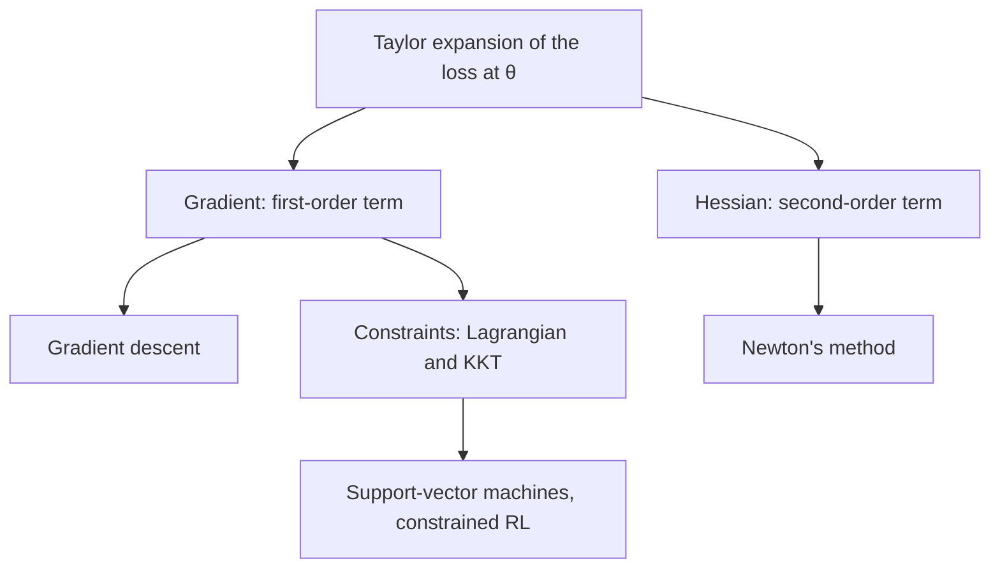

# Calculus and Optimisation Foundations

Calculus gives optimisation its local information: the slope of a loss, its curvature, and the conditions that a constrained optimum must satisfy. This page covers the gradient, the Jacobian, the Hessian, the Taylor expansion, convexity and Lagrange multipliers, and shows how each one underlies a landmark method.

## Overview

Training a model means finding parameters $\theta$ that make a loss $L(\theta)$ small. Calculus describes what $L$ looks like near a candidate point. The first derivatives say which direction lowers the loss fastest. The second derivatives say how that slope changes, which tells a method how far it can safely move. When some parameter values are forbidden, the constraints add a further condition at the optimum, written with Lagrange multipliers.

The [optimisation](../../optimization/index.md) folder uses these ideas without restating them. Its pages assume that the reader already knows:

- the gradient $\nabla L$ and the update $\theta \leftarrow \theta - \eta\nabla L$;
- the Hessian $\nabla^2 L$, and its eigenvalues as a measure of curvature and sharpness, as used in the [second-order methods](../../optimization/second-order.md) page;
- convexity and smoothness, the assumptions behind the convergence rates quoted for gradient descent and its [accelerated variant](../../optimization/sgd-and-momentum/nesterov.md);
- Lagrange multipliers, which the literature uses for constrained problems such as the margin constraints of a support-vector machine and the trust region of constrained reinforcement learning.

Computing these derivatives in software is the subject of [automatic differentiation](../automatic-differentiation/index.md). This page is about what the derivatives mean and what they guarantee.

## Key concepts

- **Gradient**: for a scalar function $f:\mathbb{R}^d\to\mathbb{R}$, the vector $\nabla f(x)$ of partial derivatives $\partial f/\partial x_i$. It points in the direction of steepest increase, so a small step along $-\nabla f(x)$ lowers $f$ faster than a step in any other direction of the same length.
- **Directional derivative**: for a unit vector $u$, the rate at which $f$ changes along $u$ is $\nabla f(x)^\top u$.
- **Jacobian**: for a vector-valued function $F:\mathbb{R}^n\to\mathbb{R}^m$, the $m\times n$ matrix $J_{ij}=\partial F_i/\partial x_j$. The chain rule says that the Jacobian of a composition is the product of the Jacobians, $J_{g\circ f}=J_g J_f$, which is why backpropagation multiplies matrices. The gradient of a scalar function is the transpose of its Jacobian.
- **Hessian**: the symmetric $d\times d$ matrix $H=\nabla^2 f$ of second partial derivatives. Its eigenvalues describe the curvature along its eigenvectors: positive eigenvalues curve upwards and negative ones downwards.
- **Taylor expansion**: near a point $x$, a smooth function is approximated by a polynomial in the step $\delta$:
$$f(x+\delta)\approx f(x)+\nabla f(x)^\top\delta+\tfrac12\,\delta^\top H(x)\,\delta.$$
- **Convexity**: $f$ is convex on a convex set when $f(\lambda x+(1-\lambda)y)\le\lambda f(x)+(1-\lambda)f(y)$ for all points $x, y$ and $\lambda\in[0,1]$. A convex function has no spurious local minima, so every local minimum is a global one. For a twice-differentiable function, convexity is equivalent to a positive semidefinite Hessian everywhere.
- **Smoothness**: the gradient is $L$-Lipschitz if $\lVert\nabla f(x)-\nabla f(y)\rVert\le L\lVert x-y\rVert$ for all $x, y$. The constant $L$ bounds how fast the gradient can change, and so how large a step is safe.
- **Saddle point**: a point where the gradient is zero but the Hessian has both positive and negative eigenvalues. It is not a minimum, yet a method that only looks at the gradient sees it as a stationary point.
- **Lagrangian**: for minimising $f$ subject to inequality constraints $g_i(x)\le 0$, the function $\mathcal{L}(x,\lambda)=f(x)+\sum_i\lambda_i g_i(x)$, with multipliers $\lambda_i\ge 0$.

## How it works

Each derivative gives a local model of the loss, and an optimiser chooses its next step using that model. The three models below are the ones that matter for the methods in this wiki.

**First order.** The linear term $f(x)+\nabla f(x)^\top\delta$ alone has no minimum, because the best step is unbounded. The smoothness constant fixes this. If the gradient is $L$-Lipschitz, Taylor's theorem gives the quadratic upper bound

$$
f(x+\delta)\le f(x)+\nabla f(x)^\top\delta+\tfrac{L}{2}\lVert\delta\rVert^2 .
$$

Minimising the right-hand side over $\delta$ gives the step $-\nabla f(x)/L$. A gradient step of size $1/L$ therefore never increases the loss, and it lowers the loss by at least $\lVert\nabla f(x)\rVert^2/(2L)$. This is the calculation behind [gradient descent](gradient-descent/index.md).

**Second order.** Keeping the Hessian term gives a quadratic model. If $H$ is positive definite, minimising the model gives the Newton step $\delta=-H^{-1}\nabla f(x)$. The step rescales the gradient by the curvature, so it moves far along flat directions and little along steep ones. For a quadratic $f(x)=\tfrac12 x^\top A x-b^\top x$ with $A$ positive definite, one Newton step from any starting point reaches the minimiser $A^{-1}b$. The price is the Hessian itself, which has $d^2$ entries. [Newton's method](newton-method/index.md) develops this in full.

**Constraints.** When some parameter values are forbidden, the gradient alone cannot decide the answer, because the best unconstrained step may leave the feasible set. At a constrained optimum, the gradient of $f$ is balanced by the gradients of the active constraints. Lagrange multipliers state this balance: the gradient of the Lagrangian vanishes, the multipliers are nonnegative, and each multiplier is zero unless its constraint is active. These are the Karush–Kuhn–Tucker (KKT) conditions, developed in [Lagrange multipliers and the KKT conditions](lagrange-multipliers/index.md).

## Key methods

Three landmark methods are built on these tools. Each has its own page.

| Method | Order of information used | What separates it | Detail |
|---|---|---|---|
| [Gradient descent](gradient-descent/index.md) | First (gradient and smoothness) | Cheap steps, with convergence rates set by smoothness and convexity | [Gradient descent](gradient-descent/index.md) |
| [Newton's method](newton-method/index.md) | Second (gradient and Hessian) | Very fast local convergence, but the Hessian is costly at scale | [Newton's method](newton-method/index.md) |
| [Lagrange multipliers and KKT](lagrange-multipliers/index.md) | First, with constraints | Turns a constrained problem into conditions on the gradients of the objective and constraints | [Lagrange multipliers](lagrange-multipliers/index.md) |

## Connections

- **Optimisation.** The [optimisation](../../optimization/index.md) folder applies these methods to training. [Second-order methods](../../optimization/second-order.md) approximate the Hessian, and [theory and landscapes](../../optimization/theory-and-landscapes.md) covers convergence in more depth.
- **Automatic differentiation.** The gradients and Jacobians above are what [automatic differentiation](../automatic-differentiation/index.md) computes. Its Hessian-vector products make curvature-aware steps affordable.
- **Linear algebra.** The Hessian is a symmetric matrix, so its eigendecomposition is the one from [linear algebra for AI](../linear-algebra/index.md). Convexity is also a statement about positive semidefinite matrices.
- **Deep learning.** Losses of deep networks are non-convex, which is why saddle points and sharpness matter there. See [deep learning](../../deep-learning/index.md).
- **Constrained learning.** The [kernel methods and SVM](../../paradigms/supervised/kernel-methods-svm/index.md) page works with the dual problem, which depends on the data only through inner products, the form that Lagrange multipliers produce.
- **Brain and mind.** Whittington and Bogacz (2017) show that a predictive-coding network with local Hebbian plasticity can approximate the weight changes of backpropagation. Whether cortex performs gradient-like inference in this way is unresolved. See [predictive coding](../../../brain-mind/predictive-coding/index.md) and [NeuroAI](../../../brain-mind/neuroai/index.md).

## Applications

- **Training differentiable models.** Bottou, Curtis and Nocedal (2016) review how stochastic gradient methods became the central tool for large-scale learning, and where the conventional gradient-based methods fall short.
- **Diagnosing training.** The Hessian spectrum separates a bulk of small eigenvalues from a few large ones. Sagun, Bottou and LeCun (2016) study this distribution before and after training, and Ghorbani and colleagues (2019) estimate the full spectrum for ImageNet-scale networks. Li and colleagues (2017) use filter-normalised plots to compare loss landscapes.
- **Support-vector machines.** The margin problem is a constrained quadratic program. Cortes and Vapnik (1995) introduced the soft-margin version, whose dual is solved through Lagrange multipliers.
- **Constrained reinforcement learning.** Trust region policy optimisation (Schulman et al., 2015) keeps each policy update within a bound on the KL divergence between the old and new policies.

## Open questions

- **Saddle points and landscapes.** Dauphin and colleagues (2014) argue that saddle points, rather than poor local minima, are the main obstacle in high dimensions. Kawaguchi (2016) proves that deep linear networks have no bad local minima, but also that bad saddle points exist for deeper ones. How far these results extend to nonlinear networks, under their stated assumptions, is open.
- **Sharpness and generalisation.** Keskar and colleagues (2016) associate large-batch training with sharp minima and a generalisation gap. Whether sharpness, measured through the Hessian, causes poor generalisation or only accompanies it is still debated.
- **Curvature at scale.** Which approximations of the Hessian give useful second-order steps for models with billions of parameters, at an acceptable cost, is an open engineering question.
- **Biological implementation.** Local learning rules can approximate gradients in models of cortex, but the evidence that real circuits perform such computations is still indirect.

## References

### Seminal papers

- Kuhn, H. W. & Tucker, A. W. (1951). Nonlinear Programming. *Proceedings of the Second Berkeley Symposium on Mathematical Statistics and Probability*. https://doi.org/10.1525/9780520411586-036 — First-order conditions for a constrained optimum, the origin of KKT.
- Cortes, C. & Vapnik, V. (1995). Support-vector networks. *Machine Learning*. https://doi.org/10.1007/BF00994018 — Soft-margin support-vector machine, trained through its Lagrangian dual.
- Dauphin, Y. et al. (2014). Identifying and attacking the saddle point problem in high-dimensional non-convex optimization. arXiv. https://arxiv.org/abs/1406.2572 — Argues that saddle points, not local minima, dominate high-dimensional training.
- Schulman, J. et al. (2015). Trust Region Policy Optimization. arXiv. https://arxiv.org/abs/1502.05477 — Policy optimisation within a KL trust region, with practical approximations.
- Kawaguchi, K. (2016). Deep Learning without Poor Local Minima. arXiv. https://arxiv.org/abs/1605.07110 — Deep linear networks have no bad local minima, but may have bad saddles.
- Keskar, N. S. et al. (2016). On Large-Batch Training for Deep Learning: Generalization Gap and Sharp Minima. arXiv. https://arxiv.org/abs/1609.04836 — Large-batch training finds sharp minima that generalise worse.
- Sagun, L., Bottou, L. & LeCun, Y. (2016). Eigenvalues of the Hessian in Deep Learning: Singularity and Beyond. arXiv. https://arxiv.org/abs/1611.07476 — Hessian spectrum of a loss before and after training.
- Whittington, J. C. R. & Bogacz, R. (2017). An Approximation of the Error Backpropagation Algorithm in a Predictive Coding Network with Local Hebbian Synaptic Plasticity. *Neural Computation*. https://doi.org/10.1162/NECO_a_00949 — Predictive coding with local Hebbian plasticity approximates backpropagation.

### Surveys and textbooks

- Boyd, S. & Vandenberghe, L. (2004). *Convex Optimization*. Cambridge University Press. https://doi.org/10.1017/CBO9780511804441 — Convex sets and functions, duality, KKT conditions and gradient methods.
- Nocedal, J. & Wright, S. J. (2006). *Numerical Optimization*. Springer. https://doi.org/10.1007/978-0-387-40065-5 — Gradient, Newton, quasi-Newton and constrained methods.
- Bottou, L., Curtis, F. E. & Nocedal, J. (2016). Optimization Methods for Large-Scale Machine Learning. arXiv. https://arxiv.org/abs/1606.04838 — Review of optimisation algorithms for machine learning.

### Articles and documentation

- Li, H. et al. (2017). Visualizing the Loss Landscape of Neural Nets. arXiv. https://arxiv.org/abs/1712.09913 — Filter normalisation for visualising loss curvature and minima.
- Ghorbani, B., Krishnan, S. & Xiao, Y. (2019). An Investigation into Neural Net Optimization via Hessian Eigenvalue Density. arXiv. https://arxiv.org/abs/1901.10159 — Estimates the Hessian spectrum of ImageNet-scale networks during training.
