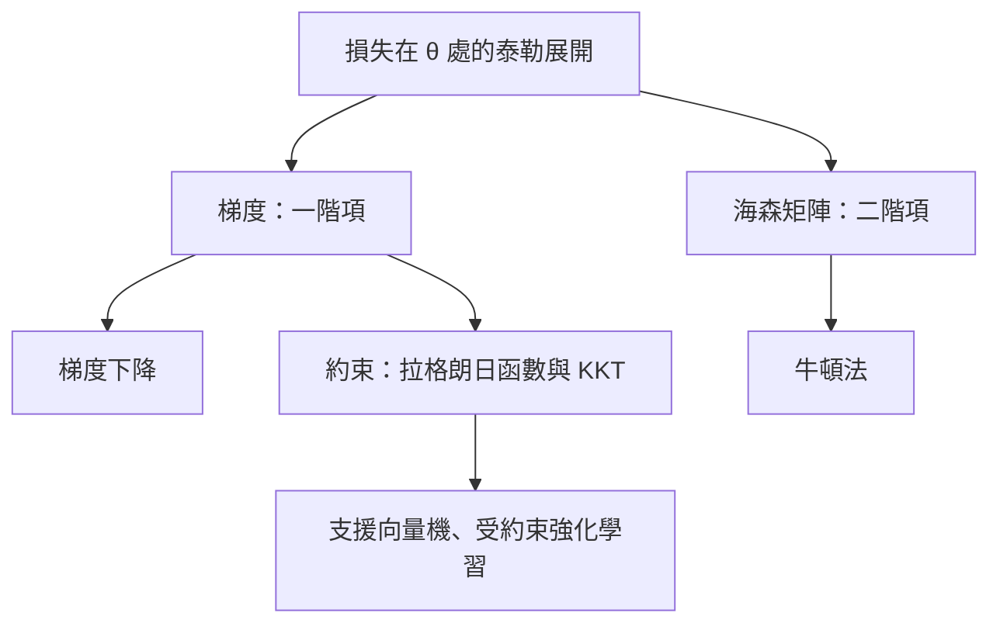

# 微積分與最佳化基礎

微積分為最佳化提供局部資訊：損失函數的斜率、局部曲率，以及受約束的最佳解必須滿足的條件。本頁涵蓋梯度、雅可比矩陣、海森矩陣、泰勒展開、凸性與拉格朗日乘數，並說明每個概念如何支撐一種關鍵方法。

## 概述

訓練模型就是找出能讓損失 $L(\theta)$ 變小的參數 $\theta$。微積分描述候選點附近的 $L$ 長什麼樣子。一階導數告訴我們哪個方向能讓損失下降最快；二階導數說明斜率如何變化，從而告訴方法可以安全地走多遠。當某些參數值被禁止時，約束會在最佳解處加上另一個條件，這個條件以拉格朗日乘數表示。

[最佳化](../../optimization/index.md)章節直接使用這些概念，不另外解釋。其中的頁面預設讀者已經知道：

- 梯度 $\nabla L$ 與更新式 $\theta \leftarrow \theta - \eta\nabla L$；
- 海森矩陣 $\nabla^2 L$，以及用它的特徵值描述曲率與銳度，如[二階方法](../../optimization/second-order.md)頁所用；
- 凸性與光滑性，這是梯度下降及其[加速變體](../../optimization/sgd-and-momentum/nesterov.md)收斂速率所依賴的假設；
- 拉格朗日乘數，文獻用它處理約束問題，例如支援向量機的間隔約束，以及受約束強化學習的信任域。

這些導數在軟體中如何計算，是[自動微分](../automatic-differentiation/index.md)的主題。本頁討論的是這些導數代表什麼，以及它們能保證什麼。

## 核心概念

- **梯度**：對純量函數 $f:\mathbb{R}^d\to\mathbb{R}$，梯度 $\nabla f(x)$ 是偏導數 $\partial f/\partial x_i$ 組成的向量。它指向增加最快的方向，因此沿 $-\nabla f(x)$ 走一小步，$f$ 下降的速度比沿相同長度的其他方向快。
- **方向導數**：對單位向量 $u$，$f$ 沿 $u$ 方向的變化率是 $\nabla f(x)^\top u$。
- **雅可比矩陣**：對向量值函數 $F:\mathbb{R}^n\to\mathbb{R}^m$，它是 $m\times n$ 矩陣 $J_{ij}=\partial F_i/\partial x_j$。連鎖律指出，複合函數的雅可比矩陣等於各雅可比矩陣的乘積 $J_{g\circ f}=J_g J_f$，這正是反向傳播要做矩陣乘法的原因。純量函數的梯度是其雅可比矩陣的轉置。
- **海森矩陣**：二階偏導數組成的對稱 $d\times d$ 矩陣 $H=\nabla^2 f$。它的特徵值描述沿特徵向量方向的曲率：正特徵值表示向上彎曲，負特徵值表示向下彎曲。
- **泰勒展開**：在點 $x$ 附近，光滑函數可以用步長 $\delta$ 的多項式近似：
$$f(x+\delta)\approx f(x)+\nabla f(x)^\top\delta+\tfrac12\,\delta^\top H(x)\,\delta.$$
- **凸性**：在凸集上，若對所有點 $x, y$ 與 $\lambda\in[0,1]$ 都有 $f(\lambda x+(1-\lambda)y)\le\lambda f(x)+(1-\lambda)f(y)$，則 $f$ 為凸函數。凸函數沒有虛假的局部極小值，因此每個局部極小值都是全域極小值。對二階可微的函數，凸性等價於處處半正定的海森矩陣。
- **光滑性**：若 $\lVert\nabla f(x)-\nabla f(y)\rVert\le L\lVert x-y\rVert$ 對所有 $x, y$ 成立，則梯度是 $L$-Lipschitz 的。常數 $L$ 限制梯度變化的速度，也決定多大的步長是安全的。
- **鞍點**：梯度為零、但海森矩陣同時有正與負特徵值的點。它不是極小值，但只看梯度的方法會把它當成駐點。
- **拉格朗日函數**：要在不等式約束 $g_i(x)\le 0$ 下最小化 $f$ 時，定義 $\mathcal{L}(x,\lambda)=f(x)+\sum_i\lambda_i g_i(x)$，其中乘數滿足 $\lambda_i\ge 0$。

## 運作方式

每個導數都給出損失的局部模型，最佳化器利用這個模型選擇下一步。以下三種模型是本維基中各方法所需要的。

**一階。** 只保留線性項 $f(x)+\nabla f(x)^\top\delta$ 時，模型沒有極小值，因為最佳步長沒有上界。光滑常數解決了這個問題。若梯度是 $L$-Lipschitz 的，泰勒定理給出二次上界

$$
f(x+\delta)\le f(x)+\nabla f(x)^\top\delta+\tfrac{L}{2}\lVert\delta\rVert^2 .
$$

對右側關於 $\delta$ 求最小值，得到步長 $-\nabla f(x)/L$。因此步長為 $1/L$ 的梯度步不會使損失上升，並且至少使損失下降 $\lVert\nabla f(x)\rVert^2/(2L)$。這是[梯度下降](gradient-descent/index.md)背後的計算。

**二階。** 保留海森項時得到二次模型。若 $H$ 為正定矩陣，對模型求最小值得到牛頓步 $\delta=-H^{-1}\nabla f(x)$。這一步用曲率重新調整梯度，因此沿平坦方向能走得很遠，沿陡峭方向只走很短。對於 $A$ 為正定矩陣的二次函數 $f(x)=\tfrac12 x^\top A x-b^\top x$，從任何起點出發，一步牛頓步就能到達極小值 $A^{-1}b$。代價是海森矩陣本身有 $d^2$ 個元素。[牛頓法](newton-method/index.md)一頁會完整發展這部分。

**約束。** 當某些參數值不被允許時，單靠梯度無法決定答案，因為最佳的無約束步可能離開可行集。在受約束的最佳解處，$f$ 的梯度與有效約束的梯度互相平衡。拉格朗日乘數描述這種平衡：拉格朗日函數的梯度為零、乘數非負，而且只有有效約束的乘數可以不為零。這些就是 Karush–Kuhn–Tucker（KKT）條件，詳見[拉格朗日乘數與 KKT 條件](lagrange-multipliers/index.md)。

## 關鍵方法

三種關鍵方法都建立在這些工具之上。每種方法各有一頁。

| 方法 | 使用的資訊階數 | 區別所在 | 詳細頁面 |
|---|---|---|---|
| [梯度下降](gradient-descent/index.md) | 一階（梯度與光滑性） | 每步成本低，收斂速率由光滑性與凸性決定 | [梯度下降](gradient-descent/index.md) |
| [牛頓法](newton-method/index.md) | 二階（梯度與海森矩陣） | 在局部收斂非常快，但海森矩陣在大規模下成本高昂 | [牛頓法](newton-method/index.md) |
| [拉格朗日乘數與 KKT](lagrange-multipliers/index.md) | 一階，含約束 | 將約束問題轉換為目標函數與約束梯度之間的條件 | [拉格朗日乘數](lagrange-multipliers/index.md) |

## 關聯

- **最佳化。** [最佳化](../../optimization/index.md)章節把這些方法應用於訓練。[二階方法](../../optimization/second-order.md)用近似來處理海森矩陣，[理論與損失地形](../../optimization/theory-and-landscapes.md)則更深入地討論收斂。
- **自動微分。** 上文的梯度與雅可比矩陣正是[自動微分](../automatic-differentiation/index.md)所計算的量。它的海森向量乘積使依賴曲率的步長變得可以負擔。
- **線性代數。** 海森矩陣是對稱矩陣，因此它的特徵分解就是[AI 的線性代數](../linear-algebra/index.md)中的那一種。凸性本身也是關於半正定矩陣的敘述。
- **深度學習。** 深度網路的損失是非凸的，所以鞍點與銳度在那裡很重要。見[深度學習](../../deep-learning/index.md)。
- **受約束學習。** [支援向量機與核方法](../../paradigms/supervised/kernel-methods-svm/index.md)一頁使用對偶問題，它只透過內積依賴資料，這正是拉格朗日乘數產生的形式。
- **腦與心智。** Whittington 與 Bogacz（2017）指出，具有局部 Hebbian 可塑性的預測編碼網路，可以近似反向傳播的權重變化。皮質是否以這種方式進行類似梯度的推論，目前尚無定論。見[預測編碼](../../../brain-mind/predictive-coding/index.md)與[神經 AI](../../../brain-mind/neuroai/index.md)。

## 應用

- **訓練可微分模型。** Bottou、Curtis 與 Nocedal（2016）回顧隨機梯度方法如何成為大規模學習的核心工具，以及傳統基於梯度的方法有哪些不足。
- **診斷訓練過程。** 海森矩陣的譜會分成接近零的大量特徵值，以及少數遠離零的特徵值。Sagun、Bottou 與 LeCun（2016）研究訓練前後的這種分布；Ghorbani 等人（2019）則估計 ImageNet 規模網路的完整譜。Li 等人（2017）使用濾波器正規化的圖形來比較損失地形。
- **支援向量機。** 間隔問題是受約束的二次規劃。Cortes 與 Vapnik（1995）提出軟間隔版本，其對偶問題透過拉格朗日乘數求解。
- **受約束的強化學習。** 信任域策略最佳化（Schulman 等人，2015）將每次策略更新限制在新舊策略之間 KL 散度的範圍內。

## 開放問題

- **鞍點與損失地形。** Dauphin 等人（2014）主張，在高維度中，妨礙訓練的主要是鞍點而非較差的局部極小值。Kawaguchi（2016）證明深度線性網路沒有較差的局部極小值，但也指出較深的網路可能存在較差的鞍點。這些結果在非線性網路上能推廣到什麼程度，在各自的假設之外仍是開放問題。
- **銳度與泛化。** Keskar 等人（2016）把大批次訓練與銳利極小值及泛化差距連結起來。銳度（以海森矩陣衡量）是造成泛化不佳，還是只是伴隨而生，目前仍有爭議。
- **大規模曲率。** 對於具有數十億參數的模型，哪些海森近似能在可接受的成本下提供有用的二階步長，仍是開放的工程問題。
- **生物實現。** 局部學習規則可以在皮質模型中近似梯度，但真實迴路確實執行這類計算的證據仍然間接。

## 參考文獻

### 開創性論文

- Kuhn, H. W. & Tucker, A. W. (1951). Nonlinear Programming. *Proceedings of the Second Berkeley Symposium on Mathematical Statistics and Probability*. https://doi.org/10.1525/9780520411586-036 — 給出受約束最佳解的一階條件，是 KKT 條件的起源。
- Cortes, C. & Vapnik, V. (1995). Support-vector networks. *Machine Learning*. https://doi.org/10.1007/BF00994018 — 提出軟間隔支援向量機，其訓練透過拉格朗日對偶求解。
- Dauphin, Y. et al. (2014). Identifying and attacking the saddle point problem in high-dimensional non-convex optimization. arXiv. https://arxiv.org/abs/1406.2572 — 主張在高維度中，鞍點而非局部極小值主導訓練的困難。
- Schulman, J. et al. (2015). Trust Region Policy Optimization. arXiv. https://arxiv.org/abs/1502.05477 — 在 KL 信任域內最佳化策略，並使用實用的近似方法。
- Kawaguchi, K. (2016). Deep Learning without Poor Local Minima. arXiv. https://arxiv.org/abs/1605.07110 — 深度線性網路沒有較差的局部極小值，但可能存在較差的鞍點。
- Keskar, N. S. et al. (2016). On Large-Batch Training for Deep Learning: Generalization Gap and Sharp Minima. arXiv. https://arxiv.org/abs/1609.04836 — 大批次訓練找到的銳利極小值，其泛化較差。
- Sagun, L., Bottou, L. & LeCun, Y. (2016). Eigenvalues of the Hessian in Deep Learning: Singularity and Beyond. arXiv. https://arxiv.org/abs/1611.07476 — 研究訓練前後損失的海森譜。
- Whittington, J. C. R. & Bogacz, R. (2017). An Approximation of the Error Backpropagation Algorithm in a Predictive Coding Network with Local Hebbian Synaptic Plasticity. *Neural Computation*. https://doi.org/10.1162/NECO_a_00949 — 具有局部 Hebbian 可塑性的預測編碼網路，可以近似反向傳播。

### 綜述與教科書

- Boyd, S. & Vandenberghe, L. (2004). *Convex Optimization*. Cambridge University Press. https://doi.org/10.1017/CBO9780511804441 — 凸集與凸函數、對偶、KKT 條件與梯度方法。
- Nocedal, J. & Wright, S. J. (2006). *Numerical Optimization*. Springer. https://doi.org/10.1007/978-0-387-40065-5 — 梯度法、牛頓法、擬牛頓法與受約束方法。
- Bottou, L., Curtis, F. E. & Nocedal, J. (2016). Optimization Methods for Large-Scale Machine Learning. arXiv. https://arxiv.org/abs/1606.04838 — 機器學習最佳化演算法的綜述。

### 文章與文件

- Li, H. et al. (2017). Visualizing the Loss Landscape of Neural Nets. arXiv. https://arxiv.org/abs/1712.09913 — 以濾波器正規化視覺化損失曲率與極小值。
- Ghorbani, B., Krishnan, S. & Xiao, Y. (2019). An Investigation into Neural Net Optimization via Hessian Eigenvalue Density. arXiv. https://arxiv.org/abs/1901.10159 — 估計 ImageNet 規模網路訓練期間的海森譜。
