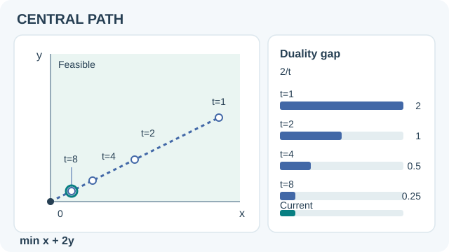
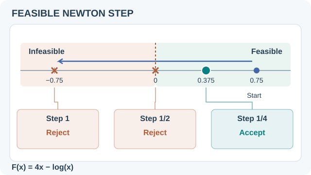

# Interior-Point Methods

Interior-point methods solve constrained optimisation problems by keeping every iterate strictly inside the feasible region and reducing the relative weight of a barrier that holds the iterates away from the boundary. They are the standard tool for convex programs, and they solve numerically the [Lagrange multiplier](lagrange-multipliers.md) conditions for inequality constraints. This page is part of [Calculus and optimisation foundations](index.md).

## Overview

Consider the problem \(\min_x f_0(x)\) subject to \(f_i(x)\le 0\) for \(i=1,\dots,m\) and \(Ax=b\). Solutions often lie on the boundary of the feasible region, where some constraints are tight. Two families of methods handle this. Active-set methods track which constraints are tight and move along the boundary. Interior-point methods instead keep every iterate strictly feasible, with \(f_i(x)<0\) at each step, and approach the solution from inside.

The idea is old. Fiacco and McCormick proposed sequential unconstrained minimisation in the 1960s, and Boyd and Vandenberghe (2004) describe that approach as the barrier method. Karmarkar's (1984) polynomial-time method for linear programming then drew wide attention to interior approaches.

## Key concepts

- **Logarithmic barrier**: \(\phi(x) = -\sum_{i=1}^m \log(-f_i(x))\). It is finite inside the feasible region and grows without bound as a constraint approaches its boundary.
- **Central path**: for each \(t>0\), the minimiser \(x^\star(t)\) of \(t f_0(x)+\phi(x)\). The central points lie on a curve that reaches an optimal point as \(t\to\infty\) (Boyd and Vandenberghe, 2004, section 11.2).
- **Duality-gap certificate**: every central point satisfies \(f_0(x^\star(t))-p^\star\le m/t\), where \(p^\star\) is the optimal value and \(m\) is the number of inequality constraints. The quantity \(m/t\) therefore bounds the suboptimality.
- **Centering step**: minimising \(t f_0(x)+\phi(x)\) for fixed \(t\). It is usually solved by Newton's method, starting from the previous central point.
- **Primal-dual methods**: a later family that updates primal and dual variables together, taking Newton steps on a perturbed form of the KKT conditions.

## How it works

The barrier method alternates a centering step with an increase in \(t\). Given a strictly feasible \(x\), a starting value \(t>0\), a factor \(\mu>1\) and a tolerance \(\epsilon>0\), it repeats the following steps (Boyd and Vandenberghe, 2004, Algorithm 11.1):

1. **Centering.** Compute \(x^\star(t)\) by minimising \(t f_0+\phi\) subject to \(Ax=b\), starting from \(x\).
2. **Update.** Set \(x := x^\star(t)\).
3. **Stop** if \(m/t<\epsilon\).
4. **Increase the objective weight.** Set \(t := \mu t\).

The barrier gradient is \(\nabla\phi(x) = -\sum_i \nabla f_i(x)/f_i(x)\). At a central point the optimality condition \(t\nabla f_0(x)+\nabla\phi(x)+A^\top\hat\nu=0\) holds for some \(\hat\nu\). Defining \(\lambda_i^\star(t) = -1/\big(t f_i(x^\star(t))\big)\) gives a dual feasible point, which is the source of the \(m/t\) bound. These multipliers satisfy \(\lambda_i^\star f_i(x^\star)=-1/t\). As \(t\) grows, this relaxed complementary slackness condition approaches the exact condition \(\lambda_i f_i(x)=0\) from the KKT conditions.

The method uses each centering step as an inner Newton iteration. The number of outer iterations grows with the logarithm of the ratio between the initial and final duality gaps, so a moderate increase in \(t\) per outer step is efficient.

### Central path and the duality gap

  

    
  

[Static overview](../../../assets/concept-animations/barrier-central-path-gap-still.svg) · [Full animation](../../../assets/concept-animations/barrier-central-path-gap-motion.svg)

*Original instructional animation, CC BY-SA 4.0.* Consider the illustrative linear program $\min_{x,y\geq 0}(x+2y)$. Its optimum is the origin. For $t>0$, the centering objective is $F_t(x,y)=t(x+2y)-\log x-\log y$. Setting its two partial derivatives to zero gives $x^\star(t)=1/t$ and $y^\star(t)=1/(2t)$. The two dual multipliers are 1 and 2, so the dual feasible lower bound is zero and the exact duality gap in this example is $2/t$.

At the four labelled reference points, the gap decreases from 2 to 1, 0.5 and 0.25. The teal marker and bar interpolate along the analytic central path (linearly in the reciprocal of t); the marker never reaches the origin at finite t. The brief reset is only for looping. This is a constructed mathematical example, not a solver benchmark or an observed sequence of Newton iterates. The general gap certificate is described in Boyd and Vandenberghe (2004), §11.2 (see References).

**Why centering matters for the certificate.** At the illustrated point with t = 2, the exact center is (0.5, 0.25). A nearby strictly feasible point (0.6, 0.25) has original objective 1.1, exceeding the nominal gap 2/t = 1. Substituting this point into the central multiplier formula gives (5/6, 2), which violates the LP dual stationarity requirement that the multipliers equal (1, 2). Both componentwise complementarity products are still 1/t, but their sum is not a certified duality gap. Using the actual dual feasible pair (1, 2), whose dual value is zero, gives a valid gap of 1.1. Inexact centering can require a separate correction or a verified dual feasible point before claiming a rigorous stopping certificate.[^barrier-centering]

### Feasibility during a Newton centering step

  

    
  

[Static overview](../../../assets/concept-animations/barrier-feasible-newton-still.svg) · [Full animation](../../../assets/concept-animations/barrier-feasible-newton-motion.svg)

*Original instructional animation, CC BY-SA 4.0.* In a separate one-dimensional example, minimize $F(x)=4x-\log x$ on $x>0$. At $x_0=0.75$, the gradient is 8/3 and the Hessian is 16/9, so the Newton direction is −1.5. Starting with step length 1 and repeatedly halving it gives trial points −0.75, 0 and 0.375. Reject the first two **before evaluating the logarithm**, because neither is strictly feasible. The quarter step is feasible and also satisfies the Armijo sufficient-decrease test with parameter 0.1: the new objective is about 2.4808 versus an upper bound of 3.1877. It can therefore be accepted; the exact center is 0.25, not 0.375.

The moving dot represents candidate trial positions, not accepted iterates; intermediate motion is a reading guide and the loop reset is not an optimization update. All values are illustrative, not measured solver performance. This backtracking example illustrates the domain check followed by sufficient decrease in the centering Newton method (Boyd and Vandenberghe, 2004, chapter 11; see References).

**Feasibility alone does not imply sufficient decrease.** Keep the same starting point and direction, but consider an alternative trial step of 0.48 (not a step in the illustrated halving schedule). It lands at 0.03, strictly inside the domain, yet the objective is about 3.6266, above the Armijo upper bound of about 3.0957. Reject it even though the logarithm is defined. In this example all steps strictly between zero and 0.5 are feasible, but only a subset pass sufficient decrease. The animation shows the first accepted step of the chosen halving schedule, not an exact line minimizer.

Both figures use the shared MkDocs Play/Pause player and a reduced-motion still. On narrow screens, focus the figure and scroll with the arrow keys or swipe to read it at its original size.

## Results

- **Accuracy guarantee.** The stopping rule \(m/t<\epsilon\) guarantees an \(\epsilon\)-suboptimal solution, because each central point is \(m/t\)-suboptimal (Boyd and Vandenberghe, 2004, section 11.3.1).
- **Choice of \(\mu\).** Boyd and Vandenberghe report that values of \(\mu\) from about 10 to 20 work well in practice. Small \(\mu\) gives many outer iterations with few Newton steps each, and large \(\mu\) gives fewer outer iterations with more Newton steps each.
- **Polynomial-time theory.** Karmarkar (1984) proposed a polynomial-time method for linear programming that moves through the interior of the feasible region. Nesterov and Nemirovskii (1994) develop polynomial-time interior-point algorithms for convex programming in general.
- **Large nonlinear programs.** Wächter and Biegler (2006) describe the implementation of an interior-point method with a filter line search for large-scale nonlinear programming, the algorithm behind the IPOPT software.

## Limitations

- **Cost per iteration.** Each Newton step solves a linear system built from the Hessian of the barrier problem. For large dense problems this cost dominates, even when the number of iterations is small.
- **Starting point.** The barrier method needs a strictly feasible starting point. Finding one can require a separate phase-one problem.
- **Conditioning.** As \(t\) grows, the centering problems become increasingly ill-conditioned, so numerical precision matters in practice (Boyd and Vandenberghe, 2004, section 11.3).
- **Warm starts.** Reusing a solution after a small change to the problem is generally harder than with active-set methods, which makes repeated solves of slowly changing problems less straightforward.
- **Non-convex problems.** The global guarantees above apply to convex problems. For non-convex nonlinear programs an interior-point method finds a local solution.

## Connections

- [Lagrange multipliers](lagrange-multipliers.md) define the KKT conditions that interior-point methods approximate. The barrier multipliers \(\lambda_i^\star(t)\) are the Lagrange multipliers of the barrier problem.
- [Newton's method](newtons-method.md) solves each centering step.
- [Optimisation](../../optimization/index.md) covers first-order and adaptive methods. Most deep-learning training uses those methods rather than interior-point methods, because the number of variables is very large.

## Applications

- **Convex programs.** Boyd and Vandenberghe (2004) treat the barrier method and primal-dual methods for general convex problems, including quadratic and geometric programs.
- **Linear programming.** Karmarkar's (1984) polynomial-time interior method is the origin of interior approaches to linear programs, which are an alternative to the simplex method.
- **Nonlinear programming.** Wächter and Biegler (2006) describe an interior-point solver for large nonlinear programs with inequality constraints.

## Open questions

- Warm-starting interior-point methods for sequences of related problems, such as online or receding-horizon control, remains an active question.
- Exploiting parallel hardware for the linear algebra in each Newton step, for very large sparse problems, is a practical open problem.
- Global guarantees for non-convex problems are limited. Interior-point solvers give local solutions, and the choice of starting point affects which local solution is found.

[^barrier-centering]: Boyd and Vandenberghe (2004), *Convex Optimization*, §11.3.1, “Accuracy of centering”, and exercise 11.9. https://web.stanford.edu/~boyd/cvxbook/

## References

### Seminal papers

- Karmarkar, N. (1984). A new polynomial-time algorithm for linear programming. *Combinatorica* 4(4), 373–395. https://doi.org/10.1007/BF02579150 — Proposes a polynomial-time method for linear programming that moves through the interior of the feasible region.
- Wächter, A. & Biegler, L. T. (2006). On the implementation of an interior-point filter line-search algorithm for large-scale nonlinear programming. *Mathematical Programming* 106(1), 25–57. https://doi.org/10.1007/s10107-004-0559-y — Describes an interior-point method with a filter line search for large nonlinear programs, the algorithm implemented in IPOPT.

### Surveys and textbooks

- Boyd, S. & Vandenberghe, L. (2004). *Convex Optimization*. Cambridge University Press. https://web.stanford.edu/~boyd/cvxbook/ — Free online text. Chapter 11 presents the logarithmic barrier, the central path and the barrier method.
- Nesterov, Y. & Nemirovskii, A. (1994). *Interior-Point Polynomial Algorithms in Convex Programming*. SIAM. https://doi.org/10.1137/1.9781611970791 — Monograph on polynomial-time interior-point algorithms for convex programming, the main theoretical reference for the field.
- Nocedal, J. & Wright, S. J. (2006). *Numerical Optimization*, 2nd ed. Springer. https://doi.org/10.1007/978-0-387-40065-5 — Textbook covering constrained optimisation and the interior-point methods for linear and nonlinear programs.
