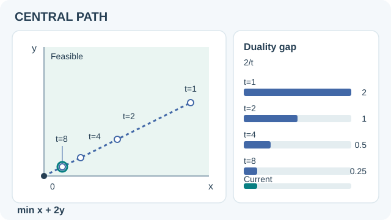
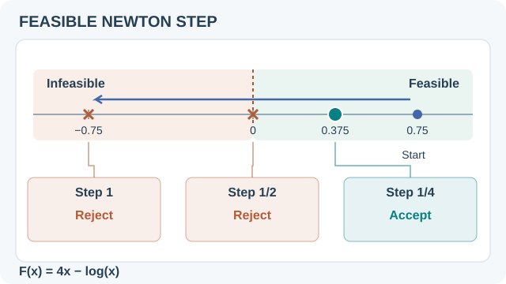

# 內點法

內點法解有約束的最佳化問題時，讓每個迭代點都嚴格位於可行區域內部，並逐步降低障礙項的相對權重，使迭代點遠離邊界。它們是凸規劃的標準工具，並以數值方式求解不等式約束下的[拉格朗日乘數](lagrange-multipliers.md)條件。本頁是[微積分與最佳化基礎](index.md)的一部分。

## 概述

考慮問題 \(\min_x f_0(x)\)，約束為對 \(i=1,\dots,m\) 有 \(f_i(x)\le 0\)，以及 \(Ax=b\)。解通常位於可行區域的邊界上，那裡有些約束是緊的。處理這類問題有兩大類方法。有效集法追蹤哪些約束是緊的，並沿著邊界移動。內點法則讓每個迭代點都嚴格可行，即每一步都有 \(f_i(x)<0\)，並從內部逼近解。

這個想法很早就有。Fiacco 與 McCormick 在 1960 年代提出序列無約束極小化方法，Boyd 與 Vandenberghe（2004）把此方法稱為障礙法。之後 Karmarkar（1984）的線性規劃多項式時間方法，引起了人們對內部方法的廣泛關注。

## 關鍵概念

- **對數障礙**：\(\phi(x) = -\sum_{i=1}^m \log(-f_i(x))\)。它在可行區域內部為有限值，並在約束逼近其邊界時無限增長。
- **中心路徑**：對每個 \(t>0\)，\(t f_0(x)+\phi(x)\) 的極小點 \(x^\star(t)\)。這些中心點構成一條曲線，當 \(t\to\infty\) 時會到達一個最優點（Boyd 與 Vandenberghe，2004，第 11.2 節）。
- **對偶間隙證書**：每個中心點都滿足 \(f_0(x^\star(t))-p^\star\le m/t\)，其中 \(p^\star\) 為最優值，\(m\) 為不等式約束的個數。因此 \(m/t\) 給出次優程度的上界。
- **中心化步驟**：對固定的 \(t\) 極小化 \(t f_0(x)+\phi(x)\)。通常以牛頓法求解，起點為前一個中心點。
- **原始－對偶方法**：一類較晚發展的方法，同時更新原始變數與對偶變數，對 KKT 條件的擾動形式取牛頓步。

## 運作方式

障礙法交替進行中心化步驟與增加 \(t\)。給定一個嚴格可行的 \(x\)、初始值 \(t>0\)、因子 \(\mu>1\) 與容忍值 \(\epsilon>0\)，它重複以下步驟（Boyd 與 Vandenberghe，2004，演算法 11.1）：

1. **中心化。** 在 \(Ax=b\) 的約束下，從 \(x\) 出發，計算使 \(t f_0+\phi\) 最小的 \(x^\star(t)\)。
2. **更新。** 令 \(x := x^\star(t)\)。
3. **停止**：若 \(m/t<\epsilon\)。
4. **增加目標函數權重。** 令 \(t := \mu t\)。

障礙項的梯度為 \(\nabla\phi(x) = -\sum_i \nabla f_i(x)/f_i(x)\)。在中心點上，對某個 \(\hat\nu\) 滿足最優性條件 \(t\nabla f_0(x)+\nabla\phi(x)+A^\top\hat\nu=0\)。定義 \(\lambda_i^\star(t) = -1/\big(t f_i(x^\star(t))\big)\)，得到一個對偶可行點，這正是 \(m/t\) 界的來源。這些乘數滿足 \(\lambda_i^\star f_i(x^\star)=-1/t\)。隨著 \(t\) 增大，這個放寬的互補鬆弛條件會趨近 KKT 條件中的精確條件 \(\lambda_i f_i(x)=0\)。

每個中心化步驟都以內層牛頓迭代完成。外層迭代的次數與初始與最終對偶間隙之比的對數成正比，因此每個外層步驟適度增加 \(t\) 是有效率的。

### 中心路徑與對偶間隙

  

    
  

[靜態總覽](../../../assets/concept-animations/barrier-central-path-gap-still.svg) · [完整動畫](../../../assets/concept-animations/barrier-central-path-gap-motion.svg)

*原創教學動畫，CC BY-SA 4.0。* 考慮示意線性規劃 $\min_{x,y\geq 0}(x+2y)$，最優解為原點。當 $t>0$ 時，中心化目標函數為 $F_t(x,y)=t(x+2y)-\log x-\log y$。令兩個偏導數皆為零，可得 $x^\star(t)=1/t$ 與 $y^\star(t)=1/(2t)$。兩個對偶乘數為 1 與 2，因此對偶可行下界為零，此例的精確對偶間隙為 $2/t$。

四個標記參考點的間隙依序為 2、1、0.5 與 0.25。青綠色游標與長條同步沿解析中心路徑插值（對 t 的倒數作線性插值）；有限的 t 不會使游標抵達原點。短暫重設僅為循環播放。這是人工構造的數學算例，不是求解器效能測量或實際牛頓迭代軌跡。一般對偶間隙證書可參見 Boyd 與 Vandenberghe（2004）第 11.2 節（見參考文獻）。

**中心化精度為何影響證書。** 動畫中 t = 2 的精確中心為 (0.5, 0.25)。附近的嚴格可行點 (0.6, 0.25) 之原始目標函數值為 1.1，超過名義間隙 2/t = 1。將此點代入中心路徑乘數公式得到 (5/6, 2)，但線性規劃的對偶駐點條件要求乘數為 (1, 2)。雖然兩個互補鬆弛乘積的絕對值仍各為 1/t，其總和卻不是有效的對偶間隙證書。改用真正對偶可行的乘數 (1, 2)，其對偶值為零，可得有效間隙 1.1。非精確中心化時，必須另行修正乘數或確認對偶可行性，才能宣稱嚴格的停止證書。[^barrier-centering]

### 牛頓中心化步驟的可行性

  

    
  

[靜態總覽](../../../assets/concept-animations/barrier-feasible-newton-still.svg) · [完整動畫](../../../assets/concept-animations/barrier-feasible-newton-motion.svg)

*原創教學動畫，CC BY-SA 4.0。* 另考慮一維問題，在 $x>0$ 上極小化 $F(x)=4x-\log x$。於 $x_0=0.75$，梯度為 8/3，海森矩陣為 16/9，故牛頓方向為 −1.5。步長從 1 開始逐次減半，試探點依序為 −0.75、0 與 0.375。前兩個點皆非嚴格可行，必須**在計算對數之前拒絕**。四分之一步嚴格可行，且滿足參數為 0.1 的 Armijo 充分下降條件：新目標函數值約為 2.4808，低於右式上界 3.1877。因此可接受該步，但精確中心點是 0.25，而非 0.375。

移動圓點表示候選試探點，而非已接受的迭代點；中間移動僅引導閱讀，循環重設不是最佳化更新。所有數值皆為示意，不代表求解器實測效能。此例展示中心化牛頓法中先檢查定義域、再檢查充分下降的回溯線搜尋（Boyd 與 Vandenberghe，2004，第 11 章；見參考文獻）。

**嚴格可行不代表充分下降。** 維持相同起點與方向，另取試探步長 0.48（並非動畫逐次減半序列中的步長）。候選點為 0.03，仍嚴格位於定義域內，但目標函數值約為 3.6266，高於 Armijo 上界約 3.0957。因此即使對數有定義，也必須拒絕。此例中介於零與 0.5 之間的步長皆嚴格可行，卻只有部分滿足充分下降條件。動畫展示的是指定減半序列中第一個可接受的步長，而非線搜尋的精確極小點。

兩圖皆使用 MkDocs 共用播放／暫停控制與降低動態效果的靜態回退。窄螢幕可聚焦圖表後使用方向鍵或滑動，以原始字級閱讀。

## 結果

- **精度保證。** 停止規則 \(m/t<\epsilon\) 保證得到 \(\epsilon\)-次優解，因為每個中心點都是 \(m/t\)-次優的（Boyd 與 Vandenberghe，2004，第 11.3.1 節）。
- **\(\mu\) 的選擇。** Boyd 與 Vandenberghe 指出，\(\mu\) 取約 10 到 20 在實務上效果良好。\(\mu\) 小時外層迭代多、每次的牛頓步少；\(\mu\) 大時外層迭代少、每次的牛頓步多。
- **多項式時間理論。** Karmarkar（1984）提出一個線性規劃的多項式時間方法，它在可行多面體的內部移動。Nesterov 與 Nemirovskii（1994）則針對凸規劃一般地發展了多項式時間的內點演算法。
- **大型非線性規劃。** Wächter 與 Biegler（2006）描述了一個以濾子線搜尋實作、用於大型非線性規劃的內點法，即 IPOPT 軟體所用的演算法。

## 限制

- **每次迭代的成本。** 每個牛頓步都要解一個由障礙問題的海森矩陣組成的線性方程組。對大型稠密問題，這個成本佔主導，即使迭代次數很少。
- **起始點。** 障礙法需要一個嚴格可行的起始點，找到它可能需要另一個第一階段問題。
- **條件數。** 隨著 \(t\) 增大，中心化問題會愈來愈病態，因此數值精度在實務上很重要（Boyd 與 Vandenberghe，2004，第 11.3 節）。
- **熱啟動。** 在問題作小幅改動後重用解，通常比有效集法更困難，因此對緩慢變化問題的重複求解不那麼直接。
- **非凸問題。** 上述的全域保證適用於凸問題。對非凸非線性規劃，內點法只能找到局部解。

## 與其他頁面的連結

- [拉格朗日乘數法](lagrange-multipliers.md)定義了內點法所逼近的 KKT 條件。障礙乘數 \(\lambda_i^\star(t)\) 就是障礙問題的拉格朗日乘數。
- [牛頓法](newtons-method.md)用於解每個中心化步驟。
- [最佳化](../../optimization/index.md)涵蓋一階與適應性方法。多數深度學習訓練使用這些方法而非內點法，因為變數數目極大。

## 應用

- **凸規劃。** Boyd 與 Vandenberghe（2004）針對一般凸問題（包括二次規劃與幾何規劃）討論障礙法與原始－對偶方法。
- **線性規劃。** Karmarkar（1984）的多項式時間內部方法是線性規劃內部方法的起源，它是單純形法的另一選擇。
- **非線性規劃。** Wächter 與 Biegler（2006）描述了一個用於帶不等式約束之大型非線性規劃的內點求解器。

## 開放問題

- 對一連串相關問題（例如線上控制或滾動時域控制）的內點法熱啟動，仍是活躍的研究課題。
- 如何利用平行硬體加速每個牛頓步中的線性代數，以處理大型稀疏問題，是一個實務上的開放問題。
- 非凸問題的全域保證仍然有限。內點求解器只給出局部解，起始點的選擇會影響找到哪個局部解。

[^barrier-centering]: Boyd 與 Vandenberghe（2004），*Convex Optimization*，第 11.3.1 節「Accuracy of centering」及習題 11.9。https://web.stanford.edu/~boyd/cvxbook/

## 參考文獻

### 奠基性論文

- Karmarkar, N. (1984). A new polynomial-time algorithm for linear programming. *Combinatorica* 4(4), 373–395. https://doi.org/10.1007/BF02579150 — 提出一個線性規劃的多項式時間方法，它在可行區域的內部移動。
- Wächter, A. & Biegler, L. T. (2006). On the implementation of an interior-point filter line-search algorithm for large-scale nonlinear programming. *Mathematical Programming* 106(1), 25–57. https://doi.org/10.1007/s10107-004-0559-y — 描述一個以濾子線搜尋實作、用於大型非線性規劃的內點法，即 IPOPT 所實作的演算法。

### 綜述與教科書

- Boyd, S. & Vandenberghe, L. (2004). *Convex Optimization*. Cambridge University Press. https://web.stanford.edu/~boyd/cvxbook/ — 免費線上教科書。第 11 章介紹對數障礙、中心路徑與障礙法。
- Nesterov, Y. & Nemirovskii, A. (1994). *Interior-Point Polynomial Algorithms in Convex Programming*. SIAM. https://doi.org/10.1137/1.9781611970791 — 專著，論述凸規劃的多項式時間內點演算法，是該領域主要的理論參考。
- Nocedal, J. & Wright, S. J. (2006). *Numerical Optimization*, 2nd ed. Springer. https://doi.org/10.1007/978-0-387-40065-5 — 教科書，涵蓋有約束最佳化，以及線性與非線性規劃的內點法。
