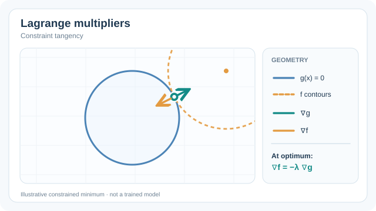
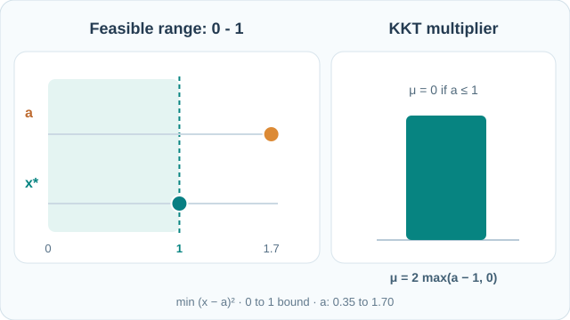
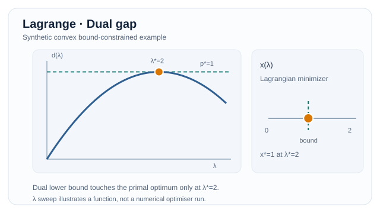

# Lagrange Multipliers

Lagrange multipliers solve optimisation problems with equality or inequality constraints. They replace the constrained problem with an unconstrained one that has extra variables, the multipliers, one for each constraint. Support vector machines and constrained reinforcement-learning objectives are built this way. Part of [Calculus and optimisation foundations](index.md).

## Overview

Many learning problems have constraints. A margin classifier must separate the classes, a policy must stay close to a reference policy, and a probability vector must sum to one. Solving \(\min_x f(x)\) subject to \(g(x)=0\) directly is hard, because the feasible set is curved. The Lagrange approach adds \(\lambda g(x)\) to the objective and asks where the combined function is stationary.

## Key concepts

- **Lagrangian**: \(\mathcal{L}(x,\lambda) = f(x) + \lambda\, g(x)\). Its stationary points give candidate solutions.
- **Multiplier**: \(\lambda\) measures how much the optimal value would change if the constraint were relaxed.
- **Inequality constraints**: \(h(x)\le 0\) add a non-negative multiplier \(\mu\ge 0\) and a complementary slackness condition \(\mu\,h(x)=0\).
- **KKT conditions**: the first-order necessary conditions for constrained optimisation with inequalities, named after Karush, Kuhn and Tucker.
- **Duality**: for a minimisation problem, minimise the Lagrangian over the primal variables to obtain the dual function, then maximise that lower bound over dual-feasible multipliers. This formulation also yields the kernelised support vector machine dual.

## How it works

For a single equality constraint, a stationary point of \(\mathcal{L}\) satisfies

\[
\nabla f(x) + \lambda \nabla g(x) = 0, \qquad g(x)=0.
\]

Geometrically, at the optimum the gradient of the objective is parallel to the gradient of the constraint. For inequality constraints the KKT conditions add \(\mu\ge 0\) and \(\mu\,h(x)=0\). The support vector machine is the classic example: its dual problem involves only the training points that lie on the margin, whose multipliers are non-zero (Cortes & Vapnik, 1995).

Lagrange multipliers also appear in deep learning as penalty terms with fixed or adaptive weights, when an inequality constraint is enforced by a penalty rather than solved exactly.

## Animated example: tangency on a feasible circle

*Original continuous mathematical teaching animation, CC BY-SA 4.0. GitHub shows its static fallback; the wiki player adds keyboard-accessible Play/Pause and reduced-motion fallback.*

Let $f(x,y)=(x-2)^2+(y-1)^2$ with equality constraint $g(x,y)=x^2+y^2-1=0$. The orange dashed circle is a level set of $f$ centred at $(2,1)$, while the blue circle is the feasible set. Minimising distance on the unit circle gives the analytic solution $(x^*,y^*)=(2/\sqrt5,1/\sqrt5)$. There $\nabla f=2((x^*,y^*)-(2,1))$ and $\nabla g=2(x^*,y^*)$ are oppositely directed; $\nabla f+\lambda\nabla g=0$ holds for $\lambda=\sqrt5-1$. The arrows are independently normalised to show direction; their lengths do not represent gradient magnitudes. The animated passage between feasible points is a **geometric sweep, not an optimisation algorithm or learned trajectory**. Contours and gradients use illustrative exact arithmetic, not empirical results. See Boyd and Vandenberghe (2004) in References.

[GitHub-readable static preview](../../../assets/concept-animations/lagrange-tangency-still.svg)

## Inequality constraints: watching the active set change

[GitHub-readable KKT active-set snapshot](../../../assets/concept-animations/lagrange-kkt-active-set-still.svg)

*Original 10-second continuously interpolated instructional animation, CC BY-SA 4.0. The site's existing accessible player offers Play/Pause and a reduced-motion fallback.*

Consider the **analytic toy problem** $\min_{0\le x\le1}(x-a)^2$ while $a$ moves from $0.35$ to $1.70$. Throughout this chosen range the lower bound is inactive. With upper-bound constraint $h(x)=x-1\le0$, stationarity and complementary slackness give $2(x-a)+\mu=0$, $\mu\ge0$, and $\mu(x-1)=0$. Thus $x^*=\min(a,1)$ and $\mu^*=2\max(a-1,0)$. For $a<1$ the target is feasible and $\mu=0$; for $a>1$ the solution remains at $x^*=1$ while the multiplier increases (at $a=1.7$, $\mu=1.4$). The orange target, teal solution, and bar show these linked quantities across the parameter sweep, **not the time steps of an optimisation solver**. Intermediate positions are visual interpolation of analytic values, **not trained-model measurements**. This is a one-dimensional illustration of KKT complementary slackness as developed in Boyd and Vandenberghe (2004).

## Dual lower bounds: when the primal-dual gap closes

For the constructed convex problem $\min_x (x-2)^2$ subject to $x\le1$, the primal optimum is $x^*=1$, $p^*=1$. With $\lambda\ge0$, form $\mathcal L(x,\lambda)=(x-2)^2+\lambda(x-1)$. Minimising over unrestricted $x$ gives $x(\lambda)=2-\lambda/2$ and the **dual lower bound** $d(\lambda)=\lambda-\lambda^2/4\le p^*$. At $\lambda^*=2$, the dual bound touches the primal value, $d(2)=p^*=1$, and the Lagrangian minimiser reaches the active boundary $x=1$. Increasing the multiplier further does not improve the lower bound: for example, $d(3)=0.75$. The moving orange marker shows an **analytic multiplier sweep**, not an actual primal-dual optimisation run. These are schematic calculations, **not measured model training outcomes**. Strong duality in this convex, strictly feasible example is consistent with Boyd and Vandenberghe (2004; References).

*Original instructional visual, CC BY-SA 4.0.* The MkDocs site inherits Play/Pause and keyboard support from its shared motion player; reduced-motion users see the static fallback and narrow screens can scroll the figure locally. [Open animated SVG](../../../assets/concept-animations/lagrange-dual-gap-motion.svg).

[GitHub-readable still preview](../../../assets/concept-animations/lagrange-dual-gap-still.svg)

## Key methods

- [Newton's method](newtons-method.md): a second-order method that can be applied to the Lagrangian's stationarity conditions, as an alternative to the first-order KKT approach.
- Interior-point methods: handle inequality constraints by barrier terms, a related but distinct approach described in Boyd and Vandenberghe (2004).

## Connections

- [Calculus and optimisation foundations](index.md) gives the gradient calculus that the stationarity conditions use.
- [Linear algebra](../linear-algebra/index.md) shows how constraints on weight norms relate to projections.
- The support vector machine appears in [supervised learning](../../paradigms/supervised/index.md).

## Applications

- **Support vector machines**: maximum-margin classifiers solved through the dual problem (Cortes & Vapnik, 1995).
- **Constrained policy updates**: trust-region methods limit how far a policy moves per update using a constraint on the KL divergence (see [reinforcement learning](../../paradigms/reinforcement-learning/index.md)).
- **Fairness and safety constraints**: constrained training problems use multipliers to enforce a measurable requirement (Boyd & Vandenberghe, 2004).

## Open questions

- Constrained training of large models, with stochastic gradients, can be unstable. The multiplier updates interact with the parameter updates in ways that are not fully understood.
- Non-convex constraints have no general duality guarantee, so KKT conditions are necessary but may not yield a global solution.

## References

### Seminal papers

- Cortes, C. & Vapnik, V. (1995). Support-vector networks. *Machine Learning* 20(3), 273–297. https://doi.org/10.1007/BF00994018 — Applies constrained optimisation with multipliers to derive the support vector machine.
- Boyd, S. & Vandenberghe, L. (2004). *Convex Optimization*. Cambridge University Press. https://web.stanford.edu/~boyd/cvxbook/ — Presents Lagrange duality, the KKT conditions and their use in convex problems.

### Surveys and textbooks

- Bishop, C. M. (2006). *Pattern Recognition and Machine Learning*. Springer. https://www.microsoft.com/en-us/research/wp-content/uploads/2006/01/Bishop-Pattern-Recognition-and-Machine-Learning-2006.pdf — Covers constrained optimisation and the Lagrangian in its treatment of support vector machines.
- Murphy, K. P. (2022). *Probabilistic Machine Learning: An Introduction*. MIT Press. https://github.com/probml/pml-book — Free textbook; covers the constrained formulations used for kernel methods.

### Articles and documentation

- Bottou, L., Curtis, F. E. & Nocedal, J. (2018). Optimization methods for large-scale machine learning. *SIAM Review*. arXiv:1606.04838. https://arxiv.org/abs/1606.04838 — Surveys optimisation methods for learning, including constrained formulations and their practical costs.
