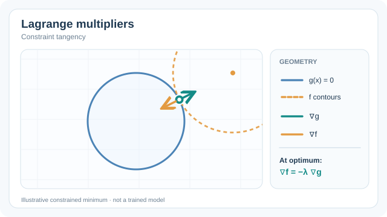
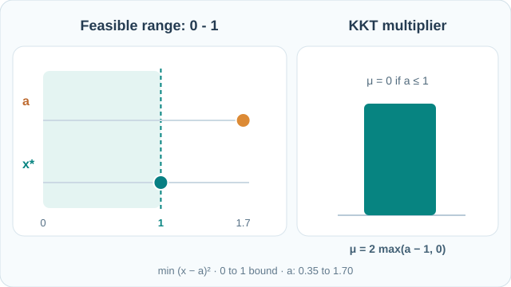
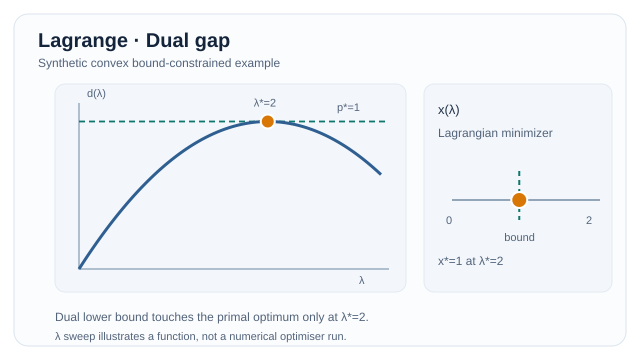

# 拉格朗日乘數法

拉格朗日乘數法用來解有等式或不等式約束的最佳化問題。它以額外的變數（即乘數，每個約束一個）把有約束問題改寫為無約束問題。支持向量機與有約束的強化學習目標都以此方式建構。本頁是[微積分與最佳化基礎](index.md)的一部分。

## 概述

許多學習問題都有約束。間隔分類器必須分開各類別，策略必須接近參考策略，機率向量的元素總和必須為一。直接解 \(\min_x f(x)\) 且 \(g(x)=0\) 很困難，因為可行集是彎曲的。拉格朗日方法把 \(\lambda g(x)\) 加入目標，並尋找合併後函數的駐點。

## 關鍵概念

- **拉格朗日函數**：\(\mathcal{L}(x,\lambda) = f(x) + \lambda\, g(x)\)。其駐點給出候選解。
- **乘數**：\(\lambda\) 衡量若放寬該約束，最佳值會改變多少。
- **不等式約束**：\(h(x)\le 0\) 會加入非負乘數 \(\mu\ge 0\)，以及互補鬆弛條件 \(\mu\,h(x)=0\)。
- **KKT 條件**：含不等式約束的有約束最佳化的一階必要條件，以 Karush、Kuhn 與 Tucker 命名。
- **對偶性**：對原始最小化問題，先對原變數最小化拉格朗日函數，得到對偶函數，再於符合對偶可行條件的乘數上最大化此下界。核化支持向量機的對偶形式也由此得到。

## 運作方式

對於單一等式約束，\(\mathcal{L}\) 的駐點滿足

\[
\nabla f(x) + \lambda \nabla g(x) = 0, \qquad g(x)=0.
\]

幾何上，在最佳點目標函數的梯度與約束的梯度平行。對不等式約束，KKT 條件另外加入 \(\mu\ge 0\) 與 \(\mu\,h(x)=0\)。支持向量機是經典例子：其對偶問題只涉及位於間隔邊界上的訓練點，這些點的乘數非零（Cortes & Vapnik, 1995）。

拉格朗日乘數也會以懲罰項的形式出現在深度學習中：當一個不等式約束以懲罰而非精確求解來實施時，就會用到權重固定或自適應的乘數。

## 教學動畫：約束集合上的切觸條件

*原創連續數學教學動畫，CC BY-SA 4.0。GitHub 顯示靜態預覽；Wiki 網站提供鍵盤可操作的播放／暫停，以及減少動態效果回退。*

設 $f(x,y)=(x-2)^2+(y-1)^2$，等式約束為 $g(x,y)=x^2+y^2-1=0$。橘色虛線圓是以 $(2,1)$ 為中心的目標函數等高線，藍色圓則是可行集合。單位圓上距離 $(2,1)$ 最近的解析解是 $(x^*,y^*)=(2/\sqrt5,1/\sqrt5)$。此處 $\nabla f=2((x^*,y^*)-(2,1))$ 與 $\nabla g=2(x^*,y^*)$ 方向相反，並以 $\lambda=\sqrt5-1$ 滿足 $\nabla f+\lambda\nabla g=0$。箭頭各自正規化以呈現方向，長度不代表梯度大小。動畫沿可行集合的連續移動是**幾何掃描，並非最佳化演算法或學習軌跡**；所有等高線與梯度皆為解析示例，非實測數值。參見參考文獻 Boyd 與 Vandenberghe（2004）。

[GitHub 靜態預覽](../../../assets/concept-animations/lagrange-tangency-still.svg)

## 不等式約束：觀察有效約束集合如何改變

[GitHub 可直接檢視的 KKT 有效約束靜態圖](../../../assets/concept-animations/lagrange-kkt-active-set-still.svg)

*原創 10 秒連續插值教學動畫，CC BY-SA 4.0。網站沿用無障礙播放／暫停控制與減少動態效果靜態回退。*

考慮**人工解析示例** $\min_{0\le x\le1}(x-a)^2$，讓 $a$ 在 $0.35$ 到 $1.70$ 之間移動。在這個刻意選取的範圍，下界始終不活躍。對上界限制 $h(x)=x-1\le0$，一階駐點與互補鬆弛條件為 $2(x-a)+\mu=0$、$\mu\ge0$、$\mu(x-1)=0$，因此 $x^*=\min(a,1)$、$\mu^*=2\max(a-1,0)$。當 $a<1$，目標本身可行，乘數為零；當 $a>1$，極小點固定在 $x^*=1$，乘數隨超出邊界的程度增加（$a=1.7$ 時 $\mu=1.4$）。橘點、青綠點與長條同步顯示參數掃描的解析變化，**並非最佳化求解器的時間步驟**；連續位置只是解析樣本間的視覺插值，**不是模型實測**。理論依據為 Boyd 與 Vandenberghe（2004）的 KKT 與互補鬆弛條件。

## 對偶下界：原始－對偶間隙何時縮至零？

考慮人工凸最佳化問題 $\min_x(x-2)^2$，約束為 $x\le1$，原始最優解與最優值為 $x^*=1$、$p^*=1$。對 $\lambda\ge0$，建立 $\mathcal L(x,\lambda)=(x-2)^2+\lambda(x-1)$。先對不受限制的 $x$ 最小化，可得 $x(\lambda)=2-\lambda/2$，以及**對偶下界** $d(\lambda)=\lambda-\lambda^2/4\le p^*$。在 $\lambda^*=2$，對偶下界碰到原始最優值：$d(2)=p^*=1$，拉格朗日函數的極小點也剛好到達有效約束邊界 $x=1$。乘數並非越大越好，例如 $d(3)=0.75$。橘色移動標記顯示的是**解析式的乘數掃描**，不是實際的原始－對偶最佳化器運行；數值均為教學示意，**不是模型訓練實測**。此凸且嚴格可行的例子符合 Boyd 與 Vandenberghe（2004；見參考文獻）的強對偶條件。

*原創教學視覺，CC BY-SA 4.0。* MkDocs 網站沿用共用 Play／Pause 與鍵盤操作；偏好減少動態效果時顯示靜態回退圖，手機可在圖面內水平捲動。完整動畫：[SVG](../../../assets/concept-animations/lagrange-dual-gap-motion.svg)。

[GitHub 靜態預覽](../../../assets/concept-animations/lagrange-dual-gap-still.svg)

## 主要方法

- [牛頓法](newtons-method.md)：可用於拉格朗日函數的駐點條件的二階方法，是一階 KKT 方法的替代。
- [內點法](interior-point-methods.md)：以障礙項處理不等式約束，並讓迭代點嚴格可行。其障礙乘數逼近本頁的 KKT 乘數。

## 與其他頁面的連結

- [微積分與最佳化基礎](index.md)提供駐點條件所用的梯度微積分。
- [線性代數](../linear-algebra/index.md)說明權重範數的約束如何與投影相關。
- 支持向量機出現在[監督式學習](../../paradigms/supervised/index.md)中。

## 應用

- **支持向量機**：透過對偶問題求解的最大間隔分類器（Cortes & Vapnik, 1995）。
- **有約束的策略更新**：信賴域方法以 KL 散度的約束限制每次更新中策略的移動幅度，例如 TRPO（Schulman et al., 2015；見[強化學習](../../paradigms/reinforcement-learning/index.md)）。
- **公平性與安全約束**：有約束的訓練問題可以用乘數執行可量測的要求，其構造與上文所述的拉格朗日函數相同。

## 開放問題

- 以隨機梯度訓練大型模型的有約束訓練可能不穩定。乘數的更新與參數的更新以目前尚未完全理解的方式相互作用。
- 非凸約束沒有一般的對偶性保證，因此 KKT 條件是必要的，但未必能得到全域解。

## 參考文獻

### 奠基性論文

- Cortes, C. & Vapnik, V. (1995). Support-vector networks. *Machine Learning* 20(3), 273–297. https://doi.org/10.1007/BF00994018 — 以帶乘數的約束最佳化推導支持向量機。
- Boyd, S. & Vandenberghe, L. (2004). *Convex Optimization*. Cambridge University Press. https://web.stanford.edu/~boyd/cvxbook/ — 介紹拉格朗日對偶、KKT 條件及其在凸問題中的應用。

### 綜述與教科書

- Bishop, C. M. (2006). *Pattern Recognition and Machine Learning*. Springer. https://www.microsoft.com/en-us/research/wp-content/uploads/2006/01/Bishop-Pattern-Recognition-and-Machine-Learning-2006.pdf — 在支持向量機的討論中涵蓋有約束最佳化與拉格朗日函數。
- Nocedal, J. & Wright, S. J. (2006). *Numerical Optimization*, 2nd ed. Springer. https://doi.org/10.1007/978-0-387-40065-5 — 涵蓋有約束問題的拉格朗日乘數與 KKT 條件，以及建立於其上的內點法。

### 文章與文件

- Bottou, L., Curtis, F. E. & Nocedal, J. (2018). Optimization methods for large-scale machine learning. *SIAM Review*. arXiv:1606.04838. https://arxiv.org/abs/1606.04838 — 綜述機器學習的數值最佳化演算法，重點為隨機梯度方法及其實務成本。
- Schulman, J. et al. (2015). Trust region policy optimization. *Proceedings of the 32nd International Conference on Machine Learning (ICML)*. arXiv:1502.05477. https://arxiv.org/abs/1502.05477 — 提出 TRPO，以 KL 散度的信賴域限制每次策略更新。
